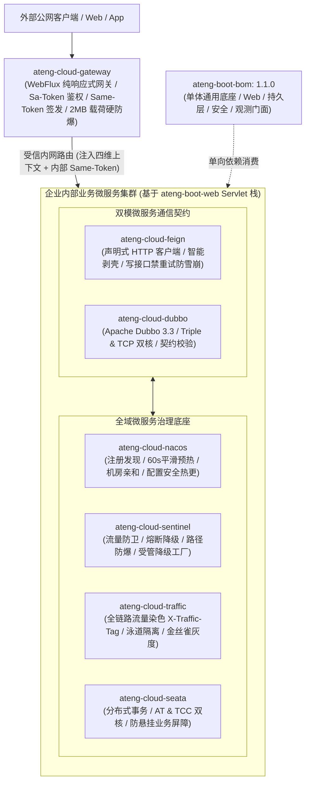

# ateng-cloud

> 面向生产就绪的 Spring Cloud 工业级微服务基础设施 Starter 套件。

[](https://github.com/atengk/ateng-cloud/actions/workflows/ci.yml)
[](https://central.sonatype.com/artifact/io.github.atengk/ateng-cloud-bom)
[](./llms.txt)
[](https://www.oracle.com/java/)
[](https://spring.io/projects/spring-boot)
[](https://spring.io/projects/spring-cloud)
[](https://dubbo.apache.org/)
[](LICENSE)

---

## 1. 架构全景与生态定位

`ateng-cloud` 是面向企业级分布式生产环境打造的微服务通用基础设施套件。项目单向消费并依赖已发布的 `ateng-boot-bom`（纯净单体基础设施底座），专注于提供垂直正交、开箱即用、无侵入的高可用微服务治理能力。



---

## 2. 核心特性亮点 (Features)

- ⚡ **开箱即用全能聚合**：通过 `ateng-cloud-bom` 统一锁定全域版本，`ateng-cloud-all` 一键装配微服务骨干构件，消除版本地狱与繁琐依赖配置；
- 🔄 **双模微服务通信**：支持 OpenFeign 声明式 HTTP 与 Apache Dubbo 3.3 现代流式 Triple/TCP RPC，根据业务吞吐自由选型与正交共存；
- 🌐 **全链路四维上下文穿透**：跨进程透明透传四维快照 $\langle\text{MDC traceId}, \text{userId}, \text{tenantId}, \text{ignoreTenant}\rangle$ 与金丝雀染色标（`X-Traffic-Tag`），多跳泳道隔离不丢标；
- 🛡️ **微服务防雪崩与弹性容灾**：智能剥壳并因果转译对端业务异常；非幂等写接口（POST/PUT）发生读超时坚决禁止重试，杜绝重复落库与重试风暴；
- 🔒 **零信任内网防穿透与响应式隔离**：网关集中鉴权并向下游安全注入 `Same-Token`，直连服务端口直接 401 熔断；网关坚持 WebFlux 纯响应式，与 Servlet 阻塞栈严格物理隔离；
- ⚙️ **单例不可变配置安全热更**：全面遵循 Spring Boot 3 `spring.config.import` 规范，严禁在业务单例上标注 `@RefreshScope`，增量热更严格收敛于 `@ConfigurationProperties`。

---

## 3. 30 秒极速起步 (Quick Start)

### 第 1 步：引入物料清单 (BOM)

在业务工程根 `pom.xml` 中导入 `ateng-cloud-bom`（单导入即可自动继承微服务与单体底座全域版本，子模块免写 `<version>`）：

```xml
<dependencyManagement>
    <dependencies>
        <dependency>
            <groupId>io.github.atengk</groupId>
            <artifactId>ateng-cloud-bom</artifactId>
            <version>1.0.0</version>
            <type>pom</type>
            <scope>import</scope>
        </dependency>
    </dependencies>
</dependencyManagement>
```

### 第 2 步：引入微服务起步包

在业务微服务（如 `order-service/pom.xml`）中声明聚合全家桶：

```xml
<dependencies>
    <!-- 一键引入微服务通用聚合全家桶 (Nacos + Feign + Dubbo + Sentinel + Traffic) -->
    <dependency>
        <groupId>io.github.atengk</groupId>
        <artifactId>ateng-cloud-all</artifactId>
    </dependency>

    <!-- 引入 Web 运行底座 (基于 ateng-boot-web 提供 Spring MVC 容器与统一 Result<T> 契约) -->
    <dependency>
        <groupId>io.github.atengk</groupId>
        <artifactId>ateng-boot-web</artifactId>
    </dependency>
</dependencies>
```

> 💡 **按需精细化装配**：若无需全家桶，可将 `ateng-cloud-all` 替换为独立单 Starter（如仅引入 `ateng-cloud-feign` 或 `ateng-cloud-dubbo`），自由组合。

### 第 3 步：配置基础连接 (application.yml)

```yaml
server:
  port: 8080

spring:
  application:
    name: order-service
  cloud:
    nacos:
      server-addr: 127.0.0.1:8848
      discovery:
        enabled: true
      config:
        enabled: true
        file-extension: yaml
    sentinel:
      transport:
        dashboard: 127.0.0.1:8080
      eager: true

dubbo:
  application:
    name: order-service
  registry:
    address: nacos://127.0.0.1:8848
  protocol:
    name: tri
    port: 50051

ateng:
  cloud:
    feign:
      enabled: true
    traffic:
      enabled: true
```

### 第 4 步：编写业务代码

声明式定义跨服务 HTTP 客户端，开箱即享四维上下文自动透传与智能解包：

```java
@FeignClient(name = "user-service")
public interface UserServiceClient {

    @GetMapping("/api/user/{id}")
    Result<UserVO> getUserById(@PathVariable("id") Long id);
}

@RestController
@RequestMapping("/api/order")
public class OrderController {

    @Autowired
    private UserServiceClient userServiceClient;

    @GetMapping("/{orderId}")
    public Result<OrderDetailVO> getOrderDetail(@PathVariable("orderId") String orderId) {
        // 自动完成 Result<T> 状态码校验与解包，若下游报错自动因果转译为本地业务异常
        UserVO user = userServiceClient.getUserById(1001L).getData();
        return Result.success(new OrderDetailVO(orderId, user));
    }
}
```

---

## 4. 核心模块生态导航 (Module Ecosystem)

| 模块名称 | 坐标 (ArtifactId) | 一句话核心职责 | 详细文档 |
| :--- | :--- | :--- | :---: |
| **物料清单 (BOM)** | `ateng-cloud-bom` | 全域依赖版本物料清单，统管 Spring Cloud、Dubbo 3.3 与全套 Starter 版本 | [查看文档](./ateng-cloud-bom/README.md) |
| **Nacos 服务治理** | `ateng-cloud-nacos` | Nacos 2.x 注册中心、冷启动平滑预热、机房就近亲和与配置安全增量热更 | [查看文档](./ateng-cloud-nacos/README.md) |
| **Feign 声明式客户端** | `ateng-cloud-feign` | 声明式 HTTP 通信、四维上下文透明透传、智能剥壳与非幂等写接口禁重试防雪崩 | [查看文档](./ateng-cloud-feign/README.md) |
| **Dubbo 高性能 RPC** | `ateng-cloud-dubbo` | Apache Dubbo 3.3 高性能 RPC、Triple/TCP 双核、双模契约校验与四维上下文透传 | [查看文档](./ateng-cloud-dubbo/README.md) |
| **响应式微服务网关** | `ateng-cloud-gateway` | WebFlux 纯响应式网关、2MB 载荷硬防爆、Sa-Token 鉴权、Same-Token 签发与动态路由 | [查看文档](./ateng-cloud-gateway/README.md) |
| **流量防卫与降级** | `ateng-cloud-sentinel` | Sentinel 流量防卫、熔断降级、路径防爆清洗、受管降级工厂与 Nacos 5 大规则持久化 | [查看文档](./ateng-cloud-sentinel/README.md) |
| **全链路流量染色** | `ateng-cloud-traffic` | 全链路流量染色、泳道隔离、三层复合灰度责任链与金丝雀平滑降级 | [查看文档](./ateng-cloud-traffic/README.md) |
| **分布式事务增强** | `ateng-cloud-seata` | 分布式事务协调、AT/TCC 双核、TCC 防悬挂业务屏障与假切源守卫协同 | [查看文档](./ateng-cloud-seata/README.md) |
| **全家桶一键聚合** | `ateng-cloud-all` | 通用微服务骨干构件全家桶聚合起步包（网关保持可选隔离） | [查看文档](./ateng-cloud-all/README.md) |
| **场景样例与冒烟工程** | `ateng-cloud-samples` | 1:1 场景自验沙箱矩阵与 CI 全家桶离线冒烟门禁工程 | [查看文档](./ateng-cloud-samples/README.md) |

---

## 5. 微服务核心开发契约速查 (AI & Developer Best Practices)

为保障分布式体系的高可用与一致性，在基于 `ateng-cloud` 进行业务开发或使用 AI 编程助手（Cursor / Copilot / Windsurf / Claude Code 等）生成代码时，请先按以下索引定位权威上下文，并严格遵循下述契约：

### 🤖 AI / Agent 上下文导航与 1:1 示例沙箱速查

| 文档 / 入口 | 定位与职责 | 适用时机 |
| :--- | :--- | :--- |
| [`llms.txt`](./llms.txt) | 遵循 `llmstxt.org` 的纯相对路径 AI 全局索引与高危架构防线摘要 | Cursor / Windsurf / Claude Code / MCP 检索首跳 |
| [`CONTEXT-MAP.md`](./CONTEXT-MAP.md) | 全仓 10 个模块的领域限界上下文地图与跨服务协作关系 | 界定模块归属、灰度/网关/事务跨模块交互设计 |
| [`AGENTS.md`](./AGENTS.md) | 7 项微服务核心不变量、9 道代码成熟度防线与测试准出规范 | 提交前人工或 AI 自动化质量门禁审核 |
| [`ateng-cloud-bom`](./ateng-cloud-bom/README.md) | Spring Boot / Cloud / Alibaba / Dubbo / `ateng-boot-bom` 版本唯一真源 | 查询纳管依赖版本号与 BOM 引入配置 |
| [`Nacos 配置指南`](./docs/guides/nacos-configuration-guide.md) | Nacos 动态配置导入、命名空间与安全热更规范 | 配置多环境接入与动态规则下发 |

<details>
<summary><strong>1:1 示例沙箱快速直达 (ateng-cloud-samples — 支持离线自洽与 local 双模)</strong></summary>

| 映射 Starter | 1:1 示例工程目录 | 核心体验场景与契约校验 | 体验卡直达 |
| :--- | :--- | :--- | :--- |
| `ateng-cloud-nacos` | `sample-cloud-nacos` | 服务注册发现、冷启动预热与 `spring.config.import` 配置热更 | [`README.md`](./ateng-cloud-samples/sample-cloud-nacos/README.md) |
| `ateng-cloud-feign` | `sample-cloud-feign` | 四维上下文穿透、`Result<T>` 自适应剥壳与写接口防重试雪崩 | [`README.md`](./ateng-cloud-samples/sample-cloud-feign/README.md) |
| `ateng-cloud-dubbo` | `sample-cloud-dubbo` | Apache Dubbo 3.3 Triple/TCP 双核流式调用与上下文透传 | [`README.md`](./ateng-cloud-samples/sample-cloud-dubbo/README.md) |
| `ateng-cloud-gateway` | `sample-cloud-gateway` | WebFlux 纯响应式网关、标头防伪造、`Same-Token` 与动态路由 | [`README.md`](./ateng-cloud-samples/sample-cloud-gateway/README.md) |
| `ateng-cloud-sentinel` | `sample-cloud-sentinel` | 秒杀 QPS 限流、路径防爆清洗、受管降级与 Nacos 规则持久化 | [`README.md`](./ateng-cloud-samples/sample-cloud-sentinel/README.md) |
| `ateng-cloud-traffic` | `sample-cloud-traffic-gray` | `X-Traffic-Tag` 流量染色、三层复合灰度路由链与金丝雀平滑降级 | [`README.md`](./ateng-cloud-samples/sample-cloud-traffic-gray/README.md) |
| `ateng-cloud-seata` | `sample-cloud-seata` | 跨境电商 AT/TCC 分布式事务、TCC 防悬挂屏障与 `XID` 透传 | [`README.md`](./ateng-cloud-samples/sample-cloud-seata/README.md) |
| `ateng-cloud-all` | `sample-cloud-smoke-test` | 全反应堆通用骨干协同装配与多 Controller 冒烟自验 | [`README.md`](./ateng-cloud-samples/sample-cloud-smoke-test/README.md) |

</details>

### 📋 可直接复制的微服务 AI 规则配置 (.cursorrules / Agent Prompt)

```markdown
你正在基于 `ateng-cloud` Spring Boot 3 / Spring Cloud / Dubbo 3.3 套件编写生产代码，请严格遵守：
1. 生成依赖或配置前，先读取 `./llms.txt`、根 `./pom.xml` 及目标 `ateng-cloud-*/README.md`，严禁臆测依赖版本号或自造配置前缀。
2. 严禁混用阻塞 Servlet 栈与响应式网关：`ateng-cloud-gateway` 100% 纯 WebFlux/Netty，绝对不能引入 `ateng-boot-web` 或 `spring-boot-starter-web`。
3. 业务服务统一引入 `ateng-cloud-bom` 后按需引用 Starter（或直接引入 `ateng-cloud-all` + `ateng-boot-web`）；Servlet 控制器显式返回 `Result<T>`，严禁直接接收或返回 ORM Entity。
4. 跨 Feign / Dubbo / Gateway / Seata / 异步线程池透明透传 <traceId, userId, tenantId, ignoreTenant> 与 `X-Traffic-Tag`；外部入口标头由网关清洗并签发内部 `Same-Token`。
5. Nacos 动态配置统一采用 `spring.config.import` + `@ConfigurationProperties`，严禁在 `@Service`/`@Component` 上标注 `@RefreshScope`；Feign 写接口超时严禁自动重试。
6. 超时与容量配置强制使用 `Duration` / `DataSize`；耗时 I/O 临界区同步优先使用 `ReentrantLock`，禁止裸 `Thread` 或 `Executors`。
```

### 🛡️ 核心分布式开发红线清单

1. **命名与配置坐标**：
   - 基础包名：`io.github.atengk.cloud.*`；
   - 配置属性前缀：统一为 `ateng.cloud.<module>.*`；
2. **显式强类型响应契约**：
   - Controller 接口必须显式声明返回强类型 `Result<T>`，严禁返回裸对象或依靠切面全局隐式包装；
3. **网关与业务服务物理隔离**：
   - 网关工程（`ateng-cloud-gateway`）基于 Spring WebFlux 纯响应式实现，**严禁引入** `ateng-boot-web`（Servlet 阻塞栈）；
   - 普通微服务业务工程统一基于 `ateng-boot-web` 运行，严禁混用；
4. **单例不可变性与配置热更**：
   - **严禁在 `@Service`、`@Component` 等承载业务逻辑与事务的单例 Bean 上标注 `@RefreshScope`**；
   - 配置安全热更统一收敛于 `@ConfigurationProperties` 纯属性类增量绑定；
5. **持久层与传输层绝对解耦**：
   - 跨服务 RPC（Feign/Dubbo）与 Controller 接口 **100% 严禁接收或返回数据库 ORM 实体（Entity）**，统一使用 DTO/VO 传输模型。

---

## 6. 延伸阅读与生态资产

- [系统限界上下文拓扑图谱 (CONTEXT-MAP.md)](./CONTEXT-MAP.md) — 梳理微服务 Starter 限界上下文边界与系统协作拓扑；
- [微服务配置中心治理与配置速查 (docs/guides/nacos-configuration-guide.md)](./docs/guides/nacos-configuration-guide.md) — 详述微服务配置分层哲学与 Nacos 4 层 Data ID 配置字典；
- [标准 Nacos 配置模板资产库 (deploy/nacos/)](./deploy/nacos/) — 收录全网共享基线、Redis/MyBatis/RocketMQ 共享配置与标准微服务模板；
- [架构决策记录库 (docs/adr/)](./docs/adr/) — 沉淀不可逆重大架构选型与技术演进；
- [研发行为准则 (AGENTS.md)](./AGENTS.md) — 详述微服务架构铁律、成熟度防线与代码审查红线；
- [贡献指南 (CONTRIBUTING.md)](./CONTRIBUTING.md) 与 [安全策略 (SECURITY.md)](./SECURITY.md) — 规范开源协作与安全漏洞披露。
