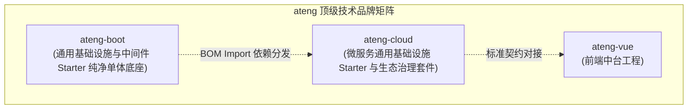

# ateng-cloud

> 面向企业级高可用分布式生产环境的 Spring Cloud & Apache Dubbo 双模微服务基础设施 Starter 套件。

---

## 1. 项目定位与生态全景

`ateng-cloud` 是 `ateng` 顶级技术品牌矩阵下的微服务通用基础设施套件。项目单向消费并依赖已发布的 `ateng-boot-bom`（纯净单体底座），专注于打造垂直正交、开箱即用、无侵入的微服务通用治理能力：



- **技术基线**：JDK 17 LTS（运行时兼容 21+）、Spring Boot `3.3.13`、Spring Cloud `2023.0.x`、Spring Cloud Alibaba `2023.0.x`、Apache Dubbo `3.3.x`、ateng-boot-bom `1.0.0`；
- **配置与注册**：统一收敛于 Nacos 2.4.x（严格遵循 Spring Boot 3 原生 `spring.config.import` 规范）；
- **通信底座**：OpenFeign (声明式 HTTP) 与 Apache Dubbo 3.3 (高性能 Triple/TCP) 双核驱动；
- **边界防御**：WebFlux 响应式纯净网关 + Sa-Token 网关鉴权 + 内部 `Same-Token` 零信任防穿透；
- **流量治理**：全链路流量染色 (`X-Traffic-Tag`) + 金丝雀灰度发布 + Sentinel 流量防卫。

---

## 2. 核心文档与架构指南

本仓库工程设计指南、契约规范与部署配置资产收敛于 [`docs/`](./docs/) 与 [`deploy/`](./deploy/) 体系：

- [微服务配置中心治理与组件配置速查指南 (docs/guides/nacos-configuration-guide.md)](./docs/guides/nacos-configuration-guide.md) — 详述微服务配置分层哲学、Nacos 4 层 Data ID 分层矩阵、`ateng-boot` 存量组件微服务化纳管裁剪矩阵、`@RefreshScope` 禁令安全红线与各组件配置字典。
- [标准 Nacos 配置模板资产库 (deploy/nacos/)](./deploy/nacos/) — 收录全网共享基线、Redis/MyBatis/RocketMQ/S3 共享配置、响应式网关专属配置及业务微服务标准模板。
- [Agent 研发行为准则 (AGENTS.md)](./AGENTS.md) — 详述 7 大微服务专属架构铁律、九道工业级成熟度防线、质量门禁与审查红线。
- [贡献指南 (CONTRIBUTING.md)](./CONTRIBUTING.md) 与 [安全策略 (SECURITY.md)](./SECURITY.md) — 规范开源协作与漏洞披露流程。

---

## 3. 规划模块矩阵 (Module Taxonomy)

```
ateng-cloud/
├── ateng-cloud-bom/              # 微服务版本管控清单 (统管 Spring Cloud、SCA、Dubbo 3.3、ateng-boot、自身构件)
├── ateng-cloud-nacos/            # Nacos 注册与动态配置中心整合 (spring.config.import 规范与无损上下线)
├── ateng-cloud-feign/            # 声明式 HTTP 通信底座 (四维上下文透传、双模自适应解包、防重试雪崩)
├── ateng-cloud-dubbo/            # 高性能 RPC 通信底座 (Apache Dubbo 3.3 Triple/TCP、Filter 上下文注入)
├── ateng-cloud-gateway/          # WebFlux 纯响应式网关 (物理隔离 Servlet、Sa-Token 鉴权、动态路由、文档聚合、载荷防爆)
├── ateng-cloud-sentinel/         # 流量防卫与熔断降级 (受管 AtengFallbackFactory、规则持久化 SPI)
├── ateng-cloud-traffic/          # 全链路流量染色与金丝雀灰度路由 (X-Traffic-Tag 穿透、LoadBalancer/Dubbo Tag Router)
├── ateng-cloud-seata/            # 分布式事务增强 (AT / TCC 事务协调与数据源代理适配)
├── ateng-cloud-all/              # 微服务通用起步依赖聚合工程
└── ateng-cloud-samples/          # 微服务场景演示矩阵与 1:1 离线自洽沙箱
```
