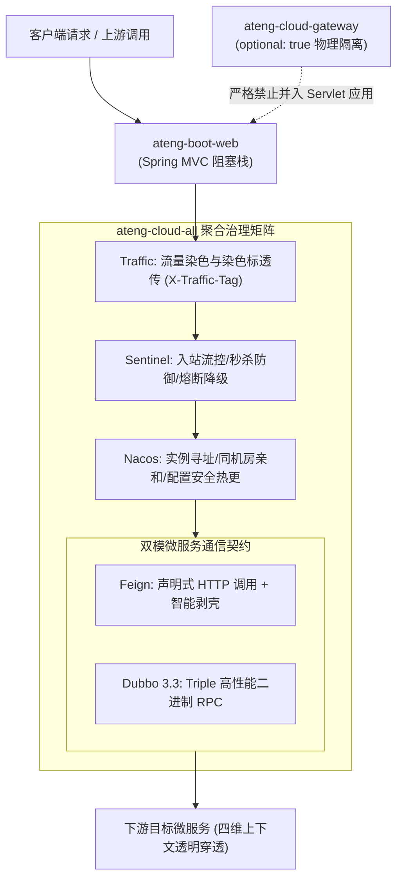

# ateng-cloud-all 微服务全能聚合基础设施全家桶

> 面向标准企业级微服务业务应用的一站式开箱即用聚合 Starter，内置集中打包 Nacos（服务注册与配置中心）、OpenFeign（声明式 HTTP RPC）、Apache Dubbo 3.3（高性能 Triple RPC）、Sentinel（流量防卫与熔断降级）与 Traffic（全链路流量染色与金丝雀灰度）五大通用微服务治理骨架，同时严格遵循 Reactive vs Servlet 物理隔离铁律（网关设为 optional 隔离），杜绝业务微服务重复堆砌分散依赖。

---

## 0. 特性与构件聚合矩阵 (100% 覆盖)

| 聚合构件坐标 (GroupId : ArtifactId) | 依赖状态 | 核心职责 | 默认行为与生产治理边界 |
| :--- | :--- | :--- | :--- |
| `io.github.atengk:ateng-cloud-nacos` | 默认传递 | 服务注册发现与 Nacos 现代配置中心 | 标配 60s 冷启动平滑预热、同机房可用区亲和与配置热更单例不可变守卫 |
| `io.github.atengk:ateng-cloud-feign` | 默认传递 | 声明式 HTTP 通信与双模自适应解包 | 标配四维上下文快照跨进程透传、非幂等写接口禁重试防雪崩 |
| `io.github.atengk:ateng-cloud-dubbo` | 默认传递 | Apache Dubbo 3.3 高性能 RPC 治理 | 标配 Triple/TCP 协议双核、双模契约解包校验与透明四维上下文穿透 |
| `io.github.atengk:ateng-cloud-sentinel` | 默认传递 | 统一受管降级工厂与流量防卫治理 | 标配高频限流、路径防爆清洗与 Nacos 5 大规则全家桶集中持久化 |
| `io.github.atengk:ateng-cloud-traffic` | 默认传递 | 全链路流量染色与金丝雀灰度路由 | 标配三层复合灰度责任链调度与多跳 RPC 泳道防丢失穿透 |
| `io.github.atengk:ateng-cloud-gateway` | `optional: true` | WebFlux 纯响应式网关底座 | **可选依赖**：物理隔离 Reactive 与 Servlet 依赖栈，防止网关与 MVC 相互污染 |
| `io.github.atengk:ateng-cloud-seata` | **按需独立引入** | 分布式事务协调与 TCC 业务防悬挂屏障 | 保持独立不并入全家桶，按需按库引入，消除无事务微服务的额外存储与切源开销 |

---

## 1. 模块定位与 Maven 坐标

在分布式微服务架构中，常规业务服务（如订单中心、商品中心、会员服务等）通常需要同时接入服务发现、声明式调用、高性能 RPC、流量限流与全链路灰度染色。若每个业务工程均逐项引入 5~6 个 Starter，极易发生依赖遗漏、排包疏忽与版本错配。

`ateng-cloud-all` 作为**“全反应堆骨干一站式起步包”**，向下游微服务提供聚合接入入口，业务微服务只需声明引入单个聚合包，即可即刻具备完整的微服务治理能力。

### Maven 引入方式

```xml
<dependencies>
    <!-- 一键引入微服务通用聚合全家桶 (免写版本号，由 ateng-cloud-bom 统管) -->
    <dependency>
        <groupId>io.github.atengk</groupId>
        <artifactId>ateng-cloud-all</artifactId>
    </dependency>

    <!-- 搭配引入 Web 运行时底座 (基于 ateng-boot-web 提供 MVC 容器与统一 Result<T> 契约) -->
    <dependency>
        <groupId>io.github.atengk</groupId>
        <artifactId>ateng-boot-web</artifactId>
    </dependency>
</dependencies>
```

---

## 2. 核心架构与设计不变量

### 2.1 全反应堆骨干链路拓扑



---

### 2.2 网关运行时纯洁性与物理隔离铁律 (Reactive vs Servlet Invariant)

`ateng-cloud-all` 在 POM 依赖中将网关模块显式标注为 `<optional>true</optional>`：

```xml
<!-- Spring Cloud Gateway 响应式微服务网关底座 (可选依赖，遵循 Reactive vs Servlet 物理隔离铁律) -->
<dependency>
    <groupId>io.github.atengk</groupId>
    <artifactId>ateng-cloud-gateway</artifactId>
    <optional>true</optional>
</dependency>
```

**【微服务架构铁律】**：
- Spring Cloud Gateway 是基于 **Spring WebFlux 与 Netty 事件循环** 构建的纯响应式无阻塞架构，**绝对严禁引入** `ateng-boot-web` 或任何 Servlet 阻塞式容器（如 Tomcat）；
- 普通微服务（99% 的业务服务）基于 **Spring MVC 与 Servlet 阻塞栈** 构建；
- 若将 Gateway 强依赖混入普通微服务，将导致类路径下出现 WebFlux 与 Servlet 双重上下文冲突，或者在响应式 Netty 线程中执行阻塞式 DB / RPC 操作，引发 Netty EventLoop 整网假死崩溃；
- 因此，网关工程必须**独立部署**，`ateng-cloud-all` 默认不向普通微服务传递 Gateway 依赖。

---

### 2.3 分布式事务 `seata` 独立解耦决策

`ateng-cloud-seata` **未被并入** `ateng-cloud-all` 聚合全家桶，这是经过深思熟虑的生产架构决策：
1. **轻量性保障**：Seata 分布式事务涉及重型客户端、动态数据源代理（AT 模式 `DataSourceProxy`）及数据库 `undo_log` 表依赖，仅有跨服务/跨库需要强一致性事务的业务方才需开启；
2. **避免非必要拦截**：绝大部分只读查询或单库原子事务的微服务若引入 Seata，会产生不必要的上下文拦截与假切源开销；
3. **按需声明**：对于需要分布式事务的特定微服务（如订单提单中心），仅需按需单独引入 `io.github.atengk:ateng-cloud-seata`。

---

## 3. 开箱即用配置与协同实战 (就近三要素闭环)

### 3.1 本特性专属 YAML 配置片段

在业务微服务 `application.yml` 中配置聚合组件的基础属性：

```yaml
server:
  port: 8080

spring:
  application:
    name: order-service
  cloud:
    nacos:
      # Nacos 服务注册与配置中心
      server-addr: 127.0.0.1:8848
      discovery:
        enabled: true
      config:
        enabled: true
        file-extension: yaml
    sentinel:
      # Sentinel 控制台连接与即时加载
      transport:
        dashboard: 127.0.0.1:8080
      eager: true

dubbo:
  application:
    name: order-service
    register-mode: instance
  registry:
    # Dubbo 级联复用 Nacos 注册中心
    address: nacos://127.0.0.1:8848
  protocol:
    name: tri
    port: 50051

ateng:
  cloud:
    feign:
      # 启用声明式 HTTP 客户端增强
      enabled: true
      retry:
        enabled: true
        max-attempts: 2
    traffic:
      # 启用全链路流量染色与金丝雀灰度
      enabled: true
```

---

### 3.2 面向实战的业务 Java 示例

在业务服务中同时使用 Feign、Dubbo 与限流降级能力：

```java
package io.github.atengk.cloud.sample.smoke.controller;

import io.github.atengk.boot.core.model.Result;
import org.springframework.web.bind.annotation.GetMapping;
import org.springframework.web.bind.annotation.RequestMapping;
import org.springframework.web.bind.annotation.RestController;

import java.util.LinkedHashMap;
import java.util.Map;

/**
 * 聚合全家桶微服务业务协同控制器示例
 *
 * @author Ateng
 * @since 2026-11-03
 */
@RestController
@RequestMapping("/sample/cloud/smoke")
public class SmokeTestController {

    /**
     * 冒烟存活心跳探针
     */
    @GetMapping("/ping")
    public Result<String> ping() {
        return Result.success("pong");
    }

    /**
     * 查询微服务全家桶组件装配状态快照
     */
    @GetMapping("/status")
    public Result<Map<String, Object>> getSmokeStatus() {
        Map<String, Object> statusMap = new LinkedHashMap<>();
        statusMap.put("framework", "ateng-cloud-all");
        statusMap.put("status", "UP");
        statusMap.put("timestamp", System.currentTimeMillis());

        Map<String, String> components = new LinkedHashMap<>();
        components.put("nacos", "LOADED");
        components.put("feign", "LOADED");
        components.put("dubbo", "LOADED");
        components.put("sentinel", "LOADED");
        components.put("traffic", "LOADED");
        components.put("gateway", "OPTIONAL_ISOLATED");
        components.put("seata", "STANDALONE_ON_DEMAND");
        statusMap.put("components", components);

        return Result.success(statusMap);
    }
}
```

---

### 3.3 核心机制与协同容灾说明

1. **四维上下文透明穿透**：当请求经由 Web 入站时，Traffic 模块捕获染色标（`X-Traffic-Tag`），配合上下文传递机制将 $\langle\text{MDC traceId}, \text{userId}, \text{tenantId}, \text{ignoreTenant}\rangle$ 自动穿透到后续的 Feign HTTP 客户端或 Dubbo 3.3 RPC 调用的附件（Attachment）中；
2. **双模解包与防重试雪崩**：Feign 客户端对端返回 `Result<T>` 时自动校验业务状态码并完成剥壳；写接口发生读超时（`SocketTimeoutException`）彻底关闭重试，杜绝下游重复落库；
3. **安全配置热更**：Nacos 配置变更时恪守单例 Bean 不可变性铁律，严禁使用 `@RefreshScope` 物理重建 Bean，仅针对 `@ConfigurationProperties` 增量热绑并发布刷新事件。

---

## 4. 依赖裁剪与生产排包指南 (Tailoring Patterns)

当下游业务项目仅需要部分微服务能力时，可依托 Maven `<exclusions>` 实现优雅裁剪：

### 场景一：纯 Dubbo RPC 微服务（裁剪掉 Feign HTTP）

```xml
<dependency>
    <groupId>io.github.atengk</groupId>
    <artifactId>ateng-cloud-all</artifactId>
    <exclusions>
        <!-- 排除 OpenFeign 依赖，仅保留 Dubbo 作为跨服务通信底座 -->
        <exclusion>
            <groupId>io.github.atengk</groupId>
            <artifactId>ateng-cloud-feign</artifactId>
        </exclusion>
    </exclusions>
</dependency>
```

### 场景二：纯 Spring Cloud HTTP 微服务（裁剪掉 Dubbo RPC）

```xml
<dependency>
    <groupId>io.github.atengk</groupId>
    <artifactId>ateng-cloud-all</artifactId>
    <exclusions>
        <!-- 排除 Dubbo 及其 RPC 通信相关依赖，保持纯净 HTTP 微服务栈 -->
        <exclusion>
            <groupId>io.github.atengk</groupId>
            <artifactId>ateng-cloud-dubbo</artifactId>
        </exclusion>
    </exclusions>
</dependency>
```

### 场景三：无外部流控微服务（裁剪掉 Sentinel）

```xml
<dependency>
    <groupId>io.github.atengk</groupId>
    <artifactId>ateng-cloud-all</artifactId>
    <exclusions>
        <!-- 排除 Sentinel 流量防卫依赖 -->
        <exclusion>
            <groupId>io.github.atengk</groupId>
            <artifactId>ateng-cloud-sentinel</artifactId>
        </exclusion>
    </exclusions>
</dependency>
```

---

## 5. 对应样例工程与全真验证

- **配套冒烟验证工程**：`ateng-cloud-samples/sample-cloud-smoke-test`
- **体验 Controller 路由**：
  - 心跳探测：`GET /sample/cloud/smoke/ping`
  - 骨干状态：`GET /sample/cloud/smoke/status`

### 全真自动化回归验证命令

```bash
mvn test -pl ateng-cloud-all,ateng-cloud-samples/sample-cloud-smoke-test -am -T 1C -nsu -B
```

> 各子模块的深入原理、扩展点 SPI 与全量配置项，请参阅各专项 Starter 文档：
> - [ateng-cloud-nacos README](../ateng-cloud-nacos/README.md)
> - [ateng-cloud-feign README](../ateng-cloud-feign/README.md)
> - [ateng-cloud-dubbo README](../ateng-cloud-dubbo/README.md)
> - [ateng-cloud-sentinel README](../ateng-cloud-sentinel/README.md)
> - [ateng-cloud-traffic README](../ateng-cloud-traffic/README.md)
> - [ateng-cloud-gateway README](../ateng-cloud-gateway/README.md)
> - [ateng-cloud-seata README](../ateng-cloud-seata/README.md)
