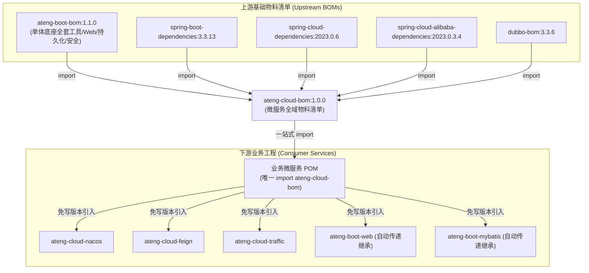

# ateng-cloud-bom 微服务全域依赖版本物料清单

> 面向企业级高可用分布式生产环境的 Spring Cloud & Apache Dubbo 双模微服务物料清单（Bill of Materials, BOM），单向消费并完整继承 `ateng-boot-bom`（纯净单体基础设施底座），集中管理全域 Spring Boot 3.3.x、Spring Cloud 2023.0.x、Spring Cloud Alibaba 2023.0.x、Apache Dubbo 3.3.x、Apache Seata 2.5.x 与 Sa-Token 核心基线，为企业业务微服务提供“一处声明、全网对齐、零版本冲突”的一站式依赖版本统管契约。

---

## 0. 特性与依赖版本统管全景矩阵 (100% 覆盖)

### 0.1 上游技术底座与官方框架基线

| 依赖坐标 (GroupId : ArtifactId) | 纳管版本号 | 来源 / 类型 | 核心职责与治理边界 |
| :--- | :--- | :--- | :--- |
| `io.github.atengk:ateng-boot-bom` | `1.1.0` | 内部底座 / BOM Import | 单体纯净基础设施底座（单向依赖消费已发布 Release 稳定版） |
| `org.springframework.boot:spring-boot-dependencies` | `3.3.13` | 官方框架 / BOM Import | Spring Boot 3 官方依赖基线（JDK 17 LTS 字节码标准） |
| `org.springframework.cloud:spring-cloud-dependencies` | `2023.0.6` | 官方框架 / BOM Import | Spring Cloud 2023 官方微服务治理依赖基线 |
| `com.alibaba.cloud:spring-cloud-alibaba-dependencies` | `2023.0.3.4` | 官方生态 / BOM Import | Spring Cloud Alibaba 官方套件（Nacos、Sentinel 等） |
| `org.apache.dubbo:dubbo-bom` | `3.3.6` | 官方生态 / BOM Import | Apache Dubbo 3.3 现代高性能 Triple/RPC 依赖基线 |

---

### 0.2 ateng-cloud 自身微服务 Starter 构件清单

| 构件坐标 (GroupId : ArtifactId) | 纳管版本号 | 构件类型 | 核心微服务能力与设计不变量 |
| :--- | :--- | :--- | :--- |
| `io.github.atengk:ateng-cloud-nacos` | `${project.version}` | Starter | Nacos 服务注册发现、元数据精准探测、冷启动平滑预热与安全配置热更 |
| `io.github.atengk:ateng-cloud-feign` | `${project.version}` | Starter | 声明式 HTTP RPC、四维上下文透明透传、智能剥壳与非幂等写接口禁重试 |
| `io.github.atengk:ateng-cloud-dubbo` | `${project.version}` | Starter | Apache Dubbo 3.3 高性能 RPC、Triple/TCP 双核驱动与四维上下文透传 |
| `io.github.atengk:ateng-cloud-gateway` | `${project.version}` | Starter | WebFlux 纯响应式网关、2MB 载荷硬防爆、Sa-Token 鉴权与 Same-Token 签发 |
| `io.github.atengk:ateng-cloud-sentinel` | `${project.version}` | Starter | 流量防卫、熔断降级、路径防爆清洗、受管降级工厂与 Nacos 规则持久化 |
| `io.github.atengk:ateng-cloud-traffic` | `${project.version}` | Starter | 全链路流量染色、泳道隔离、三层复合灰度责任链与金丝雀平滑降级 |
| `io.github.atengk:ateng-cloud-seata` | `${project.version}` | Starter | 分布式事务协调、AT/TCC 双核、TCC 防悬挂业务屏障与假切源守卫协同 |
| `io.github.atengk:ateng-cloud-all` | `${project.version}` | Starter | 通用微服务骨干构件全家桶聚合起步包（网关保持可选隔离） |

---

### 0.3 关键三方扩展与受管构件

| 依赖坐标 (GroupId : ArtifactId) | 纳管版本号 | 作用域与场景 | 核心价值与治理说明 |
| :--- | :--- | :--- | :--- |
| `com.alibaba.cloud:spring-cloud-starter-alibaba-seata` | `2023.0.3.4` | 编译 / 运行时 | Seata 官方 Spring Boot 3 起步依赖，对齐 Alibaba 依赖基线 |
| `org.apache.seata:seata-core` | `2.5.0` | 编译 / 运行时 | Seata 核心事务协调原语与通信协议内核 |
| `com.alibaba:transmittable-thread-local` | `2.14.5` | 编译 / 运行时 | 跨线程池四维上下文与链路追踪透明透传增强 |
| `cn.dev33:sa-token-reactor-spring-boot3-starter` | `1.46.0` | 响应式网关专享 | Sa-Token 响应式网关集中鉴权与零信任凭据签发组件 |

---

## 1. 模块定位与 Maven 坐标

`ateng-cloud-bom` 专职作为微服务版本元数据的**“全域唯一权威真理源 (Single-Source of Truth)”**。

下游业务微服务或衍生 Starter 统一在根 POM 的 `<dependencyManagement>` 中通过 `import` 模式引入，即可无缝对齐全套微服务依赖基线，在引入各子模块时**100% 严禁声明 `<version>` 标签**。

### Maven BOM 引入坐标

```xml
<dependencyManagement>
    <dependencies>
        <!-- 引入 ateng-cloud 微服务全域物料清单 (BOM) -->
        <dependency>
            <groupId>io.github.atengk</groupId>
            <artifactId>ateng-cloud-bom</artifactId>
            <version>1.0.0</version>
            <type>pom</type>
            <scope>import</scope>
        </dependency>
    </dependencies>
</dependencyManagement>
```

---

## 2. 核心架构与依赖治理不变量

### 2.1 BOM 单向消费与闭环继承拓扑



- **一站式全能传递铁律**：`ateng-cloud-bom` 内部已经显式 import 导入了 `ateng-boot-bom`，下游业务工程无需在 POM 中分别声明 `ateng-boot-bom` 与 `ateng-cloud-bom`，只需导入 `ateng-cloud-bom` 即可同时拥有单体底座与微服务套件的全量版本托管能力；
- **上游单向锁定铁律**：`ateng-cloud` 仅单向依赖已发布的 `ateng-boot-bom` 正式 Release 版本（当前锁定 `1.1.0`），坚决杜绝依赖 SNAPSHOT 快照，保障生产构建的绝对确定性。

---

### 2.2 Maven 依赖仲裁与“先声明优先”覆写原则

Maven 在处理 `<dependencyManagement>` 中的版本继承时，遵循 **“先声明者优先 (First-Declaration-Wins)”** 仲裁机制：

1. **框架默认仲裁**：当在 `<dependencyManagement>` 中直接 import `ateng-cloud-bom` 时，由 BOM 统筹锁定全域组件版本；
2. **业务受控覆写**：若业务微服务确有特殊需求（如安全升级修复紧急 CVE）需覆写某个特定第三方组件版本，**必须且只能将该依赖项置于 `ateng-cloud-bom` 的 import 声明之前**。

---

## 3. 推荐接入范式与场景实战

### 3.1 标准业务微服务推荐接入范式

业务项目推荐在父 POM 中声明物料清单，各子模块直接声明业务所需的 Starter（免写 `<version>`）：

```xml
<!-- 业务项目根 pom.xml -->
<project>
    <dependencyManagement>
        <dependencies>
            <!-- 统一依赖版本托管中心 -->
            <dependency>
                <groupId>io.github.atengk</groupId>
                <artifactId>ateng-cloud-bom</artifactId>
                <version>1.0.0</version>
                <type>pom</type>
                <scope>import</scope>
            </dependency>
        </dependencies>
    </dependencyManagement>
</project>
```

在具体业务微服务（例如 `order-service/pom.xml`）中引入业务所需构件：

```xml
<!-- 业务微服务 order-service/pom.xml -->
<dependencies>
    <!-- 引入 Web 运行底座 (源自 ateng-boot-bom，免配版本) -->
    <dependency>
        <groupId>io.github.atengk</groupId>
        <artifactId>ateng-boot-web</artifactId>
    </dependency>

    <!-- 引入 Nacos 注册与动态配置中心 (源自 ateng-cloud-bom，免配版本) -->
    <dependency>
        <groupId>io.github.atengk</groupId>
        <artifactId>ateng-cloud-nacos</artifactId>
    </dependency>

    <!-- 引入 OpenFeign 声明式客户端与容灾重试治理 (免配版本) -->
    <dependency>
        <groupId>io.github.atengk</groupId>
        <artifactId>ateng-cloud-feign</artifactId>
    </dependency>

    <!-- 引入全链路流量染色与金丝雀灰度 (免配版本) -->
    <dependency>
        <groupId>io.github.atengk</groupId>
        <artifactId>ateng-cloud-traffic</artifactId>
    </dependency>
</dependencies>
```

---

### 3.2 局部依赖版本覆盖 (Custom Overriding) 实战

若业务线需要针对特定三方库进行增量升级，示例配置如下：

```xml
<dependencyManagement>
    <dependencies>
        <!-- 1. 显式置于 ateng-cloud-bom 之前：业务定制版本（先声明者优先生效） -->
        <dependency>
            <groupId>com.alibaba</groupId>
            <artifactId>transmittable-thread-local</artifactId>
            <version>2.14.5</version>
        </dependency>

        <!-- 2. 引入 ateng-cloud-bom 基线 -->
        <dependency>
            <groupId>io.github.atengk</groupId>
            <artifactId>ateng-cloud-bom</artifactId>
            <version>1.0.0</version>
            <type>pom</type>
            <scope>import</scope>
        </dependency>
    </dependencies>
</dependencyManagement>
```

---

## 4. 依赖治理与微服务防雪崩边界

1. **版本地狱物理阻断**：全域微服务消除由于各模块自行指定依赖版本所引发的运行时 `NoSuchMethodError` 与 `ClassNotFoundException`；
2. **响应式与 Servlet 栈物理隔离**：
   - 响应式微服务网关（`ateng-cloud-gateway`）基于 Spring WebFlux 与 Netty 实现，**绝对严禁**引入任何 Servlet 阻塞依赖（如 `ateng-boot-web`、`spring-boot-starter-web`、Tomcat 等）；
   - 普通微服务业务工程统一使用 `ateng-boot-web`（基于 Spring MVC / Servlet 栈），严禁误入 WebFlux，杜绝运行时 Netty EventLoop 线程被阻塞；
3. **零实体泄露与强契约模型**：BOM 纳管的各微服务 Starter 严格恪守分层防卫体系，跨服务 RPC（Feign/Dubbo）与 Controller 边界严禁直接传递或泄露数据库 ORM 实体，统一使用契约 DTO/VO 并返回强类型 `Result<T>`。

---

## 5. 依赖诊断与全真验证命令

在日常研发或升级过程中，可通过以下 Maven 诊断命令排查依赖树与冲突项：

```bash
# 1. 查看当前微服务全量依赖树与冲突版本标记
mvn dependency:tree -Dverbose

# 2. 定向检索特定依赖的传递来源（例如查找 fastjson 或 netty）
mvn dependency:tree -Dincludes=com.alibaba:*,io.netty:*

# 3. 验证当前模块编译与离线自洽测试
mvn test -pl ateng-cloud-bom -am -T 1C -nsu -B
```

> 详细架构决策与版本升级演进策略，请参阅架构决策记录：
> - [ADR-0001: 多仓库解耦与上游 BOM 基线依赖规范](../docs/adr/0001-multi-repo-and-upstream-bom-baseline.md)
> - [ADR-0002: 微服务核心依赖基线与长期演进升级策略](../docs/adr/0002-microservice-dependency-baseline-and-upgrade-strategy.md)
