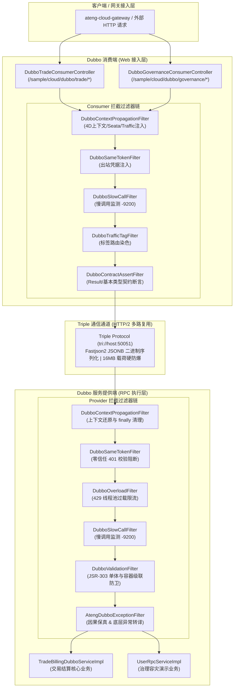

# ateng-cloud-dubbo 架构设计与使用指南

面向企业级高可用分布式生产环境的 Apache Dubbo 3.3 高性能 RPC 通信与微服务生产治理 Starter，单向依赖消费已发布的 `ateng-boot-bom`，专注于打造垂直正交、开箱即用、无侵入的双模微服务通信与治理底座。

全面拥抱现代原生 **Triple 协议** (基于 HTTP/2 与 gRPC 工业级标准)，标配 **Fastjson2 JSONB** 超高速二进制序列化引擎与应用级服务发现模式 (`register-mode: instance`)；深度融合微服务专属治理铁律：双模自适应契约校验与结果断言、因果异常保真与反序列化防御、全链路四维上下文透明透传、零信任 Same-Token 内网防穿透、Seata 分布式事务 XID 状态对称穿透、TrafficContext 全域流量染色与泳道元数据联动、客户端原生 Mock 服务降级、金丝雀灰度发布标签路由平滑降级、服务端线程池过载保护与 Micrometer 监控、JSR-303 单体与容器级联参数防卫、Unary RPC 慢调用主动监测与打点、Triple Server Stream 原生流式通信、16MB 报文载荷硬防爆以及 15 秒优雅停机无损上下线。

---

## 0. 特性与公共 API 全景速查矩阵 (100% 覆盖)

### 1. 核心类与治理门面

| 类 / 接口 | 类型 | 核心职责 | 默认行为 / 装配条件 |
| :--- | :--- | :--- | :--- |
| `AtengDubboAutoConfiguration` | 自动装配类 | Dubbo 通信与核心治理基础设施装配总入口 | 当 `ateng.cloud.dubbo.enabled=true` 且类路径存在 Dubbo 时激活 |
| `AtengDubboProperties` | 根配置属性类 | 强类型映射配置前缀 `ateng.cloud.dubbo` | 生产默认启用，收敛超时、重试、硬防爆载荷及各治理子项 |
| `AtengDubboProtocolProperties` | 协议配置属性类 | Triple 协议基线配置（协议名、暴露端口与序列化） | 默认 `tri` 协议、端口 `50051`、`fastjson2` JSONB 序列化 |
| `AtengDubboApplicationProperties` | 应用配置属性类 | 应用级服务发现模式与优雅停机等待超时 | 默认应用级注册 `instance`，停机超时硬兜底 `15000ms` |
| `AtengDubboContextProperties` | 上下文配置属性类 | 全链路四维上下文出站注入与入站还原开关 | 默认 `true` 开启 |
| `AtengDubboSameTokenProperties` | 零信任配置属性类 | 零信任内网防穿透 Same-Token 校验开关 | 默认 `true` 开启 |
| `AtengDubboExceptionProperties` | 异常配置属性类 | 因果异常保真与第三方未知未受检异常转译开关 | 默认 `true` 开启 |
| `AtengDubboContractProperties` | 契约配置属性类 | 双模契约校验与非 200 业务结果自动断言转译开关 | 默认 `true` 开启 (`ateng.cloud.dubbo.contract.enabled=true`) |
| `AtengDubboTrafficProperties` | 流量路由配置属性类 | 金丝雀灰度发布流量染色穿透与标签路由模式配置 | 默认 `true` 开启，`tag-force=false` 平滑降级兜底 |
| `AtengDubboOverloadProperties` | 过载保护配置属性类 | 服务端线程池过载保护转译与指标采集导出开关 | 默认 `true` 开启，`metrics-enabled=true` |
| `AtengDubboValidationProperties` | 参数校验配置属性类 | JSR-303 参数格式快速失败防卫与结构化转译开关 | 默认 `true` 开启 |
| `AtengDubboSecurityProperties` | 生产安全配置属性类 | Dubbo 生产级安全防护配置入口，挂载反序列化安全配置 | 默认初始化安全子配置 |
| `AtengDubboSerializeProperties` | 序列化安全配置属性类 | 声明反序列化受信任的业务包路径前缀集合 (`allowPackages`) | 配合 `SerializeSecurityManager` 注册安全白名单 |
| `AtengDubboSlowCallProperties` | 慢调用监测配置属性类 | 配置 RPC 慢调用监测开关、耗时阈值及 Consumer/Provider 监测范围 | 默认开启 (`threshold=3000ms`, `include-consumer=true`, `include-provider=true`) |
| `AtengDubboEnvironmentPostProcessor` | 环境后置处理器 | 向 Spring 环境预设优雅停机安全基线默认属性 | 预设停机 15s 硬兜底，支持用户 application.yml 优先无缝接管 |
| `DubboContextPropagationFilter` | RPC 过滤器 | 全链路四维上下文、Seata XID、Traffic 泳道透传与 Netty 线程池确定性清理 | 双向激活 (`order = -10000`)，`finally` 块绝对清理杜绝污染 |
| `DubboSameTokenFilter` | RPC 过滤器 | 零信任 Same-Token 校验拦截器（防公网绕过网关穿透） | 双向激活 (`order = -9800`)，豁免 `injvm` 与白名单接口 |
| `DubboOverloadFilter` | RPC 过滤器 | 捕获线程池打满拒绝异常并转译为标准 429 限流异常 | 双向激活 (`order = -9500`) |
| `DubboConsumerExceptionClusterFilter` | 集群过滤器 | 消费端按需将底层 `RpcException` 转译为保真因果的 `BusinessException`（504/503/500） | Consumer 端激活 (`order = -9500`)，让路原生 `mock` 降级 |
| `DubboSlowCallFilter` | RPC 过滤器 | Unary RPC 同步/异步慢调用计时告警与 Micrometer 指标打点 | 双向激活 (`order = -9200`)，豁免 `injvm` 与 `StreamObserver` |
| `DubboValidationFilter` | RPC 过滤器 | Provider 边界单体与集合/Map/数组级联 JSR-303 参数校验拦截与转译 | Provider 端激活 (`order = -9000`)，Fail-Fast 抛出 400 业务异常 |
| `DubboTrafficTagFilter` | RPC 过滤器 | 出站提取流量染色标记并压入 Dubbo 标签路由 | Consumer 端激活 (`order = -8500`)，支持强隔离与平滑降级 |
| `DubboContractAssertFilter` | RPC 过滤器 | 对端返回非 `void` 基本类型 `null` 或非 200 `Result<T>` 时自动断言转译 | Consumer 端激活 (`order = 1000`, SPI `contractAssert`)，豁免流式通信 |
| `AtengDubboExceptionFilter` | RPC 过滤器 | 接管默认异常过滤器，白名单放行业务异常并转译未知私有异常 | Provider 端激活，防御客户端 `ClassNotFoundException` |
| `DubboOverloadHandler` | 拒绝执行处理器 | Dubbo 线程池耗尽拒绝策略实现，记录过载诊断并递增计数 | 绑定 Dubbo 扩展机制 `threadpool` |
| `DubboOverloadThreadPool` | 线程池扩展 SPI | 挂载 `DubboOverloadHandler` 拒绝策略的生产级线程池实现 | 注册于 Dubbo `ThreadPool` SPI (`threadpool=overload`) |
| `DubboOverloadListener` | 线程池耗尽监听器 | 监听 Dubbo 线程池耗尽事件并提供全局静态累计计数器 | SPI 注册于 `ThreadPoolExhaustedListener` |
| `DubboOverloadMetrics` | 性能指标采集器 | 自动采集 Dubbo 核心线程池状态指标与拒绝计数至 Micrometer | 标配 `@ConditionalOnMissingBean`，导出 `dubbo.threadpool.reject` |
| `DubboSlowCallMetrics` | 慢调用指标采集器 | 绑定 `MeterRegistry` 并导出按 `side/service/method` 维度的慢调用计数器 | 标配 `@ConditionalOnMissingBean`，导出 `dubbo.rpc.slow.calls` |
| `DubboAttachmentSupport` | 附件对齐公共工具类 | 对称清理与对齐 Consumer 出站受管附件，防御跨调用附件残留与 `injvm` 判定 | 无状态静态辅助工具 |
| `DubboSeataPropagationSupport` | 分布式事务适配桥梁 | Seata 全局事务 XID 条件探测、双向透传与状态对称绑定/释放 | 缺失 Seata 时自动静默短路，局部持有判定杜绝误释放 |
| `DubboTrafficPropagationSupport` | 流量治理适配桥梁 | `TrafficContextHolder` 泳道与规则元数据探测、穿透与确定性清理 | 缺失 Traffic 模块时平滑降级至 MDC 模式，入站出口 `finally` 幂等清理 |
| `DubboExceptionUtils` | 异常研判公共工具类 | 线程池过载判断、`ConstraintViolationException` 链路提取与流式调用判定 | 统一异常判定收敛，消除重复代码 |
| `AbstractDubboTripleExceptionHandler` | 协议异常处理器基类 | Triple 协议异常处理公共模板，统一流式豁免与 grpc-status 封包 | 模板方法模式消除重复代码，统一保护传输层通道 |
| `DubboBusinessExceptionHandler` | 协议异常处理器 | Triple 传输层受管 `BusinessException` 保真回传 | HTTP/2 协议层异常处理器，流式通信自动放行 |
| `DubboOverloadExceptionHandler` | 协议异常处理器 | Triple 传输层线程池过载拒绝异常转译为 429 业务异常 | HTTP/2 协议层异常处理器，杜绝传输物理断连 |
| `DubboValidationExceptionHandler` | 协议异常处理器 | Triple 传输层参数校验违规异常转译为 400 业务异常 | HTTP/2 协议层异常处理器，保真违规字段信息 |
| `DubboResultUnwrapFilter` | RPC 过滤器 (已废弃) | 旧版业务结果自动解包过滤器，平滑标记弃用 | `@Deprecated`，建议迁移至 `DubboContractAssertFilter`，保持类二进制与编译向后兼容 |
| `AtengDubboResultUnwrapProperties` | 配置属性类 (已废弃) | 旧版 `ateng.cloud.dubbo.result-unwrap.*` 配置，映射至新契约属性 | `@Deprecated`，建议迁移至 `AtengDubboContractProperties` |

---

### 2. 核心声明式注解全景速查

| 注解 | 作用目标 | 核心属性与微服务治理语义 | 生产推荐配置与默认行为 |
| :--- | :--- | :--- | :--- |
| `@DubboReference` | 消费端注入字段/方法 | 客户端声明式 RPC 引用：`mock = "true"`（启用原生客户端降级兜底）、`check = false`（启动期不强依赖对端在线）、`timeout = 5000`（读超时时限）、`retries = 0`（写请求防重试雪崩铁律） | 生产推荐标配 `check = false` 与写请求 `retries = 0` |
| `@DubboService` | 服务端实现类 | 服务端声明式 RPC 暴露：`protocol = "tri"`（Triple 协议）、`version`（服务版本号）、`group`（服务分组）、`timeout`（服务端超时阈值） | 默认发布至应用级服务发现注册中心 |

---

### 3. 配置属性速查表 (`ateng.cloud.dubbo.*`)

| 配置项 | 类型 | 默认值 | 详细业务说明 |
| :--- | :--- | :--- | :--- |
| `ateng.cloud.dubbo.enabled` | `boolean` | `true` | 是否激活 ateng-cloud-dubbo 核心通信与治理能力 |
| `ateng.cloud.dubbo.timeout` | `Duration` | `5000ms` | 全局 RPC 默认调用超时时限（强类型 Duration 消除无量纲歧义） |
| `ateng.cloud.dubbo.retries` | `int` | `0` | 全局 RPC 默认重试次数（写请求读超时绝不重试防雪崩铁律） |
| `ateng.cloud.dubbo.payload` | `DataSize` | `16MB` | 单个 RPC 请求/响应报文载荷硬防爆上限（防止黑客恶意报文击穿 JVM OOM） |
| `ateng.cloud.dubbo.protocol.name` | `String` | `"tri"` | 默认通信协议名称，全面推行现代原生 Triple 协议 |
| `ateng.cloud.dubbo.protocol.port` | `Integer` | `50051` | 默认服务暴露端口，对齐 gRPC / Triple 工业级标准推荐端口 |
| `ateng.cloud.dubbo.protocol.serialization` | `String` | `"fastjson2"` | 默认序列化算法，采用 Fastjson2 JSONB 高速二进制格式 |
| `ateng.cloud.dubbo.application.register-mode` | `String` | `"instance"` | 默认服务注册模式，应用级服务发现，彻底避免注册表膨胀 |
| `ateng.cloud.dubbo.application.shut-wait` | `Duration` | `15000ms` | 优雅停机等待超时时间（由 AtengDubboEnvironmentPostProcessor 注入原生 dubbo.application.shut-down.wait 与 shutwait，默认 15000ms 硬兜底） |
| `ateng.cloud.dubbo.context.enabled` | `boolean` | `true` | 是否开启全链路四维上下文透传与 Netty 线程池确定性清理 |
| `ateng.cloud.dubbo.same-token.enabled` | `boolean` | `true` | 是否开启内部微服务零信任 Same-Token 防穿透隔离校验 |
| `ateng.cloud.dubbo.same-token.check` | `boolean` | `true` | Provider 端是否强制校验 Same-Token（未携带或非法直接 401 快速失败） |
| `ateng.cloud.dubbo.same-token.exclude-interfaces` | `List<String>` | `[]` | 豁免 Same-Token 入站强校验的 RPC 接口全限定名或通配符列表（如 `*OpenRpcService`） |
| `ateng.cloud.dubbo.exception.enabled` | `boolean` | `true` | 是否开启因果异常保真与第三方未知未受检异常转译 |
| `ateng.cloud.dubbo.exception.translate-consumer-rpc-exception` | `boolean` | `false` | 消费端无原生 `mock` 时是否将底层 `RpcException` 按需因果转译为受管 `BusinessException` (504/503/500) |
| `ateng.cloud.dubbo.contract.enabled` | `boolean` | `true` | 是否开启双模契约校验与非 200 业务结果自动断言转译 |
| `ateng.cloud.dubbo.contract.assert-non-null-result` | `boolean` | `true` | 当接口声明返回 `Result<T>` 且对端返回 `null` 空壳响应时是否断言失败并抛出 `BusinessException` |
| `ateng.cloud.dubbo.traffic.enabled` | `boolean` | `true` | 是否开启金丝雀灰度流量染色与标签路由支持 |
| `ateng.cloud.dubbo.traffic.tag-force` | `boolean` | `false` | 标签路由是否强制隔离（`false` 平滑降级至基线实例；`true` 严格强隔离） |
| `ateng.cloud.dubbo.overload.enabled` | `boolean` | `true` | 是否开启服务端线程池过载保护与异常受管转译 |
| `ateng.cloud.dubbo.overload.metrics-enabled` | `boolean` | `true` | 是否自动将 Dubbo 核心线程池状态与拒绝指标导出至 Micrometer |
| `ateng.cloud.dubbo.overload.threads` | `Integer` | `200` | 服务端 `overload` 定长业务线程池工作线程数 |
| `ateng.cloud.dubbo.overload.queues` | `Integer` | `0` | 服务端 `overload` 线程池队列容量（默认 `0` 零队列快速失败） |
| `ateng.cloud.dubbo.validation.enabled` | `boolean` | `true` | 是否在 Provider 边界开启 JSR-303 参数格式快速失败防卫（含集合/Map/数组级联校验） |
| `ateng.cloud.dubbo.slow-call.enabled` | `boolean` | `true` | 是否开启 Dubbo Unary RPC 慢调用主动监测、WARN 告警与 Micrometer 打点 |
| `ateng.cloud.dubbo.slow-call.threshold` | `Duration` | `3000ms` | 慢调用判定耗时阈值，达到或超过该值触发告警并计数（`0` 或负数关闭） |
| `ateng.cloud.dubbo.slow-call.include-consumer` | `boolean` | `true` | 是否在 Consumer 端执行慢调用耗时监测 |
| `ateng.cloud.dubbo.slow-call.include-provider` | `boolean` | `true` | 是否在 Provider 端执行慢调用耗时监测 |
| `ateng.cloud.dubbo.security.serialize.allow-packages` | `List<String>` | `[]` | 允许反序列化的业务包路径前缀白名单列表（自动注册至 Dubbo 3 序列化安全校验器） |

---

### 4. 上下文透传与防穿透标准标头

| 标头名称 (Attachment / Header) | 来源常量 | 语义与流转机制 | 默认脱敏策略 |
| :--- | :--- | :--- | :--- |
| `X-Trace-Id` / `traceId` | `MessageHeaderConstants.TRACE_ID` | 分布式调用链 Trace ID，与 MDC 自动绑定透传并在入站还原 | 明文透传，日志打印 |
| `X-User-Id` | `MessageHeaderConstants.USER_ID` | 当前操作用户 ID，出站从 `UserContextHolder` 提取，入站自动还原 | 原始透传 |
| `X-Tenant-Id` | `MessageHeaderConstants.TENANT_ID` | 当前多租户 ID，出站从 `TenantContextHolder` 提取，入站自动还原 | 原始透传 |
| `X-Ignore-Tenant` | `MessageHeaderConstants.IGNORE_TENANT` | 是否忽略多租户隔离过滤逻辑 (`true`/`false`) | 原始透传 |
| `X-Traffic-Tag` | `DubboTrafficPropagationSupport.TRAFFIC_TAG` | 全链路流量染色标记 (如 `gray-v1`)，激活 Dubbo 标签路由 | 原始透传 |
| `X-Traffic-Lane` | `DubboTrafficPropagationSupport.TRAFFIC_LANE` | 流量所属隔离泳道名称 (如 `payment-gray-lane`) | 原始透传 |
| `X-Traffic-Rule` | `DubboTrafficPropagationSupport.TRAFFIC_RULE` | 命中的动态分流规则标识 (如 `rule-user-vip`) | 原始透传 |
| `TX_XID` / `tx_xid` | `DubboSeataPropagationSupport.TX_XID` | Seata 全局分布式事务 ID，跨 RPC 透明透传并状态对称绑定/解绑 | 内部透传，出口对称清理 |
| `Same-Token` / `SA-SAME-TOKEN` | `SaSameUtil.SAME_TOKEN` | 内部微服务零信任受信凭据（防止公网直连内部微服务端口） | **受管校验并在出口自动清理** |

---

## 1. 模块定位与 Maven 坐标

`ateng-cloud-dubbo` 是 `ateng-cloud` 微服务基础设施的核心远程调用套件。针对传统 RPC 体系中易出现的“协议过时（旧 TCP 协议穿透性差）、序列化安全黑洞、异常反序列化崩溃（ClassNotFoundException）、多租户上下文线程污染、公网绕过网关直连穿透、写请求读超时重试雪崩”等痛点，提供高可用、生产就绪的统一治理基线。

```xml
<dependency>
    <groupId>io.github.atengk</groupId>
    <artifactId>ateng-cloud-dubbo</artifactId>
</dependency>
```

> [!TIP]
> 依赖版本由父工程 `ateng-cloud-bom` 统一纳管，业务模块中无需显式声明 `<version>` 标签。

---

## 2. 核心架构与微服务 RPC 调用拓扑

模块采用双模通信体系与分层拦截器责任链架构，支持 POJO 强契约与统一 `Result<T>` 响应契约，将接入层正交解耦为**高频交易业务消费端**与**微服务生产治理容灾端**两大独立切片：



---

## 3. Triple 协议基线与双模契约调用

### 3.1 Triple 现代流式协议与极简起步配置

```yaml
# 本节专属 YAML 配置 (application.yml)
dubbo:
  application:
    name: sample-cloud-dubbo
    register-mode: instance # 应用级服务发现注册模式
  protocol:
    name: tri               # 启用现代原生 Triple 协议
    port: 50051             # 标准 Triple/gRPC 工业端口
    serialization: fastjson2 # Fastjson2 JSONB 超高速二进制序列化
  consumer:
    check: false            # 启动期不强检 Provider 在线状态，支持自洽解耦
    direct-url: tri://127.0.0.1:50051 # 离线直连 URL (激活 local profile 时置空走注册中心)

ateng:
  cloud:
    dubbo:
      enabled: true
      timeout: 5000ms       # 默认 RPC 调用超时
      retries: 0            # 默认写请求禁重试防雪崩
```

面向分布式高频交易撮合与结算的 RPC 契约定义：

```java
package io.github.atengk.cloud.sample.dubbo.api;

import io.github.atengk.boot.core.model.Result;
import io.github.atengk.cloud.sample.dubbo.model.TradeBillingRequest;
import io.github.atengk.cloud.sample.dubbo.model.TradeBillingResult;
import jakarta.validation.Valid;

/**
 * 高频交易撮合与结算 Dubbo RPC 契约接口
 */
public interface TradeBillingDubboService {

    /**
     * 单笔同步结算（原生强类型 POJO 契约）
     */
    TradeBillingResult settlePojo(@Valid TradeBillingRequest request);

    /**
     * 单笔包装结算（Result 强契约返回，由消费端 DubboContractAssertFilter 自动断言成功状态）
     */
    Result<TradeBillingResult> settleResult(@Valid TradeBillingRequest request);

    /**
     * 模拟结算失败（返回 Result.fail，触发消费端自动断言并转换为 BusinessException）
     */
    Result<TradeBillingResult> settleFailedResult(@Valid TradeBillingRequest request);
}
```

**核心机制与容灾边界**：
- **原生 Triple 架构**：基于 HTTP/2 帧实现多路复用，穿透云原生网关与代理防火墙，免除传统私有二进制协议的序列化漏洞与防火墙阻断问题；
- **Fastjson2 JSONB 引擎**：吞吐量比经典 Hessian2 提升 30% 以上，具备严苛的反序列化安全边界。

---

### 3.2 原生 POJO 强契约单笔结算

高频交易结算服务在 Web 接入层的消费调用：

```java
package io.github.atengk.cloud.sample.dubbo.controller;

import io.github.atengk.boot.core.model.Result;
import io.github.atengk.cloud.sample.dubbo.api.TradeBillingDubboService;
import io.github.atengk.cloud.sample.dubbo.model.TradeBillingRequest;
import io.github.atengk.cloud.sample.dubbo.model.TradeBillingResult;
import jakarta.validation.Valid;
import org.apache.dubbo.config.annotation.DubboReference;
import org.springframework.web.bind.annotation.*;

@RestController
@RequestMapping("/sample/cloud/dubbo/trade")
public class DubboTradeConsumerController {

    @DubboReference(url = "${dubbo.consumer.direct-url:${dubbo.test.reference.url:tri://127.0.0.1:50051}}", check = false)
    private TradeBillingDubboService tradeBillingDubboService;

    /**
     * 单笔同步结算（原生强类型 POJO 契约）
     */
    @PostMapping("/settle/pojo")
    public Result<TradeBillingResult> settlePojo(@RequestBody @Valid TradeBillingRequest request) {
        // RPC 接口直接返回强类型 POJO，消除二次拆包损耗
        TradeBillingResult result = tradeBillingDubboService.settlePojo(request);
        return Result.success(result);
    }
}
```

**核心机制与容灾边界**：
- **强类型零开销**：对于内部紧密微服务调用，接口直接声明业务对象 `TradeBillingResult`，兼具极致性能与强类型 IDE 校验能力；
- **异常直接捕获**：服务端执行抛出的业务异常直接被 `AtengDubboExceptionFilter` 白名单放行，因果链完整保留。

---

### 3.3 统一 Result 契约与自动断言防呆

```yaml
# 本节专属 YAML 配置 (application.yml)
ateng:
  cloud:
    dubbo:
      contract:
        enabled: true # 开启双模契约校验与结果自动断言（生产默认启用）
```

当团队推行规范化分布式微服务架构时，RPC 接口统一声明返回 `Result<T>`。消费端接入层调用示例：

```java
package io.github.atengk.cloud.sample.dubbo.controller;

import io.github.atengk.boot.core.model.Result;
import io.github.atengk.cloud.sample.dubbo.api.TradeBillingDubboService;
import io.github.atengk.cloud.sample.dubbo.model.TradeBillingRequest;
import io.github.atengk.cloud.sample.dubbo.model.TradeBillingResult;
import jakarta.validation.Valid;
import org.springframework.web.bind.annotation.*;

@RestController
@RequestMapping("/sample/cloud/dubbo/trade")
public class DubboTradeConsumerController {

    private TradeBillingDubboService tradeBillingDubboService;

    /**
     * 单笔统一包装结算（Result 契约，自动断言防呆剥壳）
     */
    @PostMapping("/settle/result")
    public Result<TradeBillingResult> settleResult(@RequestBody @Valid TradeBillingRequest request) {
        return tradeBillingDubboService.settleResult(request);
    }

    /**
     * 模拟结算失败（对端返回非 200 Result，触发 DubboContractAssertFilter 自动转译为 BusinessException）
     */
    @PostMapping("/settle/failed")
    public Result<TradeBillingResult> settleFailedResult(@RequestBody @Valid TradeBillingRequest request) {
        return tradeBillingDubboService.settleFailedResult(request);
    }
}
```

**核心机制与容灾边界**：
- **防呆自动断言**：当对端服务返回 `Result<T>` 且其业务状态码 `code != 200` 时，消费端拦截器 `DubboContractAssertFilter` 自动将其转译为本地 `BusinessException(code, msg)` 抛出；
- **彻底杜绝静默带病运行**：彻底终结了调用方忘记编写 `if (!result.isSuccess())` 校验、带着 `null` 数据或业务失败码继续执行导致数据库产生脏数据的生产隐患。

---

## 4. 全链路四维上下文、Seata 事务与金丝雀灰度透传

### 4.1 四维上下文跨进程透明透传与确定性对称清理

```yaml
# 本节专属 YAML 配置 (application.yml)
ateng:
  cloud:
    dubbo:
      context:
        enabled: true # 激活四维上下文透明透传与线程清理
```

消费端接收到外部请求后，四维上下文快照（$\langle\text{MDC traceId}, \text{userId}, \text{tenantId}, \text{ignoreTenant}\rangle$）自动随 Dubbo RPC 隐式参数穿透至下游服务：

```java
package io.github.atengk.cloud.sample.dubbo.controller;

import io.github.atengk.boot.core.context.TenantContextHolder;
import io.github.atengk.boot.core.context.UserContextHolder;
import io.github.atengk.boot.core.model.Result;
import io.github.atengk.cloud.dubbo.filter.DubboContextPropagationFilter;
import io.github.atengk.cloud.sample.dubbo.api.TradeBillingDubboService;
import org.slf4j.MDC;
import org.springframework.web.bind.annotation.*;

import java.util.Map;

@RestController
@RequestMapping("/sample/cloud/dubbo/trade")
public class DubboTradeConsumerController {

    private TradeBillingDubboService tradeBillingDubboService;

    /**
     * 探查跨进程 RPC 四维上下文、Seata XID 与金丝雀灰度染色穿透
     */
    @GetMapping("/context/probe")
    public Result<Map<String, String>> probeContext(
            @RequestHeader(value = "X-Traffic-Tag", required = false) String trafficTag,
            @RequestHeader(value = "X-User-Id", required = false) String userId,
            @RequestHeader(value = "X-Tenant-Id", required = false) String tenantId) {

        if (userId != null && !userId.isBlank()) {
            UserContextHolder.setUserId(userId);
        }
        if (tenantId != null && !tenantId.isBlank()) {
            TenantContextHolder.setTenantId(tenantId);
        }
        if (trafficTag != null && !trafficTag.isBlank()) {
            MDC.put(DubboContextPropagationFilter.TRAFFIC_TAG, trafficTag);
        }

        try {
            // 发起 RPC 调用，服务端自动还原上下文
            Map<String, String> providerContext = tradeBillingDubboService.getProviderContext();
            return Result.success(providerContext);
        } finally {
            // 确定性对称清理，防止当前 Web 线程池上下文污染
            UserContextHolder.clear();
            TenantContextHolder.clear();
            MDC.remove(DubboContextPropagationFilter.TRAFFIC_TAG);
        }
    }
}
```

**核心机制与容灾边界**：
- **Netty 线程确定性清理铁律**：`DubboContextPropagationFilter` 在服务端请求执行的 `finally` 块中强制执行 `cleanContexts()`，无条件注销 `UserContextHolder`、`TenantContextHolder` 及 MDC，杜绝线程复用时引发的多租户数据泄露与上下文残留脏读；
- **标准 W3C 协议对齐**：调用链 `traceId` 采用统一 MDC 门面，无缝对接 SkyWalking、OpenTelemetry 及 Zipkin。

---

### 4.2 Seata 全局分布式事务 XID 状态对称穿透

```java
// 消费端处于 Seata 全局分布式事务中
String globalXid = "192.168.1.50:8091:8877665544";
RootContext.bind(globalXid);

try {
    // 发起 Dubbo RPC 调用，DubboSeataPropagationSupport 自动将 XID 注入 TX_XID Attachment
    tradeBillingDubboService.settlePojo(request);
} finally {
    RootContext.unbind();
}
```

**核心机制与容灾边界**：
- **状态判断对称解绑范式**：服务提供端在入站时记录局部标志 `boundByCurrent`；在 `finally` 块中**仅当本端由于当前 RPC 请求真实绑定 XID 时才触发 `RootContext.unbind()`**；
- **静默条件探测**：当应用环境未引入 Seata 依赖时，适配桥梁自动静默短路，坚决不发生 `NoClassDefFoundError`。

---

### 4.3 TrafficContext 全域流量染色与标签路由平滑降级

```yaml
# 本节专属 YAML 配置 (application.yml)
ateng:
  cloud:
    dubbo:
      traffic:
        enabled: true      # 开启金丝雀灰度流量染色
        tag-force: false   # 默认 false：平滑降级至基线实例；true：强隔离
```

```java
// 设置当前线程隔离泳道与流量规则
TrafficContextHolder.setContext(TrafficContext.of("canary-v2", "trade-lane-01", "rule-vip-trade"));
try {
    tradeBillingDubboService.settlePojo(request);
} finally {
    TrafficContextHolder.clear();
}
```

**核心机制与容灾边界**：
- **金丝雀平滑降级**：出站时将流量标签自动映射至 Dubbo 原生 `CommonConstants.TAG_KEY`。在 `tag-force: false` 默认模式下，若集群中不存在对应 `canary-v2` 的灰度服务节点，流量自动回退至基线实例正常响应，防止版本发布期间因灰度节点未就绪引发整网雪崩。

---

## 5. 零信任 Same-Token 防穿透与反序列化安全

### 5.1 零信任 Same-Token 内网防穿透隔离

```yaml
# 本节专属 YAML 配置 (application.yml)
ateng:
  cloud:
    dubbo:
      same-token:
        enabled: true # 开启 Sa-Token 内部受信凭据校验
        check: true   # Provider 端强制校验（未携带或非法直接 401 快速失败）
```

微服务生产治理控制器接入示例：

```java
package io.github.atengk.cloud.sample.dubbo.controller;

import io.github.atengk.boot.core.model.Result;
import io.github.atengk.cloud.dubbo.filter.DubboSameTokenFilter;
import io.github.atengk.cloud.sample.dubbo.api.UserRpcService;
import org.apache.dubbo.config.annotation.DubboReference;
import org.apache.dubbo.rpc.RpcContext;
import org.springframework.web.bind.annotation.*;

@RestController
@RequestMapping("/sample/cloud/dubbo/governance")
public class DubboGovernanceConsumerController {

    @DubboReference(url = "${dubbo.consumer.direct-url:${dubbo.test.reference.url:tri://127.0.0.1:50051}}", check = false)
    private UserRpcService userRpcService;

    /**
     * 零信任 Same-Token 内部受信凭据防穿透校验
     */
    @GetMapping("/same-token")
    public Result<String> testSameToken(@RequestHeader(value = "Same-Token", required = false) String sameToken) {
        if (sameToken != null) {
            // 模拟显式覆盖凭据（如测试非法或空白凭据）
            RpcContext.getClientAttachment().setAttachment(DubboSameTokenFilter.SAME_TOKEN_KEY, sameToken);
            RpcContext.getClientAttachment().setAttachment(DubboSameTokenFilter.SA_SAME_TOKEN_KEY, sameToken);
        }
        try {
            String pingResult = userRpcService.ping("same-token-check");
            return Result.success("Same-Token 受信凭据校验通过: " + pingResult);
        } finally {
            RpcContext.removeClientAttachment();
        }
    }
}
```

**核心机制与容灾边界**：
- **公网穿透 Fail-Fast 阻断**：所有流量必须先经由 `ateng-cloud-gateway` 鉴权并注入受信凭据；凡黑客或恶意扫描绕过网关直连内部微服务暴露端口（50051），`DubboSameTokenFilter` 在 Provider 边界直接抛出 `BusinessException(401, "微服务内部调用未携带合法 Same-Token 受信凭据")` 快速阻断；
- **短路调用豁免**：本地 JVM 内部调用 (`injvm`) 自动豁免，保障单体集成单测极速运行。

---

### 5.2 反序列化动态包安全白名单配置

```yaml
# 本节专属 YAML 配置 (application.yml)
ateng:
  cloud:
    dubbo:
      security:
        serialize:
          allow-packages:
            - io.github.atengk.cloud.sample.dubbo.model
            - io.github.atengk.boot.core.model
```

**核心机制与容灾边界**：
- **安全沙箱隔离**：深度接入 Dubbo 3 `SerializeSecurityManager` 机制，在 Fastjson2 二进制解码阶段对非允许路径的类执行拒绝反序列化，从根本上杜绝任意代码执行（RCE）类反序列化攻击。

---

## 6. 服务端过载保护、参数校验、异常保真与慢调用观测

### 6.1 服务端线程池过载 429 保护与 Micrometer 指标监控

```yaml
# 本节专属 YAML 配置 (application.yml)
ateng:
  cloud:
    dubbo:
      overload:
        enabled: true         # 启用线程池过载保护
        metrics-enabled: true # 启用 Micrometer 指标导出
```

微服务生产治理控制器模拟过载请求：

```java
package io.github.atengk.cloud.sample.dubbo.controller;

import io.github.atengk.boot.core.model.Result;
import io.github.atengk.cloud.sample.dubbo.api.UserRpcService;
import org.springframework.web.bind.annotation.*;

@RestController
@RequestMapping("/sample/cloud/dubbo/governance")
public class DubboGovernanceConsumerController {

    private UserRpcService userRpcService;

    /**
     * 服务端并发线程池打满 429 过载保护限流
     */
    @GetMapping("/overload")
    public Result<String> testOverload() {
        // 模拟触发线程池耗尽，DubboOverloadFilter 将其转译为受管 429 限流异常
        userRpcService.simulateOverload();
        return Result.success("未抛出预期异常");
    }
}
```

**核心机制与容灾边界**：
- **生产级拒绝策略**：`DubboOverloadHandler` 替代传统无脑丢弃或直接崩溃策略，记录过载诊断并递增计数器；
- **429 标准状态码映射**：`DubboOverloadFilter` 与 `DubboOverloadExceptionHandler` 将线程池拒绝转译为 `BusinessException(429, "服务端并发线程池已耗尽，触发过载保护限流")`，告知调用方立即触发退避削峰；
- **Actuator 指标导出**：自动暴露 `dubbo.threadpool.reject` 计数器与当前活跃线程度量。

---

### 6.2 分层双防参数校验防卫 (Web 边界与 RPC 边界)

```yaml
# 本节专属 YAML 配置 (application.yml)
ateng:
  cloud:
    dubbo:
      validation:
        enabled: true # 启用 Provider 端 JSR-303 参数格式快速失败防卫
```

控制层双层防卫示例：

```java
package io.github.atengk.cloud.sample.dubbo.controller;

import io.github.atengk.boot.core.model.Result;
import io.github.atengk.boot.core.validation.ValidList;
import io.github.atengk.cloud.sample.dubbo.api.UserRpcService;
import io.github.atengk.cloud.sample.dubbo.model.UserCreateRequest;
import io.github.atengk.cloud.sample.dubbo.model.UserVO;
import jakarta.validation.Valid;
import org.springframework.web.bind.annotation.*;

import java.util.List;

@RestController
@RequestMapping("/sample/cloud/dubbo/governance")
public class DubboGovernanceConsumerController {

    private UserRpcService userRpcService;

    /**
     * Web 传输边界参数校验快速失败防卫（第一道防线）
     */
    @PostMapping("/validation")
    public Result<UserVO> validateUser(@RequestBody @Valid UserCreateRequest request) {
        UserVO vo = userRpcService.createUser(request);
        return Result.success(vo);
    }

    /**
     * RPC 协议边界参数校验快速失败防卫（第二道防线，由 DubboValidationFilter 拦截转译）
     */
    @PostMapping("/validation/rpc")
    public Result<UserVO> validateUserRpcDirect(@RequestBody UserCreateRequest request) {
        // 未在 Web 边界显式标注 @Valid 时，数据直发 RPC 仍由 DubboValidationFilter 执行严格防卫
        UserVO vo = userRpcService.createUser(request);
        return Result.success(vo);
    }

    /**
     * RPC 协议边界批量集合参数校验快速失败防卫（绕过 Web 层校验直达 Provider 边界，由 DubboValidationFilter 执行级联校验）
     */
    @PostMapping("/validation/batch")
    public Result<List<UserVO>> validateUsersBatch(@RequestBody ValidList<UserCreateRequest> requests) {
        List<UserVO> list = userRpcService.batchCreateUsers(requests);
        return Result.success(list);
    }
}
```

**核心机制与容灾边界**：
- **Defense-in-Depth 双防体系**：第一道防线在 Web Controller 边界拦截非法请求；第二道防线在 RPC 服务端入口处拦截，递归校验单体 Bean 与 `Collection`/`Map`/数组容器元素，自动提取 `ConstraintViolationException` 并附带 `[index]` / `[key]` 路径前缀结构化转译为 `BusinessException(400, "参数校验失败: ...")`。

---

### 6.3 因果异常保真与底层未声明异常安全转译

```yaml
# 本节专属 YAML 配置 (application.yml)
ateng:
  cloud:
    dubbo:
      exception:
        enabled: true                            # 启用因果异常保真与未知异常防反序列化崩溃转译
        translate-consumer-rpc-exception: false  # 消费端无原生 mock 时按需将底层 RpcException 转译为 504/503/500
```

治理控制器异常场景验证：

```java
package io.github.atengk.cloud.sample.dubbo.controller;

import io.github.atengk.boot.core.model.Result;
import io.github.atengk.cloud.sample.dubbo.api.UserRpcService;
import org.springframework.web.bind.annotation.*;

@RestController
@RequestMapping("/sample/cloud/dubbo/governance")
public class DubboGovernanceConsumerController {

    private UserRpcService userRpcService;

    /**
     * 受管业务异常因果保真拦截（白名单放行受管 BusinessException，精准还原 404 状态码）
     */
    @GetMapping("/business-exception")
    public Result<String> testBusinessException() {
        userRpcService.throwBusinessException();
        return Result.success("未抛出预期异常");
    }

    /**
     * 底层未声明异常安全因果转译（防反序列化崩溃，转译为受管 BusinessException，统一映射为 500 状态码）
     */
    @GetMapping("/custom-exception")
    public Result<String> testCustomException() {
        userRpcService.throwCustomException();
        return Result.success("未抛出预期异常");
    }
}
```

**核心机制与容灾边界**：
- **业务异常 100% 因果保真**：受管 `BusinessException` 列入白名单放行，错误码与多语言消息完全无损穿透；
- **防御 ClassNotFoundException 崩溃**：对端抛出未声明的底层非 JDK 私有异常（如驱动层死锁异常），由 `AtengDubboExceptionFilter` 安全转译为通用 `BusinessException(500, "系统执行异常: ...")`，杜绝消费端因缺少私有异常类导致的二次反序列化瘫痪；
- **消费端底层 `RpcException` 按需因果转译**：开启 `translate-consumer-rpc-exception=true` 且方法未配置原生 `mock` 时，`DubboConsumerExceptionClusterFilter` 将超时、网络异常等转译为保留原始 `cause` 的受管 `BusinessException`（504/503/500）。

---

### 6.4 RPC 慢调用主动监测与 Micrometer 可观测性

```yaml
# 本节专属 YAML 配置 (application.yml)
ateng:
  cloud:
    dubbo:
      slow-call:
        enabled: true          # 开启慢调用主动监测与指标统计
        threshold: 3000ms      # 慢调用判定耗时阈值（设为 0 或负数时关闭）
        include-consumer: true # 是否在 Consumer 端执行监测
        include-provider: true # 是否在 Provider 端执行监测
```

从样本工程提取的慢调用观测接口实现：

```java
package io.github.atengk.cloud.sample.dubbo.controller;

import io.github.atengk.boot.core.model.Result;
import io.github.atengk.cloud.sample.dubbo.api.UserRpcService;
import org.springframework.web.bind.annotation.*;

@RestController
@RequestMapping("/sample/cloud/dubbo/governance")
public class DubboGovernanceConsumerController {

    private UserRpcService userRpcService;

    /**
     * RPC 慢调用主动监测与可观测指标演示（当耗时达到配置阈值时输出 WARN 告警并累加 dubbo.rpc.slow.calls）
     */
    @GetMapping("/slow-call")
    public Result<String> testSlowCall(@RequestParam(defaultValue = "3200") long sleepMillis) {
        long boundedSleepMillis = Math.max(0L, Math.min(sleepMillis, 10_000L));
        return Result.success(userRpcService.slowEcho(boundedSleepMillis));
    }
}
```

**核心机制与可观测边界**：
- **精准双向异步计时与防误报**：`DubboSlowCallFilter`（`order = -9200`）覆盖同步执行与 `onResponse` / `onError` 异步回调，自动豁免 `injvm` 本地短路调用与 `StreamObserver` 长连接流式通信；
- **结构化告警日志与 Micrometer 指标闭环**：单次 Unary RPC 耗时达到或超过 `threshold` 时，输出包含 `side`、`service`、`method`、`elapsedMs`、`thresholdMs`、`traceId` 的结构化 `WARN` 日志，并通过 `DubboSlowCallMetrics` 累加打标计数器 `dubbo.rpc.slow.calls`；未引入 `micrometer-core` 时自动静默降级为纯日志告警。

---

## 7. 客户端原生 Mock 容灾与防重试雪崩纪律

### 7.1 Dubbo 3 客户端原生同包 Mock 服务降级

当微服务发生网络分区、下游服务宕机或出现读超时时，消费端依据 Dubbo 3 原生同包约定自动平滑触发 `*Mock` 保底实现。

同包降级类声明：

```java
package io.github.atengk.cloud.sample.dubbo.api;

import io.github.atengk.cloud.sample.dubbo.model.UserVO;

/**
 * 用户 RPC 服务原生客户端降级契约实现 (对齐 Dubbo 3 原生 Mock 同包约定)
 */
public class UserRpcServiceMock implements UserRpcService {

    public static final String MOCK_TAG = "[MOCK-FALLBACK]";
    public static final String DEFAULT_MOCK_EMAIL = "mock@example.com";

    @Override
    public UserVO getUserById(Long id) {
        // 下游宕机不可达时返回兜底用户模型
        return new UserVO(id != null ? id : 0L, "mock-user-fallback", DEFAULT_MOCK_EMAIL);
    }
    
    // ... 其他降级保底方法
}
```

治理控制器消费降级调用：

```java
package io.github.atengk.cloud.sample.dubbo.controller;

import io.github.atengk.boot.core.model.Result;
import io.github.atengk.cloud.sample.dubbo.api.UserRpcService;
import io.github.atengk.cloud.sample.dubbo.model.UserVO;
import org.apache.dubbo.config.annotation.DubboReference;
import org.springframework.web.bind.annotation.*;

@RestController
@RequestMapping("/sample/cloud/dubbo/governance")
public class DubboGovernanceConsumerController {

    // 声明 mock = "true"：下游服务不可达时自动触发 UserRpcServiceMock 降级
    @DubboReference(url = "${dubbo.test.unreachable.url:tri://127.0.0.1:59999}", check = false, mock = "true", timeout = 1000)
    private UserRpcService fallbackMockRpcService;

    @DubboReference(url = "${dubbo.consumer.direct-url:${dubbo.test.reference.url:tri://127.0.0.1:50051}}", check = false)
    private UserRpcService userRpcService;

    /**
     * Dubbo 3 原生客户端同包 Mock 自动降级（当远端服务不可达时自动平滑返回兜底数据）
     */
    @GetMapping("/mock/fallback")
    public Result<UserVO> testMockFallback(@RequestParam(required = false, defaultValue = "888") Long id) {
        UserVO vo = fallbackMockRpcService.getUserById(id);
        return Result.success(vo);
    }

    /**
     * 正常在线直连调用（验证服务健康时正常响应真实 Provider 数据）
     */
    @GetMapping("/mock/live")
    public Result<UserVO> testMockLive(@RequestParam(required = false, defaultValue = "123") Long id) {
        UserVO vo = userRpcService.getUserById(id);
        return Result.success(vo);
    }
}
```

**核心机制与容灾边界**：
- **同包无侵入约定**：服务契约接口名为 `UserRpcService`，Mock 类名严格为 `UserRpcServiceMock` 并与接口同包；
- **健康直通不降级**：服务正常健康时优先响应真实数据，仅在故障时毫秒级切换降级，阻断级联雪崩。

---

### 7.2 读写超时与写请求绝对禁止重试不变量

```yaml
# 本节专属 YAML 配置 (application.yml)
ateng:
  cloud:
    dubbo:
      timeout: 5000ms # 全局 RPC 默认调用超时
      retries: 0      # 写请求重试次数严格为 0
```

**核心机制与容灾边界**：
- **写请求绝对禁止重试铁律**：对于非幂等写接口（如转账、扣减库存、落单），发生读超时（`SocketTimeoutException`）默认坚决关闭重试（`retries: 0`），坚决杜绝下游重复落库产生资金损失与并发死锁。

---

## 8. Triple 原生流式通信与载荷硬防爆

### 8.1 Triple 原生 Server Stream 服务端流式推送

对于大批量对账单、流式数据导出场景，Triple 原生基于 HTTP/2 Data 帧提供高效流式传输。

RPC 契约与流式方法声明：

```java
package io.github.atengk.cloud.sample.dubbo.api;

import io.github.atengk.cloud.sample.dubbo.model.BillingStreamItemVO;
import io.github.atengk.cloud.sample.dubbo.model.BillingStreamQuery;
import org.apache.dubbo.common.stream.StreamObserver;

public interface TradeBillingDubboService {

    /**
     * Triple 原生 Server Stream 服务端流式推送对账明细
     */
    void streamBillings(BillingStreamQuery query, StreamObserver<BillingStreamItemVO> responseObserver);
}
```

控制器接入端异步汇聚拉取：

```java
package io.github.atengk.cloud.sample.dubbo.controller;

import io.github.atengk.boot.core.code.CommonResultCode;
import io.github.atengk.boot.core.exception.BusinessException;
import io.github.atengk.boot.core.model.Result;
import io.github.atengk.cloud.sample.dubbo.api.TradeBillingDubboService;
import io.github.atengk.cloud.sample.dubbo.model.BillingStreamItemVO;
import io.github.atengk.cloud.sample.dubbo.model.BillingStreamQuery;
import org.apache.dubbo.common.stream.StreamObserver;
import org.springframework.web.bind.annotation.*;

import java.util.List;
import java.util.concurrent.CopyOnWriteArrayList;
import java.util.concurrent.CountDownLatch;
import java.util.concurrent.TimeUnit;
import java.util.concurrent.atomic.AtomicReference;

@RestController
@RequestMapping("/sample/cloud/dubbo/trade")
public class DubboTradeConsumerController {

    private TradeBillingDubboService tradeBillingDubboService;

    /**
     * Triple 原生 Server Stream 服务端流式拉取对账明细
     */
    @GetMapping("/stream/bills")
    public Result<List<BillingStreamItemVO>> streamBillings(
            @RequestParam(required = false, defaultValue = "10001") Long accountId,
            @RequestParam(required = false, defaultValue = "5") Integer limit) {

        List<BillingStreamItemVO> items = new CopyOnWriteArrayList<>();
        CountDownLatch latch = new CountDownLatch(1);
        AtomicReference<Throwable> errorRef = new AtomicReference<>();

        BillingStreamQuery query = new BillingStreamQuery(accountId, 5, limit);
        tradeBillingDubboService.streamBillings(query, new StreamObserver<BillingStreamItemVO>() {
            @Override
            public void onNext(BillingStreamItemVO data) {
                items.add(data);
            }

            @Override
            public void onError(Throwable throwable) {
                errorRef.set(throwable);
                latch.countDown();
            }

            @Override
            public void onCompleted() {
                latch.countDown();
            }
        });

        try {
            boolean completed = latch.await(5, TimeUnit.SECONDS);
            if (!completed) {
                throw new BusinessException(CommonResultCode.SERVICE_UNAVAILABLE, "流式对账单拉取超时");
            }
        } catch (InterruptedException e) {
            Thread.currentThread().interrupt();
            throw new BusinessException(CommonResultCode.INTERNAL_SERVER_ERROR, "流式对账单处理线程中断");
        }

        if (errorRef.get() != null) {
            throw new BusinessException(CommonResultCode.INTERNAL_SERVER_ERROR, "流式对账单推送失败: " + errorRef.get().getMessage());
        }

        return Result.success(items);
    }
}
```

**核心机制与容灾边界**：
- **契约断言自动豁免**：流式调用参数与出参为 `StreamObserver`，`DubboContractAssertFilter` 自动探测并放行，绝不破坏流式调用管道；
- **全链路上下文穿透**：请求建立帧中随行透传四维上下文与灰度染色标记。

---

### 8.2 16MB 报文载荷硬防爆防护

```yaml
# 本节专属 YAML 配置 (application.yml)
ateng:
  cloud:
    dubbo:
      payload: 16MB # 单请求报文载荷硬防爆上限（强类型 DataSize）
```

**核心机制与容灾边界**：
- **Netty 解码前置熔断**：配置统一注入底层 Netty 与 Triple 协议层；超大畸形报文直接在解码入口触发 `ExceedPayloadLimitException` 熔断拦截，守卫 JVM 堆外内存安全。

---

### 8.3 15 秒优雅停机无损上下线状态机

```yaml
# 本节专属 YAML 配置 (application.yml)
ateng:
  cloud:
    dubbo:
      application:
        shut-wait: 15000ms # 优雅停机硬兜底时限
```

**核心机制与容灾边界**：
- **停机三部曲**：由 `AtengDubboEnvironmentPostProcessor` 预设 15s 硬兜底。应用退出时：①先向 Nacos 注销当前实例以切断入口流量；②等待在途（in-flight）请求排空；③超时后关闭 Netty 线程池与物理连接，保障 Pod 滚动更新无损上下线。

---

## 9. 附录：生产级全量配置速查与排障指南

### 1. 生产级全量配置速查字典

```yaml
# ==============================================================================
# ateng-cloud-dubbo 生产级全量配置属性速查清单
# ==============================================================================
ateng:
  cloud:
    dubbo:
      # 核心总开关
      enabled: true
      # 全局 RPC 默认调用超时时限
      timeout: 5000ms
      # 写请求防重试雪崩铁律（默认 0，禁读超时重试）
      retries: 0
      # 单个 RPC 请求/响应报文载荷硬防爆上限
      payload: 16MB

      # 协议基线配置
      protocol:
        name: tri
        port: 50051
        serialization: fastjson2

      # 应用与停机治理
      application:
        register-mode: instance
        shut-wait: 15000ms

      # 全链路四维上下文透传
      context:
        enabled: true

      # 零信任 Same-Token 内部防穿透
      same-token:
        enabled: true
        check: true
        exclude-interfaces: []

      # 因果异常保真与私有异常转译
      exception:
        enabled: true
        translate-consumer-rpc-exception: false

      # 双模契约校验与结果自动断言
      contract:
        enabled: true
        assert-non-null-result: true

      # 金丝雀灰度流量染色与标签路由
      traffic:
        enabled: true
        tag-force: false

      # 服务端核心线程池过载保护与度量
      overload:
        enabled: true
        metrics-enabled: true
        threads: 200
        queues: 0

      # Provider 边界 JSR-303 参数防卫（含集合/Map/数组级联校验）
      validation:
        enabled: true

      # RPC 慢调用主动监测与指标统计
      slow-call:
        enabled: true
        threshold: 3000ms
        include-consumer: true
        include-provider: true

      # 反序列化安全白名单
      security:
        serialize:
          allow-packages:
            - io.github.atengk.cloud.sample.dubbo.model
            - io.github.atengk.boot.core.model
```

---

### 2. 核心生产排障指南

#### Q1: 调用返回非 200 Result 时为什么直接抛出 `BusinessException`？
- **原因**：框架默认启用了 `DubboContractAssertFilter` 双模契约防呆机制；
- **排查与解决**：若对端返回非 200 Result，框架自动转译为受管业务异常，防止业务层漏判。若确实需要获取原始失败 Result，可配置 `ateng.cloud.dubbo.contract.enabled: false` 关闭全局断言。

#### Q2: 直连 RPC 端口时抛出 `401 / UNAUTHORIZED` 拦截异常？
- **原因**：触发了 `DubboSameTokenFilter` 零信任内网防穿透保护；
- **排查与解决**：内部微服务通信必须通过网关受信凭据透传，或在 Consumer 容器中加载 Sa-Token 环境；若为非生产单测，可设置 `ateng.cloud.dubbo.same-token.check: false`。

#### Q3: 高峰期接口抛出 `429 / TOO_MANY_REQUESTS`？
- **原因**：服务端 Netty / Dubbo 业务线程池打满，触发了 `DubboOverloadFilter` 限流熔断；
- **排查与解决**：检查 Prometheus `dubbo.threadpool.reject` 计数器与活动线程指标；适度调大服务端工作线程数 `dubbo.provider.threads`，或通过网关层实施前置限流削峰。

#### Q4: 反序列化报错 `ClassNotFoundException` 或安全拦截？
- **原因**：传输对象的实体包路径未注册在安全白名单中；
- **排查与解决**：在 `ateng.cloud.dubbo.security.serialize.allow-packages` 中追加声明该 DTO/VO 的 package 前缀。

#### Q5: Triple 流式通信发生中断或阻塞？
- **原因**：流式调用处理未正确闭环，缺少 `onCompleted()` 或被同步阻塞；
- **排查与解决**：确保在 `onError` 或 `onCompleted` 中调用 `latch.countDown()`，并且流式传输中不要在 `onNext` 执行耗时过长阻塞操作。

#### Q6: 如何排查微服务间的 RPC 慢调用并导出 Prometheus 监控指标？

- **原因**：部分 Unary RPC 调用耗时偏高接近超时线，需要定位是消费端网络耗时还是提供端处理缓慢；
- **排查与解决**：按环境调整 `ateng.cloud.dubbo.slow-call.threshold`（默认 `3000ms`），查看 `[DUBBO-SLOW-CALL]` `WARN` 日志中的 `side`、`elapsedMs` 与 `traceId` 字段，并在 Prometheus / Actuator 采集 `dubbo.rpc.slow.calls` 计数器（按 `side`、`service`、`method` 标签聚合分析）。

---

### 3. 配套样例工程与全真回归验证

配套可交互微服务工程已落地于 [sample-cloud-dubbo](../ateng-cloud-samples/sample-cloud-dubbo/)。

执行微服务精准自动化全量回归测试命令：

```bash
mvn test -pl ateng-cloud-dubbo,ateng-cloud-samples/sample-cloud-dubbo -am -T 1C -nsu -B
```
