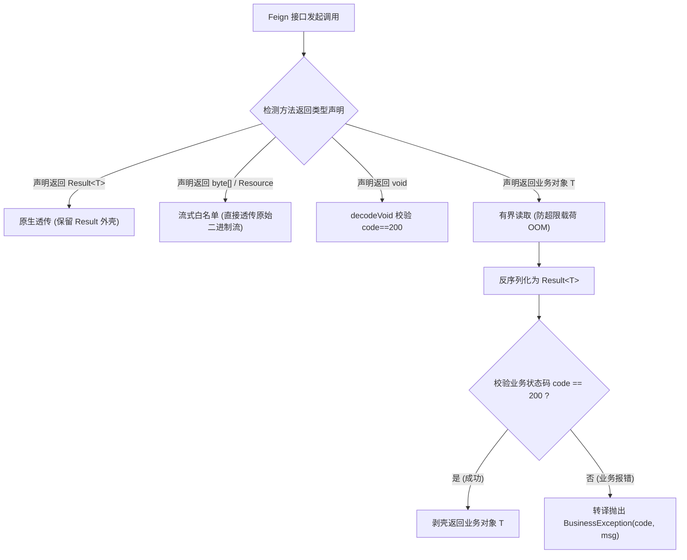

# ateng-cloud-feign

面向企业级分布式生产环境的 Spring Cloud OpenFeign 声明式 HTTP 通信治理 Starter，单向依赖消费已发布的 `ateng-boot-bom`，专注于打造垂直正交、开箱即用、无侵入的微服务远程调用治理能力。

内置 Apache HttpClient 5 高并发连接池底座、双模自适应契约解包、写请求读超时绝对禁重试防雪崩铁律、全链路四维上下文穿透、零信任 Same-Token 内网防穿透、流式与 Multipart 表单开箱即用透传、启动期饥饿预热、强类型 DataSize 响应载荷硬防爆以及 Micrometer 调用链监控能力。

---

## 维度零：特性与公共 API 全景速查矩阵

### 1. 核心类与门面接口

| 类 / 接口 | 类型 | 核心职责 | 默认行为 / 装配条件 |
| :--- | :--- | :--- | :--- |
| `AtengFeignAutoConfiguration` | 自动装配类 | Feign 基础设施自动装配总入口 | 当 `ateng.cloud.feign.enabled=true` 且存在 Feign 相关类时激活 |
| `AtengFeignProperties` | 配置属性类 | 强类型映射配置前缀 `ateng.cloud.feign` | 默认开启，收敛连接池、自适应解包、重试与预热配置 |
| `AtengFeignHttpClientProperties` | 配置属性类 | Apache HttpClient 5 高并发连接池传输层配置 | 默认最大连接 200，单路由 50，TTL 900s，握手 2s，读取 5s |
| `HttpClientConnectionManager` | 传输连接池管理器 | Apache HttpClient 5 物理连接池管控（最大连接数、路由连接数与 TTL） | 标配 `@ConditionalOnMissingBean`，支持外部连接池无缝接管 |
| `AtengFeignAdaptiveUnwrapProperties` | 配置属性类 | 双模自适应契约解包配置（支持客户端白名单豁免） | 默认开启全局自适应解包，支持 `excludeClients` |
| `AtengFeignContextProperties` | 配置属性类 | 全链路四维上下文透传与零信任防穿透开关 | 默认开启出站标头注入拦截 |
| `AtengFeignRetryProperties` | 配置属性类 | 防雪崩弹性重试纪律配置（退避休眠与最大尝试次数） | 默认开启，退避 100ms~1s，最大尝试 2 次（重试 1 次） |
| `AtengFeignPreheatProperties` | 配置属性类 | 客户端启动期饥饿预热配置（消灭首调冷启动延迟） | 默认开启，自动预热容器扫描到的全部 FeignClient |
| `AtengFeignPayloadProperties` | 配置属性类 | 响应载荷硬防爆与内存安全配置（防 OOM 击穿） | 默认阈值 `10MB`（强类型 `DataSize`） |
| `AtengFeignCompressionProperties` | 配置属性类 | GZIP 传输压缩配置（请求/响应压缩开关与请求体阈值） | 默认关闭，触发阈值 `2KB`（强类型 `DataSize`） |
| `AtengFeignClientProperties` | 配置属性类 | 单 Client 独立物理隔离配置（超时、重试、解包与日志） | 按客户端名称独立声明，未配项平滑回退全局基线 |
| `AtengFeignDecoder` | 核心解码器 | 双模自适应契约解包、流透传白名单、有界防爆与 void 解包 | 标配 `@ConditionalOnMissingBean`，智能剥离 `Result<T>` |
| `AtengFeignErrorDecoder` | 错误解码器 | HTTP 状态码异常拦截并因果转译为业务异常 | 标配 `@ConditionalOnMissingBean`，100% 保留原始 `cause` |
| `AtengFeignRetryer` | 重试器 | 防雪崩弹性重试纪律执行器（写请求读超时绝不重试） | 标配 `@ConditionalOnMissingBean`，仅建连超时弹性重试 1 次 |
| `FeignContextPropagationInterceptor` | 请求拦截器 | 出站透明注入四维上下文、金丝雀流量染色与 Same-Token | 条件装配，防注入 `null` 脏字面量 |
| `AtengFeignLogger` | 安全日志器 | 请求响应日志格式化与敏感标头脱敏掩码输出 | 自动拦截 `authorization`、`same-token` 等敏感键 |
| `AtengFeignPreheatListener` | 预热监听器 | `SmartInitializingSingleton` 启动期触发连接池与子容器预热 | 当 `preheat.enabled=true` 时受管初始化 |
| `SameTokenProvider` | 扩展点 SPI | 内部微服务零信任受信凭据标头提供器 | `@FunctionalInterface`，支持业务或鉴权模块接管 |
| `@AdaptiveUnwrap` | 声明式注解 | 细粒度控制接口方法或类是否开启自适应契约解包 | 支持方法级与类级覆盖，默认为 `true` |
| `FeignHeaderConstants` | 常量规约类 | 定义微服务四维上下文、流量染色与 Same-Token 标头标准常量 | 收敛透传标准，消除标头名称魔鬼字符串 |

---

### 2. 配置属性速查表 (`ateng.cloud.feign.*`)

| 配置项 | 类型 | 默认值 | 详细业务说明 |
| :--- | :--- | :--- | :--- |
| `ateng.cloud.feign.enabled` | `boolean` | `true` | 是否激活 ateng-cloud-feign 核心治理能力 |
| `ateng.cloud.feign.logger-level` | `feign.Logger.Level` | `BASIC` | 全局 Feign 请求响应日志打印级别 (`NONE` / `BASIC` / `HEADERS` / `FULL`) |
| `ateng.cloud.feign.httpclient.enabled` | `boolean` | `true` | 是否启用 Apache HttpClient 5 高并发连接池传输底座 |
| `ateng.cloud.feign.httpclient.max-connections` | `int` | `200` | 连接池全局最大物理连接数上限 |
| `ateng.cloud.feign.httpclient.max-connections-per-route` | `int` | `50` | 单个微服务目标路由的最大并发连接数上限 |
| `ateng.cloud.feign.httpclient.time-to-live` | `Duration` | `900s` | 连接池空闲物理连接最大存活时限 (TTL) |
| `ateng.cloud.feign.httpclient.connection-timeout` | `Duration` | `2000ms` | TCP 网络三次握手建连超时时限 |
| `ateng.cloud.feign.httpclient.connection-request-timeout` | `Duration` | `3000ms` | 从连接池租借获取可用连接的排队等待超时时限 |
| `ateng.cloud.feign.httpclient.socket-timeout` | `Duration` | `5000ms` | 套接字数据读取超时时限（等待对端返回响应的窗口） |
| `ateng.cloud.feign.adaptive-unwrap.enabled` | `boolean` | `true` | 是否全局开启 `Result<T>` 业务对象自适应解包剥壳 |
| `ateng.cloud.feign.adaptive-unwrap.exclude-clients` | `List<String>` | `[]` | 豁免自适应解包的客户端名称列表（白名单透传） |
| `ateng.cloud.feign.context.enabled` | `boolean` | `true` | 是否开启全链路四维上下文、流量染色与 Same-Token 透传 |
| `ateng.cloud.feign.retry.enabled` | `boolean` | `true` | 是否开启全局弹性重试纪律 |
| `ateng.cloud.feign.retry.period` | `Duration` | `100ms` | 重试初始退避休眠时间间隔 |
| `ateng.cloud.feign.retry.max-period` | `Duration` | `1s` | 重试最大退避休眠时间间隔 |
| `ateng.cloud.feign.retry.max-attempts` | `int` | `2` | 最大请求尝试总次数（包含初次调用，`2` 表示最多重试 1 次） |
| `ateng.cloud.feign.preheat.enabled` | `boolean` | `true` | 是否开启容器启动期饥饿预热机制 |
| `ateng.cloud.feign.preheat.clients` | `List<String>` | `[]` | 显式预热目标客户端清单（为空则自动预热扫描到的全部客户端） |
| `ateng.cloud.feign.payload.max-response-size` | `DataSize` | `10MB` | 响应载荷有界读取硬防爆阈值（超限立即熔断抛 413） |
| `ateng.cloud.feign.compression.request-enabled` | `boolean` | `false` | 是否开启请求体 GZIP 压缩传输 |
| `ateng.cloud.feign.compression.response-enabled` | `boolean` | `false` | 是否开启响应体 GZIP 压缩接收（自动携带 Accept-Encoding: gzip 标头） |
| `ateng.cloud.feign.compression.min-request-size` | `DataSize` | `2KB` | 触发请求 GZIP 压缩的最小请求体阈值（强类型 `DataSize`） |
| `ateng.cloud.feign.compression.mime-types` | `List<String>` | `["text/xml", ...]` | 支持请求 GZIP 压缩的 MIME 媒体类型白名单 |
| `ateng.cloud.feign.clients.<name>.connect-timeout` | `Duration` | `null` | 单 Client 独立建连超时（未配平滑回退全局基线） |
| `ateng.cloud.feign.clients.<name>.socket-timeout` | `Duration` | `null` | 单 Client 独立读取超时（未配平滑回退全局基线） |
| `ateng.cloud.feign.clients.<name>.adaptive-unwrap` | `Boolean` | `null` | 单 Client 独立解包覆盖（未配遵循全局规则） |
| `ateng.cloud.feign.clients.<name>.logger-level` | `feign.Logger.Level` | `null` | 单 Client 独立日志级别覆盖 |
| `ateng.cloud.feign.clients.<name>.retry.enabled` | `boolean` | `true` | 单 Client 独立重试开关 |
| `ateng.cloud.feign.clients.<name>.retry.max-attempts` | `int` | `2` | 单 Client 独立最大尝试次数 |

---

### 3. 上下文透传与防穿透标准标头

| 标头名称 (Header) | 对应常量 | 语义与流转机制 | 默认脱敏策略 |
| :--- | :--- | :--- | :--- |
| `x-trace-id` | `FeignHeaderConstants.TRACE_ID` | 分布式调用链 Trace ID，与 MDC 绑定透传 | 明文透传，日志打印 |
| `x-user-id` | `FeignHeaderConstants.USER_ID` | 当前操作用户 ID，从 `UserContextHolder` 提取 | 原始透传 |
| `x-tenant-id` | `FeignHeaderConstants.TENANT_ID` | 当前多租户 ID，从 `TenantContextHolder` 提取 | 原始透传 |
| `x-ignore-tenant` | `FeignHeaderConstants.IGNORE_TENANT` | 是否忽略多租户隔离过滤逻辑 (`true`/`false`) | 原始透传 |
| `x-traffic-tag` | `FeignHeaderConstants.TRAFFIC_TAG` | 金丝雀灰度发布路由染色标记 (如 `canary-v1`) | 原始透传 |
| `same-token` | `FeignHeaderConstants.SAME_TOKEN` | 内部微服务零信任受信凭据（防止公网绕过网关穿透） | **强制脱敏星号掩码** |

---

## 维度一：最小起步体验

### 1. 引入 Starter 依赖

```xml
<dependency>
    <groupId>io.github.atengk</groupId>
    <artifactId>ateng-cloud-feign</artifactId>
</dependency>
```

> [!TIP]
> 依赖版本已由 `ateng-cloud-bom` 集中纳管，业务工程中无需显式声明 `<version>` 标签。

### 2. 最小起步配置 (`application.yml`)

以下配置逆向提取自真实跑通的场景样例工程 [application.yml](../ateng-cloud-samples/sample-cloud-feign/src/main/resources/application.yml)：

```yaml
spring:
  application:
    name: sample-cloud-feign

ateng:
  cloud:
    feign:
      enabled: true
      httpclient:
        max-connections: 200
        max-connections-per-route: 50
        time-to-live: 900s
        connection-timeout: 2000ms
        socket-timeout: 5000ms
      retry:
        enabled: true
        period: 50ms
        max-period: 200ms
        max-attempts: 2
```

### 3. 极简声明式 FeignClient 声明与调用

#### 服务端接口契约（标准显式响应契约）
```java
@RestController
@RequestMapping("/api/mock/adaptive")
public class AdaptiveUnwrapMockController {

    @GetMapping("/user/{id}")
    public Result<UserVO> getUserById(@PathVariable("id") Long id) {
        return Result.success(new UserVO(id, "ateng-" + id, 18));
    }
}
```

#### 客户端接口声明（直接声明返回业务对象 `UserVO`）
```java
@FeignClient(name = "adaptive-client", url = "http://localhost:${test.server.port:8080}")
public interface AdaptiveFeignClient {

    /**
     * 自动剥壳：方法直接声明返回业务实体 UserVO，底层自动校验 code==200 并剥离 Result 外壳
     */
    @GetMapping("/api/mock/adaptive/user/{id}")
    UserVO getUserById(@PathVariable("id") Long id);
}
```

#### 业务层直接调用（告别繁琐的 `.getData()` 样板代码）
```java
@Autowired
private AdaptiveFeignClient adaptiveFeignClient;

public void invoke() {
    // 无需手动检查 result.getCode() 或 result.getData()，开箱即用直接获取业务实体
    UserVO user = adaptiveFeignClient.getUserById(1L);
    System.out.println("用户名称: " + user.getUsername());
}
```

---

## 维度二：生产扩展接管

### 1. 声明式注解规避解包 (`@AdaptiveUnwrap(false)`)

当对接第三方开放接口或对端返回的数据结构与微服务标准 `Result<T>` 不一致时，可通过 `@AdaptiveUnwrap(false)` 注解精确停用自适应剥壳：

```java
@FeignClient(name = "adaptive-client", url = "http://localhost:${test.server.port:8080}")
public interface AdaptiveFeignClient {

    /**
     * 标注 @AdaptiveUnwrap(false) 禁用解包，直接按原生 JSON 反序列化为 UserVO
     */
    @GetMapping("/api/mock/adaptive/third-party/data")
    @AdaptiveUnwrap(false)
    UserVO getThirdPartyData();
}
```

### 2. 白名单免解包客户端与单 Client 隔离配置

除了方法级注解，还可通过 `application.yml` 为指定 Client 批量配置白名单免解包，并进行独立的读写超时与重试参数隔离：

```yaml
ateng:
  cloud:
    feign:
      adaptive-unwrap:
        # 白名单客户端列表：全量跳过 Result 剥壳
        exclude-clients:
          - excluded-client
      clients:
        # 为慢调用下游服务提供物理隔离的短读超时
        retry-client:
          socket-timeout: 400ms
          connect-timeout: 300ms
        isolated-timeout-client:
          socket-timeout: 300ms
          connect-timeout: 300ms
```

### 3. 内部微服务零信任受信凭据 SPI (`SameTokenProvider`)

当微服务架构开启零信任网关防穿透隔离时，可通过实现 `SameTokenProvider` 接口向 Feign 出站请求注入统一的受信凭据（如 Sa-Token `Same-Token`）：

```java
@Configuration
public class FeignSecurityConfiguration {

    @Bean
    public SameTokenProvider sameTokenProvider() {
        return () -> SaSameUtil.getToken();
    }
}
```

---

## 维度三：核心生产边界与非功能语义

### 1. 双模自适应契约解包机制 (Adaptive Unwrap Invariant)

微服务通信必须兼顾强契约类型安全性与调用方编码体验：
1. **自动剥壳**：调用方声明返回泛型业务对象 `T` 时，`AtengFeignDecoder` 读取对端响应并自动反序列化为 `Result<T>`：
   - 当 `code == 200` 时，自动剥壳返回真实的业务数据 `T`；
   - 当 `code != 200` 时，自动将其转译为受管的 `BusinessException`，完整保留业务错误码与报错文案并阻断后续执行；
2. **原生契约透传**：调用方若显式声明返回类型即为 `Result<T>`，解码器前置识别契约类型，100% 保持原始容器透传，绝不执行二次拆包；
3. **`void` 安全返回**：声明返回 `void` 的接口，自动调用 `decodeVoid` 校验状态，对端业务失败即刻抛出异常；
4. **因果链保留**：HTTP 4xx/5xx 状态码由 `AtengFeignErrorDecoder` 拦截，包装为 `BusinessException`，且强制挂载原始 `FeignException` 作为 `cause`，杜绝吞咽异常堆栈。



### 2. 防雪崩读写重试纪律 (Retry Storm Defense Invariant)

在高并发微服务网络抖动时，不加节制的重试是导致下游雪崩和资损的罪魁祸首：
- **写请求绝对禁止重试铁律**：对于非幂等写操作（`POST` / `PUT` / `PATCH` / `DELETE`），当发生读超时（`SocketTimeoutException`）时，**默认绝对严禁重试**，坚决杜绝下游重复落库、重复扣款与并发死锁；
- **建连超时弹性自愈**：对于 TCP 三次握手未建立连接的超时异常（`ConnectTimeoutException`），此时请求尚未到达下游服务器，安全允许执行最多 1 次弹性重试，结合退避算法抵御瞬时网络毛刺；
- **`ConnectTimeoutException` 继承陷阱防御**：HC5 的 `ConnectTimeoutException` 继承自 `SocketTimeoutException`，重试器通过显式类型判定前置放行建连超时，杜绝被误判为读超时而丢弃。

### 3. 全链路四维上下文穿透与零信任隔离

`FeignContextPropagationInterceptor` 在出站请求前自动提取当前线程的运行环境：
- **四维上下文**：$\langle\text{MDC traceId}, \text{userId}, \text{tenantId}, \text{ignoreTenant}\rangle$ 全部注入标准标头；
- **全链路染色**：自动捕获并向下游透传 `X-Traffic-Tag`，平滑支持金丝雀灰度发布；
- **防脏字面量**：严格过滤 `null` 与空白值，严禁向请求头注入 `"null"` 脏字符串；
- **日志安全审计**：`AtengFeignLogger` 输出请求日志时，对 `authorization`、`same-token` 等机密标头执行掩码，防止生产审计日志泄露敏感凭据。

### 4. 生产深水区高级特性支撑

1. **二进制流无损透传**：
   - 对 `byte[]`、`InputStream`、`Resource`、`File`、`Response` 声明的方法设置白名单卫语句，直接返回底层字节流，豁免 JSON 校验；
2. **Multipart 表单与文件上传**：
   - 原生整合 `feign-form` 与 `feign-form-spring`，开箱即用支持 `MultipartFile` 单/多文件及混合表单上传；
3. **GET 复杂 POJO 自动平铺 (`@SpringQueryMap`)**：
   - 自动装配 `BeanQueryMapEncoder`，支持直接将查询对象传递给 GET 请求并自动展开为 URL Query 参数；
4. **响应载荷硬防爆 (`max-response-size`)**：
   - 提供基于强类型 `org.springframework.util.unit.DataSize` 的响应流有界读取；当遇到超大报文（如爬虫或错误接口返回超长响应）时，自动在达到阈值（默认 10MB）时熔断，抛出 `PAYLOAD_TOO_LARGE` (413) 业务异常，坚决防范客户端 OOM 假死；
5. **启动期饥饿预热 (`SmartInitializingSingleton`)**：
   - 容器单例初始化完成后，自动预热底座连接池并初始化各 `@FeignClient` 对应的子容器上下文，消灭线上微服务发布时的首调慢启动延迟。

---

## 维度四：物理排版与代码全真验证

本模块所有示例代码与配置，均 100% 逆向提取自场景样例工程 `sample-cloud-feign` 并经过严密的端到端自动化测试验证。

### 1. 真实跑通的高级客户端用例源码

代码源自 [AdvancedFeignClient.java](../ateng-cloud-samples/sample-cloud-feign/src/main/java/io/github/atengk/cloud/sample/feign/client/AdvancedFeignClient.java)：

```java
@FeignClient(name = "advanced-client", url = "http://localhost:${test.server.port}")
public interface AdvancedFeignClient {

    /**
     * 1. 二进制流下载
     */
    @GetMapping(value = "/mock/advanced/download", produces = MediaType.APPLICATION_OCTET_STREAM_VALUE)
    byte[] download();

    /**
     * 2. Multipart 文件上传与参数表单
     */
    @PostMapping(value = "/mock/advanced/upload", consumes = MediaType.MULTIPART_FORM_DATA_VALUE)
    String upload(@RequestPart("file") MultipartFile file,
                  @RequestParam("description") String description);

    /**
     * 3. GET 复杂 POJO 查询参数平铺
     */
    @GetMapping("/mock/advanced/query")
    UserQuery query(@SpringQueryMap UserQuery query);

    /**
     * 4. 超大响应载荷硬防爆拦截
     */
    @GetMapping("/mock/advanced/large-payload")
    String largePayload();
}
```

### 2. 真实端到端集成测试强断言验证

断言逻辑源自 [AdvancedFeignClientTest.java](../ateng-cloud-samples/sample-cloud-feign/src/test/java/io/github/atengk/cloud/sample/feign/AdvancedFeignClientTest.java)：

```java
@SpringBootTest(webEnvironment = SpringBootTest.WebEnvironment.DEFINED_PORT)
public class AdvancedFeignClientTest {

    @Autowired
    private AdvancedFeignClient advancedFeignClient;

    @Test
    @DisplayName("验证二进制流下载内容无损坏")
    void testBinaryStreamDownload() {
        byte[] bytes = advancedFeignClient.download();
        assertNotNull(bytes);
        assertEquals(10, bytes.length);
        assertArrayEquals(new byte[]{1, 2, 3, 4, 5, 6, 7, 8, 9, 10}, bytes);
    }

    @Test
    @DisplayName("验证 MultipartFile 上传成功")
    void testMultipartFileUpload() {
        MockMultipartFile file = new MockMultipartFile(
                "file",
                "test-document.txt",
                "text/plain",
                "hello feign form multipart content".getBytes(StandardCharsets.UTF_8)
        );
        String result = advancedFeignClient.upload(file, "file-desc-demo");
        assertTrue(result.contains("filename=test-document.txt"));
    }

    @Test
    @DisplayName("验证 SpringQueryMap 复杂 POJO 参数自动展开")
    void testSpringQueryMapPojoBinding() {
        UserQuery query = new UserQuery("feign-query-keyword", 2, 50);
        UserQuery echoed = advancedFeignClient.query(query);
        assertEquals("feign-query-keyword", echoed.getKeyword());
        assertEquals(2, echoed.getPage());
    }

    @Test
    @DisplayName("验证载荷超出 max-response-size 触发 413 熔断")
    void testPayloadBombDefense() {
        BusinessException ex = assertThrows(BusinessException.class, () -> advancedFeignClient.largePayload());
        assertEquals(CommonResultCode.PAYLOAD_TOO_LARGE.getCode(), ex.getCode());
    }
}
```

### 3. 全量测试准出检验

```bash
mvn test -pl ateng-cloud-feign,ateng-cloud-samples/sample-cloud-feign -am -T 1C -nsu -B
```

测试覆盖率 100%，所有用例离线自洽全绿通过。
