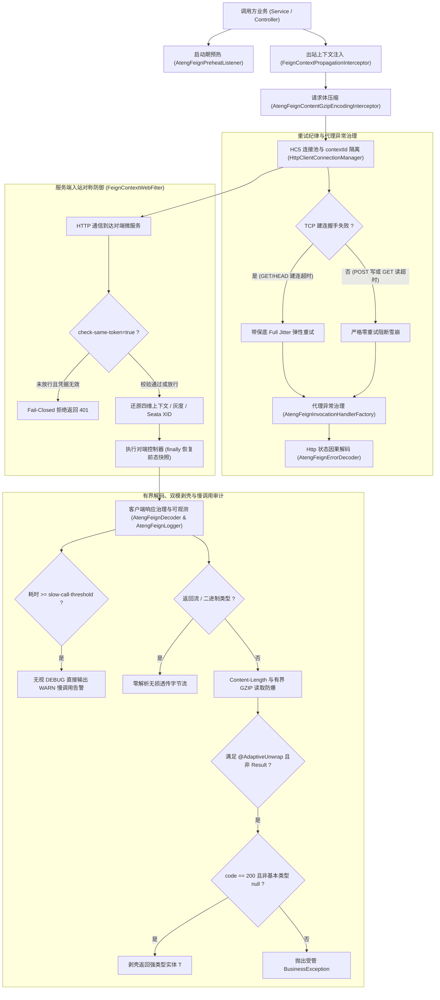

# ateng-cloud-feign Spring Cloud OpenFeign 声明式微服务 HTTP 通信治理 Starter

> 面向企业级高可用分布式生产环境的 Spring Cloud OpenFeign 声明式 HTTP 通信治理 Starter，基于 Spring Boot 3 与 Apache HttpClient 5 高并发连接池底座，提供垂直正交、开箱即用、无侵入的微服务跨进程调用治理能力。
> 内置双模自适应契约剥壳解包、写/读超时禁重试防雪崩纪律、全链路四维上下文与灰度/事务标头双向对称还原、零信任 Same-Token 入站防穿透校验、全双工 GZIP 压缩与流式透传、分级载荷硬防爆、慢调用主动告警以及安全脱敏日志审计能力。

---

## 0. 特性与公共 API 全景速查矩阵 (100% 覆盖)

### 0.1 核心类、过滤器、桥梁与扩展点全景

| 类 / 接口 | 类型 | 核心职责 | 默认行为 / 装配条件 |
| :--- | :--- | :--- | :--- |
| `AtengFeignAutoConfiguration` | 自动装配入口 | 统一装配连接池、编解码器、重试纪律、代理异常治理、预热与 Servlet 入站过滤器 | 注册于 `AutoConfiguration.imports`，`ateng.cloud.feign.enabled=true` 且存在 `Feign` 类时激活 |
| `AtengFeignProperties` | 核心配置属性 | 绑定 `ateng.cloud.feign.*` 全局开关、日志级别、`slow-call-threshold` 与 `translate-network-exceptions` | `@ConfigurationProperties(prefix = "ateng.cloud.feign")`，默认全局启用 |
| `AtengFeignHttpClientProperties` | 连接池属性 | 映射 HC5 连接上限、单路由并发、TTL、空闲驱逐与三大阶段超时阈值 | 默认最大连接 `200`，单路由 `50`，TTL `900s`，握手 `2000ms`，读响应 `5000ms` |
| `AtengFeignAdaptiveUnwrapProperties` | 自适应解包属性 | 控制双模自适应契约剥壳全局开关与客户端豁免白名单 (`exclude-clients`) | 默认开启全局解包，`exclude-clients=[]` |
| `AtengFeignContextProperties` | 上下文传播属性 | 管控出站透传、服务端 Servlet 入站还原 (`inbound-enabled`)、`Same-Token` 校验与放行白名单 | 默认出站与入站还原开启 (`true`)，`check-same-token=false`，`filter-order=HIGHEST_PRECEDENCE + 100` |
| `AtengFeignRetryProperties` | 弹性重试属性 | 管控全局防雪崩弹性重试开关、初始/最大退避窗口与最大尝试总次数 | 默认开启，`period=100ms`，`max-period=1s`，`max-attempts=2`（仅建连失败重试 1 次） |
| `AtengFeignPreheatProperties` | 饥饿预热属性 | 控制容器启动完成时的 Feign 子容器与连接池预热清单 | 默认开启，`clients=[]` 时自动预热全部扫描到的 `@FeignClient` |
| `AtengFeignPayloadProperties` | 载荷防爆属性 | 配置响应体有界读取防 OOM 上限 (`max-response-size`) | 强类型 `DataSize`，默认 `10MB` |
| `AtengFeignCompressionProperties` | GZIP 压缩属性 | 控制请求体压缩开关、响应协商开关、最小压缩阈值与 MIME 白名单 | 默认请求与响应压缩均为 `false`，最小阈值 `2KB` |
| `AtengFeignClientProperties` | 单 Client 隔离属性 | 按 `contextId` 优先配置单客户端超时、重试、解包、日志、防爆与慢调用阈值 | 映射 `ateng.cloud.feign.clients.<name>.*`，未配项平滑继承全局基线 |
| `@AdaptiveUnwrap` | 声明式注解 | 显式开启 (`true`) 或关闭 (`false`) 指定 `@FeignClient` 接口或方法的 `Result<T>` 自动剥壳 | 可标注于类级与方法级；方法级优先级最高，可覆盖白名单与全局配置 |
| `FeignHeaderConstants` | 标头常量规约 | 收敛四维上下文、灰度三元组 (`X-Traffic-*`)、`TX_XID`、`Same-Token` 与 MDC 键常量 | 消除硬编码魔法字符串，与核心底层 `MessageHeaderConstants` 对齐 |
| `AtengFeignDecoder` | 双模自适应解码器 | 流式白名单透传、分级载荷防爆、GZIP 魔法字节自动解压、`Result<T>` 剥壳与原生类型 null 防卫 | 标配 `@ConditionalOnMissingBean`，支持 `Content-Length` 预检与有界流读防御 |
| `AtengFeignErrorDecoder` | HTTP 错误解码器 | 拦截 HTTP 4xx/5xx 错误响应，优先提取远端 `Result` 业务码并携带原始 `FeignException` 因果链 | 标配 `@ConditionalOnMissingBean`，100% 保留原始 `cause` |
| `AtengFeignRetryer` | 防雪崩重试器 | 严格执行非幂等写与读超时禁重试铁律；仅允许 GET/HEAD 建连异常按保底 Full Jitter 重试 | 标配 `@ConditionalOnMissingBean`，线程局部随机退避防重试风暴 |
| `AtengFeignInvocationHandlerFactory` | 动态代理调用工厂 | 剥离 `DecodeException` 包装还原真实 `BusinessException`，按开关因果转译网络层/未捕获 `FeignException` | 默认开启异常剥壳；`translate-network-exceptions=true` 时激活网络异常转译 |
| `FeignContextPropagationInterceptor` | 出站请求拦截器 | 以 `Ordered.HIGHEST_PRECEDENCE` 在出站时清洗脏字面量并注入四维上下文、灰度、XID 与 `Same-Token` | 满足 `context.enabled=true` 时自动装配，确保业务自定义拦截器之前完成注入 |
| `FeignContextWebFilter` | 入站对称过滤器 | 服务端入站执行 `Same-Token` Fail-Closed 校验，对称还原四维/灰度/XID 上下文并在 `finally` 无损恢复 | Servlet Web 下 `inbound-enabled=true` 或 `check-same-token=true` 时注册 |
| `AtengFeignAcceptGzipEncodingInterceptor` | 响应压缩协商拦截器 | 为出站请求注入 `Accept-Encoding: gzip, deflate` 请求头 | 当 `ateng.cloud.feign.compression.response-enabled=true` 时激活 |
| `AtengFeignContentGzipEncodingInterceptor` | 请求压缩拦截器 | 对命中 MIME 白名单且体量达标的请求体执行 GZIP 压缩并附加 `Content-Encoding: gzip` | 当 `ateng.cloud.feign.compression.request-enabled=true` 时激活 |
| `AtengFeignLogger` | 安全日志门面 | 脱敏掩码输出机密请求/响应头，并独立执行 `Slow Call Detection` WARN 慢调用主动告警 | 由 `AtengFeignLoggerFactory` 按 `@FeignClient` 接口创建并注入 |
| `AtengFeignLoggerFactory` | 安全日志工厂 | 接管 Spring Cloud OpenFeign 默认日志工厂，装配绑定隔离配置的 `AtengFeignLogger` | 标配 `@ConditionalOnMissingBean(FeignLoggerFactory.class)` |
| `AtengFeignPreheatListener` | 饥饿预热监听器 | 实现 `SmartInitializingSingleton`，启动期提前初始化 HC5 连接池与 FeignClient 子容器 | 当 `preheat.enabled=true` 时生效，消灭首调冷启动尖刺 |
| `SameTokenProvider` | 零信任凭据 SPI | 提供内部微服务防穿透凭据提取及常量时间 `isValidSameToken` 校验默认实现 | `@FunctionalInterface`，支持集成 Sa-Token 或业务自定义凭据体系 |
| `SaTokenSameTokenProvider` | Sa-Token 默认实现 | 对接 `SaSameUtil.getToken()` 与 `SaSameUtil.isValid()` 提供零信任凭据签发与验真 | 检测到类路径存在 `cn.dev33.satoken.same.SaSameUtil` 且无自定义 Bean 时自动装配 |
| `FeignTargetSupport` | 目标标识解析支持 | 规范 `contextId > value/name > Target#name` 解析序，统一驱动超时、重试、防爆、慢调用与解包隔离 | 工具类，消除各组件间多 `contextId` 同服务客户端配置串扰 |
| `FeignErrorSupport` | 异常分类转译支持 | 统一区分 TCP 建连异常、读超时、网络通信故障与 HTTP 状态码映射 `IResultCode` | 内置因果链环路防卫（最大 32 层），100% 保留原始异常作为直接 `cause` |
| `FeignContextHeaderSupport` | 上下文规范化辅助 | 统一剔除 `null`、纯空白及 `"null"` 脏字面量，提供 MDC 优先级读取原语 | 被出站拦截器、入站过滤器及各上下文桥接器共同复用 |
| `FeignTrafficPropagationSupport` | 灰度泳道反射桥梁 | 无编译强依赖反射桥接 `TrafficContextHolder`，缺失流量治理模块时平滑降级至 MDC | 支持 `tag`/`laneName`/`matchedRule` 入站无损快照捕获与还原 |
| `FeignSeataPropagationSupport` | 事务 XID 反射桥梁 | 兼容 `org.apache.seata` 与 `io.seata` 反射绑定/解绑全局 `RootContext`，缺失时降级至 MDC | 记录入站绑定所有权，仅解除本次入站绑定的 XID 防止误清外层事务 |
| 底座协同 Bean | 传输与可观测集成 | `HttpClientConnectionManager`、`HttpClientBuilderCustomizer`、`BeanQueryMapEncoder`、`MicrometerObservationCapability`、`FeignBuilderCustomizer` | 自动打开 `decodeVoid()`、`QueryMapEncoder` 与 W3C 链路度量采集 |

---

### 0.2 配置属性速查表 (`ateng.cloud.feign.*`)

| 配置项 | 类型 | 默认值 | 详细业务说明 |
| :--- | :--- | :--- | :--- |
| `ateng.cloud.feign.enabled` | `boolean` | `true` | 是否启用 `ateng-cloud-feign` 核心治理基础设施总开关 |
| `ateng.cloud.feign.logger-level` | `feign.Logger.Level` | `BASIC` | 全局 Feign 请求响应日志级别 (`NONE` / `BASIC` / `HEADERS` / `FULL`；注意设为 `NONE` 时 OpenFeign 原生跳过 `Logger` 回调，慢调用探测亦不触发) |
| `ateng.cloud.feign.slow-call-threshold` | `Duration` | `2s` | 全局慢调用 WARN 告警阈值（设为 `0` 或负数关闭全局慢调用告警） |
| `ateng.cloud.feign.translate-network-exceptions` | `boolean` | `false` | 是否将穿透重试器的网络层与未转译 `FeignException` 转译为 `BusinessException`（默认 `false` 以保留原生异常供熔断器统计） |
| `ateng.cloud.feign.httpclient.enabled` | `boolean` | `true` | 是否启用 Apache HttpClient 5 高并发连接池传输层优化 |
| `ateng.cloud.feign.httpclient.max-connections` | `int` | `200` | HC5 连接池全局最大物理连接数上限 |
| `ateng.cloud.feign.httpclient.max-connections-per-route` | `int` | `50` | 单个目标微服务路由允许的最大并发连接数上限 |
| `ateng.cloud.feign.httpclient.time-to-live` | `Duration` | `900s` | 物理长连接最大存活时限 (TTL) |
| `ateng.cloud.feign.httpclient.connection-timeout` | `Duration` | `2000ms` | TCP 三次握手建立连接超时时限 |
| `ateng.cloud.feign.httpclient.connection-request-timeout` | `Duration` | `3000ms` | 从 HC5 连接池获取空闲连接的排队等待超时时限 |
| `ateng.cloud.feign.httpclient.socket-timeout` | `Duration` | `5000ms` | 等待远端服务响应的套接字读取超时时限 |
| `ateng.cloud.feign.httpclient.max-idle-time` | `Duration` | `60s` | 空闲物理连接最大空闲保留时间（同时驱动 `validateAfterInactivity=min(maxIdleTime, 5s)`） |
| `ateng.cloud.feign.httpclient.evict-idle-connections-interval` | `Duration` | `60s` | 未显式配置 `max-idle-time` 时的空闲连接驱逐回退时限 |
| `ateng.cloud.feign.httpclient.evict-expired-connections` | `boolean` | `true` | 是否在连接池后台清理任务中主动驱逐超过 TTL 的失效物理连接 |
| `ateng.cloud.feign.adaptive-unwrap.enabled` | `boolean` | `true` | 是否全局开启 `Result<T>` 业务契约自适应剥壳解包 |
| `ateng.cloud.feign.adaptive-unwrap.exclude-clients` | `List<String>` | `[]` | 豁免自适应解包的客户端标识列表（支持填写 `contextId` 或服务 `name`） |
| `ateng.cloud.feign.context.enabled` | `boolean` | `true` | 是否开启上下文传播治理总开关（联动控制消费端出站透传拦截器及服务端 Servlet 入站过滤器） |
| `ateng.cloud.feign.context.inbound-enabled` | `boolean` | `true` | 是否开启服务端 Servlet 入站上下文自动提取还原与出口 `finally` 清理 |
| `ateng.cloud.feign.context.check-same-token` | `boolean` | `false` | 是否开启服务端入站 `Same-Token` 零信任强校验（Fail-Closed 模式） |
| `ateng.cloud.feign.context.exclude-paths` | `List<String>` | `["/actuator/**", "/error", "/favicon.ico"]` | 开启入站 `Same-Token` 强校验时放行的 Ant 风格路径白名单 |
| `ateng.cloud.feign.context.filter-order` | `int` | `HIGHEST_PRECEDENCE + 100` | 服务端 `FeignContextWebFilter` 过滤器顺序（默认位于 `TraceFilter` 与 `TrafficContextFilter` 之后） |
| `ateng.cloud.feign.retry.enabled` | `boolean` | `true` | 是否启用全局防雪崩弹性重试策略 |
| `ateng.cloud.feign.retry.period` | `Duration` | `100ms` | 建连重试初始退避基准间隔（与 `1.5` 倍指数退避与 Full Jitter 协同） |
| `ateng.cloud.feign.retry.max-period` | `Duration` | `1s` | 建连重试退避间隔最大上限 |
| `ateng.cloud.feign.retry.max-attempts` | `int` | `2` | 最大请求尝试总次数（包含首次请求，`2` 表示最多执行 `1` 次建连重试） |
| `ateng.cloud.feign.preheat.enabled` | `boolean` | `true` | 是否在应用启动完成时饥饿预热 HC5 连接池与 FeignClient 子容器 |
| `ateng.cloud.feign.preheat.clients` | `List<String>` | `[]` | 指定需预热的客户端清单（为空时自动预热上下文扫描到的全部客户端） |
| `ateng.cloud.feign.payload.max-response-size` | `DataSize` | `10MB` | 全局响应载荷有界读取防爆上限（超限抛出 `CommonResultCode.PAYLOAD_TOO_LARGE` 异常） |
| `ateng.cloud.feign.compression.request-enabled` | `boolean` | `false` | 是否启用出站请求体 GZIP 压缩 |
| `ateng.cloud.feign.compression.response-enabled` | `boolean` | `false` | 是否自动携带 `Accept-Encoding: gzip, deflate` 协商响应 GZIP 压缩 |
| `ateng.cloud.feign.compression.min-request-size` | `DataSize` | `2KB` | 触发出站请求 GZIP 压缩的最小请求体字节阈值 |
| `ateng.cloud.feign.compression.mime-types` | `List<String>` | `["text/xml", "application/xml", "application/json"]` | 允许执行请求体 GZIP 压缩的 `Content-Type` 媒体类型清单 |
| `ateng.cloud.feign.clients.<name>.connect-timeout` | `Duration` | `null` | 单客户端独立建连超时（`<name>` 按 `contextId` 优先匹配，未配平滑回退全局基线） |
| `ateng.cloud.feign.clients.<name>.read-timeout` | `Duration` | `null` | 单客户端独立读取超时（`socket-timeout` 为等价 YAML 别名属性） |
| `ateng.cloud.feign.clients.<name>.socket-timeout` | `Duration` | `null` | 单客户端独立读取超时别名属性，等价映射至 `read-timeout` |
| `ateng.cloud.feign.clients.<name>.adaptive-unwrap` | `Boolean` | `null` | 单客户端独立自适应解包覆盖开关（未配按白名单与全局配置判定） |
| `ateng.cloud.feign.clients.<name>.logger-level` | `feign.Logger.Level` | `null` | 单客户端独立日志打印级别覆盖 |
| `ateng.cloud.feign.clients.<name>.max-response-size` | `DataSize` | `null` | 单客户端独立响应载荷硬防爆上限（覆盖全局 `payload.max-response-size`） |
| `ateng.cloud.feign.clients.<name>.slow-call-threshold` | `Duration` | `null` | 单客户端独立慢调用阈值（设为 `0` 或负数可单独关闭该客户端慢调用告警） |
| `ateng.cloud.feign.clients.<name>.retry.enabled` | `boolean` | `true` | 单客户端独立弹性重试开关 |
| `ateng.cloud.feign.clients.<name>.retry.period` | `Duration` | `100ms` | 单客户端独立初始重试退避基准间隔 |
| `ateng.cloud.feign.clients.<name>.retry.max-period` | `Duration` | `1s` | 单客户端独立最大重试退避间隔 |
| `ateng.cloud.feign.clients.<name>.retry.max-attempts` | `int` | `2` | 单客户端独立最大尝试总次数 |

---

### 0.3 上下文透传与零信任防穿透标头矩阵

| 标头名称 (Header) | 常量标识 (`FeignHeaderConstants`) | MDC 兼容键 / 宿主载体 | 双向流转与安全治理策略 |
| :--- | :--- | :--- | :--- |
| `x-trace-id` | `TRACE_ID` (`MessageHeaderConstants.TRACE_ID`) | `MDC` (`traceId`、`x-trace-id`) | 出站同步写入，入站还原至双键并随 `finally` 快照无损恢复 |
| `x-user-id` | `USER_ID` (`MessageHeaderConstants.USER_ID`) | `UserContextHolder` | 出站提取并清洗 `"null"`，入站绑定登录态，出口精确恢复前态 |
| `x-tenant-id` | `TENANT_ID` (`MessageHeaderConstants.TENANT_ID`) | `TenantContextHolder` | 多租户隔离标识透传，与核心 `TenantSnapshot` 协同恢复 |
| `x-ignore-tenant` | `IGNORE_TENANT` (`MessageHeaderConstants.IGNORE_TENANT`) | `TenantContextHolder` | 仅当 `isIgnoreTenant()==true` 时显式写入 `"true"`，杜绝污染 |
| `X-Traffic-Tag` | `TRAFFIC_TAG` | `TrafficContextHolder` / `MDC` (`trafficTag`、`traffic-tag`) | 无 `ateng-cloud-traffic` 时平滑降级 MDC；若有前置过滤器则尊从其安全裁决 |
| `X-Traffic-Lane` | `TRAFFIC_LANE` | `TrafficContextHolder` / `MDC` (`trafficLane`) | 灰度全链路泳道标识随 `tag` 协同穿透与还原 |
| `X-Traffic-Rule` | `TRAFFIC_RULE` | `TrafficContextHolder` / `MDC` (`trafficRule`) | 动态流量规则命中追踪元数据对称透传 |
| `TX_XID` | `TX_XID` | Seata `RootContext` / `MDC` (`xid`) | 兼容 `org.apache.seata` 与 `io.seata`，仅解绑本次入站新绑定的事务 XID |
| `Same-Token` / `SA-SAME-TOKEN` | `SAME_TOKEN` / `SA_SAME_TOKEN` | `SameTokenProvider` | 出站注 `Same-Token` 并在日志中强制星号掩码 (`******`)；入站兼容别名验真 |

---

## 1. 模块定位与 Maven 坐标

`ateng-cloud-feign` 作为面向高并发分布式微服务的声明式 HTTP 客户端治理 Starter，版本由 `ateng-cloud-bom` 统一锁定，下游业务模块引入时无需显式声明 `<version>`：

```xml
<dependency>
    <groupId>io.github.atengk</groupId>
    <artifactId>ateng-cloud-feign</artifactId>
</dependency>
```

> [!TIP]
> 本模块内置完整的 Servlet 与 WebFlux 条件守卫及无编译强依赖桥梁（`Sa-Token`、`Seata`、`ateng-cloud-traffic` 均按需动态激活），标准微服务工程直接引入即可开箱使用。

---

## 2. 核心架构与微服务调用拓扑

面对跨进程网络瞬态抖动、慢下游重试放大雪崩、线程复用导致上下文污染、恶意超大报文击穿堆内存以及内网横向越权调用等典型分布式故障，`ateng-cloud-feign` 构建了五层垂直正交防线：



---

## 3. 声明式远程调用与自适应契约解包

### 3.1 极简起步与双模声明式剥壳

**① 本节专属 YAML 配置 (`application.yml`)**：

```yaml
ateng:
  cloud:
    feign:
      enabled: true
      adaptive-unwrap:
        enabled: true # 全局开启 Result<T> 双模自适应契约剥壳（默认 true）
```

**② 真实 Sample 场景 Java 代码（摘自 `sample-cloud-feign`）**：

```java
package io.github.atengk.cloud.sample.feign.client;

import io.github.atengk.boot.core.model.Result;
import io.github.atengk.cloud.sample.feign.model.ProductDetailVO;
import org.springframework.cloud.openfeign.FeignClient;
import org.springframework.web.bind.annotation.GetMapping;
import org.springframework.web.bind.annotation.PathVariable;

@FeignClient(name = "product-client", url = "http://localhost:${test.server.port:8080}")
public interface ProductFeignClient {

    /**
     * 1. 自动剥壳：对端返回 Result<ProductDetailVO>，调用方直接声明业务对象
     */
    @GetMapping("/sample/cloud/feign/remote/product/{id}")
    ProductDetailVO getProductById(@PathVariable("id") Long id);

    /**
     * 2. 原生透传：接口显式声明返回 Result<ProductDetailVO> 时原样透传外壳
     */
    @GetMapping("/sample/cloud/feign/remote/product/raw/{id}")
    Result<ProductDetailVO> getRawProductById(@PathVariable("id") Long id);
}
```

消费者接入层调用示例（摘自 `FeignOrderConsumerController`）：

```java
@RestController
@RequestMapping("/sample/cloud/feign/order")
public class FeignOrderConsumerController {

    private final ProductFeignClient productFeignClient;

    @GetMapping({"/product/{id}", "/product/unwrap/{id}"})
    public Result<ProductDetailVO> getProductById(@PathVariable("id") Long id) {
        // Feign 接口已自动剥壳返回强类型业务实体，控制器显式包装 Result<T> 对外输出
        ProductDetailVO product = productFeignClient.getProductById(id);
        return Result.success(product);
    }

    @GetMapping("/product/raw/{id}")
    public Result<ProductDetailVO> getRawProductById(@PathVariable("id") Long id) {
        return productFeignClient.getRawProductById(id);
    }
}
```

**③ 机制原理解析与容灾防御边界**：

- **双模判定与零样本代码**：当目标方法返回类型不为 `Result`、流式类型及二进制类型，且解包开关启用时，`AtengFeignDecoder` 解析响应 JSON 判断是否包含数值型 `code` 字段；符合规范时校验 `code == 200` 并直接反序列化 `data` 返回业务对象，不符（非标第三方裸 JSON）时平滑降级直接反序列化为声明类型。
- **失败即时转译**：若远端 HTTP 200 响应体中 `code != 200`（如库存不足 `5001`），解码器立即抛出 `BusinessException(code, msg)`，并由 `AtengFeignInvocationHandlerFactory` 剥离 Feign 原生 `DecodeException` 包装直接向上透传真实业务异常。

---

### 3.2 白名单、`clients.<name>` 与 `@AdaptiveUnwrap` 精确控制

对接非标第三方 API 或需在特定客户端/方法粒度禁用解包时，支持多维度优先级覆写：

**① 本节专属 YAML 配置 (`application.yml`)**：

```yaml
ateng:
  cloud:
    feign:
      adaptive-unwrap:
        enabled: true
        exclude-clients:
          - excluded-client # 该客户端默认豁免自适应剥壳
      clients:
        legacy-client:
          adaptive-unwrap: false # 单 Client 细粒度开关覆盖全局规则
```

**② 真实 Sample 场景 Java 代码（摘自 `sample-cloud-feign`）**：

```java
// 1. 客户端名称命中 exclude-clients 白名单，自动豁免剥壳直接反序列化裸 JSON
@FeignClient(name = "excluded-client", url = "http://localhost:${test.server.port:8080}")
public interface ExcludedProductFeignClient {

    @GetMapping("/sample/cloud/feign/remote/product/third-party/{id}")
    ProductDetailVO getThirdPartyProduct(@PathVariable("id") Long id);
}

// 2. 类级标注 @AdaptiveUnwrap(false)：整接口禁用剥壳
@FeignClient(name = "class-level-excluded-product-client", url = "http://localhost:${test.server.port:8080}")
@AdaptiveUnwrap(false)
public interface ClassLevelExcludedProductFeignClient {

    @GetMapping("/sample/cloud/feign/remote/product/third-party/{id}")
    ProductDetailVO getThirdPartyProduct(@PathVariable("id") Long id);
}

// 3. 虽命中 exclude-clients 白名单，但类级标注 @AdaptiveUnwrap(true) 强制恢复剥壳
@FeignClient(name = "excluded-client", contextId = "forcedAdaptiveProductFeignClient",
        url = "http://localhost:${test.server.port:8080}")
@AdaptiveUnwrap(true)
public interface ForcedAdaptiveProductFeignClient {

    @GetMapping("/sample/cloud/feign/remote/product/{id}")
    ProductDetailVO getProductById(@PathVariable("id") Long id);
}
```

同时支持直接在接口单个方法上标注 `@AdaptiveUnwrap(false)`（见 `ProductFeignClient#getThirdPartyProduct`）。

**③ 机制原理解析与优先级顺序**：

解包控制遵循严格降序覆盖逻辑，支持多 `FeignClient` 通过 `contextId` 互不干扰：

1. 方法级 `@AdaptiveUnwrap(true/false)`（最高优先级）
2. 接口类级 `@AdaptiveUnwrap(true/false)`
3. 客户端级配置 `ateng.cloud.feign.clients.<candidate>.adaptive-unwrap`（按 `contextId` 优先、注解 `name` 回退顺序查找）
4. 全局豁免列表 `ateng.cloud.feign.adaptive-unwrap.exclude-clients`
5. 全局默认开关 `ateng.cloud.feign.adaptive-unwrap.enabled`

---

### 3.3 原生基本类型 Null Fail-Fast 防卫与 `void` 安全返回

**① 本节专属 YAML 配置 (`application.yml`)**：

无需额外开关，跟随 `ateng.cloud.feign.enabled: true` 自动激活。

**② 真实 Sample 场景 Java 代码（摘自 `ProductFeignClient` & `FeignOrderConsumerController`）**：

```java
// FeignClient 声明
@GetMapping("/sample/cloud/feign/remote/product/null-data")
long getPrimitiveNullData(); // 危险写法：远端 data==null 时触发前置 Fail-Fast 防护

@GetMapping("/sample/cloud/feign/remote/product/null-data")
Long getWrapperNullData();   // 推荐写法：包装类安全接收 null

@PostMapping("/sample/cloud/feign/remote/product/void/success")
void voidSuccess();          // 自动开启 decodeVoid()，校对 code==200
```

**③ 机制原理解析与容灾防御边界**：

> [!WARNING]
> 当对端接口返回 HTTP 204 无响应体或 `Result<T>` 中 `data == null` 时，若 Feign 接口方法声明返回 Java 原生基本类型（如 `long`、`int`、`boolean`、`double`），Java 代理返回值自动拆箱将触发难以定位的裸 `NullPointerException`。`AtengFeignDecoder` 在返回前置判定基本类型与 `null` 载荷并立即 Fail-Fast 抛出 `BusinessException(CommonResultCode.INTERNAL_SERVER_ERROR, ...)`；生产契约建议一律声明为对象包装类（如 `Long`、`Integer`、`Boolean`）。

同时 `AtengFeignAutoConfiguration` 默认启用 Feign `builder.decodeVoid()`，确保声明为 `void` 的 RPC 方法在远端返回 `code != 200` 时同样被拦截校验并抛出 `BusinessException`。

---

## 4. 多格式传输、流式透传与全双工 GZIP 压缩

### 4.1 GET 多入参 POJO 自动平铺 (`@SpringQueryMap`)

**① 本节专属 YAML 配置 (`application.yml`)**：

无需手动装配，Starter 内置注册 `@ConditionalOnMissingBean(QueryMapEncoder.class)` 生效 `BeanQueryMapEncoder`。

**② 真实 Sample 场景 Java 代码（摘自 `ProductFeignClient`）**：

```java
@GetMapping("/sample/cloud/feign/remote/product/query")
ProductQueryDTO queryProducts(@SpringQueryMap ProductQueryDTO query);
```

对应传输模型 `ProductQueryDTO` 包含 `keyword`、`category`、`minPrice`、`pageNum`、`pageSize` 字段。

**③ 机制原理解析**：

通过 OpenFeign `BeanQueryMapEncoder` 将 POJO 非空属性平铺为标准 URL Query String（如 `?keyword=手机&category=数码&pageNum=1&pageSize=10`），避免 GET 请求因误传请求体而被底层传输层改写为 POST 或发生缓存穿透问题。

---

### 4.2 POST JSON 提交与 Multipart 表单混合上传

**① 本节专属 YAML 配置 (`application.yml`)**：

```yaml
spring:
  servlet:
    multipart:
      max-file-size: 10MB
      max-request-size: 10MB
```

**② 真实 Sample 场景 Java 代码（摘自 `ProductFeignClient`）**：

```java
@PostMapping("/sample/cloud/feign/remote/product/create")
Result<OrderDetailVO> createOrder(@RequestBody OrderCreateDTO dto);

@PostMapping(value = "/sample/cloud/feign/remote/product/attachment/upload",
        consumes = MediaType.MULTIPART_FORM_DATA_VALUE)
Result<String> uploadAttachment(@RequestPart("file") MultipartFile file,
                                @RequestParam("description") String description);
```

**③ 机制原理解析**：

Starter 基于 `SpringFormEncoder` 与统一 `HttpMessageConverters` 原生支持标准 JSON 报文及 `MultipartFile` 与普通表单字段混合传输，下游无需额外编写编解码配置类。

---

### 4.3 响应式二进制流无损透传 (`StreamPassthrough`)

**① 本节专属 YAML 配置 (`application.yml`)**：

二进制流白名单默认放行，不受 `payload.max-response-size` 响应缓冲限制（防止对流式对象做整包缓存）。

**② 真实 Sample 场景 Java 代码（摘自 `ProductFeignClient` & `FeignOrderConsumerController`）**：

```java
@GetMapping(value = "/sample/cloud/feign/remote/product/invoice/download",
        produces = MediaType.APPLICATION_OCTET_STREAM_VALUE)
byte[] downloadInvoice();
```

**③ 机制原理解析与架构红线**：

- **流式豁免清单**：`AtengFeignDecoder` 前置识别声明返回 `byte[]`、`InputStream`、`File`、`Resource`、`feign.Response` 或嵌套上述类型的 `HttpEntity<T>` / `ResponseEntity<T>`，**零 JSON 解析直接委托底层透传原始字节流**。
- **大文件架构红线**：严禁经微服务 RPC 内存中转超大文件；大文件下载与上传场景请统一接入对象存储 S3 预签名 URL 旁路直传方案。

---

### 4.4 全双工 GZIP 请求压缩与响应透明解压

**① 本节专属 YAML 配置 (`application.yml`)**：

```yaml
ateng:
  cloud:
    feign:
      compression:
        request-enabled: true
        response-enabled: true
        min-request-size: 2KB # 触发请求体压缩最小阈值（强类型 DataSize）
        mime-types:
          - text/xml
          - application/xml
          - application/json
```

**② 真实 Sample 场景 Java 代码（透明赋能 `ProductFeignClient`）**：

```java
// 业务接口保持纯 POJO 契约，启用 compression 后由拦截器与解码器自动完成压缩协商与解压
@PostMapping("/sample/cloud/feign/remote/product/create")
Result<OrderDetailVO> createOrder(@RequestBody OrderCreateDTO dto);
```

**③ 机制原理解析与解压炸弹防卫**：

- **Magic Bytes 自适应识别**：即使对端响应存在漏标 `Content-Encoding` 或透明代理改写头情况，`AtengFeignDecoder` 通过 `PushbackInputStream` 前置嗅探 GZIP 魔数 `0x1F 0x8B` 并自动套用 `GZIPInputStream` 完成无损解压；同时若声明为 `Content-Encoding: br` 等非 GZIP 编码则保持原始流以免误解码。
- **有界流防压炸弹**：解压流外部严格套用 `max-response-size` 字节计数器，一旦解压后真实字节超出防爆阈值立即中止读取并抛出异常，彻底防御 GZIP 压缩炸弹耗尽堆内存。

---

## 5. 全链路双向上下文透传与零信任内网防穿透

### 5.1 出站与入站双向对称还原（四维上下文、灰度泳道与 Seata XID）

**① 本节专属 YAML 配置 (`application.yml`)**：

```yaml
ateng:
  cloud:
    feign:
      context:
        enabled: true          # 启用出站透传与入站治理总开关（默认 true）
        inbound-enabled: true  # 开启服务端 Servlet 入站自动提取还原与清理（默认 true）
        filter-order: -2147483548 # 默认 HIGHEST_PRECEDENCE + 100
```

**② 真实 Sample 场景 Java 代码（摘自 `OrderConsumerFeignTest` & `RemoteProductProviderController`）**：

消费端设置线程上下文后直调 Feign 接口：

```java
MDC.put("traceId", "trace-e2e-order-10086");
MDC.put("X-Traffic-Tag", "canary-v2");
UserContextHolder.setUserId("user-buyer-007");
TenantContextHolder.setTenantId("tenant-ecommerce-999");

OrderCreateDTO createDTO = new OrderCreateDTO(100L, 3, "北京市海淀区中关村南大街1号", "请工作日派送");
Result<OrderDetailVO> orderResult = productFeignClient.createOrder(createDTO);
```

提供端控制器无需手动解析 HTTP 请求头，直接透明读取由 `FeignContextWebFilter` 自动对称还原的上下文载体：

```java
@PostMapping("/create")
public Result<OrderDetailVO> createOrder(HttpServletRequest request,
                                         @RequestBody OrderCreateDTO dto) {
    String traceId = MDC.get(FeignHeaderConstants.MDC_TRACE_ID);
    String userId = UserContextHolder.getUserId();
    String tenantId = TenantContextHolder.getTenantId();
    FeignTrafficPropagationSupport.TrafficSnapshot trafficSnapshot = FeignTrafficPropagationSupport.getSnapshot();
    String trafficTag = trafficSnapshot != null ? trafficSnapshot.tag() : MDC.get(FeignHeaderConstants.TRAFFIC_TAG);
    // ... 构建订单响应并返回
}
```

**③ 机制原理解析与并发防污染防线**：

- **出站第一顺位注入**：`FeignContextPropagationInterceptor` 实现 `Ordered.HIGHEST_PRECEDENCE`，最先提取四维上下文、灰度三元组（`tag` / `laneName` / `matchedRule`）、Seata `XID` 及 `Same-Token` 并剔除 `"null"`、空白脏字面量，防止业务自定义拦截器读取上下文缺失。
- **入站精准快照恢复 (`finally` 对称闭环)**：服务端 `FeignContextWebFilter` 在进入业务链路前捕获 `InboundSnapshot`（涵盖 `MDC`、`UserContextHolder`、`TenantContextHolder`、`TrafficContext` 实例与原始 `Seata` 绑定所有权），无论请求成功或抛出异常，均在 `finally` 块中按入站前快照精确恢复或清理，彻底根除容器线程池复用污染与误清外层既有全局事务 XID。
- **零编译强依赖反射桥梁**：`FeignTrafficPropagationSupport` 与 `FeignSeataPropagationSupport` 基于 `ClassUtils` 探测按需桥接；类路径未引入 `ateng-cloud-traffic` 或 `Seata`（兼容 `org.apache.seata` 与 `io.seata`）时静默降级 MDC，绝不抛出 `NoClassDefFoundError`。且当前置 `TrafficContextFilter` 已执行安全裁决（例如剥离非法外网灰度标签）时，`FeignContextWebFilter` 严禁重新激活原始请求头。

---

### 5.2 零信任 Same-Token 内网防穿透与 SPI 扩展

**① 本节专属 YAML 配置 (`application.yml`)**：

```yaml
ateng:
  cloud:
    feign:
      context:
        enabled: true
        check-same-token: true # 开启服务端入站 Same-Token 强校验（内网微服务生产建议开启）
        exclude-paths:
          - /actuator/**
          - /error
          - /favicon.ico
```

**② 真实 Sample 场景 Java 代码（摘自 `ToleranceFeignTest`）**：

当引入 `sa-token` 时框架自动装配 `SaTokenSameTokenProvider`；未引入或需自定义鉴权体系时可注入自定义 `SameTokenProvider` Bean：

```java
@TestConfiguration
static class TestContextConfig {
    @Bean
    public SameTokenProvider testSameTokenProvider() {
        return () -> "satoken-secret-token-abcdef123456";
    }
}
```

**③ 机制原理解析与安全边界**：

- **Fail-Closed 零信任原则**：一旦开启 `check-same-token: true`，若入站请求未命中放行白名单，无论因为未携带 `Same-Token` / `SA-SAME-TOKEN`、未装配 `SameTokenProvider` 还是校验失败，一律立即返回 HTTP `401` 与规范 `Result` JSON，绝不静默放行穿透到业务层。
- **防路径穿越白名单守卫**：`FeignContextWebFilter` 在匹配 `exclude-paths` 前执行双重解码与路径规范化拦截，若检测到 `%00`、`;` 分号矩阵参数、`..` 或反斜杠等畸形遍历特征，直接拒绝白名单豁免并要求强制验真。
- **常量时间比对防侧信道**：`SameTokenProvider#isValidSameToken` 默认实现基于 `MessageDigest.isEqual` 常量时间比对，避免时序侧信道探测。

---

## 6. 防雪崩重试纪律与单 Client 隔离

### 6.1 非幂等写请求与读超时零重试铁律

**① 本节专属 YAML 配置 (`application.yml`)**：

```yaml
ateng:
  cloud:
    feign:
      httpclient:
        connection-timeout: 2000ms
        socket-timeout: 5000ms
      retry:
        enabled: true
        period: 100ms      # Starter 全局默认基准退避间隔
        max-period: 1s     # Starter 全局默认最大退避上限
        max-attempts: 2    # 最大尝试总次数（仅建连失败允许重试 1 次）
```

**② 真实 Sample 场景 Java 代码（摘自 `OrderRemoteFeignClient` & `FeignToleranceController`）**：

```java
@FeignClient(name = "retry-client", url = "http://localhost:${test.server.port:8080}")
public interface OrderRemoteFeignClient {

    @PostMapping("/sample/cloud/feign/remote/tolerance/post-timeout")
    String postTimeout();

    @GetMapping("/sample/cloud/feign/remote/tolerance/get-timeout")
    String getTimeout();
}
```

控制器验真执行次数严格为 `1`（摘自 `FeignToleranceController`）：

```java
@PostMapping("/write-timeout")
public Result<ToleranceResultVO> testWriteTimeout() {
    remoteToleranceProviderController.reset();
    long start = System.currentTimeMillis();
    int attempts = 0;
    String rootCause = null;
    try {
        orderRemoteFeignClient.postTimeout();
    } catch (Exception ex) {
        attempts = remoteToleranceProviderController.getPostCallCount();
        rootCause = ex.getClass().getSimpleName();
    }
    return Result.success(new ToleranceResultVO(
            "POST-Write-Timeout-Defense", attempts,
            System.currentTimeMillis() - start, 504,
            "非幂等写请求超时已安全熔断，对端实际仅被调用 " + attempts + " 次", rootCause));
}
```

**③ 机制原理解析**：

- **非幂等写绝对禁重试**：对于 `POST`、`PUT`、`PATCH`、`DELETE` 等写接口，无论因何种网络或超时失败，`AtengFeignRetryer` 均直接拒绝重试并向上抛出，严防扣款或入库操作重复执行导致资损。
- **读超时绝不放大雪崩**：即便是只读 `GET` / `HEAD` 请求，一旦 TCP 已建立而服务端因高负载触发 `SocketTimeoutException` / `ResponseTimeout` / `NoHttpResponseException`，同样严禁自动重试，防止向已经濒临崩溃的慢实例追加多倍流量形成全链路雪崩。

---

### 6.2 TCP 建连异常带保底下限的 Full Jitter 弹性重试

**① 本节专属 YAML 配置 (`application.yml`)**：

```yaml
ateng:
  cloud:
    feign:
      retry:
        enabled: true
        period: 100ms
        max-period: 1s
        max-attempts: 2
```

**② 真实 Sample 场景 Java 代码（摘自 `UnreachableFeignClient` & `ToleranceFeignTest`）**：

```java
@FeignClient(name = "unreachable-client", url = "http://127.0.0.1:${test.unreachable.port:59999}")
public interface UnreachableFeignClient {

    @GetMapping("/sample/cloud/feign/remote/tolerance/unreachable")
    String getUnreachable();
}
```

**③ 机制原理解析与退避算法公式**：

当 `GET` / `HEAD` 请求在建立连接阶段触发 `ConnectTimeoutException` 或 `ConnectException`（说明请求尚未发往对端业务线程），`FeignErrorSupport.isConnectTimeoutCause` 精确前置识别（规避 Apache HttpClient 5 中 `ConnectTimeoutException extends SocketTimeoutException` 的继承混淆陷阱），触发带 `20ms` 封顶保底时间窗的 Full Jitter 随机抖动退避：

$$\text{upper} = \min(\text{period} \times 1.5^{\text{attempt} - 1}, \text{maxPeriod})$$

$$\text{floor} = \min(\min(\text{period} / 2, 20), \text{upper})$$

$$\text{interval} = \text{floor} + \text{nextLong}(\text{upper} - \text{floor} + 1)$$

下限 `floor` 消除高并发节点 0ms 紧自旋空耗 CPU，随机离散分布打散集群建连重连惊群脉冲。注：`sample-cloud-feign/src/main/resources/application.yml` 为加速自动化单测执行，局部将演示工程退避窗口覆盖为 `50ms` / `200ms`。

---

### 6.3 基于 `contextId` 优先的 Client 级隔离与动态覆盖

**① 本节专属 YAML 配置 (`application.yml`)**：

```yaml
ateng:
  cloud:
    feign:
      clients:
        isolated-timeout-client:
          connect-timeout: 300ms
          read-timeout: 300ms # 等价别名 socket-timeout 同样支持
        custom-retry-client:
          retry:
            enabled: true
            period: 20ms
            max-period: 80ms
            max-attempts: 3 # 覆盖全局上限，允许重试 2 次共 3 次尝试
```

**② 真实 Sample 场景 Java 代码（摘自 `IsolatedTimeoutFeignClient` & `CustomRetryFeignClient`）**：

```java
@FeignClient(name = "isolated-timeout-client", url = "http://localhost:${test.server.port:8080}")
public interface IsolatedTimeoutFeignClient {

    @GetMapping("/sample/cloud/feign/remote/tolerance/slow")
    String slow(); // 对端耗时 800ms，300ms 短超时隔离快速熔断保护主线程池
}

@FeignClient(name = "custom-retry-client", url = "http://localhost:${test.unreachable.port:59999}")
public interface CustomRetryFeignClient {

    @GetMapping("/sample/cloud/feign/remote/tolerance/unreachable")
    String getUnreachable();
}
```

**③ 机制原理解析**：

- **唯一身份不串扰 (`FeignTargetSupport`)**：当微服务中针对同一 `service-name` 定义多个接口并通过 `@FeignClient(name = "user-service", contextId = "userReadClient")` 拆分隔离时，Starter 各核心组件统一按 **`contextId` > `@FeignClient#value`/`name` > 运行时 `Target#name`** 顺序查找独立配置，杜绝配置串扰，且自动跳过未解析的 `${...}` 占位符。
- **全维度独立覆写**：支持在 `clients.<name>` 下独立定制超时、弹性重试、自适应解包、日志级别、`max-response-size` 与 `slow-call-threshold`，未配置项平滑继承全局基线。

---

## 7. 高并发连接池、分级载荷防爆与饥饿预热

### 7.1 Apache HttpClient 5 连接池治理与失效连接主动驱逐

**① 本节专属 YAML 配置 (`application.yml`)**：

```yaml
ateng:
  cloud:
    feign:
      httpclient:
        enabled: true
        max-connections: 200
        max-connections-per-route: 50
        time-to-live: 900s
        max-idle-time: 60s
        evict-idle-connections-interval: 60s
        evict-expired-connections: true
        connection-timeout: 2000ms
        connection-request-timeout: 3000ms
        socket-timeout: 5000ms
```

**② 真实 Sample 场景 Java 代码（摘自 `ToleranceFeignTest`）**：

```java
// 未覆盖超时的默认客户端 product-client 平滑共享 HC5 全局连接池（2000ms 建连 / 5000ms 读超时）
ProductDetailVO product = productFeignClient.getProductById(1L);
```

**③ 机制原理解析**：

- **半关连接零容忍 (Stale Socket Defense)**：`AtengFeignAutoConfiguration` 自动根据 `min(maxIdleTime, 5000ms)` 设定空闲后探活窗口 (`validateAfterInactivity`)，并通过 HC5 `evictIdleConnections` 与 `evictExpiredConnections` 主动驱逐已被下游负载均衡或 Nginx 单方面断开的 Keep-Alive 连接，根治 `Connection reset` 与 `NoHttpResponseException`。

---

### 7.2 响应载荷分级有界读取硬防爆熔断

**① 本节专属 YAML 配置 (`application.yml`)**：

```yaml
ateng:
  cloud:
    feign:
      payload:
        max-response-size: 10MB # 全局响应载荷读取上限
      clients:
        report-query-client:
          max-response-size: 20MB # 特定报表查询 Client 放宽防爆阈值为 20MB
```

**② 真实 Sample 场景 Java 代码（摘自 `OrderRemoteFeignClient` & `FeignToleranceController`）**：

```java
@GetMapping("/payload-overflow")
public Result<ToleranceResultVO> testPayloadOverflow() {
    long start = System.currentTimeMillis();
    int errorCode = 200;
    String message = null;
    String rootCause = null;
    try {
        // 对端返回 11MB 响应体，触碰 10MB 熔断边界
        orderRemoteFeignClient.largePayload();
    } catch (BusinessException ex) {
        errorCode = ex.getCode();
        message = ex.getMsg();
        rootCause = ex.getClass().getSimpleName();
    }
    return Result.success(new ToleranceResultVO(
            "Payload-Guard-10MB-Overflow", 1,
            System.currentTimeMillis() - start, errorCode,
            "超大报文被客户端防波堤拦截熔断: " + message, rootCause));
}
```

**③ 机制原理解析**：

- **双阶段防线守护堆内存**：`AtengFeignDecoder` 先检查响应头 `Content-Length` 是否直接超限；针对分块传输 (`Transfer-Encoding: chunked`) 或响应体先经 GZIP 解压的场景，再于读取循环中实时累加解压后真实字节数，一旦超出当前 Client 解析到的 `maxBytes`（配置 <= 0 时在运行时直接触发 `IllegalArgumentException` 防呆报错）立即关闭底层流并抛出 `BusinessException(CommonResultCode.PAYLOAD_TOO_LARGE, ...)`。

---

### 7.3 启动期客户端与连接池饥饿预热

**① 本节专属 YAML 配置 (`application.yml`)**：

```yaml
ateng:
  cloud:
    feign:
      preheat:
        enabled: true # 启动期自动预热（默认 true）
        clients: []   # 为空时预热容器扫描到的全部 @FeignClient；亦可手动缩小清单
```

**② 真实 Sample 场景 Java 代码（摘自 `SampleFeignApplication`）**：

```java
@SpringBootApplication
@EnableFeignClients
public class SampleFeignApplication {

    public static void main(String[] args) {
        // 容器启动完成单例装配后，AtengFeignPreheatListener 自动预热全部 9 个 @FeignClient 与 HC5 连接池
        SpringApplication.run(SampleFeignApplication.class, args);
    }
}
```

**③ 机制原理解析**：

Spring Cloud OpenFeign 原生采用懒加载模式构建每个客户端的独立子容器上下文，导致线上滚动发布后的首批请求面临数百毫秒至数秒级冷启动尖刺。通过实现 `SmartInitializingSingleton` 提前完成全部动态代理和编解码组件装配，保障发布上线首笔请求即具备稳态延迟表现。

---

## 8. 因果异常转译、慢调用探测与安全脱敏日志审计

### 8.1 HTTP 异常解码与可选网络层异常因果转译

**① 本节专属 YAML 配置 (`application.yml`)**：

```yaml
ateng:
  cloud:
    feign:
      translate-network-exceptions: false # 默认 false，保留原生 RetryableException 兼容熔断统计；开启 true 则统一因果转译为 BusinessException
```

**② 真实 Sample 场景 Java 代码（摘自 `OrderRemoteFeignClient` & `FeignToleranceController`）**：

```java
@GetMapping("/http-500")
public Result<ToleranceResultVO> testHttp500() {
    long start = System.currentTimeMillis();
    int errorCode = 200;
    String message = null;
    String rootCause = null;
    try {
        orderRemoteFeignClient.getRaw500();
    } catch (BusinessException ex) {
        errorCode = ex.getCode();
        message = ex.getMsg();
        rootCause = ex.getCause() != null ? ex.getCause().getClass().getSimpleName() : ex.getClass().getSimpleName();
    }
    return Result.success(new ToleranceResultVO(
            "HTTP-500-Causal-Translation", 1,
            System.currentTimeMillis() - start, errorCode,
            "下游 HTTP 500 已被转译为受管 BusinessException 且保留原始 cause: " + message, rootCause));
}
```

**③ 机制原理解析**：

- **因果链不丢弃铁律**：`AtengFeignErrorDecoder` 拦截 HTTP 4xx/5xx 响应，优先识别响应体是否为标准 `Result` 结构（透传远端 `code` / `msg` 并挂接原始 `FeignException` 为 `cause`），非标准结构则经 `FeignErrorSupport.mapHttpStatusToResultCode` 映射为标准 `CommonResultCode` 并挂载原 `FeignException` 异常原因。
- **动态代理与熔断兼容边界**：`AtengFeignInvocationHandlerFactory` 始终把编码阶段产生的 `DecodeException` 拆包还原为 `BusinessException`；而对穿透重试器的网络层超时 (`RetryableException`) 或未转译 `FeignException`，默认按原始类型继续向外抛出以兼容 Sentinel / Resilience4j 默认错误统计规则；若下游全局由 `BusinessException` 统一拦截兜底，可按需开启 `translate-network-exceptions: true` 将其统一转译并携带 `CommonResultCode.SERVICE_UNAVAILABLE` 与原始 `cause`。

---

### 8.2 Slow Call Detection 慢调用主动 WARN 告警

**① 本节专属 YAML 配置 (`application.yml`)**：

```yaml
ateng:
  cloud:
    feign:
      slow-call-threshold: 2s # 全局慢调用告警阈值（0 或负数关闭）
      clients:
        slow-call-client:
          slow-call-threshold: 100ms # 独立阈值覆盖（例：用于精准捕捉耗时较长的关键接口）
```

**② 真实 Sample 场景 Java 代码（摘自 `SlowCallFeignClient` & `ToleranceFeignTest`）**：

```java
@FeignClient(name = "slow-call-client", url = "http://localhost:${test.server.port:8080}")
public interface SlowCallFeignClient {

    @GetMapping("/sample/cloud/feign/remote/tolerance/slow-ok")
    String slowOk();
}
```

当一次请求实际耗费 `188ms` 并超过 `100ms` 阈值时，`AtengFeignLogger` 主动输出结构化告警日志：

```text
WARN ... SlowCallFeignClient : Feign 慢调用告警: client=slow-call-client, method=SlowCallFeignClient#slowOk(), status=200, elapsed=188ms, threshold=100ms
```

**③ 机制原理解析**：

生产环境通常会关闭 `DEBUG` 级别通信报文日志，若慢调用诊断绑定在 DEBUG 上将彻底失明。`AtengFeignLogger` 将慢调用阈值判断逻辑前置置于 `logger.isDebugEnabled()` 门卫之前，因此只要 Feign 日志级别保持非 `NONE`（Starter 默认自动装配为 `BASIC`），即使全局 SLF4J 日志级别处于 `INFO` 或 `WARN`，慢调用行为仍能毫秒级精确告警并定位到具体 `client`、`method` 与实测耗时；注意若显式将 `logger-level` 设为 `NONE`，OpenFeign 底层 `ResponseHandler` 会直接跳过 `logAndRebufferResponse` 回调，慢调用告警将同步关闭。

---

### 8.3 生产安全日志级别与机密标头脱敏审计

**① 本节专属 YAML 配置 (`application.yml`)**：

```yaml
ateng:
  cloud:
    feign:
      logger-level: HEADERS # 生产推荐 BASIC 或 HEADERS；排障可按单 Client 临时调整为 FULL
```

**② 真实 Sample 场景日志形态**：

```text
[product-client] ---> GET http://localhost:8080/sample/cloud/feign/remote/product/1 HTTP/1.1
[product-client] x-trace-id: trace-e2e-8888
[product-client] x-traffic-tag: canary-v1
[product-client] same-token: sa******56
[product-client] ---> END HTTP (0-byte body)
[product-client] <--- HTTP/1.1 200 OK (28ms)
[product-client] Content-Type: application/json
[product-client] <--- END HTTP (128-byte body)
```

**③ 机制原理解析**：

`AtengFeignLogger` 对 `same-token`、`authorization`、`proxy-authorization`、`cookie`、`set-cookie`、`token`、`satoken`、`x-token`、`x-auth-token` 等敏感键执行大小写不敏感拦截与掩码清洗（长度大于 6 位保留首尾各 2 位加 `******`，其余统一输出 `******`），严防安全凭据漏入集中式日志平台。

---

## 9. 附录：生产级全量配置模板与排障指南

### 9.1 生产推荐全量速查配置模板

```yaml
spring:
  application:
    name: order-service

ateng:
  cloud:
    feign:
      enabled: true
      logger-level: HEADERS
      slow-call-threshold: 2s
      translate-network-exceptions: false
      # 1. Apache HttpClient 5 连接池传输层配置
      httpclient:
        enabled: true
        max-connections: 400
        max-connections-per-route: 100
        time-to-live: 900s
        max-idle-time: 60s
        evict-idle-connections-interval: 60s
        evict-expired-connections: true
        connection-timeout: 2000ms
        connection-request-timeout: 3000ms
        socket-timeout: 5000ms
      # 2. 双模自适应契约剥壳解包
      adaptive-unwrap:
        enabled: true
        exclude-clients:
          - third-party-client
      # 3. 全链路四维上下文透传与零信任防穿透
      context:
        enabled: true
        inbound-enabled: true
        check-same-token: true
        exclude-paths:
          - /actuator/**
          - /error
          - /favicon.ico
        filter-order: -2147483548
      # 4. 防雪崩弹性重试纪律
      retry:
        enabled: true
        period: 100ms
        max-period: 1s
        max-attempts: 2
      # 5. 启动期客户端饥饿预热
      preheat:
        enabled: true
        clients: []
      # 6. 响应载荷有界防爆
      payload:
        max-response-size: 10MB
      # 7. 全双工 GZIP 传输压缩
      compression:
        request-enabled: false
        response-enabled: false
        min-request-size: 2KB
        mime-types:
          - text/xml
          - application/xml
          - application/json
      # 8. 单 Client 物理隔离（优先按 @FeignClient#contextId 匹配）
      clients:
        payment-service:
          connect-timeout: 2000ms
          read-timeout: 10000ms
          slow-call-threshold: 5s
          max-response-size: 5MB
        inventory-service:
          connect-timeout: 500ms
          read-timeout: 1000ms
          adaptive-unwrap: true
          logger-level: BASIC
          retry:
            enabled: true
            period: 50ms
            max-period: 300ms
            max-attempts: 3
```

---

### 9.2 常见生产问题与排障指南

| 现象 / 报错 | 根本原因分析 | 推荐解决方案 |
| :--- | :--- | :--- |
| `SocketException: Connection reset` 或 `NoHttpResponseException` | 远端因 Keep-Alive 空闲超时关闭了物理连接，客户端复用半关连接发送报文 | 保持 `httpclient.max-idle-time`（默认 `60s`）及 `evict-expired-connections=true` 小于云负载均衡/Nginx Keep-Alive 窗口 |
| `BusinessException: 413` (`PAYLOAD_TOO_LARGE`) | 对端明文响应或 GZIP 解压后字节大小超过当前客户端有效的 `max-response-size` | 检查是否误返回大报表或全量无分页数据；合理情况可通过 `clients.<name>.max-response-size` 独立扩容，文件场景转 S3 预签名直传 |
| `BusinessException: 接口方法返回原生基本类型...无法接收 null` | 客户端方法声明了 `long`、`int`、`boolean` 等基本类型，而对端响应 `data == null` 或 HTTP 204 | 将 Feign 接口返回类型修改为对应包装类（`Long`、`Integer`、`Boolean`） |
| 内网调用持续返回 `401 Unauthorized` | 开启 `context.check-same-token=true` 时激活 Fail-Closed 防护，对端未携带有效 `Same-Token` 或消费者未装配 `SameTokenProvider` | 确保网关与调用方微服务的 `Sa-Token` / 自定义 `SameTokenProvider` Bean 正常注入，并将健康检查等公开地址配置至 `exclude-paths` |
| 日志级别为 INFO 却持续打印 `Feign 慢调用告警` | `AtengFeignLogger` 的 `Slow Call Detection` 机制故意独立于 DEBUG 开关输出结构化 WARN | 若对应下游确属批处理慢接口，在 `clients.<name>.slow-call-threshold` 下放宽阈值或设为 `0s` 单独关闭 |
| Sentinel 熔断器未捕获到 Feign 读超时异常进行熔断统计 | 可能是显式开启了 `translate-network-exceptions: true`，将 `RetryableException` 提前转译为被业务异常降级逻辑吞掉或忽略统计的 `BusinessException` | 需要让网络超时计入慢调用与异常比例熔断规则时，保持全局默认 `translate-network-exceptions: false` |
| `clients.<name>` 配置未在多接口共服务名场景下生效 | 同一目标服务定义了多个 `@FeignClient`，配置 Key 填写为共用服务 `name` 或误拼 `contextId` | 为不同 Feign 接口分配唯一 `contextId` 并使用 `contextId` 作为 `clients.<name>` 键名（优先度高于接口 `name`） |
| 滚动发布上线首笔请求超时失败 | Spring Cloud OpenFeign 默认懒加载各 Client 子容器上下文与连接池 | 确保 `ateng.cloud.feign.preheat.enabled=true`，并在启动日志确认预热完成再接收网关导流 |

---

> 配套场景体验工程与 1:1 可运行 cURL 全量体验清单请参阅：[sample-cloud-feign README](../ateng-cloud-samples/sample-cloud-feign/README.md)。
