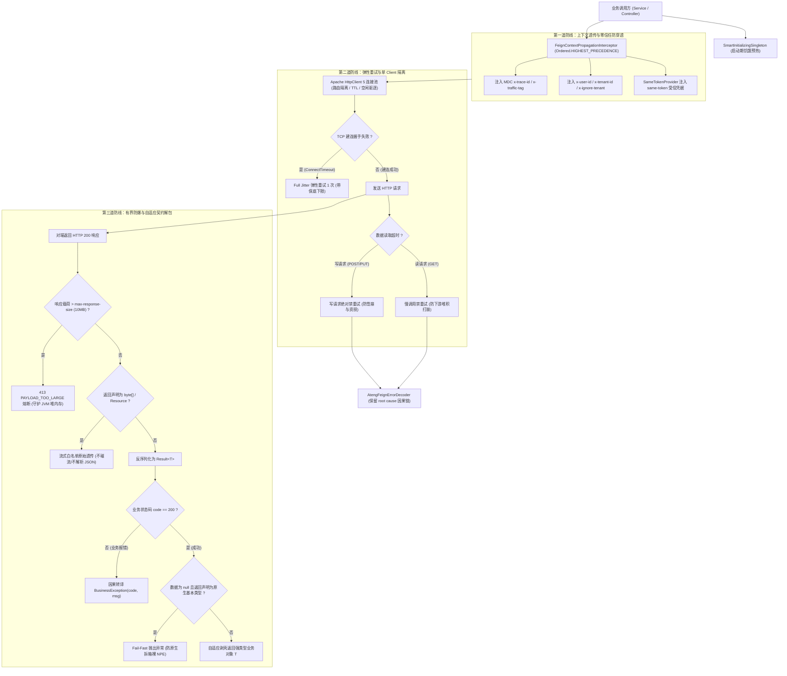

# ateng-cloud-feign Spring Cloud OpenFeign 声明式微服务 HTTP 通信治理 Starter

> 面向企业级高可用分布式生产环境的 Spring Cloud OpenFeign 声明式 HTTP 通信治理 Starter，基于 Spring Boot 3 与 Apache HttpClient 5 高并发连接池底座，打造垂直正交、开箱即用、无侵入的微服务远程调用治理能力。
> 内置双模自适应契约剥壳解包、写请求读超时绝对禁重试防雪崩铁律、全链路四维上下文透明穿透、零信任 Same-Token 内网防穿透、流式大文件与 Multipart 表单开箱透传、启动期饥饿预热、强类型 DataSize 响应载荷硬防爆以及安全脱敏日志审计能力。

---

## 0. 特性与公共 API 全景速查矩阵 (100% 覆盖)

### 0.1 核心类与门面接口全景

| 类 / 接口 | 类型 | 核心职责 | 默认行为 / 装配条件 |
| :--- | :--- | :--- | :--- |
| `AtengFeignAutoConfiguration` | 自动装配类 | Feign 治理基础设施自动装配总入口 | 注册于 `AutoConfiguration.imports`，`ateng.cloud.feign.enabled=true` 且存在 Feign 相关类时激活 |
| `AtengFeignProperties` | 配置属性类 | 强类型映射配置前缀 `ateng.cloud.feign` | 默认开启，收敛连接池、自适应解包、上下文透传、重试、预热与报文防爆配置 |
| `AtengFeignHttpClientProperties` | 配置属性类 | Apache HttpClient 5 高并发连接池传输层配置 | 默认最大连接 200，单路由 50，TTL 900s，空闲驱逐 60s，握手 2s，读取 5s |
| `HttpClientConnectionManager` | 传输连接池管理器 | Apache HttpClient 5 物理连接池管控（最大连接数、路由连接数、TTL 与空闲驱逐） | 标配 `@ConditionalOnMissingBean`，支持外部连接池无缝接管 |
| `AtengFeignAdaptiveUnwrapProperties` | 配置属性类 | 双模自适应契约解包配置（支持客户端白名单豁免） | 默认开启全局自适应解包，支持 `excludeClients` |
| `AtengFeignContextProperties` | 配置属性类 | 全链路四维上下文透传与零信任防穿透开关 | 默认开启出站标头注入拦截 |
| `AtengFeignRetryProperties` | 配置属性类 | 防雪崩弹性重试纪律配置（带保底下限的 Full Jitter 随机抖动退避） | 默认开启，退避 50ms~200ms，最大尝试 2 次（最多建连重试 1 次） |
| `AtengFeignPreheatProperties` | 配置属性类 | 客户端启动期饥饿预热配置（消灭首调冷启动延迟） | 默认开启，自动预热容器扫描到的全部 FeignClient 子容器上下文 |
| `AtengFeignPayloadProperties` | 配置属性类 | 响应载荷硬防爆与内存安全配置（防 OOM 击穿） | 默认阈值 `10MB`（强类型 `DataSize`） |
| `AtengFeignCompressionProperties` | 配置属性类 | GZIP 传输压缩配置（请求/响应压缩开关与请求体阈值） | 默认关闭，触发阈值 `2KB`（强类型 `DataSize`） |
| `AtengFeignClientProperties` | 配置属性类 | 单 Client 独立物理隔离配置（超时、重试、解包与日志） | 按客户端名称独立声明，未配项平滑回退全局基线 |
| `AtengFeignDecoder` | 核心解码器 | 双模自适应契约解包、原生基本类型 null 防卫 Fail-Fast、流透传白名单、有界防爆与 void 解包 | 标配 `@ConditionalOnMissingBean`，智能剥离 `Result<T>` 外壳 |
| `AtengFeignErrorDecoder` | 错误解码器 | HTTP 状态码异常拦截并因果转译为业务异常 | 标配 `@ConditionalOnMissingBean`，100% 保留原始 `cause` 因果链 |
| `AtengFeignRetryer` | 重试器 | 防雪崩弹性重试纪律执行器（写请求读超时绝不重试，建连超时带保底下限 Full Jitter 弹性重试 1 次） | 标配 `@ConditionalOnMissingBean`，仅建连超时弹性重试 1 次 |
| `FeignContextPropagationInterceptor` | 请求拦截器 | 出站透明注入四维上下文、金丝雀流量染色与 Same-Token | 标配 `Ordered.HIGHEST_PRECEDENCE` 确保第一顺位注入，防注入 `null` 脏字面量 |
| `AtengFeignLogger` | 安全日志器 | 请求响应日志格式化与敏感标头脱敏掩码输出 | 自动拦截 `authorization`、`same-token` 等敏感键 |
| `AtengFeignPreheatListener` | 预热监听器 | `SmartInitializingSingleton` 启动期触发连接池与子容器预热 | 当 `preheat.enabled=true` 时受管初始化 |
| `SameTokenProvider` | 扩展点 SPI | 内部微服务零信任受信凭据标头提供器 | `@FunctionalInterface`，支持业务或鉴权模块接管 |
| `@AdaptiveUnwrap` | 声明式注解 | 细粒度控制接口方法或类是否开启自适应契约解包 | 支持方法级与类级覆盖，默认为 `true` |
| `@ExcludeAdaptiveUnwrap` | 声明式注解 | 声明指定接口方法或类排除自适应解包，保持原始包装返回 | 支持类级与方法级标注 |
| `FeignHeaderConstants` | 常量规约类 | 定义微服务四维上下文、流量染色与 Same-Token 标头标准常量 | 收敛透传标准，消除标头名称魔鬼字符串 |

---

### 0.2 配置属性速查表 (`ateng.cloud.feign.*`)

| 配置项 | 类型 | 默认值 | 详细业务说明 |
| :--- | :--- | :--- | :--- |
| `ateng.cloud.feign.enabled` | `boolean` | `true` | 是否激活 ateng-cloud-feign 核心治理能力 |
| `ateng.cloud.feign.logger-level` | `feign.Logger.Level` | `BASIC` | 全局 Feign 请求响应日志打印级别 (`NONE` / `BASIC` / `HEADERS` / `FULL`) |
| `ateng.cloud.feign.httpclient.enabled` | `boolean` | `true` | 是否启用 Apache HttpClient 5 高并发连接池传输底座 |
| `ateng.cloud.feign.httpclient.max-connections` | `int` | `200` | 连接池全局最大物理连接数上限 |
| `ateng.cloud.feign.httpclient.max-connections-per-route` | `int` | `50` | 单个微服务目标路由的最大并发连接数上限 |
| `ateng.cloud.feign.httpclient.time-to-live` | `Duration` | `900s` | 连接池空闲物理连接最大存活时限 (TTL) |
| `ateng.cloud.feign.httpclient.max-idle-time` | `Duration` | `60s` | 连接最大空闲时限，超过该时间的空闲连接将被后台线程主动驱逐防半关 |
| `ateng.cloud.feign.httpclient.evict-idle-connections-interval` | `Duration` | `60s` | 连接池后台主动驱逐空闲连接的执行周期 |
| `ateng.cloud.feign.httpclient.evict-expired-connections` | `boolean` | `true` | 是否在后台驱逐任务中主动清理超过 TTL 的失效物理连接 |
| `ateng.cloud.feign.httpclient.connection-timeout` | `Duration` | `2000ms` | TCP 网络三次握手建连超时时限 |
| `ateng.cloud.feign.httpclient.connection-request-timeout` | `Duration` | `3000ms` | 从连接池租借获取可用连接的排队等待超时时限 |
| `ateng.cloud.feign.httpclient.socket-timeout` | `Duration` | `5000ms` | 套接字数据读取超时时限（等待对端返回响应的窗口） |
| `ateng.cloud.feign.adaptive-unwrap.enabled` | `boolean` | `true` | 是否全局开启 `Result<T>` 业务对象自适应解包剥壳 |
| `ateng.cloud.feign.adaptive-unwrap.exclude-clients` | `List<String>` | `[]` | 豁免自适应解包的客户端名称列表（白名单透传） |
| `ateng.cloud.feign.context.enabled` | `boolean` | `true` | 是否开启全链路四维上下文、流量染色与 Same-Token 透传 |
| `ateng.cloud.feign.retry.enabled` | `boolean` | `true` | 是否开启全局弹性重试纪律（写请求读超时绝不重试） |
| `ateng.cloud.feign.retry.period` | `Duration` | `50ms` | 重试初始退避休眠时间间隔（Full Jitter 基础退避时间） |
| `ateng.cloud.feign.retry.max-period` | `Duration` | `200ms` | 重试最大退避休眠时间间隔（Full Jitter 最大上限） |
| `ateng.cloud.feign.retry.max-attempts` | `int` | `2` | 最大请求尝试总次数（包含初次调用，`2` 表示最多建连重试 1 次） |
| `ateng.cloud.feign.preheat.enabled` | `boolean` | `true` | 是否开启容器启动期饥饿预热机制 |
| `ateng.cloud.feign.preheat.clients` | `List<String>` | `[]` | 显式预热目标客户端清单（为空则自动预热扫描到的全部客户端） |
| `ateng.cloud.feign.payload.max-response-size` | `DataSize` | `10MB` | 响应载荷有界读取硬防爆阈值（超限立即熔断抛 413） |
| `ateng.cloud.feign.compression.request-enabled` | `boolean` | `false` | 是否开启请求体 GZIP 压缩传输 |
| `ateng.cloud.feign.compression.response-enabled` | `boolean` | `false` | 是否开启响应体 GZIP 压缩接收（自动携带 Accept-Encoding: gzip 标头） |
| `ateng.cloud.feign.compression.min-request-size` | `DataSize` | `2KB` | 触发请求 GZIP 压缩的最小请求体阈值（强类型 `DataSize`） |
| `ateng.cloud.feign.compression.mime-types` | `List<String>` | `["text/xml", ...]` | 支持请求 GZIP 压缩的 MIME 媒体类型白名单 |
| `ateng.cloud.feign.clients.<name>.connect-timeout` | `Duration` | `null` | 单 Client 独立建连超时（未配平滑回退全局基线） |
| `ateng.cloud.feign.clients.<name>.socket-timeout` | `Duration` | `null` | 单 Client 独立读取超时（未配平滑回退全局基线） |
| `ateng.cloud.feign.clients.<name>.adaptive-unwrap` | `Boolean` | `null` | 单 Client 独立解包覆盖（未配遵循全局规则） |
| `ateng.cloud.feign.clients.<name>.logger-level` | `feign.Logger.Level` | `null` | 单 Client 独立日志级别覆盖 |
| `ateng.cloud.feign.clients.<name>.retry.enabled` | `boolean` | `true` | 单 Client 独立重试开关 |
| `ateng.cloud.feign.clients.<name>.retry.max-attempts` | `int` | `2` | 单 Client 独立最大尝试次数 |

---

### 0.3 上下文透传与防穿透标准标头

| 标头名称 (Header) | 对应常量 | 语义与流转机制 | 默认脱敏策略 |
| :--- | :--- | :--- | :--- |
| `x-trace-id` | `FeignHeaderConstants.TRACE_ID` | 分布式调用链 Trace ID，与 MDC 绑定透传 | 明文透传，日志打印 |
| `x-user-id` | `FeignHeaderConstants.USER_ID` | 当前操作用户 ID，从 `UserContextHolder` 提取 | 原始透传 |
| `x-tenant-id` | `FeignHeaderConstants.TENANT_ID` | 当前多租户 ID，从 `TenantContextHolder` 提取 | 原始透传 |
| `x-ignore-tenant` | `FeignHeaderConstants.IGNORE_TENANT` | 是否忽略多租户隔离过滤逻辑 (`true`/`false`) | 原始透传 |
| `x-traffic-tag` | `FeignHeaderConstants.TRAFFIC_TAG` | 金丝雀灰度发布路由染色标记 (如 `canary-v1`) | 原始透传 |
| `same-token` | `FeignHeaderConstants.SAME_TOKEN` | 内部微服务零信任受信凭据（防止公网绕过网关穿透） | **强制脱敏星号掩码** |

---

## 1. 模块定位与 Maven 坐标

`ateng-cloud-feign` 是面向 Spring Cloud 微服务高并发分布式环境的声明式 HTTP 客户端通用治理 Starter。版本由 `ateng-cloud-bom` 统一纳管：

```xml
<dependency>
    <groupId>io.github.atengk</groupId>
    <artifactId>ateng-cloud-feign</artifactId>
</dependency>
```

> [!TIP]
> 业务工程统一引入 `ateng-cloud-bom` 即可免去配 `<version>` 标签，确保微服务依赖版本一致性与向后兼容。

---

## 2. 核心架构与微服务调用拓扑

微服务跨进程 HTTP 通信在生产环境中面临网络瞬态抖动、慢调用积压、链路上下文断裂及雪崩风暴等极端挑战。`ateng-cloud-feign` 构建了多层防御体系：



---

## 3. 声明式远程调用与自适应解包契约

### 3.1 极简起步与声明式 FeignClient 接口定义

```yaml
# 本节专属 YAML 配置 (application.yml)
ateng:
  cloud:
    feign:
      enabled: true
      adaptive-unwrap:
        enabled: true # 开启自适应契约解包（默认开启）
```

面向真实电商商品中心的领域客户端接口声明：

```java
package io.github.atengk.cloud.sample.feign.client;

import io.github.atengk.cloud.sample.feign.model.ProductDetailVO;
import org.springframework.cloud.openfeign.FeignClient;
import org.springframework.web.bind.annotation.GetMapping;
import org.springframework.web.bind.annotation.PathVariable;

/**
 * 商品中心远程调用声明式客户端
 */
@FeignClient(name = "product-client", url = "http://localhost:${test.server.port:8080}")
public interface ProductFeignClient {

    /**
     * 自适应剥壳查询：直接声明返回业务对象 ProductDetailVO
     * 底层自动校验对端返回的 Result<ProductDetailVO> 中 code==200 并剥离外壳
     */
    @GetMapping("/sample/cloud/feign/remote/product/{id}")
    ProductDetailVO getProductById(@PathVariable("id") Long id);
}
```

**核心机制与容灾边界**：
- **声明即所得**：业务方法直接声明返回强类型业务对象（如 `ProductDetailVO`），无需业务层充斥繁琐的手动 `.getData()` 剥壳样板代码；
- **智能校验**：若对端返回 `code != 200`，自动中断执行并将其转译为受管的 `BusinessException`。

---

### 3.2 双模智能剥壳与因果转译

业务订单中心接入层 Controller 示例：

```java
package io.github.atengk.cloud.sample.feign.controller;

import io.github.atengk.boot.core.model.Result;
import io.github.atengk.cloud.sample.feign.client.ProductFeignClient;
import io.github.atengk.cloud.sample.feign.model.ProductDetailVO;
import org.springframework.web.bind.annotation.*;

@RestController
@RequestMapping("/sample/cloud/feign/order")
public class FeignOrderConsumerController {

    private final ProductFeignClient productFeignClient;

    public FeignOrderConsumerController(ProductFeignClient productFeignClient) {
        this.productFeignClient = productFeignClient;
    }

    /**
     * 体验自适应契约剥壳解包
     */
    @GetMapping("/product/unwrap/{id}")
    public Result<ProductDetailVO> getProductUnwrap(@PathVariable("id") Long id) {
        // FeignClient 直接返回剥壳后的 ProductDetailVO，接入层显式契约回传 Result<T>
        ProductDetailVO product = productFeignClient.getProductById(id);
        return Result.success(product);
    }
}
```

---

### 3.3 白名单与注解精确豁免解包

当调用第三方未遵循 `Result<T>` 规范的系统，或需要保留原生 `Result<T>` 包装进行特殊校验时，可通过配置白名单或注解灵活控制：

```yaml
# 本节专属 YAML 配置 (application.yml)
ateng:
  cloud:
    feign:
      adaptive-unwrap:
        # 白名单客户端：该 Client 下的所有方法全量豁免剥壳，保持原始包装返回
        exclude-clients:
          - excluded-client
```

```java
package io.github.atengk.cloud.sample.feign.client;

import io.github.atengk.boot.core.model.Result;
import io.github.atengk.cloud.feign.annotation.AdaptiveUnwrap;
import io.github.atengk.cloud.feign.annotation.ExcludeAdaptiveUnwrap;
import io.github.atengk.cloud.sample.feign.model.ProductDetailVO;
import org.springframework.cloud.openfeign.FeignClient;
import org.springframework.web.bind.annotation.GetMapping;
import org.springframework.web.bind.annotation.PathVariable;

/**
 * 类级别排除自适应解包注解示例
 */
@FeignClient(name = "class-level-excluded-product-client", url = "http://localhost:${test.server.port:8080}")
@ExcludeAdaptiveUnwrap
public interface ClassLevelExcludedProductFeignClient {

    /**
     * 标注了 @ExcludeAdaptiveUnwrap，返回完整的 Result<ProductDetailVO>
     */
    @GetMapping("/sample/cloud/feign/remote/product/{id}")
    Result<ProductDetailVO> getProductById(@PathVariable("id") Long id);

    /**
     * 方法级别覆盖：显式标注 @AdaptiveUnwrap 强制解包
     */
    @GetMapping("/sample/cloud/feign/remote/product/forced/{id}")
    @AdaptiveUnwrap
    ProductDetailVO getProductForced(@PathVariable("id") Long id);
}
```

**优先级规则**：
`方法级 @AdaptiveUnwrap / @ExcludeAdaptiveUnwrap` > `类级注解` > `exclude-clients 白名单配置` > `全局 enabled 开关`。

---

### 3.4 原生基本类型 Null 防卫与 void 安全返回

> [!WARNING]
> **原生基本类型返回值 Null 注入避坑防线 (Primitive Return Type Invariant)**：
> 当对端接口返回 `Result<T>` 且 `data == null`（或 HTTP 204 无返回体）时，若 Feign 客户端接口声明了 Java 基础原始类型（如 `long`、`int`、`boolean`、`double` 等），Java 在底层自动拆箱（Unboxing）过程中会不可避免地触发底层运行时 `NullPointerException`。
> `AtengFeignDecoder` 构建了前置防线：当检测到目标方法声明返回原生类型且解包结果为 `null` 时，**前置 Fail-Fast 阻断并转译抛出语义清晰的 `BusinessException`**（错误码 `500`）。
> **生产最佳实践**：跨微服务远程调用的接口方法返回类型必须统一声明为对象包装类（如 `Long`、`Integer`、`Boolean`）或实体对象，坚决杜绝声明 `long`、`int` 等原生基本类型！

对于声明返回 `void` 的接口，框架内部通过 `decodeVoid` 自动校验对端 `code == 200`，业务失败时准时抛出异常。

---

## 4. 多格式传输与大文件流式通信

### 4.1 GET 多入参 POJO 自动平铺 (`@SpringQueryMap`)

```java
package io.github.atengk.cloud.sample.feign.model;

import java.io.Serializable;

/**
 * 商品查询条件传输对象
 */
public class ProductQueryDTO implements Serializable {
    private String keyword;
    private String category;
    private Integer pageNum;
    private Integer pageSize;
    // getter/setter/构造器省略
}
```

在 Feign 接口中使用 `@SpringQueryMap`：

```java
@FeignClient(name = "product-client", url = "http://localhost:${test.server.port:8080}")
public interface ProductFeignClient {

    /**
     * GET 查询：使用 @SpringQueryMap 自动将 POJO 字段平铺展开为 HTTP Query 参数
     */
    @GetMapping("/sample/cloud/feign/remote/product/search")
    ProductQueryDTO searchProducts(@SpringQueryMap ProductQueryDTO query);
}
```

**核心机制**：底层自动装配 `BeanQueryMapEncoder`，避免将 GET 请求参数拼接在 URL 路径上导致长度超限或误转为 POST 请求。

---

### 4.2 POST JSON 业务对象提交

```java
package io.github.atengk.cloud.sample.feign.model;

import java.io.Serializable;
import java.math.BigDecimal;

/**
 * 订单创建请求 DTO
 */
public class OrderCreateDTO implements Serializable {
    private Long productId;
    private Integer quantity;
    private BigDecimal amount;
    // getter/setter/构造器省略
}
```

```java
@FeignClient(name = "product-client", url = "http://localhost:${test.server.port:8080}")
public interface ProductFeignClient {

    /**
     * POST 请求：以 JSON 请求体方式提交业务数据
     */
    @PostMapping("/sample/cloud/feign/remote/product/order/create")
    OrderDetailVO createOrder(@RequestBody OrderCreateDTO orderCreateDTO);
}
```

---

### 4.3 响应式二进制流导出下载

```java
@FeignClient(name = "product-client", url = "http://localhost:${test.server.port:8080}")
public interface ProductFeignClient {

    /**
     * 二进制流传输：声明返回 byte[]，底层自动绕过 JSON 反序列化与契约解包
     */
    @GetMapping(value = "/sample/cloud/feign/remote/product/export/stream",
                produces = MediaType.APPLICATION_OCTET_STREAM_VALUE)
    byte[] exportProductStream();
}
```

**流式白名单机制 (Stream Passthrough)**：
当接口声明返回 `byte[]`、`InputStream`、`Resource`、`File` 或原生 `feign.Response` 时，`AtengFeignDecoder` 前置命中流式白名单，**绝对不碰流、不进行 JSON 解析，原样直传底层字节流**。

---

### 4.4 Multipart 表单多部件文件上传

```java
@FeignClient(name = "product-client", url = "http://localhost:${test.server.port:8080}")
public interface ProductFeignClient {

    /**
     * 表单文件上传：原生整合 feign-form，支持 MultipartFile 与普通表单参数混合提交
     */
    @PostMapping(value = "/sample/cloud/feign/remote/product/upload/spec",
                 consumes = MediaType.MULTIPART_FORM_DATA_VALUE)
    String uploadProductSpec(@RequestPart("file") MultipartFile file,
                            @RequestParam("category") String category);
}
```

**开箱即用支持**：Starter 内部集成了 `feign-form` 与 `feign-form-spring` 编码器支持，下游业务无需额外引入任何依赖或自行配置复杂的 Form Encoder。

---

## 5. 全链路四维上下文与金丝雀染色透传

### 5.1 四维上下文跨进程透明透传

```yaml
# 本节专属 YAML 配置 (application.yml)
ateng:
  cloud:
    feign:
      context:
        enabled: true # 开启全链路四维上下文、流量染色与 Same-Token 透传（默认 true）
```

```java
// 发起 Feign 调用前设置上下文
MDC.put("traceId", "trace-feign-8888");
MDC.put("X-Traffic-Tag", "canary-v1");
UserContextHolder.setUserId("user-cloud-100");
TenantContextHolder.setTenantId("tenant-cloud-200");
TenantContextHolder.setIgnoreTenant(true);

// 发起远程调用
ProductDetailVO product = productFeignClient.getProductById(1L);
```

**标头映射标准**：
- `traceId` -> `x-trace-id` (W3C 兼容链路追踪)
- `userId` -> `x-user-id`
- `tenantId` -> `x-tenant-id`
- `ignoreTenant` -> `x-ignore-tenant`
- `X-Traffic-Tag` -> `x-traffic-tag` (金丝雀灰度标签)

---

### 5.2 零信任 Same-Token 内网防穿透与 SPI 扩展

为防止外部攻击者绕过 API 网关直接扫描或调用内网微服务端口，所有服务强制开启 `Same-Token` 校验。Feign 客户端在出站时通过 SPI 注入受信凭据：

```java
package io.github.atengk.cloud.sample.feign.config;

import io.github.atengk.cloud.feign.spi.SameTokenProvider;
import org.springframework.context.annotation.Bean;
import org.springframework.context.annotation.Configuration;

@Configuration
public class FeignSameTokenConfiguration {

    /**
     * 实现 SameTokenProvider 扩展点，动态注入 Sa-Token 受信凭据
     */
    @Bean
    public SameTokenProvider customSameTokenProvider() {
        return () -> "satoken-secret-token-abcdef123456";
    }
}
```

---

### 5.3 第一顺位注入保证与敏感标头脱敏审计

- **第一顺位保障**：`FeignContextPropagationInterceptor` 显式实现 `Ordered.HIGHEST_PRECEDENCE`（`-2147483648`），确保四维上下文和 `Same-Token` 始终最先注入，后续下游拦截器可 100% 确定性从 `RequestTemplate.headers()` 中读取；
- **防脏字面量**：严格过滤 `null` 与空白值，杜绝注入 `"null"` 脏字符串；
- **日志敏感脱敏**：`AtengFeignLogger` 输出请求日志时，对 `authorization`、`same-token` 等机密标头执行掩码（`******`），彻底防御审计日志凭证泄露。

---

## 6. 防雪崩重试纪律与单 Client 隔离容灾

### 6.1 非幂等写请求读超时绝不重试铁律

```yaml
# 本节专属 YAML 配置 (application.yml)
ateng:
  cloud:
    feign:
      retry:
        enabled: true
        period: 50ms
        max-period: 200ms
        max-attempts: 2 # 最大请求尝试总次数（2 表示最多重试 1 次）
```

```java
@FeignClient(name = "order-client", url = "http://localhost:${test.server.port:8080}")
public interface OrderRemoteFeignClient {

    /**
     * 非幂等写接口（POST）：超时绝不重试，下游服务端严格仅执行 1 次
     */
    @PostMapping("/sample/cloud/feign/remote/tolerance/timeout/post")
    String postTimeout();
}
```

> [!IMPORTANT]
> **写请求绝对禁止重试不变量 (Write Timeout Strictly No-Retry Invariant)**：
> 对于非幂等写接口（`POST` / `PUT` / `PATCH`），当发生读取超时（`SocketTimeoutException`）时，说明请求已经送达下游并可能正在执行扣款或落库操作。若盲目重试，将直接导致下游资损、重复扣款或数据库锁竞争引发服务瘫痪。
> 框架重试器前置判定请求方法：凡写请求发生读取超时，**直接熔断抛出异常，绝不发起重试**！

---

### 6.2 建连握手失败带保底下限 Full Jitter 弹性重试

对于 TCP 三次握手未建立连接的超时异常（`ConnectTimeoutException`），请求尚未到达下游服务器，安全允许执行最多 1 次弹性重试。

**带保底时间窗的 Full Jitter 随机抖动退避算法**：
$$\text{upper} = \min(\text{period} \times 1.5^{\text{attempt}-1}, \text{maxPeriod})$$
$$\text{floor} = \min(\min(\text{period} / 2, 20), \text{upper})$$
$$\text{interval} = \text{floor} + \text{ThreadLocalRandom.current().nextLong}(\text{upper} - \text{floor} + 1)$$

保底时间窗 $\text{floor}$ 消除了 0ms 紧密自旋对 CPU 的无谓消耗，离散随机分布彻底打散集群重试风暴（Thundering Herd）。

---

### 6.3 单 Client 级独立重试与超时参数物理隔离

在微服务拓扑中，不同下游服务具备不同的性能特征。通过 `clients.<name>` 实现单 Client 物理隔离：

```yaml
# 本节专属 YAML 配置 (application.yml)
ateng:
  cloud:
    feign:
      # 全局基线配置
      httpclient:
        connection-timeout: 2000ms
        socket-timeout: 5000ms
      retry:
        enabled: true
        period: 50ms
        max-period: 200ms
        max-attempts: 2
      clients:
        # 1. 为特定下游服务配置独立短超时隔离（防止慢服务拖垮当前应用线程池）
        isolated-timeout-client:
          socket-timeout: 300ms
          connect-timeout: 300ms
        # 2. 为高可靠幂等查询客户端定制重试参数（覆盖全局基线）
        custom-retry-client:
          retry:
            enabled: true
            period: 20ms
            max-period: 80ms
            max-attempts: 3 # 定制最大尝试 3 次（即最多重试 2 次）
```

```java
/**
 * 独立短超时客户端
 */
@FeignClient(name = "isolated-timeout-client", url = "http://localhost:${test.server.port:8080}")
public interface IsolatedTimeoutFeignClient {

    @GetMapping("/sample/cloud/feign/remote/tolerance/slow")
    String slow();
}

/**
 * 定制重试客户端
 */
@FeignClient(name = "custom-retry-client", url = "http://localhost:${test.unreachable.port:59999}")
public interface CustomRetryFeignClient {

    @GetMapping("/sample/cloud/feign/remote/tolerance/unreachable")
    String getUnreachable();
}
```

未单独配置的参数，自动平滑继承全局基线，实现“全局托底 + 局部定制”的弹性隔离模型。

---

## 7. 高并发连接池、载荷防爆与饥饿预热

### 7.1 Apache HttpClient 5 高并发连接池与主动驱逐防线

```yaml
# 本节专属 YAML 配置 (application.yml)
ateng:
  cloud:
    feign:
      httpclient:
        enabled: true
        max-connections: 200 # 全局最大连接数上限
        max-connections-per-route: 50 # 单目标微服务路由最大并发连接数
        time-to-live: 900s # 物理长连接最大存活时限 (TTL)
        max-idle-time: 60s # 最大空闲时限
        evict-idle-connections-interval: 60s # 后台主动驱逐周期
        evict-expired-connections: true # 主动清理超过 TTL 的失效连接
        connection-timeout: 2000ms # TCP 握手建连超时
        socket-timeout: 5000ms # 套接字读取响应超时
```

> [!TIP]
> **空闲失效长连接主动驱逐机制 (Stale Socket Defense)**：
> 下游服务、云网关或 Nginx 通常具备 Keep-Alive 空闲超时机制（默认 60s）。若客户端不主动驱逐，复用已被服务端半关（Half-Closed）的连接发起通信将直接导致 `Connection reset` 或 `NoHttpResponseException`。
> 框架通过后台守护线程按 `evict-idle-connections-interval` 定时主动回收空闲超时的连接，并在租借连接时前置探活，彻底根除瞬时长连接断连报错。

---

### 7.2 10MB 响应载荷有界读取硬防爆熔断

```yaml
# 本节专属 YAML 配置 (application.yml)
ateng:
  cloud:
    feign:
      payload:
        max-response-size: 10MB # 响应体有界读取阈值，默认 10MB（强类型 DataSize）
```

```java
@FeignClient(name = "order-client", url = "http://localhost:${test.server.port:8080}")
public interface OrderRemoteFeignClient {

    /**
     * 响应超大报文接口调用：达到 10MB 阈值时触发硬熔断
     */
    @GetMapping("/sample/cloud/feign/remote/tolerance/large-payload")
    String largePayload();
}
```

**内存防波堤机制**：
`AtengFeignDecoder` 在流式读取响应时设置了基于 `DataSize` 的有界读取计数器。当检测到响应数据超过配置的硬防爆阈值时，**立即阻断读取并抛出 `BusinessException`（错误提示超出防爆限制）**，坚决守护客户端 JVM 堆内存不被撑爆（防 OOM 假死与解压炸弹）。

---

### 7.3 启动期客户端饥饿预热机制

```yaml
# 本节专属 YAML 配置 (application.yml)
ateng:
  cloud:
    feign:
      preheat:
        enabled: true # 开启启动期饥饿预热（默认 true）
        clients: [] # 为空则自动预热扫描到的所有 FeignClient
```

**首调慢启动加速**：
Spring Cloud OpenFeign 在默认情况下对每个 `@FeignClient` 采用懒加载（Lazy Init）创建独立的子容器上下文（ApplicationContext）。这会导致线上微服务滚动发布上线后的**第一笔请求耗时剧增甚至直接读取超时**。
框架通过 `AtengFeignPreheatListener` 监听 `SmartInitializingSingleton` 事件，在应用启动完成但尚未放行外部流量时，主动预热 Apache HttpClient 5 线程池并完成所有 FeignClient 子容器的预热加载，实现秒级平滑上线。

---

## 8. 因果异常转译与生产日志审计

### 8.1 因果异常转译 (Causal Error Decoding)

```java
@FeignClient(name = "order-client", url = "http://localhost:${test.server.port:8080}")
public interface OrderRemoteFeignClient {

    /**
     * 下游返回业务失败 Result(code=6001, msg="下游支付通道结算失败")
     */
    @GetMapping("/sample/cloud/feign/remote/tolerance/business-error")
    String getBusinessError();

    /**
     * 下游崩溃返回 HTTP 500 Internal Server Error
     */
    @GetMapping("/sample/cloud/feign/remote/tolerance/raw-500")
    String getRaw500();
}
```

**因果链保留铁律**：
- **业务错误码**：对端返回 `code != 200` 时，自动转译为本地 `BusinessException`，精确保留远端业务错误码（如 `6001`）与错误信息；
- **HTTP 状态码异常**：远端崩溃返回 HTTP 4xx/5xx 时，转译为 `BusinessException`，且**必须将原始 `FeignException` 挂载为 `cause`**。严禁吞咽因果链，确保调用栈根因可追溯。

---

### 8.2 生产安全日志级别与敏感凭据脱敏审计

```yaml
# 本节专属 YAML 配置 (application.yml)
ateng:
  cloud:
    feign:
      logger-level: HEADERS # 生产推荐 HEADERS 或 BASIC，本地调试可设为 FULL
```

`AtengFeignLogger` 输出示例：

```text
[product-client] ---> GET http://localhost:8080/sample/cloud/feign/remote/product/1 HTTP/1.1
[product-client] x-trace-id: trace-e2e-8888
[product-client] x-traffic-tag: canary-v1
[product-client] same-token: ****** (已脱敏)
[product-client] ---> END HTTP (0-byte body)
[product-client] <--- HTTP/1.1 200 OK (28ms)
[product-client] Content-Type: application/json
[product-client] <--- END HTTP (128-byte body)
```

自动对 `same-token`、`authorization` 等机密标头执行掩码，杜绝日志泄密。

---

## 9. 附录：生产级全量配置速查与排障指南

### 9.1 生产推荐全量速查配置模板

```yaml
spring:
  application:
    name: order-service
  cloud:
    openfeign:
      client:
        config:
          default:
            logger-level: basic

ateng:
  cloud:
    feign:
      enabled: true
      logger-level: HEADERS
      # 1. 高并发连接池传输层配置
      httpclient:
        enabled: true
        max-connections: 400
        max-connections-per-route: 100
        time-to-live: 900s
        max-idle-time: 60s
        evict-idle-connections-interval: 60s
        evict-expired-connections: true
        connection-timeout: 2000ms
        connection-request-timeout: 3000ms
        socket-timeout: 5000ms
      # 2. 双模自适应契约剥壳解包
      adaptive-unwrap:
        enabled: true
        exclude-clients:
          - third-party-client
      # 3. 全链路四维上下文透传
      context:
        enabled: true
      # 4. 防雪崩弹性重试纪律
      retry:
        enabled: true
        period: 50ms
        max-period: 200ms
        max-attempts: 2
      # 5. 启动期饥饿预热
      preheat:
        enabled: true
        clients: []
      # 6. 响应载荷硬防爆
      payload:
        max-response-size: 10MB
      # 7. GZIP 传输压缩
      compression:
        request-enabled: false
        response-enabled: false
        min-request-size: 2KB
      # 8. 单 Client 独立隔离配置
      clients:
        payment-service:
          socket-timeout: 10000ms
          connect-timeout: 2000ms
        inventory-service:
          socket-timeout: 1000ms
          connect-timeout: 500ms
          retry:
            enabled: true
            period: 20ms
            max-period: 80ms
            max-attempts: 3
```

---

### 9.2 常见生产问题与排障指南

| 现象 / 报错 | 根本原因分析 | 推荐解决方案 |
| :--- | :--- | :--- |
| `SocketException: Connection reset` | 远端服务已因 Keep-Alive 超时关闭了连接，客户端复用失效连接发起通信 | 确保 `evict-idle-connections-interval` 开启且小于服务端的超时时间（默认 60s） |
| `BusinessException: 413 PAYLOAD_TOO_LARGE` | 对端返回报文大小超过 `max-response-size` (默认 10MB) | 检查是否返回了大报表或超长列表，推荐改用预签名 S3 旁路直传或分页切片 |
| `BusinessException: 接口声明返回原生基本类型...无法接收 null` | 客户端 FeignClient 方法声明了 `long`/`int` 等原生类型，而服务端返回了 `null` | 将接口返回类型改为对象包装类（如 `Long`/`Integer`）防范空指针 |
| 下游服务报错 401 Unauthorized | 未配置 `SameTokenProvider` 或网关未下发受信凭据 | 检查网关与内部服务的 Same-Token 校验配置，确保注入受信提供器 |
| 启动后首次调用出现明显超时延迟 | Feign 子容器默认懒加载引发首调冷启动慢 | 开启 `ateng.cloud.feign.preheat.enabled=true` 启用容器启动期饥饿预热 |

---

> 配套场景体验工程与一键 cURL 体验卡请参阅：[sample-cloud-feign README](../ateng-cloud-samples/sample-cloud-feign/README.md)。
