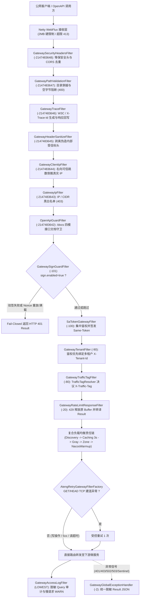

# ateng-cloud-gateway 响应式微服务 API 网关治理 Starter

> 面向企业级高可用微服务架构的 Spring Cloud 纯响应式 API 网关基础设施 Starter，单向锁定消费 `ateng-boot-bom`，基于 Spring WebFlux 与 Netty 事件循环无锁驱动构建（100% 物理隔离 Servlet 阻塞栈）。
> 开箱提供 13 层正交边缘安全与治理过滤器、Sa-Token 零信任集中鉴权与 `Same-Token` 内部同源凭证签发、Netty 2MB 载荷硬防爆与 429 `DataBuffer` 确定性释放、有界 Nonce `Fail-Closed` 防重放护栏、Nacos 双轨动态路由热更与快照兜底、写/5xx 禁重试防雪崩纪律、全链路灰度复合负载均衡链及 `/actuator/atengGateway` 无阻塞全景诊断能力。

---

## 0. 特性与公共 API 全景速查矩阵 (100% 覆盖)

### 0.1 核心自动装配、过滤器优先级与架构组件全景表

下表按 **入站过滤器执行顺序（由小到大）+ 核心治理组件** 完整收录 `ateng-cloud-gateway` 全量公开基础设施构件与准确优先级数值：

| 类 / 接口 | 类型 | 执行优先级 (`Order`) | 核心职责与设计说明 | 默认装配条件 |
| :--- | :--- | :--- | :--- | :--- |
| `AtengGatewayAutoConfiguration` | 自动装配入口 | 根配置容器 | 网关基础设施总装配入口，串联安全、路由、限流、加签、可观测与诊断端点 | `@ConditionalOnWebApplication(REACTIVE)` & `enabled=true` |
| `AtengGatewayEnvironmentPostProcessor` | 环境后置处理器 | `LOWEST_PRECEDENCE` | 注入 `spring.cloud.loadbalancer.cache.ttl=3s`、`zone` 映射与 Nacos 负载解耦标记 | `EnvironmentPostProcessor.imports` 自动加载 |
| `GatewayGlobalExceptionHandler` | 全局异常处理器 | `@Order(-2)` (`-2`) | 统一拦截网络、路由、Sentinel、Sa-Token 与 `BusinessException`，转译状态对齐的 `Result<Void>` JSON | `@ConditionalOnMissingBean` |
| `GatewaySecurityHeadersFilter` | 响应式 `WebFilter` | `ORDER_SECURITY_HEADERS` (`HIGHEST_PRECEDENCE` = `-2147483648`) | 注册 `beforeCommit` 钩子注入 OWASP 等保三级安全响应头，并对重复 CORS 响应头去重保留首项 | `security-headers.enabled=true`（默认开启） |
| `GatewayPathValidationFilter` | `GlobalFilter` | `ORDER_PATH_VALIDATION` (`HIGHEST_PRECEDENCE + 1` = `-2147483647`) | 折叠多重斜杠并校验 URI，拦截 `..`、`%2e%2e` 与空字节目录穿越攻击直接 400 阻断 | `security.path-validation-enabled=true`（默认开启） |
| `GatewayTraceFilter` | `GlobalFilter` | `ORDER_TRACE` (`HIGHEST_PRECEDENCE + 2` = `-2147483646`) | 提取/生成 32 位无横杠 `X-Trace-Id`（兼容 W3C `traceparent`），绑定 Reactor `ContextView` 与响应头回写 | `security.trace-enabled=true`（默认开启） |
| `GatewayHeaderSanitizeFilter` | `GlobalFilter` | `ORDER_HEADER_SANITIZE` (`HIGHEST_PRECEDENCE + 3` = `-2147483645`) | 物理剥离公网伪造的 `X-User-Id`、`X-Tenant-Id`、`Same-Token`、`TX_XID`、`X-Traffic-*` 等内部受信标头 | `security.header-sanitize-enabled=true`（默认开启） |
| `GatewayClientIpFilter` | `GlobalFilter` | `ORDER_CLIENT_IP` (`HIGHEST_PRECEDENCE + 4` = `-2147483644`) | 依据 `trusted-proxy-count` 从右向左安全倒推真实客户端 IP，写入 `ATTR_CLIENT_IP` 与 `X-Real-IP` | `security.client-ip-enabled=true`（默认开启） |
| `GatewayIpFilter` | `GlobalFilter` | `ORDER_IP_FILTER` (`HIGHEST_PRECEDENCE + 5` = `-2147483643`) | 依托 `IpFilterProvider` 执行 IPv4/IPv6 与 CIDR 掩码黑白名单匹配，未授权直接 403 熔断 | `security.ip-filter-enabled=true`（默认开启） |
| `OpenApiGuardFilter` | 响应式 `WebFilter` | `ORDER_OPENAPI_GUARD` (`HIGHEST_PRECEDENCE + 6` = `-2147483642`) | 守卫 `/docs`、`/v3/api-docs/**` 与 Swagger 资源，提供 `DISABLED`/`BASIC`/`SA_TOKEN`/`PUBLIC` 四模管控 | `openapi.enabled=true`（默认开启） |
| `GatewaySignGuardFilter` | `GlobalFilter` | `ORDER_SIGN_GUARD` (`-101`) | 校验开放平台 `X-App-Id`/`X-Timestamp`/`X-Nonce`/`X-Signature`（含可选 SHA-256 Body 摘要）与有界防重放 | `sign.enabled=true`（默认关闭） |
| `SaTokenGatewayFilter` | `GlobalFilter` | `ORDER_SA_TOKEN` (`-100`) | 反应式集中登录校验与白名单放行；按 `same-token-enabled` 动态签发 `Same-Token` 内部凭据与 `X-User-Id` | `security.sa-token-enabled=true`（默认开启） |
| `GatewayTenantFilter` | `GlobalFilter` | `ORDER_TENANT` (`-90`) | 鉴权优先读取会话 `tenantId`；未登录开放路由受 `tenant.allow-header` 控制防越权串租户 | `tenant.enabled=true`（默认开启） |
| `GatewayTrafficTagFilter` | `GlobalFilter` | `ORDER_TRAFFIC_TAG` (`-80`) | 依托 `TrafficTagResolver` 决议全链路灰度标签 `X-Traffic-Tag`；未解析出标签时剥离外部伪造值 | `traffic.enabled=true`（默认开启） |
| `GatewayRateLimitResponseFilter` | `GlobalFilter` | `ORDER_RATE_LIMIT_RESPONSE` (`-20`) | 拦截 HTTP 429，在 `writeWith`/`writeAndFlushWith` 中确定性释放原始 `DataBuffer` 后改写 `Result` JSON 与 `Retry-After` | `rate-limiter.enabled=true`（默认开启） |
| `GatewayAccessLogFilter` | `GlobalFilter` | `ORDER_ACCESS_LOG` (`LOWEST_PRECEDENCE` = `2147483647`) | 基于 Reactor `doFinally` 无阻塞输出单行 `[ACCESS]` 日志与慢请求 WARN，支持 Query 脱敏与 256 字符截断 | `access-log.enabled=true`（默认关闭） |
| `AtengRetryGatewayFilterFactory` | 路由过滤器工厂 | `AtengRetry=<retries>` | 写请求（POST/PUT/PATCH/DELETE）及 HTTP 5xx/读超时严格零重试；仅 GET/HEAD 建连异常弹性重试 1 次 | `@ConditionalOnMissingBean` |
| `GatewayRouteRefreshListener` | 路由热更监听器 | Spring 事件监听 | 监听主配置 `spring.cloud.gateway.routes` 变更，`ReentrantLock` 守护快照并广播 `RefreshRoutesEvent` | `dynamic-route.enabled=true`（默认开启） |
| `NacosRouteDefinitionRepository` | 动态路由仓库 | `RouteDefinitionRepository` | 监听 Nacos `gateway-routes.json`（Track A）原子更新与破损配置快照兜底，持久化卸载至 `boundedElastic` | 存在 `NacosConfigManager` 时自动装配 |
| `GatewayRouteValidator` | 静态校验工具 | 路由校验前哨 | 校验双轨动态路由 ID 唯一性、URI 合法性、谓词/过滤器非空，非法配置抛出 `IllegalArgumentException` | 工具类直接调用 |
| `GrayLoadBalancerClientConfiguration` | 负载均衡配置 | Client 子上下文 | 装配复合责任链：`DiscoveryClient` → `Caching(3s)` → `Gray` → `ZonePreference` → `NacosWarmupLoadBalancer` | `@LoadBalancerClients(defaultConfiguration)` |
| `GrayServiceInstanceListSupplier` | 灰度实例选择器 | 负载供应器 | 按 `X-Traffic-Tag` 精确匹配 Nacos `metadata.tag`；灰度全下线在 `fallback-to-default=true` 时平滑回退基线 | 默认嵌套于复合责任链 |
| `GatewayPanoramaEndpoint` | Actuator 端点 | `@Endpoint(id = "atengGateway")` | 无锁内存快照聚合输出双轨路由、灰度负载、边缘安全、开放加签四维只读报告（双路由 `/actuator/atengGateway` & `/actuator/ateng-gateway`） | 存在 Actuator `@Endpoint` 类时激活 |
| `GatewayPanoramaReport` | 强类型报告 Record | 诊断数据模型 | 封装 `dynamicRoute`、`grayLoadBalancer`、`edgeSecurity`、`signGuard` 四维快照（敏感列表仅输出计数） | 强类型不可变 Record |
| `GatewayConstants` | 常量基线类 | 全局常量 | 定义标头（`X-Trace-Id`、`Same-Token`、`X-Traffic-Tag` 等）、Exchange 属性键与全部过滤器 `ORDER_*` 基线 | 静态常量引用 |

---

### 0.2 核心公共 API 与扩展 SPI 速查表

| 类 / 接口 | 方法 / 构造签名 | 返回类型 | 功能说明与生产语义 | 默认实现 / 保底行为 |
| :--- | :--- | :--- | :--- | :--- |
| `IpFilterProvider` | `getBlacklist()` | `List<String>` | 获取当前生效的 IP 黑名单规则列表（支持 CIDR） | `PropertiesIpFilterProvider`（读取配置列表） |
| `IpFilterProvider` | `getWhitelist()` | `List<String>` | 获取当前生效的 IP 白名单规则列表（支持 CIDR） | `PropertiesIpFilterProvider`（非空时白名单模式） |
| `IpFilterProvider` | `isAllowed(clientIp)` | `boolean` | 按“黑名单优先拒绝对放行 + 白名单收敛”判定 IP 权限 | 默认接口方法内置高效匹配逻辑 |
| `SignSecretProvider` | `getSecret(appId)` | `String` | 根据开放应用 `appId` 获取签名私钥 | `InMemorySignSecretProvider`（支持运行时 `registerSecret`） |
| `GatewayNonceValidator` | `validateAndStore(nonce, ttl)` | `boolean` | 校验并存入 Nonce 防重放（重放或超限返回 `false`） | `InMemoryGatewayNonceValidator(int maxCapacity)` |
| `TrafficTagResolver` | `resolveTag(exchange)` | `String` | 从请求上下文动态决议全链路灰度染色标签 | `DefaultTrafficTagResolver`（Header `X-Traffic-Tag` 优先，Query 兜底） |
| `IpKeyResolver` | `resolve(exchange)` | `Mono<String>` | 按真实客户端 IP 解析分布式限流键（`@Primary`） | 兜底 `"127.0.0.1"` |
| `UserKeyResolver` | `resolve(exchange)` | `Mono<String>` | 按登录态 `X-User-Id` / 会话 ID 解析限流键 | 未登录平滑降级为 `"anonymous:" + clientIp` |
| `ApiKeyResolver` | `resolve(exchange)` | `Mono<String>` | 按 `"请求路径:客户端IP"` 复合维度解析限流键 | 防止单用户高频刷爆热点 API |
| `ClientIpResolver` | `resolveClientIp(request, trustedProxyCount)` | `String` | 从右向左按可信代理跳数安全倒推客户端真实 IP | 兜底物理对端 IP 或 `"127.0.0.1"` |
| `IpMatcher` | `match(pattern, ip)` / `matchesAny(ip, patterns)` | `boolean` | 高性能单 IP 与 IPv4/IPv6 CIDR 网段掩码匹配 | 非法 IP 格式静默返回 `false` |
| `GatewayQuerySanitizer` | `sanitize(rawQuery, customMaskKeys)` | `String` | Query 参数敏感键掩码脱敏与 256 字符防撑爆截断 | 畸形编码降级输出 `"[malformed-query]"`，空值返回 `"-"` |
| `GatewayResponseUtils` | `writeJsonError(exchange, objectMapper, status, code, msg)` | `Mono<Void>` | 输出 HTTP 状态码与 `Result` 码一致的标准 JSON 错误响应并回写 `X-Trace-Id` | 序列化异常自动兜底精简 JSON |
| `GatewayRouteValidator` | `validateRouteDefinitions(routes)` | `void` | 对路由集合执行 ID 唯一、URI 合法与谓词/过滤器非空防卫校验 | 校验失败抛出 `IllegalArgumentException` |
| `GatewayRouteRefreshListener` | `refreshRoutesFromEnvironment(changedKeys)` | `boolean` | 增量热绑 `spring.cloud.gateway.routes` 并广播 `RefreshRoutesEvent` | 无需刷新返回 `true`，非法配置回退旧快照返回 `false` |
| `NacosRouteDefinitionRepository` | `getRouteDefinitions()` / `save(route)` / `delete(routeId)` | `Flux<RouteDefinition>` / `Mono<Void>` | 流式读取当前生效路由定义，支持内存原子覆盖与异常回退快照 | 离线 Nacos 未启用时安全返回空 `Flux` |
| `GatewayPanoramaEndpoint` | `report()` | `GatewayPanoramaReport` | 读取微秒级内存无锁快照，输出网关四维全景健康与安全脱敏诊断 | 全无网络阻塞，规则列表仅返回计数 |

---

### 0.3 全量配置属性速查表 (`ateng.cloud.gateway.*`)

以下属性全部绑定自 `AtengGatewayProperties` 及其嵌套属性类，键值与 defaults 与源码严格逐字对齐：

| 配置项 | 类型 | 默认值 | 详细业务说明 |
| :--- | :--- | :--- | :--- |
| `ateng.cloud.gateway.enabled` | `boolean` | `true` | 是否全局激活 `ateng-cloud-gateway` 基础设施底座 |
| `ateng.cloud.gateway.max-in-memory-size` | `DataSize` | `2MB` | Netty WebFlux 编解码器堆外直接内存请求体硬限制（超限直断 HTTP 413） |
| `ateng.cloud.gateway.connect-timeout` | `Duration` | `3s` | 网关转发下游微服务的 Netty 默认 TCP 建连超时阈值 |
| `ateng.cloud.gateway.response-timeout` | `Duration` | `10s` | 网关等待下游微服务响应的默认读取超时阈值 |
| `ateng.cloud.gateway.security.enabled` | `boolean` | `true` | 是否启用边缘安全防卫与鉴权子装配模块总开关 |
| `ateng.cloud.gateway.security.path-validation-enabled` | `boolean` | `true` | 是否启用 URI 规范化与目录穿越防卫过滤器 |
| `ateng.cloud.gateway.security.header-sanitize-enabled` | `boolean` | `true` | 是否启用入站敏感与内部受信标头物理剥离过滤器 |
| `ateng.cloud.gateway.security.sanitize-headers` | `List<String>` | `["X-User-Id", "X-Tenant-Id", "X-Ignore-Tenant", "Same-Token", "SAME_TOKEN", "SA-SAME-TOKEN", "TX_XID", "X-Traffic-Lane", "X-Traffic-Rule"]` | 入站强制剥离的敏感内部标头名清单（当 `tenant.allow-header=true` 时受控放行租户标头） |
| `ateng.cloud.gateway.security.client-ip-enabled` | `boolean` | `true` | 是否启用真实公网客户端 IP 倒推解析过滤器 |
| `ateng.cloud.gateway.security.trusted-proxy-count` | `int` | `1` | 网关前置可信反向代理层数（如 1 层 Nginx/SLB 填 `1`） |
| `ateng.cloud.gateway.security.ip-filter-enabled` | `boolean` | `true` | 是否启用 IP 黑白名单边缘拦截过滤器 |
| `ateng.cloud.gateway.security.ip-blacklist` | `List<String>` | `[]` | 封禁的客户端 IP 或 CIDR 子网列表 |
| `ateng.cloud.gateway.security.ip-whitelist` | `List<String>` | `[]` | 允许放行的客户端 IP 或 CIDR 子网列表（非空时切换为白名单模式） |
| `ateng.cloud.gateway.security.trace-enabled` | `boolean` | `true` | 是否启用无锁响应式 `X-Trace-Id` 链路追踪生成与透传过滤器 |
| `ateng.cloud.gateway.security.sa-token-enabled` | `boolean` | `true` | 是否启用基于 Sa-Token 的网关层反应式集中身份鉴权 |
| `ateng.cloud.gateway.security.same-token-enabled` | `boolean` | `true` | 是否向通过网关的下游请求动态签署注入 `Same-Token` 内部同源凭据 |
| `ateng.cloud.gateway.security.exclude-paths` | `List<String>` | `[]` | 网关集中鉴权白名单路径列表（支持 AntPath；框架默认同时合并放行静态/健康端点与 `/docs/**`） |
| `ateng.cloud.gateway.security-headers.enabled` | `boolean` | `true` | 是否启用 OWASP 等保三级合规安全响应头注入与 CORS 标头去重 |
| `ateng.cloud.gateway.security-headers.content-type-options` | `String` | `nosniff` | 防 MIME 类型嗅探 `X-Content-Type-Options` 标头值 |
| `ateng.cloud.gateway.security-headers.frame-options` | `String` | `SAMEORIGIN` | 防点击劫持 `X-Frame-Options` 标头值 |
| `ateng.cloud.gateway.security-headers.xss-protection` | `String` | `1; mode=block` | 浏览器 XSS 过滤阻断 `X-XSS-Protection` 标头值 |
| `ateng.cloud.gateway.security-headers.hsts` | `String` | `max-age=31536000; includeSubDomains` | 强制安全传输 `Strict-Transport-Security` 标头值 |
| `ateng.cloud.gateway.security-headers.referrer-policy` | `String` | `strict-origin-when-cross-origin` | 来源跳转策略 `Referrer-Policy` 标头值 |
| `ateng.cloud.gateway.dynamic-route.enabled` | `boolean` | `true` | 是否启用 Nacos 与主配置双轨动态路由热更监听 |
| `ateng.cloud.gateway.dynamic-route.data-id` | `String` | `gateway-routes.json` | 独立动态路由配置在 Nacos 中的 Data ID |
| `ateng.cloud.gateway.dynamic-route.group` | `String` | `DEFAULT_GROUP` | 独立动态路由配置在 Nacos 中的配置分组 Group |
| `ateng.cloud.gateway.dynamic-route.timeout` | `Duration` | `5s` | 启动期从 Nacos 拉取初始动态路由定义的超时时限 |
| `ateng.cloud.gateway.traffic.enabled` | `boolean` | `true` | 是否启用全链路流量染色标签解析与金丝雀灰度路由 |
| `ateng.cloud.gateway.traffic.fallback-to-default` | `boolean` | `true` | 灰度实例全部下线时是否自动平滑降级调度至基线默认实例 |
| `ateng.cloud.gateway.traffic.cache-ttl` | `Duration` | `3s` | 客户端负载均衡实例列表本地缓存 TTL（同时透传配置至 LoadBalancer） |
| `ateng.cloud.gateway.traffic.zone` | `String` | `null` | 当前网关节点所属机房/可用区标识（非空时映射为 `spring.cloud.loadbalancer.zone` 实现同机房亲和） |
| `ateng.cloud.gateway.tenant.enabled` | `boolean` | `true` | 是否启用多租户入站解析与防越权跨越隔离过滤器 |
| `ateng.cloud.gateway.tenant.allow-header` | `boolean` | `false` | 未登录开放/白名单请求是否允许读取入站 `X-Tenant-Id`（默认严格禁止，已登录态始终以令牌内 `tenantId` 为准） |
| `ateng.cloud.gateway.tenant.header-name` | `String` | `X-Tenant-Id` | 向下游微服务传递多租户标识的 HTTP 标头名称 |
| `ateng.cloud.gateway.sign.enabled` | `boolean` | `false` | 是否启用开放接口 HMAC-SHA256 数字签名与防重放守卫 |
| `ateng.cloud.gateway.sign.body-enabled` | `boolean` | `false` | 是否对 POST/PUT/PATCH 请求体计算 SHA-256 摘要（`&bodyHash=`）参与加签验证 |
| `ateng.cloud.gateway.sign.max-body-size` | `DataSize` | `2MB` | 允许缓存并计算 SHA-256 摘要加签的最大请求体容量 |
| `ateng.cloud.gateway.sign.timestamp-threshold` | `Duration` | `5m` | 请求 `X-Timestamp` 允许的最大前后时钟偏差窗口 |
| `ateng.cloud.gateway.sign.nonce-max-capacity` | `int` | `100000` | 内存滑动窗口 Nonce 防重放校验器最大容量上限（满载执行 Fail-Closed 拒绝新 Nonce，防 OOM） |
| `ateng.cloud.gateway.sign.include-paths` | `List<String>` | `[]` | 需强制执行签名校验的路径匹配规则（支持 AntPath；为空则匹配除排除项外的全部请求） |
| `ateng.cloud.gateway.sign.exclude-paths` | `List<String>` | `[]` | 签名校验排除放行路径列表（支持 AntPath） |
| `ateng.cloud.gateway.rate-limiter.enabled` | `boolean` | `true` | 是否启用分布式多维限流 `KeyResolver` 与 429 响应统一转译过滤器 |
| `ateng.cloud.gateway.openapi.enabled` | `boolean` | `true` | 是否启用 OpenAPI / Swagger 文档入口重写与多模安全守卫 |
| `ateng.cloud.gateway.openapi.path` | `String` | `/docs` | 聚合接口文档统一友好入口路径（访问时重定向至 `target-path`） |
| `ateng.cloud.gateway.openapi.target-path` | `String` | `/swagger-ui.html` | 文档入口重定向的目标 UI 地址 |
| `ateng.cloud.gateway.openapi.guard-mode` | `GuardMode` | `PUBLIC` | 文档安全模式：`DISABLED`（404 关闭）、`BASIC`（Basic 认证）、`SA_TOKEN`（登录权限）、`PUBLIC`（直访） |
| `ateng.cloud.gateway.openapi.required-role` | `String` | `null` | `SA_TOKEN` 模式下要求持有的角色编码 |
| `ateng.cloud.gateway.openapi.required-permission` | `String` | `null` | `SA_TOKEN` 模式下要求持有的权限编码 |
| `ateng.cloud.gateway.openapi.basic-auth.username` | `String` | `admin` | `BASIC` 模式 HTTP Basic 认证默认用户名（生产务必通过环境变量覆写） |
| `ateng.cloud.gateway.openapi.basic-auth.password` | `String` | `admin` | `BASIC` 模式 HTTP Basic 认证默认密码（生产务必通过环境变量覆写，严禁沿用弱默认） |
| `ateng.cloud.gateway.access-log.enabled` | `boolean` | `false` | 是否启用无阻塞响应式 `[ACCESS]` 访问审计与慢请求告警 |
| `ateng.cloud.gateway.access-log.slow-threshold` | `Duration` | `3s` | 触发 WARN 级慢请求日志打印的耗时阈值 |
| `ateng.cloud.gateway.access-log.exclude-paths` | `List<String>` | `["/actuator/**", "/favicon.ico"]` | 跳过访问审计日志记录的 Ant 风格路径列表 |
| `ateng.cloud.gateway.access-log.include-query` | `boolean` | `false` | 是否在访问日志中打印 URL Query 参数（自动触发脱敏与截断护栏） |
| `ateng.cloud.gateway.access-log.mask-keys` | `List<String>` | `[]` | 除内置 12 类敏感词外额外追加的 Query 脱敏参数名列表（不区分大小写） |

---

## 1. 模块定位与 Maven 坐标

`ateng-cloud-gateway` 是 `ateng-cloud` 分布式微服务套件中的南北向统一公网流量接入网关构件，依赖版本由 `ateng-cloud-bom` 统一锁定，下游网关工程引入时无需声明 `<version>`：

```xml
<!-- 核心必选：WebFlux 响应式 API 网关治理底座 -->
<dependency>
    <groupId>io.github.atengk</groupId>
    <artifactId>ateng-cloud-gateway</artifactId>
</dependency>

<!-- 按需可选：Nacos 动态路由与服务发现 -->
<dependency>
    <groupId>io.github.atengk</groupId>
    <artifactId>ateng-cloud-nacos</artifactId>
</dependency>

<!-- 按需可选：Redis 分布式令牌桶限流支持 -->
<dependency>
    <groupId>org.springframework.boot</groupId>
    <artifactId>spring-boot-starter-data-redis-reactive</artifactId>
</dependency>

<!-- 按需可选：/actuator/atengGateway 全景只读诊断端点 -->
<dependency>
    <groupId>org.springframework.boot</groupId>
    <artifactId>spring-boot-starter-actuator</artifactId>
</dependency>
```

> [!CAUTION]
> **网关响应式物理隔离红线（ADR-0006）**：`ateng-cloud-gateway` 基于 Spring WebFlux 与 Netty 事件循环驱动，**100% 严禁引入 `ateng-boot-web`、`spring-boot-starter-web` 或任何阻塞式 Servlet / Tomcat 依赖**；若引入阻塞驱动或阻塞调用，将会占满 Netty EventLoop 导致整网假死或自动装配失效。

---

## 2. 核心架构与设计不变量

面对公网恶意伪造内部标头、高并发大报文击穿 Netty 堆外内存、写请求重试引发重复落库雪崩、滚动发布路由缓存滞后以及开放接口随机 Nonce 内存打爆等生产级痛点，`ateng-cloud-gateway` 在请求全生命周期中确立以下六项刚性不变量与七层全链路处理拓扑：

1. **零信任入站清洗与 `Same-Token` 闭环**：入站最前端无条件剥离伪造内部标头，集中完成 Sa-Token 鉴权后由网关重注权威身份并签发 `Same-Token`；下游微服务默认强校验 `Same-Token`，彻底阻断绕过网关的内网直连流量。
2. **2MB 内存护栏与 S3 预签名旁路**：全局锁定 `max-in-memory-size: 2MB`（同步约束加签 Body 缓存上限），超限直断 HTTP 413；大文件严禁流经网关中转，统一通过 `ateng-boot-storage` 签发 S3 预签名 URL 直传。
3. **写操作与 5xx 绝对禁重试防雪崩**：`AtengRetryGatewayFilterFactory` 强制清空 `statuses` 与 `series`（移除 Spring Cloud Gateway 默认的 `SERVER_ERROR` 重试），写入请求及已建立连接返回 5xx/读超时一律零重试，仅允许 `GET`/`HEAD` 在 `ConnectException`/`ConnectTimeoutException` 时弹性重试 1 次。
4. **有界 Nonce `Fail-Closed` 防重放**：默认内存防重放校验器强制受限于 `nonce-max-capacity`（默认 `100,000`），清理过期后仍满载时拒绝接纳新 Nonce，严禁无界增长 OOM 或整表清空放水。
5. **确定性堆外内存回收（Deterministic Buffer Release）**：无论是 Body 加签提前熔断，还是 `GatewayRateLimitResponseFilter` 拦截 429 改写响应，均显式消费并释放底层 Netty `DataBuffer`，防止池化直接内存泄漏。
6. **双轨路由防 Pinning 并发模型**：`GatewayRouteRefreshListener` 与 `NacosRouteDefinitionRepository` 使用 `ReentrantLock` 守护快照原子替换，并将持久化 IO 卸载至 `Schedulers.boundedElastic()`，兼容 JDK 21+ 虚拟线程运行时。



---

## 3. 边缘安全防卫与零信任身份鉴权

### 3.1 Sa-Token 集中鉴权、`Same-Token` 防穿透与多租户安全入站解析

**① 本节专属 YAML 配置 (`application.yml`)**：

```yaml
ateng:
  cloud:
    gateway:
      security:
        enabled: true
        sa-token-enabled: true
        same-token-enabled: true # 鉴权及白名单路由出站自动签发 Same-Token
        exclude-paths:
          - "/api/auth/login"
          - "/api/auth/inspect-context"
          - "/api/auth/logout"
      tenant:
        enabled: true
        allow-header: false # 默认严格禁止未登录请求透传外部 X-Tenant-Id
        header-name: X-Tenant-Id

sa-token:
  token-name: satoken
  timeout: 86400
  same-token:
    # 生产环境统一通过环境变量或配置中心注入强密钥
    project-key: ${SA_SAME_TOKEN_KEY:YOUR_SAME_TOKEN_PROJECT_KEY}
```

**② 真实 Sample 场景 Java 代码（摘自 `sample-cloud-gateway` `GatewayAuthController`）**：

```java
@RestController
@RequestMapping("/sample/cloud/gateway/auth")
public class GatewayAuthController {

    @GetMapping("/login")
    public Mono<Result<AuthTokenVO>> login(
            @RequestParam(defaultValue = "10001") String userId,
            @RequestParam(defaultValue = "tenant-888") String tenantId,
            ServerWebExchange exchange) {
        return Mono.fromCallable(() -> SaReactorSyncHolder.setContext(exchange, () -> {
            StpUtil.login(userId);
            StpUtil.getSession().set("tenantId", tenantId);
            StpUtil.getTokenSession().set("tenantId", tenantId);
            SaTokenInfo tokenInfo = StpUtil.getTokenInfo();
            AuthTokenVO tokenVO = new AuthTokenVO(
                    tokenInfo.getTokenName(),
                    tokenInfo.getTokenValue(),
                    userId,
                    tenantId,
                    tokenInfo.getTokenTimeout()
            );
            return Result.success(tokenVO);
        }));
    }

    @GetMapping("/user-info")
    public Mono<Result<UserInfoVO>> userInfo(ServerWebExchange exchange) {
        return Mono.fromCallable(() -> SaReactorSyncHolder.setContext(exchange, () -> {
            String userId = StpUtil.getLoginIdAsString();
            String tenantId = (String) StpUtil.getTokenSession().get("tenantId");
            return Result.success(new UserInfoVO(userId, tenantId, "ACTIVE"));
        }));
    }

    @GetMapping("/inspect-context")
    public Mono<Result<GatewaySecurityContextVO>> inspectContext(ServerHttpRequest request) {
        Map<String, String> headerMap = new HashMap<>();
        request.getHeaders().forEach((name, values) -> {
            if (values != null && !values.isEmpty()) {
                headerMap.put(name.toLowerCase(), values.get(0));
            }
        });
        GatewaySecurityContextVO contextVO = new GatewaySecurityContextVO(
                headerMap.get(GatewayConstants.X_TRACE_ID.toLowerCase()),
                headerMap.get(GatewayConstants.X_USER_ID.toLowerCase()),
                headerMap.get(GatewayConstants.X_TENANT_ID.toLowerCase()),
                headerMap.get(GatewayConstants.SAME_TOKEN.toLowerCase()),
                headerMap.get(GatewayConstants.X_TRAFFIC_TAG.toLowerCase()),
                headerMap.get("x-client-ip"),
                headerMap
        );
        return Mono.just(Result.success(contextVO));
    }

    @PostMapping("/logout")
    public Mono<Result<String>> logout(ServerWebExchange exchange) {
        return Mono.fromCallable(() -> SaReactorSyncHolder.setContext(exchange, () -> {
            if (StpUtil.isLogin()) {
                StpUtil.logout();
            }
            return Result.success("logout-success");
        }));
    }
}
```

**③ 核心机制与微服务边界防御说明**：

- **零信任内网闭环**：`SaTokenGatewayFilter`（Order `-100`）在响应式上下文下完成 `StpUtil.checkLogin()` 验证（白名单与合法登录流量均受管），校验通过后出站重注 `X-User-Id` 并调用 `SaSameUtil.getToken()` 动态签发 `Same-Token`；下游微服务强制开启 `sa-token.same-token.check=true`，未携带有效 `Same-Token` 的内网直连流量立即 Fail-Closed 401 阻断。
- **SaReactorSyncHolder 响应桥接**：WebFlux 控制器内同步调用 `StpUtil` 时，必须使用 `SaReactorSyncHolder.setContext(exchange, ...)` 包裹并在单步回调结束时自动清理，防止跨请求 ThreadLocal 脏读。
- **多租户防越权不变量**：`GatewayTenantFilter`（Order `-90`）强制以已认证令牌会话绑定的 `tenantId` 覆盖一切外部入站租户头；对未登录的白名单/开放路由，仅当显式开启 `ateng.cloud.gateway.tenant.allow-header=true` 时才允许读取 `X-Tenant-Id`，否则彻底屏蔽。

---

### 3.2 边缘标头清洗、可信代理倒推 IP、IP 黑白名单与路径穿越防卫

**① 本节专属 YAML 配置 (`application.yml`)**：

```yaml
ateng:
  cloud:
    gateway:
      security:
        path-validation-enabled: true
        header-sanitize-enabled: true
        # 默认同时物理剥离 X-User-Id / X-Tenant-Id / X-Ignore-Tenant / Same-Token / SA-SAME-TOKEN / TX_XID / X-Traffic-*
        client-ip-enabled: true
        trusted-proxy-count: 1 # 网关前仅部署 1 层 Nginx/SLB 时设为 1
        ip-filter-enabled: true
        ip-blacklist:
          - "192.168.100.1"
          - "10.99.0.0/16"
```

**② 真实 Sample 场景 Java 代码（摘自 `sample-cloud-gateway` `GatewaySecurityGuardController`）**：

```java
@RestController
@RequestMapping("/sample/cloud/gateway/security")
public class GatewaySecurityGuardController {

    @GetMapping("/ip-guard")
    public Mono<Result<PerimeterSecurityVO>> ipGuard(ServerHttpRequest request) {
        String clientIp = request.getHeaders().getFirst("X-Real-IP");
        return Mono.just(Result.success(new PerimeterSecurityVO(
                clientIp,
                request.getPath().value(),
                "IP_ALLOWED",
                Collections.emptyMap()
        )));
    }

    @GetMapping("/path-guard")
    public Mono<Result<PerimeterSecurityVO>> pathGuard(ServerHttpRequest request) {
        return Mono.just(Result.success(new PerimeterSecurityVO(
                null,
                request.getPath().value(),
                "PATH_NORMALIZED",
                Collections.emptyMap()
        )));
    }

    @GetMapping("/inspect-edge-headers")
    public Mono<Result<Map<String, String>>> inspectEdgeHeaders(ServerHttpRequest request) {
        Map<String, String> headerMap = new HashMap<>();
        request.getHeaders().forEach((name, values) -> {
            if (values != null && !values.isEmpty()) {
                headerMap.put(name.toLowerCase(), values.get(0));
            }
        });
        return Mono.just(Result.success(headerMap));
    }
}
```

**③ 核心机制与微服务边界防御说明**：

- **路径穿越 Fail-Fast 阻断**：`GatewayPathValidationFilter`（`HIGHEST_PRECEDENCE + 1`）先自动规范化 `///api///path` 为 `/api/path`，一旦在原始或一次 URL 解码后发现 `..`、`%2e%2e` 或 `\0` 空字节立即以 HTTP 400 Bad Request 拦截。
- **右向左可信跳数防 IP 欺诈**：恶意客户端常在请求头伪造 `X-Forwarded-For: 1.1.1.1`，经过 1 层可信 SLB 后变为 `1.1.1.1, 203.0.113.195`；`ClientIpResolver` 按 `trusted-proxy-count=1` 从右向左跳过代理节点精准提取真实的 `203.0.113.195`，供限流、日志审计与 `IpFilterProvider` 使用。

---

### 3.3 载荷 2MB 硬防爆、OWASP 安全响应头强化与开放平台有界签名防重放

**① 本节专属 YAML 配置 (`application.yml`)**：

```yaml
ateng:
  cloud:
    gateway:
      max-in-memory-size: 2MB # 全局 WebFlux Codec 堆外直接内存请求体硬限制
      sign:
        enabled: true
        body-enabled: true
        max-body-size: 2MB
        timestamp-threshold: 5m
        nonce-max-capacity: 100000 # 内存 Nonce 防重放窗口上限，满载触发 Fail-Closed
        include-paths:
          - "/api/open/**"
      security-headers:
        enabled: true
        content-type-options: nosniff
        frame-options: SAMEORIGIN
        xss-protection: "1; mode=block"
        hsts: "max-age=31536000; includeSubDomains"
        referrer-policy: strict-origin-when-cross-origin
```

**② 真实 Sample 场景 Java 代码（摘自 `sample-cloud-gateway` `GatewaySecurityGuardController` 与 `SampleGatewayApplication`）**：

```java
// 1. 开放平台防篡改加签与 2MB 载荷防爆控制器
@PostMapping("/open/merchant/sync-order")
public Mono<Result<OpenApiOrderSyncVO>> syncMerchantOrder(
        @RequestBody(required = false) Mono<OpenApiOrderSyncDTO> bodyMono) {
    if (bodyMono == null) {
        return Mono.just(Result.success(new OpenApiOrderSyncVO(
                "SYNC-EMPTY", "EMPTY", "EMPTY_BODY", System.currentTimeMillis(), true)));
    }
    return bodyMono
            .map(dto -> {
                String orderId = dto.getOrderId() != null ? dto.getOrderId() : UUID.randomUUID().toString();
                return Result.success(new OpenApiOrderSyncVO(
                        "SYNC-" + orderId,
                        orderId,
                        "SYNCED",
                        System.currentTimeMillis(),
                        true
                ));
            })
            .defaultIfEmpty(Result.success(new OpenApiOrderSyncVO(
                    "SYNC-EMPTY", "EMPTY", "EMPTY_BODY", System.currentTimeMillis(), true)));
}

@GetMapping("/open/merchant/query-order")
public Mono<Result<OpenApiOrderSyncVO>> queryMerchantOrder(
        @RequestParam(value = "orderId", defaultValue = "ORD-SAMPLE-001") String orderId) {
    return Mono.just(Result.success(new OpenApiOrderSyncVO(
            "QUERY-" + orderId,
            orderId,
            "QUERY_OK",
            System.currentTimeMillis(),
            true
    )));
}

@PostMapping("/payload-guard")
public Mono<Result<PayloadResultVO>> payloadGuard(@RequestBody(required = false) Mono<byte[]> bodyMono) {
    if (bodyMono == null) {
        return Mono.just(Result.success(new PayloadResultVO(0, MAX_ALLOWED_BYTES, true)));
    }
    return bodyMono
            .map(bytes -> Result.success(new PayloadResultVO(bytes.length, MAX_ALLOWED_BYTES, true)))
            .defaultIfEmpty(Result.success(new PayloadResultVO(0, MAX_ALLOWED_BYTES, true)));
}
```

```java
// 2. 通过 SignSecretProvider SPI 托管开放平台密钥（生产环境对接 KMS/数据库/配置中心）
@Bean
public SignSecretProvider sampleSignSecretProvider() {
    InMemorySignSecretProvider provider = new InMemorySignSecretProvider();
    provider.registerSecret("sample-app", System.getenv().getOrDefault("SAMPLE_APP_SECRET", "YOUR_APP_SECRET"));
    return provider;
}
```

**③ 核心机制与微服务边界防御说明**：

- **HMAC-SHA256 规范签名串与 Body 防篡改**：客户端需在请求头携带 `X-App-Id`、`X-Timestamp`、`X-Nonce`、`X-Signature`，网关按排序参数拼装 `appId=...&nonce=...&timestamp=...`（开启 `body-enabled=true` 且含请求体时自动追加 `&bodyHash={sha256Hex}`）；若在 Body 验签中断返回 401，立即清理已缓存请求体并释放 `DataBuffer` 引用计数。
- **有界 Nonce `Fail-Closed` 防重放**：`InMemoryGatewayNonceValidator` 基于 `ReentrantLock` 同步维护有界防重放集合（默认容量 `100,000`，由 `ateng.cloud.gateway.sign.nonce-max-capacity` 控制），触发清理水位优先驱逐过期 Nonce；若清理后仍满载则执行 **Fail-Closed** 拒绝新 Nonce（401 阻断并记录 `WARN` 告警），彻底防止高频随机 Nonce 洪泛耗尽堆内存。生产大规模多实例网关推荐自定义注入基于 Redis `SET NX EX` 的 `GatewayNonceValidator` Bean。
- **2MB 载荷防爆与大文件直传**：超过 `2MB` 的报文在解码层截断并由 `GatewayGlobalExceptionHandler` 转译为 HTTP 413；业务大文件、视频严禁经由网关上传，100% 走 `ateng-boot-storage` 预签名 URL 直传对象存储。

---

## 4. 现代动态路由热重载与全链路金丝雀灰度调度

### 4.1 Nacos 双轨动态路由热更、语义防卫与快照兜底

**① 本节专属 YAML 配置 (`application.yml`)**：

```yaml
spring:
  cloud:
    gateway:
      routes:
        - id: order-dispatch
          uri: forward:/sample/cloud/gateway/route/order-dispatch
          predicates:
            - Path=/api/order/dispatch
        - id: route-definitions
          uri: forward:/sample/cloud/gateway/route/definitions
          predicates:
            - Path=/api/route/definitions

ateng:
  cloud:
    gateway:
      dynamic-route:
        enabled: true
        data-id: gateway-routes.json
        group: DEFAULT_GROUP
        timeout: 5s # 初始拉取 Nacos 动态路由定义超时默认值
```

**② 真实 Sample 场景 Java 代码（摘自 `sample-cloud-gateway` `GatewayRouteTrafficController`）**：

```java
@RestController
@RequestMapping("/sample/cloud/gateway/route")
public class GatewayRouteTrafficController {

    private final RouteDefinitionLocator routeDefinitionLocator;
    private final ApplicationEventPublisher applicationEventPublisher;

    public GatewayRouteTrafficController(RouteDefinitionLocator routeDefinitionLocator,
                                         ApplicationEventPublisher applicationEventPublisher) {
        this.routeDefinitionLocator = routeDefinitionLocator;
        this.applicationEventPublisher = applicationEventPublisher;
    }

    @GetMapping("/definitions")
    public Mono<Result<List<RouteDefinitionVO>>> definitions() {
        return routeDefinitionLocator.getRouteDefinitions()
                .map(def -> new RouteDefinitionVO(
                        def.getId(),
                        def.getUri() != null ? def.getUri().toString() : "-",
                        def.getPredicates().stream().map(Object::toString).toList(),
                        def.getFilters().stream().map(Object::toString).toList(),
                        def.getOrder()
                ))
                .collectList()
                .map(Result::success);
    }

    @PostMapping("/refresh")
    public Mono<Result<RouteRefreshResultVO>> refresh() {
        applicationEventPublisher.publishEvent(new RefreshRoutesEvent(this));
        return routeDefinitionLocator.getRouteDefinitions()
                .count()
                .map(count -> Result.success(new RouteRefreshResultVO(
                        "SUCCESS",
                        count.intValue(),
                        "HEALTHY",
                        "动态路由刷新事件广播完成，内存路由表已无感原子重构"
                )));
    }
}
```

**③ 核心机制与微服务边界防御说明**：

- **双轨协同与碰撞仲裁**：**Track A**（`NacosRouteDefinitionRepository` 监听独立 `gateway-routes.json`）与 **Track B**（`GatewayRouteRefreshListener` 监听主配置 `spring.cloud.gateway.routes` 环境变更事件）双轨并行。发生同名 `routeId` 冲突时，独立动态路由权威覆盖主配置；删除动态条目后自动平滑回落主配置基线。
- **防 Pinning 并发安全与快照容错**：路由刷新临界区全部使用 `ReentrantLock` 同步（`finally` 中校验 `isHeldByCurrentThread()` 解锁），并将 Nacos 反向持久化调度至 `Schedulers.boundedElastic()`，既杜绝 JDK 21+ 虚拟线程 Carrier Pinning，又绝不阻塞 Netty EventLoop；新路由先经 `GatewayRouteValidator` 校验，格式异常时坚决保留上一份合法快照（Last-Known Good Snapshot）。

---

### 4.2 流量染色 SPI、复合负载均衡责任链与金丝雀无损降级

**① 本节专属 YAML 配置 (`application.yml`)**：

```yaml
ateng:
  cloud:
    gateway:
      traffic:
        enabled: true
        fallback-to-default: true # 灰度实例全下线时平滑回退至基线默认实例
        cache-ttl: 3s             # 收敛至 3s 敏捷感知实例上下线
        zone: zone-beijing-az1    # 当前网关可用区标识（自动联动 LoadBalancer 同机房亲和）
```

**② 真实 Sample 场景 Java 代码（摘自 `sample-cloud-gateway` `GatewayRouteTrafficController` 与 `SampleGatewayCustomTrafficTagResolverTest`）**：

```java
// 1. 下游控制器提取权威灰度染色标签并反馈调度结果
@GetMapping("/order-dispatch")
public Mono<Result<OrderRouteDispatchVO>> orderDispatch(
        @RequestParam(defaultValue = "ORDER-20261103001") String orderId,
        ServerHttpRequest request) {
    String tag = request.getHeaders().getFirst(GatewayConstants.X_TRAFFIC_TAG);
    if (!StringUtils.hasText(tag)) {
        tag = request.getQueryParams().getFirst(GatewayConstants.QUERY_TRAFFIC_TAG);
    }
    if (!StringUtils.hasText(tag)) {
        tag = "baseline";
    }
    String traceId = request.getHeaders().getFirst(GatewayConstants.X_TRACE_ID);
    String clientIp = request.getHeaders().getFirst(GatewayConstants.X_REAL_IP);
    if (!StringUtils.hasText(clientIp)) {
        clientIp = request.getRemoteAddress() != null
                ? request.getRemoteAddress().getAddress().getHostAddress() : "127.0.0.1";
    }
    boolean isCanary = tag.contains("canary") || tag.contains("v2") || tag.contains("vip");
    String status = isCanary ? "DISPATCHED_TO_CANARY" : "DISPATCHED_TO_BASELINE";

    return Mono.just(Result.success(new OrderRouteDispatchVO(
            orderId, "order-service", tag, "zone-beijing-az1", traceId, clientIp, status, false)));
}

// 2. 通过 TrafficTagResolver SPI 定制企业级灰度标签决议逻辑（高优先级安全重注入）
@Bean
public TrafficTagResolver customTrafficTagResolver() {
    return exchange -> {
        String userTier = exchange.getRequest().getHeaders().getFirst("X-User-Tier");
        if ("VIP".equalsIgnoreCase(userTier)) {
            return "vip-lane";
        }
        // 未命中决议策略返回 null，网关自动剥离伪造 X-Traffic-Tag 标头防止渗透
        return null;
    };
}
```

**③ 核心机制与微服务边界防御说明**：

- **业务隔离优先于拓扑亲和（Gray First）**：`GrayLoadBalancerClientConfiguration` 严格按 `DiscoveryClient` → `Caching(3s)` → `GrayServiceInstanceListSupplier`（按 `X-Traffic-Tag` 过滤 Nacos `metadata.tag`）→ `ZonePreferenceServiceInstanceListSupplier`（同可用区优选）→ `NacosWarmupLoadBalancer`（冷启动预热 + SWRR 加权 + 过载自降权）嵌套。
- **权威防渗透染色**：当自定义 `TrafficTagResolver` 返回非空标签时，网关强制覆写下游 `X-Traffic-Tag`；返回空值时立即剥离外部客户端携带的任何伪造 `X-Traffic-Tag` 标头，保证只有受信路由规则才能进入金丝雀泳道。

---

## 5. 微服务弹性容灾、确定性 429 限流转译与全局异常治理

### 5.1 防雪崩重试纪律（读建连失败重试 1 次，写操作与 5xx 严禁重试）

**① 本节专属 YAML 配置 (`application.yml`)**：

```yaml
spring:
  cloud:
    gateway:
      routes:
        - id: resilience-query-inventory
          uri: forward:/sample/cloud/gateway/resilience/query-inventory
          predicates:
            - Path=/api/resilience/query-inventory
          filters:
            - AtengRetry=1
        - id: resilience-create-order
          uri: forward:/sample/cloud/gateway/resilience/create-order
          predicates:
            - Path=/api/resilience/create-order
          filters:
            - AtengRetry=1
```

**② 真实 Sample 场景 Java 代码（摘自 `sample-cloud-gateway` `GatewayResilienceController`）**：

```java
@GetMapping("/query-inventory")
public Mono<Result<InventoryStockVO>> queryInventory(
        @RequestParam(value = "skuCode", defaultValue = "SKU-IPHONE-16") String skuCode) throws Exception {
    int count = getRetryCounter.incrementAndGet();
    if (count == 1) {
        throw new ConnectException("模拟底层库存服务网络建连超时或连接拒绝");
    }
    return Mono.just(Result.success(new InventoryStockVO(skuCode, 99, count, "SUCCESS_AFTER_RETRY")));
}

@PostMapping("/create-order")
public Mono<Result<RetryStatVO>> createOrder() throws Exception {
    postRetryCounter.incrementAndGet();
    throw new ConnectException("模拟非幂等订单创建底层建连失败，严格禁止重试防雪崩");
}

@GetMapping("/downstream-503")
public Mono<ResponseEntity<Result<RetryStatVO>>> downstream503() {
    int count = serverErrorCounter.incrementAndGet();
    return Mono.just(ResponseEntity.status(HttpStatus.SERVICE_UNAVAILABLE)
            .body(Result.fail(HttpStatus.SERVICE_UNAVAILABLE.value(), "模拟下游服务过载返回 503 (attempt=" + count + ")")));
}
```

**③ 核心机制与微服务边界防御说明**：

- **显式清空默认 5xx 重试（Retry Storm Defense）**：Spring Cloud Gateway 原生 `RetryGatewayFilterFactory.RetryConfig` 会默认重试 `Series.SERVER_ERROR`（5xx）。`AtengRetryGatewayFilterFactory` 显式调用 `setStatuses()` 与 `setSeries()` 清空全部状态码和状态系列重试触发器，仅保留 `ConnectException` 与 `ConnectTimeoutException` 作为重试异常白名单。
- **读写绝对隔离**：`POST`/`PUT`/`PATCH`/`DELETE` 等写请求一律强制绑定零重试分支（即使路由误配 `AtengRetry=3` 也严格仅执行 1 次）；`GET`/`HEAD` 即使重试上限配大于 1 也硬钳位最多额外重试 1 次（总调用 <= 2 次），且下游已建立连接并返回 500/502/503/504 时坚决零重试。

---

### 5.2 分布式多维令牌桶限流与 429 `DataBuffer` 确定性释放转译

**① 本节专属 YAML 配置 (`application.yml`)**：

```yaml
ateng:
  cloud:
    gateway:
      rate-limiter:
        enabled: true # 开启 IpKeyResolver / UserKeyResolver / ApiKeyResolver 与 429 响应统一转译
```

**② 真实 Sample 场景 Java 代码（摘自 `sample-cloud-gateway` `GatewayResilienceController`）**：

```java
@GetMapping("/seckill-spike")
public Mono<Void> seckillSpike(ServerHttpResponse response) {
    response.setStatusCode(HttpStatus.TOO_MANY_REQUESTS);
    return response.setComplete();
}
```

**③ 核心机制与微服务边界防御说明**：

- **多维限流键解析**：结合 Spring Cloud Gateway 内置 `RequestRateLimiter`，可直接指定 `key-resolver: "#{@ipKeyResolver}"`、`#{@userKeyResolver}` 或 `#{@apiKeyResolver}`。
- **429 `DataBuffer` 确定性释放防泄漏**：当限流器或下游返回 HTTP 429 时，`GatewayRateLimitResponseFilter`（Order `-20`）通过 `ServerHttpResponseDecorator` 拦截 `writeWith`、`writeAndFlushWith` 与 `setComplete()`：先以 `Flux.from(...)` + `doOnNext(DataBufferUtils::release)` + `doOnDiscard(DataBuffer.class, DataBufferUtils::release)` 安全释放上游可能遗留的池化 Netty `DataBuffer`（`refCnt() -> 0`），再输出标准 JSON `{"code":429,"msg":"当前访问过于频繁，请稍后重试","traceId":"..."}` 并附加 `Retry-After: 1` 标头。

---

### 5.3 滚动重启 502 转译与统一状态对齐全局异常处理

**① 本节专属 YAML 配置 (`application.yml`)**：

```yaml
ateng:
  cloud:
    gateway:
      connect-timeout: 3s
      response-timeout: 10s
```

**② 真实 Sample 场景 Java 代码（摘自 `sample-cloud-gateway` `GatewayResilienceController`）**：

```java
@GetMapping("/simulate-node-restart")
public Mono<Result<Void>> simulateNodeRestart(
        @RequestParam(value = "type", defaultValue = "premature") String type) {
    if ("closed".equalsIgnoreCase(type)) {
        return Mono.error(new java.nio.channels.ClosedChannelException());
    }
    return Mono.error(reactor.netty.http.client.PrematureCloseException.TEST_EXCEPTION);
}

@GetMapping("/business-error")
public Mono<Result<Void>> businessError() {
    throw new BusinessException(1001, "业务断言异常触发");
}

@GetMapping("/server-error")
public Mono<Result<Void>> serverError() {
    throw new RuntimeException("底层未知数据库异常，禁止泄漏堆栈");
}
```

**③ 核心机制与微服务边界防御说明**：

- **HTTP 状态码与 `Result.code` 双重一致**：`GatewayGlobalExceptionHandler`（`@Order(-2)`）将下游滚发中断（`PrematureCloseException` / `ClosedChannelException`）精确转译为 HTTP 502 Bad Gateway；将建连失败转译为 503、读取超时转译为 504、2MB 载荷超限转译为 413、未知异常统一脱敏返回 HTTP 500 `"网关系统内部繁忙，请稍后重试"` 且严禁泄漏任何堆栈。
- **Sentinel 无缝自适应协同**：通过 `ClassUtils.isPresent` 按需识别 Sentinel `BlockException` 子类，分别转译为 429（流控/热点/系统，自动附加 `Retry-After: 1`）、503（熔断降级）与 403（授权拦截），不引入任何冗余硬依赖。

---

## 6. 原生响应式流式直通与多模 OpenAPI 文档守卫

### 6.1 SSE / WebSocket 零缓冲直通与四模 OpenAPI 接口文档守卫

**① 本节专属 YAML 配置 (`application.yml`)**：

```yaml
ateng:
  cloud:
    gateway:
      openapi:
        enabled: true
        path: /docs
        target-path: /swagger-ui.html
        guard-mode: BASIC # 可选 DISABLED | BASIC | SA_TOKEN | PUBLIC（生产严禁 PUBLIC）
        basic-auth:
          username: ${OPENAPI_BASIC_USER:admin}
          password: ${OPENAPI_BASIC_PASSWORD:YOUR_BASIC_PASSWORD}
```

**② 真实 Sample 场景 Java 代码（摘自 `sample-cloud-gateway` `GatewayResilienceController`）**：

```java
@GetMapping(value = "/order-events", produces = MediaType.TEXT_EVENT_STREAM_VALUE)
public Flux<ServerSentEvent<String>> orderEvents() {
    return Flux.range(0, 3)
            .delayElements(Duration.ofMillis(20))
            .map(seq -> ServerSentEvent.<String>builder()
                    .id(String.valueOf(seq))
                    .event("order-track")
                    .data("chunk-" + seq)
                    .build());
}
```

**③ 核心机制与微服务边界防御说明**：

- **零中间缓冲流式穿透**：WebFlux 与 Netty 原生支持 `text/event-stream`（SSE）与 `ws://`/`wss://` 长连接双向透传，避免缓冲区积压导致 AI 对话或物流推送卡顿。
- **文档路径与身份认证解耦**：`/docs/**`、`/v3/api-docs/**` 与 Swagger UI 资源已从 Sa-Token 鉴权链剥离，完全交由 `OpenApiGuardFilter` 依据环境策略独立执行 `DISABLED`（生产一键 404 关停）、`BASIC`（标准 HTTP 401 质询挑战）、`SA_TOKEN`（管理员角色/权限校验）或 `PUBLIC`（仅限本地/内网开发环境）守护。

---

## 7. 响应式可观测性、审计脱敏与全景诊断端点

### 7.1 无阻塞访问审计脱敏与 `/actuator/atengGateway` 全景只读诊断

**① 本节专属 YAML 配置 (`application.yml`)**：

```yaml
management:
  endpoints:
    web:
      exposure:
        include: health,info,atengGateway

ateng:
  cloud:
    gateway:
      access-log:
        enabled: true
        slow-threshold: 3s
        include-query: true
        mask-keys:
          - customSecret
```

**② 真实 Sample 场景集成校验与诊断报告形态（摘自 `SampleGatewayEcosystemIntegrationTest`）**：

```java
@ParameterizedTest
@ValueSource(strings = {"/actuator/atengGateway", "/actuator/ateng-gateway"})
@DisplayName("测试网关全景诊断端点双命名别名路由 (/actuator/atengGateway 与 /actuator/ateng-gateway) 均平滑返回 HTTP 200 与脱敏结构化报告")
void testGatewayPanoramaEndpointReturns200AndStructuredReport(String endpointUri) {
    webTestClient.get()
            .uri(endpointUri)
            .exchange()
            .expectStatus().isOk()
            .expectBody()
            .jsonPath("$.status").isEqualTo("UP")
            .jsonPath("$.gatewayId").isEqualTo("sample-cloud-gateway")
            .jsonPath("$.dynamicRoute.totalRouteCount").isNumber()
            .jsonPath("$.dynamicRoute.mainConfigRoute.snapshotHealthy").isEqualTo(true)
            .jsonPath("$.grayLoadBalancer.enabled").isEqualTo(true)
            .jsonPath("$.edgeSecurity.enabled").isEqualTo(true)
            .jsonPath("$.edgeSecurity.ipBlacklistCount").isEqualTo(2)
            .jsonPath("$.edgeSecurity.ipBlacklist").doesNotExist()
            .jsonPath("$.signGuard.enabled").isEqualTo(true)
            .jsonPath("$.signGuard.bodyEnabled").isEqualTo(true);
}
```

诊断端点实时输出 JSON 结构示例（节选）：

```json
{
  "status": "UP",
  "gatewayId": "sample-cloud-gateway",
  "dynamicRoute": {
    "enabled": true,
    "dualTrackEnabled": true,
    "totalRouteCount": 23,
    "mainConfigRoute": { "snapshotHealthy": true, "lastRefreshSuccess": true }
  },
  "grayLoadBalancer": { "enabled": true, "fallbackToDefault": true, "cacheTtl": "3s" },
  "edgeSecurity": { "enabled": true, "ipBlacklistCount": 2, "ipWhitelistCount": 0 },
  "signGuard": { "enabled": true, "bodyEnabled": true, "timestampThreshold": "PT5M" }
}
```

**③ 核心机制与微服务边界防御说明**：

- **安全脱敏与旁路隔离**：`GatewayQuerySanitizer` 内置密码/令牌/密钥等 12 类敏感字段识别并结合 `mask-keys` 统一掩码为 `***`，超长 Query 在 `256` 字符截断并追加 `...(truncated)`，遇到畸形编码降级输出 `[malformed-query]` 绝不抛错影响主业务流。
- **双命名路由与防泄密红线**：`GatewayPanoramaEndpoint` 同步注册 `/actuator/atengGateway` 与 `/actuator/ateng-gateway`，全链路读取内存无锁快照且绝对隐藏 CIDR 明文、内部路径清单与任何应用密钥。

---

## 8. 生产环境避坑与高可用调优指南

| 常见故障 / 痛点现象 | 根因分析 | 生产级解决与调优策略 |
| :--- | :--- | :--- |
| 启动报错 `Spring MVC found on classpath` 或网关线程挂起 | 网关工程误引入 `ateng-boot-web` 或在 WebFilter/Controller 中执行阻塞 JDBC/HTTP 调用 | 立即移除一切 Servlet 阻塞依赖，保持网关工程仅依赖 `ateng-cloud-gateway` 与纯响应式驱动 |
| 下游微服务拦截返回 401 `"Same-Token 无效"` | 公网流量绕过网关直连内网，或网关 `sa-token.same-token.project-key` 与下游不一致 | 统一经网关入口接入，确保集群与网关共用同一高强度 `project-key` 环境变量并核对 `sa-token-enabled=true` |
| 配置 `AtengRetry=3` 后发现 `POST` 建连超时或下游返回 `503` 未触发重试 | `AtengRetryGatewayFilterFactory` 强制落实防雪崩铁律：写操作及已建连 HTTP 5xx/读超时均严格零重试 | 严禁尝试绕开写操作禁重试防线；如确需保障写幂等性，应通过前端幂等 Token + 业务唯一键兜底而非网关重试 |
| 突发大流量下开放接口返回 401 提示重放且日志出现 `Fail-Closed 拒绝` | 单节点内尚未过期的唯一 Nonce 数量超出 `nonce-max-capacity`（默认 `100,000`） | 按 QPS × 2 倍 `timestamp-threshold` 评估扩容 `nonce-max-capacity`，或提供基于 Redis 的分布式 `GatewayNonceValidator` Bean |
| 滚动发布下游微服务时网关仍持续数秒报错连接拒绝 | 原生 Spring Cloud LoadBalancer 默认实例缓存 TTL 长达 35 秒 | 保持默认注入的 `ateng.cloud.gateway.traffic.cache-ttl: 3s` 并协同下游 `ateng-cloud-nacos` 优雅摘流停机时序 |
| 修改 `gateway-routes.json` 后路由未生效或依然走旧路由 | 新推送 JSON 存在语法错误、重复 `routeId` 或非法 URI，`GatewayRouteValidator` 触发快照兜底保护 | 查看网关 `ERROR` 日志定位校验失败项并修正 JSON，修正推送前内存将继续安全维持上一份 Last-Known Good Snapshot |
| 大文件上传请求被直接熔断返回 HTTP 413 | 触发全局 `max-in-memory-size: 2MB` Netty 堆外内存硬护栏 | **严禁放宽网关内存限制做文件中转**，统一由前端申请 `ateng-boot-storage` S3 预签名 URL 直传云端对象存储 |
| 生产环境公网可直接打开 `/docs` 或 `/swagger-ui.html` | 上线未切换 `ateng.cloud.gateway.openapi.guard-mode`，沿用了开发期 `PUBLIC` 模式 | 生产配置中心强制锁定 `guard-mode: DISABLED`（一键 404 关闭）或 `SA_TOKEN` 管理员鉴权 |

---

## 9. 完整 YAML 配置属性清单（全量生产模板）

在 Nacos 配置中心或网关主工程 `application.yml` 中按需裁剪下述全量配置模板：

```yaml
server:
  port: 9000

spring:
  application:
    name: ateng-gateway
  main:
    web-application-type: reactive
  config:
    import:
      - "optional:nacos:ateng-gateway.yml?group=DEFAULT_GROUP"
  cloud:
    gateway:
      routes:
        - id: order-service-route
          uri: lb://order-service
          predicates:
            - Path=/api/order/**
          filters:
            - AtengRetry=1
    loadbalancer:
      cache:
        ttl: 3s

ateng:
  cloud:
    gateway:
      enabled: true
      max-in-memory-size: 2MB
      connect-timeout: 3s
      response-timeout: 10s
      security:
        enabled: true
        path-validation-enabled: true
        header-sanitize-enabled: true
        sanitize-headers:
          - X-User-Id
          - X-Tenant-Id
          - X-Ignore-Tenant
          - Same-Token
          - SAME_TOKEN
          - SA-SAME-TOKEN
          - TX_XID
          - X-Traffic-Lane
          - X-Traffic-Rule
        client-ip-enabled: true
        trusted-proxy-count: 1
        ip-filter-enabled: true
        ip-blacklist:
          - "192.168.100.1"
          - "10.99.0.0/16"
        ip-whitelist: []
        trace-enabled: true
        sa-token-enabled: true
        same-token-enabled: true
        exclude-paths:
          - "/api/auth/login"
          - "/api/open/**"
      security-headers:
        enabled: true
        content-type-options: nosniff
        frame-options: SAMEORIGIN
        xss-protection: "1; mode=block"
        hsts: "max-age=31536000; includeSubDomains"
        referrer-policy: strict-origin-when-cross-origin
      dynamic-route:
        enabled: true
        data-id: gateway-routes.json
        group: DEFAULT_GROUP
        timeout: 5s
      traffic:
        enabled: true
        fallback-to-default: true
        cache-ttl: 3s
        zone: zone-beijing-az1
      tenant:
        enabled: true
        allow-header: false
        header-name: X-Tenant-Id
      sign:
        enabled: true
        body-enabled: true
        max-body-size: 2MB
        timestamp-threshold: 5m
        nonce-max-capacity: 100000
        include-paths:
          - "/api/open/**"
        exclude-paths: []
      rate-limiter:
        enabled: true
      openapi:
        enabled: true
        path: /docs
        target-path: /swagger-ui.html
        guard-mode: DISABLED
        required-role:
        required-permission:
        basic-auth:
          username: ${OPENAPI_BASIC_USER:admin}
          password: ${OPENAPI_BASIC_PASSWORD:YOUR_BASIC_PASSWORD}
      access-log:
        enabled: true
        slow-threshold: 3s
        exclude-paths:
          - "/actuator/**"
          - "/favicon.ico"
        include-query: true
        mask-keys:
          - customSecret
          - cvv

sa-token:
  token-name: satoken
  timeout: 86400
  same-token:
    project-key: ${SA_SAME_TOKEN_KEY:YOUR_SAME_TOKEN_PROJECT_KEY}

management:
  endpoints:
    web:
      exposure:
        include: health,info,atengGateway
```

---

> 配套场景体验工程、双模运行指南与 1:1 可运行 cURL 验证清单请参阅：[sample-cloud-gateway README](../ateng-cloud-samples/sample-cloud-gateway/README.md)。
