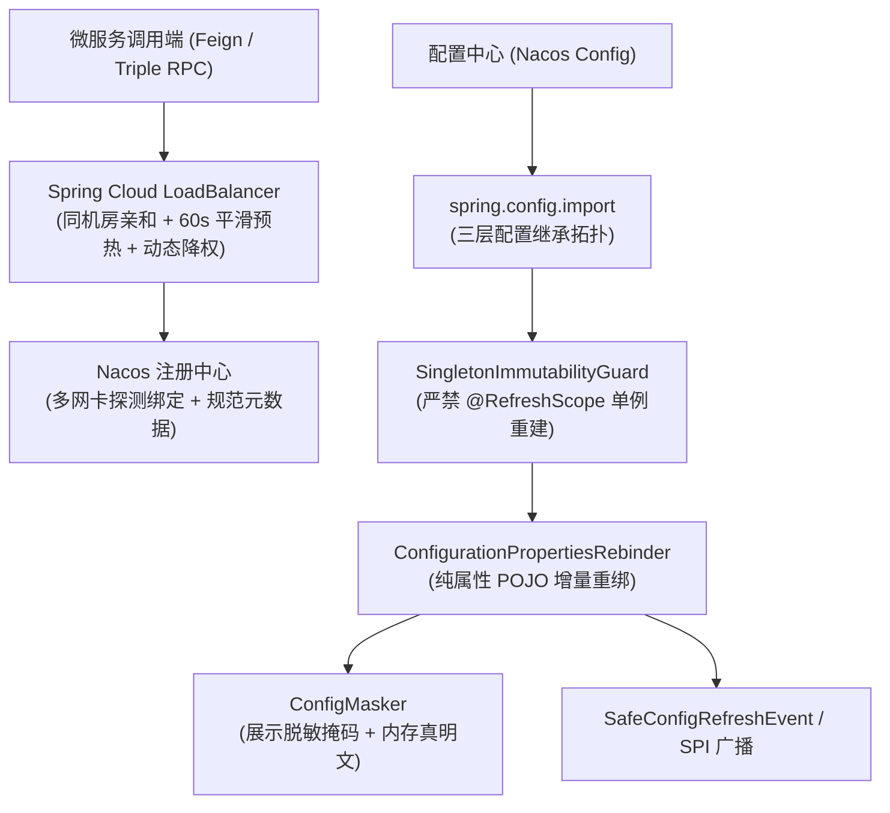
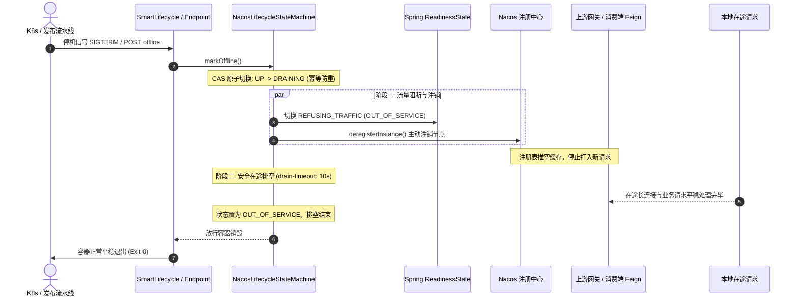

# ateng-cloud-nacos Nacos 服务注册与配置中心基础设施构件

> 面向企业级高可用分布式生产环境的 Nacos 2.x 注册发现与现代动态配置中心微服务基础设施 Starter 套件，全面对齐 Spring Boot 3 原生 `spring.config.import` 规范，内置容器多网卡精准探测、多维规范化元数据增强、60s 冷启动平滑预热、同机房可用区（Zone Affinity）亲和路由、gRPC 长连接事件感知与自愈、双阶段零 502 优雅下线治理、单例不可变安全配置热更、敏感属性星号脱敏屏障与 Micrometer 全维监控标尺。

---

## 0. 特性与公共 API 全景速查矩阵 (100% 覆盖)

### 0.1 核心组件与门面接口

| 类 / 接口 | 类型 | 核心职责 | 默认行为 / 装配守卫 |
| :--- | :--- | :--- | :--- |
| `AtengNacosAutoConfiguration` | 自动装配类 | Nacos 基础设施自动装配总入口 | 当 `ateng.cloud.nacos.enabled=true` 时激活 |
| `AtengNacosProperties` | 配置属性类 | 强类型映射配置前缀 `ateng.cloud.nacos` | 默认开启，排空 `10s`，预热 `60s` |
| `NacosTemplate` | 核心门面类 | Nacos 注册发现、配置运维、泛型强类型订阅、机房亲和筛选与状态诊断对称门面 | 标配 `@ConditionalOnMissingBean`，空安全保底 |
| `NacosWarmupHelper` | 辅助计算类 | 集中计算节点启动预热窗口、已运行秒数、剩余倒计时与完成状态 | 提供给 Actuator、健康检查器与度量管理器复用 |
| `NacosHealthChecker` | 启动诊断器 | 全景健康就绪诊断器，检测 `spring.config.import`、网卡绑定探测、回环高危告警、元数据全量快照、gRPC 通信与 K8s 排空防强杀预警 | 标配 `@ConditionalOnMissingBean`，启动即时自检 |
| `NacosConfigHealthChecker` | 诊断兼容类 | 校验配置中心连接与属性源导入状态 | 向后兼容门面 |
| `SingletonImmutabilityGuard` | 架构守卫 | `BeanFactoryPostProcessor` 容器启动扫描，严禁业务单例标注 `@RefreshScope` | 标配开启，违规直接 Fail-Fast 阻断应用启动 |
| `NacosConfigRefreshEngine` | 热更引擎 | 严格收敛于 `@ConfigurationProperties` 增量热绑，广播变更事件与链路追踪 | 驱动配置安全热更，维持 MDC 与异常隔离 |
| `SafeConfigRefreshEvent` | 应用事件类 | 携带配置变更集、新旧对比明细及 `traceId` 的强类型 Spring 事件 | 继承 `ApplicationEvent`，脱敏边界自动掩码 |
| `SafeConfigRefreshFailureEvent` | 领域事件类 | 配置热更属性增量重绑、校验或监听器执行失败时广播的强类型领域事件，携带错误描述、因果链与 MDC traceId | 继承 `ApplicationEvent`，异常不击穿容器 |
| `ConfigChangeItem` | 数据值对象 | 封装单项配置键、变更前旧值、变更后新值及变更类型 | 遵循“内存真明文”，`toString()` 输出脱敏掩码 |
| `ConfigChangeType` | 枚举类 | 配置变更类型：`ADDED`、`MODIFIED`、`DELETED` | 精准描述属性生命周期变化 |
| `NacosConfigChangeListener` | 扩展点 SPI | 支持按属性前缀（`getPrefix()`）过滤与按优先级排序的受管监听器 | 业务解耦声明，异常受到独立屏障隔离 |
| `ConfigMasker` | 安全工具类 | 自动识别 `password`、`secret`、`token`、`key` 等敏感特征键并执行掩码 | 100% 复用 `ateng-boot-core` 通用脱敏原语 |
| `NacosConnectionManager` | 连接管理器 | 统一管控 Nacos gRPC 客户端长连接监听与状态上报 | 随应用生命周期启动探测与注销释放 |
| `NacosConnectionEventListener` | 事件桥接器 | 将 Nacos 原生通信状态与 ServerList 事件转化为 Spring 强类型领域事件 | 条件装配于 `NacosConnectionManager` |
| `NacosConnectionEvent` | 领域事件类 | 描述 Nacos 长连接连接、断开与重连恢复的应用事件 | 包含通信模块、连接状态、服务端地址与客户端名 |
| `AtengNacosLoadBalancerClientConfiguration` | 负载均衡配置 | 针对微服务客户端注入同机房亲和与平滑预热选择器 | `@LoadBalancerClients` 默认规范配置 |
| `ZonePreferenceServiceInstanceListSupplier` | 负载均衡提供者 | 实现同机房（Zone Affinity）优先路由（支持 `ateng.cloud.nacos.zone` 与 `spring.cloud.loadbalancer.zone`），本区无实例时平滑降级全量 | 装饰底层 `ServiceInstanceListSupplier` |
| `NacosWarmupLoadBalancer` | 负载均衡器 | 基于节点启动时间的 60s 线性平滑加权预热 LoadBalancer | 标配保底底噪权重，杜绝冷启动雪崩 |
| `InstanceWeightCalculator` | 扩展点 SPI | 候选实例有效权重介入与动态调谐扩展点 | `@FunctionalInterface` 标配 `@ConditionalOnMissingBean` |
| `AdaptiveInstanceWeightCalculator` | 动态加权器 | 基于节点 CPU/内存系统负载的自适应阶梯阻尼平滑降权计算器 | 条件装配于 `adaptive-weight.enabled=true` |
| `NacosMetricsManager` | 监控管理器 | 向 Micrometer / Prometheus 导出 7 组核心运行、长连接、预热与热更度量标尺 | 条件装配于 `MeterRegistry`，支持平滑降级 |
| `NacosMetadataProvider` | 核心门面接口 | 收集全量元数据快照并支持填充至注册目标 | 默认实现为 `DefaultNacosMetadataProvider` |
| `NacosMetadataCustomizer` | 扩展点 SPI | 业务按需增量改写或注入自定义实例元数据 | `@FunctionalInterface`，支持 `Ordered` 排序 |
| `NacosNetworkAddressDetector` | 网络智能探测器 | 自动清洗虚拟网卡并绑定首选私网 IP，输出结构化 `NetworkAddressResult` | 默认忽略 `docker0`、`cni*` 等桥接网卡 |
| `NetworkAddressResult` | 数据值对象 | 封装侦测到的物理网卡名称、宿主 IP 与回环地址标记 | 不可变值对象，用于自检与审计 |
| `NacosDiscoveryPropertiesPostProcessor` | 属性后置处理器 | 注册前将检测 IP、集群与元数据注入 NacosDiscoveryProperties | 条件装配于 `NacosDiscoveryProperties` |
| `NacosLifecycleStateMachine` | 状态机管理器 | 原子驱动双阶段优雅下线排空与上线恢复 | 状态流转 `UP` -> `DRAINING` -> `OUT_OF_SERVICE` |
| `NacosGracefulShutdownLifecycle` | 生命周期钩子 | `SmartLifecycle` 最高优先级（`PHASE_MAX`）排空钩子 | 容器停机最先触发注销与排空 |
| `NacosServiceEndpoint` | Actuator 端点 | `/actuator/nacosService` 专属运维与状态端点 | 展示实例元数据、预热倒计时、受管监听器与热更状态 |
| `ZoneAffinityInstanceFilter` | 路由过滤器 | 机房 (Zone) 就近亲和与跨区平滑容灾降级过滤器 | 标配 `@ConditionalOnMissingBean` |
| `NacosConfigConstants` | 常量规约类 | Nacos 配置导入前缀、默认分组与三层配置 Data ID 推荐命名规约 | 开箱即用通用常量 |
| `NacosResultCode` | 错误码枚举 | Nacos 统一业务错误码 (`4101~4106`，归属 `NETWORK_RPC`) | 底层异常因果转译映射 |

---

### 0.2 NacosTemplate 核心门面 API 速查表

| 方法签名 | 返回类型 | 功能说明与生产语义 | 离线自洽保底行为 |
| :--- | :--- | :--- | :--- |
| `getConfig(dataId [, group])` | `String` | 读取指定配置集文本内容（未找到或离线时返回 null） | 离线保底返回 `null` |
| `getConfig(dataId [, group, timeout, format], targetType)` | `<T> T` | 强类型泛型读取配置集，自动执行 YAML/JSON 反序列化 | 离线保底返回 `null` |
| `findConfig(dataId [, group])` | `Optional<String>` | 弹性读取指定配置集内容（不存在或离线时返回 empty） | 保底返回 `Optional.empty()` |
| `findConfig(dataId [, group, timeout, format], targetType)` | `<T> Optional<T>` | 强类型弹性读取配置集，自动执行反序列化 | 保底返回 `Optional.empty()` |
| `subscribeConfig(dataId [, group, format], targetType, callback)` | `<T> AutoCloseable` | 编程式泛型订阅动态配置，反序列化后回调，自动透传 MDC 与生命周期注销 | 离线平滑注册空句柄 |
| `publishConfig(dataId [, group], content [, type])` | `boolean` | 发布或全量覆盖指定配置集内容 | 离线保底返回 `false` |
| `publishConfigCas(dataId [, group], content, casMd5 [, type])` | `boolean` | 基于配置内容 MD5 执行 CAS 乐观锁并发安全发布 | 离线保底返回 `false` |
| `removeConfig(dataId [, group])` | `boolean` | 物理移除指定的 Nacos 配置集 | 离线保底返回 `false` |
| `addConfigListener(dataId [, group], listener)` | `void` | 动态注册底层 Nacos 原生配置监听器回调 | 具备因果异常转译，离线平滑 No-Op |
| `removeConfigListener(dataId [, group], listener)` | `void` | 动态注销底层 Nacos 原生配置监听器回调 | 具备因果异常转译，离线平滑 No-Op |
| `ensureConfigAvailable()` | `void` | 强校验配置中心就绪状态，不可用时抛出业务异常 | 离线抛出 `NACOS_CONFIG_DISABLED` |
| `ensureDiscoveryAvailable()` | `void` | 强校验服务发现就绪状态，不可用时抛出业务异常 | 离线抛出 `NACOS_DISCOVERY_DISABLED` |
| `refreshConfig(changedKeys [, dataId, group])` | `SafeConfigRefreshEvent` | 声明式按属性键集合触发安全热更与 `@ConfigurationProperties` 重绑，失败时广播 `SafeConfigRefreshFailureEvent` 并记录至端点 | 返回强类型刷新事件对象 |
| `isConfigAvailable()` | `boolean` | 判断当前 Nacos 配置中心客户端是否就绪可用 | 离线返回 `false` |
| `isDiscoveryAvailable()` | `boolean` | 判断当前 Nacos 服务发现客户端是否就绪可用 | 离线返回 `false` |
| `getConfigServerStatus()` | `String` | 获取当前配置中心服务端通信状态（如 `UP`、`DOWN`） | 离线返回 `"DOWN"` |
| `getNamingServerStatus()` | `String` | 获取当前服务发现注册中心通信状态（如 `UP`、`DOWN`） | 离线返回 `"DOWN"` |
| `getAllInstances(serviceName [, groupName])` | `List<Instance>` | 查询指定服务全量实例列表（含未通过健康检查实例） | 保底返回空集合 `[]` |
| `getHealthyInstances(serviceName [, groupName])` | `List<Instance>` | 查询指定服务通过健康检查的实例列表 | 保底返回空集合 `[]` |
| `getInstances(serviceName [, groupName])` | `List<Instance>` | 查询健康且可用实例（自动过滤 `weight <= 0.0` 与禁用节点） | 保底返回空集合 `[]` |
| `selectOneHealthyInstance(serviceName [, groupName])` | `Optional<Instance>` | 基于 Nacos 随机权重算法选举单个健康可用实例 | 保底返回 `Optional.empty()` |
| `subscribeInstances(serviceName [, groupName, clusters], callback)` | `AutoCloseable` | 编程式订阅微服务实例拓扑动态变更（提供 4 组重载），首帧快照即时派发并自动注入 MDC 与异常隔离屏障 | 离线平滑注册空句柄 |
| `getMyInstance()` | `Optional<Instance>` | 获取当前服务节点在 Nacos 注册的自身实例信息快照 | 保底返回 `Optional.empty()` |
| `getSameZoneInstances(serviceName [, groupName])` | `List<Instance>` | 查询机房（Zone）就近亲和健康实例，本区全宕平滑降级全集群 | 保底返回空集合 `[]` |
| `isUnderProtection(serviceName [, groupName])` | `boolean` | 检测目标服务集群是否触发过载保护阈值 | 保底返回 `false` |
| `setInstanceEnabled(serviceName, [groupName,] ip, port, enabled)` | `void` | 动态启用或禁用目标服务实例 | 离线平滑 No-Op |
| `updateInstanceWeight(serviceName, [groupName,] ip, port, weight)` | `void` | 动态调节实例权重（设为 `0.0` 流量隔离，负数抛错） | 离线平滑 No-Op |
| `registerMetadata(key, value)` | `void` | 动态为当前节点追加或覆盖元数据并立即向 Nacos 推送 | 离线平滑 No-Op |
| `removeMetadata(key)` | `void` | 动态从当前节点移除指定元数据并立即向 Nacos 推送 | 离线平滑 No-Op |
| `markOnline()` | `void` | 主动将当前服务挂牌上线并恢复 Spring 就绪探针 `UP` | 离线平滑 No-Op |
| `markOffline()` | `void` | 主动将当前服务优雅摘牌并执行 `drain-timeout` 停机排空 | 离线平滑 No-Op |

---

### 0.3 配置属性速查表 (`ateng.cloud.nacos.*`)

| 配置项 | 类型 | 默认值 | 详细业务说明 |
| :--- | :--- | :--- | :--- |
| `ateng.cloud.nacos.enabled` | `boolean` | `true` | 是否激活 ateng-cloud Nacos 治理增强 |
| `ateng.cloud.nacos.drain-timeout` | `Duration` | `10s` | 实例优雅下线在途请求排空安全窗口时限 |
| `ateng.cloud.nacos.zone` | `String` | `""` | 默认物理机房 / 可用区标识 (如 `beijing-az1`) |
| `ateng.cloud.nacos.cluster` | `String` | `""` | 默认集群标识 (如 `default-cluster`) |
| `ateng.cloud.nacos.config.enabled` | `boolean` | `true` | 是否激活 Nacos 动态配置中心治理增强 |
| `ateng.cloud.nacos.config.timeout` | `Duration` | `3s` | 客户端配置运维操作默认超时时限 |
| `ateng.cloud.nacos.config.default-group` | `String` | `DEFAULT_GROUP` | 默认配置分组名称 |
| `ateng.cloud.nacos.config.check-on-startup` | `boolean` | `true` | 启动阶段是否执行配置中心连接与导入自检诊断 |
| `ateng.cloud.nacos.config.enforce-bean-immutability` | `boolean` | `true` | 是否强制开启业务单例不可变性守卫（严禁 `@RefreshScope` 滥用） |
| `ateng.cloud.nacos.loadbalancer.enabled` | `boolean` | `true` | 是否激活 Nacos 客户端负载均衡增强 |
| `ateng.cloud.nacos.loadbalancer.client-supplier-enabled` | `boolean` | `true` | 是否在客户端子上下文中激活默认服务实例提供者 |
| `ateng.cloud.nacos.loadbalancer.zone-affinity` | `boolean` | `true` | 是否开启同机房可用区（Zone Affinity）优先调度 |
| `ateng.cloud.nacos.loadbalancer.warmup` | `boolean` | `true` | 是否开启平滑启动预热（Startup Preheating）动态权重调度 |
| `ateng.cloud.nacos.loadbalancer.warmup-floor-weight-ratio` | `double` | `0.10` | 启动预热期间保底底噪权重比例 (10%) |
| `ateng.cloud.nacos.loadbalancer.adaptive-weight.enabled` | `boolean` | `false` | 是否激活基于系统资源指标的自适应动态加权调度 |
| `ateng.cloud.nacos.loadbalancer.adaptive-weight.min-floor-weight-ratio` | `double` | `0.10` | 过载保底底噪权重比例 (10%) |
| `ateng.cloud.nacos.loadbalancer.adaptive-weight.medium-load-threshold` | `double` | `0.70` | 中等负载阈值 (70%) |
| `ateng.cloud.nacos.loadbalancer.adaptive-weight.high-load-threshold` | `double` | `0.85` | 高负载过载阈值 (85%) |
| `ateng.cloud.nacos.loadbalancer.adaptive-weight.damping-ratio` | `double` | `0.15` | 权重调谐阶梯阻尼防抖比例 (15%) |
| `ateng.cloud.nacos.loadbalancer.adaptive-weight.sample-interval` | `Duration` | `5s` | 动态权重调谐采样评估周期 |
| `ateng.cloud.nacos.metrics.enabled` | `boolean` | `true` | 是否导出 Nacos 治理与热更 Micrometer 监控指标 |
| `ateng.cloud.nacos.metadata.startup-time` | `boolean` | `true` | 是否自动注入 JVM 启动毫秒时间戳 |
| `ateng.cloud.nacos.metadata.warmup-duration` | `Duration` | `60s` | 平滑启动预热窗口时长 |
| `ateng.cloud.nacos.metadata.version` | `String` | `""` | 应用版本号 (为空时自动从 Environment 读取) |
| `ateng.cloud.nacos.metadata.env` | `String` | `""` | 运行时环境标识 (为空时自动对齐 Spring Profile) |
| `ateng.cloud.nacos.metadata.traffic-tag` | `String` | `""` | 全链路流量染色标记 (如 `gray`) |
| `ateng.cloud.nacos.metadata.custom.*` | `Map<String, String>` | `{}` | 业务自定义元数据键值字典 |
| `ateng.cloud.nacos.network.network-interface` | `String` | `""` | 显式指定绑定的物理网卡名 (如 `eth0`) |
| `ateng.cloud.nacos.network.preferred-networks` | `List<String>` | `[]` | 首选网段前缀列表 (如 `["10.", "172.16."]`) |
| `ateng.cloud.nacos.network.ignored-interfaces` | `List<String>` | `["docker0", ...]` | 忽略的虚拟或桥接网卡正则黑名单 |
| `ateng.cloud.nacos.network.fail-on-loopback` | `boolean` | `true` | 仅侦测到 127.0.0.1 时是否 Fail-Fast 阻断启动 |
| `ateng.cloud.nacos.endpoint.enabled` | `boolean` | `true` | 是否暴露 `/actuator/nacosService` 运维端点 |

---

### 0.4 Micrometer 核心监控标尺矩阵

| 指标名称 | 类型 | 标签 Tag | 描述说明与数值含义 |
| :--- | :--- | :--- | :--- |
| `nacos.grpc.connection.status` | Gauge | `service` | Nacos gRPC 长连接与配置中心连通状态（`1.0`: UP/正常，`0.0`: DOWN/断连） |
| `nacos.grpc.disconnect.total` | Counter | `service` | Nacos gRPC 长连接异常断开累计次数计数器 |
| `nacos.config.refresh.total` | Counter | `service` | 动态配置安全热更累计触发总次数（随每次刷新递增） |
| `nacos.config.refresh.failure` | Counter | `service` | 动态配置安全热更失败累计计数（重绑异常或监听器抛错触发） |
| `nacos.instances.healthy` | Gauge | `service` | 当前微服务在 Nacos 注册中心已注册的健康可用实例数 |
| `nacos.lifecycle.state` | Gauge | `service` | 当前节点优雅生命周期状态（`1.0`: UP/在线，`0.0`: OUT_OF_SERVICE/已下线排空） |
| `nacos.instance.warmup.remaining.seconds` | Gauge | `service` | 当前节点启动平滑预热剩余秒数（预热完成后归 `0.0`） |

---

## 1. 模块定位与 Maven 坐标

`ateng-cloud-nacos` 专职封装 Nacos 2.x 注册中心与动态配置中心在 Spring Cloud 微服务架构下的企业级治理能力。通过单向依赖消费 `ateng-boot-bom`，为全域微服务提供统一的节点拓扑寻址、配置动态热更、网络探测与自适应负载均衡底座。

```xml
<dependency>
    <groupId>io.github.atengk</groupId>
    <artifactId>ateng-cloud-nacos</artifactId>
</dependency>
```

> [!NOTE]
> 若需体验敏感配置密文解析与展示脱敏，协同引入 `ateng-boot-encrypt`；若需集成微服务客户端负载均衡与监控，协同引入 `spring-cloud-starter-loadbalancer` 与 `spring-boot-starter-actuator`。

---

## 2. 核心架构与设计不变量

微服务基础设施在生产环境中面临网络抖动、链路穿透与瞬时雪崩等极端挑战，本构件严守以下微服务专属架构铁律：



### 零 502 无损下线双阶段状态机时序



---

## 3. 动态配置中心与安全热更治理 (能力领域大章)

### 3.1 现代三层配置导入规范与单例不可变守卫

全域统一遵循 Spring Boot 3 标准 `spring.config.import` 规范，彻底废弃过时的 `bootstrap.yml`。

#### 本特性专属 YAML 配置片段
```yaml
spring:
  config:
    import:
      # 1. 弹性探测本地真实凭据配置（物理缺失时静默跳过，保障 CI 离线自洽）
      - "optional:classpath:application-local.yml"
      # 2. 共享公共基础配置（通用超时、线程池默认参数）
      - "optional:nacos:shared-common.yaml?group=DEFAULT_GROUP&refreshEnabled=true"
      # 3. 共享中间件与数据源配置（共享 Redis、RabbitMQ 集群连接）
      - "optional:nacos:shared-infrastructure.yaml?group=DEFAULT_GROUP&refreshEnabled=true"
      # 4. 当前微服务应用专用配置（按应用名与环境 Profile 隔离）
      - "optional:nacos:${spring.application.name}-${spring.profiles.active}.yaml?group=DEFAULT_GROUP&refreshEnabled=true"

ateng:
  cloud:
    nacos:
      config:
        enabled: true # 是否激活 Nacos 动态配置中心治理增强
        check-on-startup: true # 启动阶段是否执行配置中心连接与导入自检诊断
        enforce-bean-immutability: true # 是否强制开启业务单例不可变性守卫（严禁 @RefreshScope 滥用）
```

#### 容灾与边界机制说明
- **为什么严禁在业务单例标注 `@RefreshScope`？**
  `@RefreshScope` 会在配置变更时强行物理销毁 Bean 实例并重新初始化。在生产环境下，这会导致正在执行事务的线程 Bean 被销毁引发事务断裂、持锁状态悬挂以及请求排队雪崩；
- **架构级防御 (`SingletonImmutabilityGuard`)**：
  框架内置容器启动扫描守卫。凡发现任何标注了 `@Service` 或 `@Repository` 的业务单例挂载了 `@RefreshScope`，立即抛出 `IllegalStateException` 强行阻断应用启动。

---

### 3.2 电商订单配置增量热更与敏感脱敏屏障

业务配置统一使用 `@ConfigurationProperties` 声明，热更时仅对纯属性 POJO 实施增量绑定，内存保留真明文，展示层星号掩码脱敏。

#### 本特性专属 YAML 配置片段
```yaml
ateng:
  boot:
    encrypt:
      enabled: true # 开启密文配置自动透明解密

sample:
  order:
    config:
      freight-rate: 10.0 # 基础订单运费（元）
      free-freight-threshold: 99.0 # 满额包邮门槛（元）
      pay-channel-secret-key: "ENC(ydS/bhIcoogPc1a6V/whVwUR54CsaUtyWWu9LgIZai9jksDqNO2g5yRaprANGUdt8biXgfIE)" # 第三方支付通道通信加密密钥
      order-timeout: 30m # 未支付订单自动关闭时限（强类型 Duration 规范）
      max-items-per-order: 50 # 单笔订单最大购买商品件数上限
```

#### 实战业务代码示例 (逆向提取自 Sample)
```java
@Component
@ConfigurationProperties(prefix = "sample.order.config")
public class OrderConfigProperties {
    private Double freightRate = 10.0;
    private Double freeFreightThreshold = 99.0;
    private String payChannelSecretKey = "";
    private Duration orderTimeout = Duration.ofMinutes(30);
    private Integer maxItemsPerOrder = 50;

    // Getters and Setters...
}
```

```java
@RestController
@RequestMapping("/sample/cloud/nacos/config")
public class NacosConfigController {

    private final OrderConfigProperties orderConfigProperties;
    private final NacosTemplate nacosTemplate;

    public NacosConfigController(OrderConfigProperties orderConfigProperties, NacosTemplate nacosTemplate) {
        this.orderConfigProperties = orderConfigProperties;
        this.nacosTemplate = nacosTemplate;
    }

    /**
     * 读取当前电商订单配置（展示视图自动执行敏感星号掩码脱敏）
     */
    @GetMapping("/current")
    public Result<OrderConfigVO> getCurrentConfig() {
        String maskedKey = ConfigMasker.mask("sample.order.config.pay-channel-secret-key", orderConfigProperties.getPayChannelSecretKey());
        OrderConfigVO vo = new OrderConfigVO(
                orderConfigProperties.getFreightRate(),
                orderConfigProperties.getFreeFreightThreshold(),
                maskedKey,
                orderConfigProperties.getOrderTimeout(),
                orderConfigProperties.getMaxItemsPerOrder()
        );
        return Result.success(vo);
    }

    /**
     * 读取内存中的真实解密明文（严格遵循“内存真明文”不变量）
     */
    @GetMapping("/secret")
    public Result<String> getRawSecret() {
        return Result.success(orderConfigProperties.getPayChannelSecretKey());
    }

    /**
     * 声明式主动触发配置属性安全增量热更
     */
    @PostMapping("/simulate-refresh")
    public Result<SafeConfigRefreshVO> simulateRefresh(@Valid @RequestBody RefreshRequestDTO request) {
        SafeConfigRefreshEvent event = nacosTemplate.refreshConfig(request.getKeys());
        return Result.success(new SafeConfigRefreshVO(event.getTraceId(), event.getChangedKeys(), event.getChangedKeys().size(), true));
    }
}
```

#### 容灾与边界机制说明
- **内存真明文不变量**：
  `ConfigChangeItem.getOldValue()` 与 `getNewValue()` 在内存中始终保留 100% 原始真实明文，供业务层消费真实支付凭据；仅在 `toString()`、日志审计与展示视图输出边界实施 `******` 掩码脱敏，杜绝脏掩码写回数据库；
- **全链路 MDC `traceId` 穿透**：
  配置热更触发时，框架自动检测并注入 32 位唯一 `traceId` 至 MDC 上下文，并在 `finally` 块中确定性清理，杜绝线程池污染。

---

### 3.3 双模配置变更监听 (SPI 与 Spring EventListener)

业务解耦感知配置变更提供两种范式：按属性前缀过滤的受管 SPI 接口与 Spring 原生事件广播。

#### 本特性专属 YAML 配置片段
```yaml
ateng:
  cloud:
    nacos:
      config:
        enabled: true
```

#### 实战业务代码示例 (逆向提取自 Sample)
```java
// 范式一：实现 NacosConfigChangeListener SPI 进行精确前缀过滤
@Component
public class DemoNacosConfigChangeListener implements NacosConfigChangeListener {

    private static final Logger log = LoggerFactory.getLogger(DemoNacosConfigChangeListener.class);

    @Override
    public void onConfigChange(SafeConfigRefreshEvent event) {
        log.info("[DemoNacosConfigChangeListener] 收到前缀 'sample.order.config' 变更通知，traceId: {}, changedKeys: {}",
                event.getTraceId(), event.getChangedKeys());
    }

    @Override
    public String getPrefix() {
        return "sample.order.config"; // 仅当变更集包含以 sample.order.config 开头的属性时触发
    }

    @Override
    public int getOrder() {
        return 10; // 执行优先级
    }
}

// 范式二：使用 Spring 原生 @EventListener 监听强类型事件
@Component
public class DemoSafeRefreshEventListener {

    private static final Logger log = LoggerFactory.getLogger(DemoSafeRefreshEventListener.class);

    @EventListener
    public void onSafeRefresh(SafeConfigRefreshEvent event) {
        log.info("[DemoSafeRefreshEventListener] 监听到配置热更事件，traceId: {}, changedCount: {}",
                event.getTraceId(), event.getChangedKeys().size());
    }
}
```

#### 容灾与边界机制说明
- **独立异常屏障**：每个 `NacosConfigChangeListener` SPI 的执行均受到独立 `try-catch` 屏障保护，单个监听器异常会被框架隔离并转为失败事件，绝不阻断后续监听器与全局事件广播。

---

### 3.4 编程式强类型泛型订阅与 MDC 追踪穿透

针对结构化复杂规则（如风控规则、动态黑白名单），通过 `NacosTemplate.subscribeConfig` 泛型门面实现自动反序列化与生命周期受管注销。

#### 本特性专属 YAML 配置片段
```yaml
ateng:
  cloud:
    nacos:
      config:
        timeout: 3s
```

#### 实战业务代码示例 (逆向提取自 Sample)
```java
@Service
public class DemoTypedSubscriptionService {

    private static final Logger log = LoggerFactory.getLogger(DemoTypedSubscriptionService.class);
    public static final String DATA_ID_TRADE_RULE = "trade-rule.json";

    private final NacosTemplate nacosTemplate;
    private AutoCloseable subscriptionHandle;

    public DemoTypedSubscriptionService(NacosTemplate nacosTemplate) {
        this.nacosTemplate = nacosTemplate;
    }

    @PostConstruct
    public void init() {
        // 编程式订阅 trade-rule.json 泛型强类型配置集，自动挂载 MDC traceId 穿透与异常屏障
        try {
            this.subscriptionHandle = nacosTemplate.subscribeConfig(
                    DATA_ID_TRADE_RULE,
                    "DEFAULT_GROUP",
                    TradeRuleConfig.class,
                    this::onTradeRuleUpdated
            );
            log.info("[DemoTypedSubscriptionService] 成功注册 '{}' 泛型强类型动态配置订阅句柄", DATA_ID_TRADE_RULE);
        } catch (Exception ex) {
            log.warn("[DemoTypedSubscriptionService] 初始化动态配置订阅跳过 (离线保护): {}", ex.getMessage());
        }
    }

    @PreDestroy
    public void destroy() {
        if (subscriptionHandle != null) {
            try {
                subscriptionHandle.close(); // 容器停机确定性注销，杜绝回调悬挂
            } catch (Exception ignored) {}
        }
    }

    public void onTradeRuleUpdated(TradeRuleConfig rule) {
        log.info("收到交易风控规则动态变更通知, traceId={}, ruleName={}, limit={}",
                MDC.get("traceId"), rule.getRuleName(), rule.getMaxLimit());
    }
}
```

#### 容灾与边界机制说明
- **`AutoCloseable` 确定性注销**：动态订阅返回可关闭句柄，在 Spring 销毁生命周期（`@PreDestroy`）必须显式注销，杜绝长连接监听器泄漏导致旧实例无法 GC。

---

### 3.5 配置热更异常隔离屏障与失败告警广播

#### 本特性专属 YAML 配置片段
```yaml
ateng:
  cloud:
    nacos:
      config:
        enabled: true
```

#### 实战业务代码示例 (逆向提取自 Sample)
```java
@Component
public class DemoConfigRefreshFailureEventListener {

    private static final Logger log = LoggerFactory.getLogger(DemoConfigRefreshFailureEventListener.class);

    @EventListener
    public void onSafeConfigRefreshFailure(SafeConfigRefreshFailureEvent event) {
        // 捕获热更失败根因链，驱动机器人告警（钉钉/企微）与应急处置
        log.warn("[告警通知] 检测到 Nacos 配置热更异常领域事件 [dataId='{}', group='{}', changedKeys={}, traceId='{}', error='{}']",
                event.getDataId(), event.getGroup(), event.getChangedKeys(), event.getTraceId(), event.getErrorMessage());
    }
}
```

#### 容灾与边界机制说明
- **异常不击穿原则**：热更失败时框架绝不任由未受控异常击穿 Spring 容器，而是广播携带完整因果链（`cause`）的 `SafeConfigRefreshFailureEvent` 领域事件，并同步记入 `/actuator/nacosService` 端点供运维审计。

---

## 4. 服务注册发现与无损上下线治理 (能力领域大章)

### 4.1 多网卡精准探测与规范化实例元数据增强

在 Docker / Kubernetes 容器多网卡环境中，自动清洗虚拟网卡并绑定首选私网 IP，注入标准化多维元数据。

#### 本特性专属 YAML 配置片段
```yaml
ateng:
  cloud:
    nacos:
      zone: beijing-az1 # 物理机房可用区标识
      cluster: default-cluster # 集群标识
      metadata:
        startup-time: true # 自动注入 JVM 启动毫秒时间戳
        warmup-duration: 60s # 平滑启动预热窗口时长
        version: 1.0.0 # 应用版本号
        custom:
          team: core-platform # 业务自定义标签
      network:
        preferred-networks:
          - "10."
          - "192.168."
        ignored-interfaces:
          - "docker0"
          - "cni.*"
        fail-on-loopback: true # 仅侦测到 127.0.0.1 时 Fail-Fast 阻断启动
```

#### 实战业务代码示例 (逆向提取自 Sample)
```java
// 自定义元数据扩展点 SPI
@Component
public class SampleMetadataCustomizer implements NacosMetadataCustomizer {

    @Override
    public void customize(Map<String, String> metadata) {
        metadata.put("framework", "ateng-cloud");
        metadata.put("maintainer", "Ateng");
        metadata.put("demo-module", "sample-cloud-nacos");
    }

    @Override
    public int getOrder() {
        return 0;
    }
}
```

#### 容灾与边界机制说明
- **回环地址高危防御**：若未能探测到有效局域网 IP 回退至 `127.0.0.1`，会导致跨主机微服务通信瘫痪。在开启 `fail-on-loopback: true` 时，框架在启动阶段直接 Fail-Fast 阻断容器启动，防止带病上线。

---

### 4.2 NacosTemplate 服务发现与运维管理

通过核心门面 `NacosTemplate` 对微服务健康实例、机房亲和节点、自身注册状态及动态元数据进行全生命周期对称运维。

#### 本特性专属 YAML 配置片段
```yaml
ateng:
  cloud:
    nacos:
      enabled: true
```

#### 实战业务代码示例 (逆向提取自 Sample)
```java
@RestController
@RequestMapping("/sample/cloud/nacos/discovery")
public class NacosDiscoveryController {

    private final NacosTemplate nacosTemplate;
    private final NacosMetadataProvider metadataProvider;

    public NacosDiscoveryController(NacosTemplate nacosTemplate, NacosMetadataProvider metadataProvider) {
        this.nacosTemplate = nacosTemplate;
        this.metadataProvider = metadataProvider;
    }

    /**
     * 获取当前服务节点注入的所有元数据键值快照
     */
    @GetMapping("/metadata")
    public Result<Map<String, String>> getMetadata() {
        return Result.success(metadataProvider.getMetadata());
    }

    /**
     * 查询指定服务的健康可用实例列表
     */
    @GetMapping("/instances")
    public Result<List<InstanceVO>> getInstances(@RequestParam(defaultValue = "sample-cloud-nacos") String serviceName) {
        List<InstanceVO> list = nacosTemplate.getInstances(serviceName).stream()
                .map(InstanceVO::fromInstance)
                .collect(Collectors.toList());
        return Result.success(list);
    }

    /**
     * 查询同机房亲和优先的健康实例列表
     */
    @GetMapping("/same-zone")
    public Result<List<InstanceVO>> getSameZoneInstances(@RequestParam(defaultValue = "sample-cloud-nacos") String serviceName) {
        List<InstanceVO> list = nacosTemplate.getSameZoneInstances(serviceName).stream()
                .map(InstanceVO::fromInstance)
                .collect(Collectors.toList());
        return Result.success(list);
    }

    /**
     * 动态调节指定服务实例权重 (设为 0.0 可执行流量隔离)
     */
    @PostMapping("/instance/weight")
    public Result<Void> updateInstanceWeight(@RequestParam String serviceName, @RequestParam String ip, @RequestParam int port, @RequestParam double weight) {
        nacosTemplate.updateInstanceWeight(serviceName, ip, port, weight);
        return Result.success();
    }
}
```

#### 容灾与边界机制说明
- **保底返回契约**：所有列表查询接口无可用节点时统一保底返回空集合（`Collections.emptyList()`），严禁返回 `null`；离线环境下各运维方法平滑降级执行 No-Op，绝不抛出未受控异常。

---

### 4.3 双阶段优雅下线排空与 K8s 停机防强杀联动

#### 本特性专属 YAML 配置片段
```yaml
ateng:
  cloud:
    nacos:
      drain-timeout: 10s # 实例优雅下线在途请求排空安全窗口时限
```

#### 实战业务代码示例 (逆向提取自 Sample)
```java
// 主动将当前服务优雅摘牌并触发在途排空
nacosTemplate.markOffline();

// 主动将当前服务恢复挂牌上线
nacosTemplate.markOnline();
```

#### 容灾与边界机制说明
- **双阶段下线原子流转**：
  1. **阶段一（流量阻断）**：CAS 状态切换至 `DRAINING`，Spring Boot 就绪探针立即置为 `REFUSING_TRAFFIC` (`OUT_OF_SERVICE`) 并向 Nacos 注销节点；
  2. **阶段二（在途排空）**：挂起当前线程等待 `drain-timeout: 10s`，等待全网调用端同步注册表缓存并消化已接入的在途请求；
- **K8s 停机防强杀安全预警**：
  若开发者配置的 `drain-timeout` 超过 25 秒，`NacosHealthChecker` 会在启动自检输出 `WARN` 预警，提示排空时限过长可能在 Kubernetes 发送 `SIGKILL` 强杀前尚未完成连接清理，建议调大 Pod 的 `terminationGracePeriodSeconds`。

---

### 4.4 gRPC 长连接生命周期领域事件感知 (NacosConnectionEvent)

#### 本特性专属 YAML 配置片段
```yaml
ateng:
  cloud:
    nacos:
      enabled: true
```

#### 实战业务代码示例 (逆向提取自 Sample)
```java
@Component
public class DemoConnectionEventListener {

    private static final Logger log = LoggerFactory.getLogger(DemoConnectionEventListener.class);

    @EventListener
    public void onNacosConnectionEvent(NacosConnectionEvent event) {
        log.info("[DemoConnectionEventListener] 监听到 Nacos 长连接事件 [module={}, status={}, server={}]",
                event.getModuleType(), event.getStatus(), event.getServerAddress());
    }
}
```

#### 容灾与边界机制说明
- **长连接断开韧性自愈**：在瞬时网络闪断或集群主备切换时，框架自动将底层的连接状态转换为 Spring 强类型应用事件，同时原子更新 `nacos.grpc.connection.status` 度量标尺，便于业务即时触发降级保护。

---

### 4.5 编程式微服务实例拓扑动态变更订阅

#### 本特性专属 YAML 配置片段
```yaml
ateng:
  cloud:
    nacos:
      enabled: true
```

#### 实战业务代码示例 (逆向提取自 Sample)
```java
@Service
public class DemoInstanceSubscriptionService {

    private static final Logger log = LoggerFactory.getLogger(DemoInstanceSubscriptionService.class);
    public static final String TARGET_SERVICE_NAME = "sample-cloud-nacos";

    private final NacosTemplate nacosTemplate;
    private AutoCloseable subscriptionHandle;

    public DemoInstanceSubscriptionService(NacosTemplate nacosTemplate) {
        this.nacosTemplate = nacosTemplate;
    }

    @PostConstruct
    public void init() {
        // 编程式订阅 sample-cloud-nacos 实例拓扑变更，自动挂载 MDC traceId 穿透与异常屏障
        try {
            this.subscriptionHandle = nacosTemplate.subscribeInstances(
                    TARGET_SERVICE_NAME,
                    this::onInstancesChanged
            );
            log.info("[DemoInstanceSubscriptionService] 成功注册 '{}' 实例拓扑动态变更订阅句柄", TARGET_SERVICE_NAME);
        } catch (Exception ex) {
            log.warn("[DemoInstanceSubscriptionService] 初始化实例动态订阅跳过 (离线保护): {}", ex.getMessage());
        }
    }

    @PreDestroy
    public void destroy() {
        if (subscriptionHandle != null) {
            try {
                subscriptionHandle.close();
            } catch (Exception ignored) {}
        }
    }

    public void onInstancesChanged(List<Instance> instances) {
        log.info("收到微服务实例拓扑变更通知, traceId={}, count={}",
                MDC.get("traceId"), instances != null ? instances.size() : 0);
    }
}
```

#### 容灾与边界机制说明
- **首帧即时快照派发**：在注册监听时，框架立即向底层拉取当前服务实例快照并向监听回调同步触发一次（首帧通知），避免调用方在无变更前处于拓扑盲区。

---

## 5. 客户端负载均衡与流量调谐 (能力领域大章)

### 5.1 同机房可用区（Zone Affinity）优先路由与平滑容灾降级

在多可用区多活部署架构下，微服务调用优先在本机房（可用区）内闭环，降低跨机房网络延迟与专线带宽开销。

#### 本特性专属 YAML 配置片段
```yaml
ateng:
  cloud:
    nacos:
      zone: beijing-az1 # 本地所在机房可用区
      loadbalancer:
        enabled: true
        zone-affinity: true # 是否开启同机房可用区（Zone Affinity）优先调度
```

#### 实战业务代码示例 (逆向提取自 Sample)
```java
@RestController
@RequestMapping("/sample/cloud/nacos/loadbalancer")
public class NacosLoadBalancerController {

    private final ObjectProvider<LoadBalancerClient> loadBalancerClientProvider;

    public NacosLoadBalancerController(ObjectProvider<LoadBalancerClient> loadBalancerClientProvider) {
        this.loadBalancerClientProvider = loadBalancerClientProvider;
    }

    /**
     * 根据负载均衡选择器挑选最优服务实例
     */
    @GetMapping("/choose")
    public Result<InstanceVO> chooseInstance(@RequestParam(defaultValue = "sample-cloud-nacos") String serviceName) {
        LoadBalancerClient loadBalancerClient = loadBalancerClientProvider.getIfAvailable();
        if (loadBalancerClient == null) {
            return Result.success(null);
        }
        ServiceInstance chosen = loadBalancerClient.choose(serviceName);
        return Result.success(chosen != null ? InstanceVO.fromServiceInstance(chosen) : null);
    }
}
```

#### 容灾与边界机制说明
- **平滑降级容灾语义**：`ZonePreferenceServiceInstanceListSupplier` 优先过滤匹配 `metadata.zone` 等于当前客户端所在机房的实例；若本机房所有实例均宕机或未部署本可用区实例，**自动平滑降级为全集群全量健康实例**，杜绝硬切机房导致业务彻底不可用。

---

### 5.2 60s 节点冷启动平滑加权预热防雪崩

#### 本特性专属 YAML 配置片段
```yaml
ateng:
  cloud:
    nacos:
      metadata:
        startup-time: true # 注册时自动注入启动毫秒时间戳
        warmup-duration: 60s # 预热窗口时长
      loadbalancer:
        warmup: true # 是否开启平滑启动预热动态权重调度
        warmup-floor-weight-ratio: 0.10 # 启动预热期间保底底噪权重比例 (10%)
```

#### 动态权重计算数学模型与边界说明
微服务冷启动阶段，JIT 尚未即时编译、热点代码未充分优化、连接池尚未初始化完成。若瞬间导入全量权重流量，极易引发 CPU 飙高、线程池打满与级联超时。

设实例配置基准权重为 $w_{\text{base}}$（默认为 1），预热窗口时长为 $T$（默认 60s），实例已启动运行时间为 $t$：
$$w(t) = \max\left(w_{\text{floor}}, \min\left(w_{\text{base}}, \left\lfloor w_{\text{base}} \times \left(\frac{t}{T}\right) \right\rfloor\right)\right)$$
其中保底底噪权重 $w_{\text{floor}} = \max(1, \lfloor w_{\text{base}} \times 0.10 \rfloor)$。在前 60 秒内，权重随时间线性爬升，保底保持至少 10% 底噪流量以充分激发 JIT 编译；60 秒后恢复 100% 正常调度权重。

---

### 5.3 基于系统负载指标的自适应动态加权调谐

#### 本特性专属 YAML 配置片段
```yaml
ateng:
  cloud:
    nacos:
      loadbalancer:
        adaptive-weight:
          enabled: true # 激活自适应动态加权调度
          min-floor-weight-ratio: 0.10 # 过载保底底噪权重比例 (10%)
          medium-load-threshold: 0.70 # 中等负载阈值 (70%)
          high-load-threshold: 0.85 # 高负载过载阈值 (85%)
          damping-ratio: 0.15 # 调谐阶梯阻尼防抖比例 (15%)
          sample-interval: 5s # 动态权重调谐采样评估周期
```

#### 实战业务代码示例 (逆向提取自 Sample)
```java
/**
 * 演示基于系统负载指标（CPU/内存）的自适应动态加权调谐
 */
@GetMapping("/calculate-weight")
public Result<Double> calculateWeight(
        @RequestParam(defaultValue = "1.0") double currentWeight,
        @RequestParam(defaultValue = "0.90") double cpuUsage,
        @RequestParam(defaultValue = "demo-inst-1") String instanceId,
        @RequestParam(defaultValue = "8080") int port) {
    InstanceWeightCalculator calculator = instanceWeightCalculatorProvider.getIfAvailable();
    if (calculator == null) {
        return Result.success(currentWeight);
    }
    DefaultServiceInstance instance = new DefaultServiceInstance(
            instanceId, "sample-cloud-nacos", "127.0.0.1", port, false,
            Map.of("cpu-usage", String.valueOf(cpuUsage), "nacos.weight", "1.0")
    );
    double calculated = calculator.calculateWeight(instance, currentWeight);
    return Result.success(calculated);
}
```

#### 容灾与边界机制说明
- **阻尼防抖防震荡**：采样周期收敛为 5s~10s，且仅当负载波动超过 $\pm 15\%$（`damping-ratio`）阶梯门槛时才触发调谐，消除微小波动引发的调度频繁摇摆；
- **全集群过载熔断兜底**：当全体可用实例均处于重度过载状态时，负载均衡器触发全集群过载熔断保护，自动安全回退为均匀轮询，坚决杜绝因算法过度敏感导致全网节点自我孤立引发 503。

---

## 6. 全维可观测性与健康自检 (能力领域大章)

### 6.1 Actuator `/actuator/nacosService` 专属运维端点

#### 本特性专属 YAML 配置片段
```yaml
management:
  endpoints:
    web:
      exposure:
        include: health,info,nacosService
  endpoint:
    health:
      show-details: always
      probes:
        enabled: true

ateng:
  cloud:
    nacos:
      endpoint:
        enabled: true # 是否暴露 /actuator/nacosService 运维端点
```

#### 状态端点响应 JSON 示例
```bash
curl -s http://localhost:8080/actuator/nacosService
```

```json
{
  "status": "UP",
  "serviceName": "sample-cloud-nacos",
  "drainTimeout": "10s",
  "zone": "beijing-az1",
  "cluster": "default-cluster",
  "metadata": {
    "version": "1.0.0",
    "warmup-duration": "60s",
    "team": "core-platform",
    "framework": "ateng-cloud"
  },
  "warmupDuration": "60s",
  "warmupUptimeSeconds": 15,
  "warmupRemainingSeconds": 45,
  "warmupCompleted": false,
  "config": {
    "enforceBeanImmutability": true,
    "listeners": [
      {
        "class": "io.github.atengk.cloud.sample.nacos.config.DemoNacosConfigChangeListener",
        "prefix": "sample.order.config",
        "order": 10
      }
    ],
    "lastRefresh": {
      "traceId": "ee02496e9149d0f0d281b8bf07f5e876",
      "timestamp": 1793115496654,
      "changedKeys": [
        "sample.order.config.freight-rate",
        "sample.order.config.pay-channel-secret-key"
      ],
      "success": true,
      "durationMs": 12
    }
  }
}
```

---

### 6.2 Micrometer 全维监控指标导出全景

#### 本特性专属 YAML 配置片段
```yaml
ateng:
  cloud:
    nacos:
      metrics:
        enabled: true # 是否导出 Nacos 治理与热更 Micrometer 监控指标
```

#### 监控告警指标 Prometheus PromQL 查询示例
- **Nacos gRPC 连接中断告警**：`nacos_grpc_connection_status{service="sample-cloud-nacos"} == 0`
- **动态配置热更失败率突增**：`rate(nacos_config_refresh_failure_total[5m]) > 0`
- **优雅下线状态排空跟踪**：`nacos_lifecycle_state{service="sample-cloud-nacos"} == 0`
- **冷启动节点平滑预热剩余秒数**：`nacos_instance_warmup_remaining_seconds{service="sample-cloud-nacos"}`

---

### 6.3 NacosHealthChecker 启动即时全景自检与快照探针

#### 本特性专属 YAML 配置片段
```yaml
ateng:
  cloud:
    nacos:
      config:
        check-on-startup: true
      network:
        fail-on-loopback: true
```

#### 启动阶段 ASCII 全景就绪横幅示例
```text
=================== [ateng-cloud-nacos 全景健康就绪诊断报告] ===================
 应用标识 (Application)    : sample-cloud-nacos
 服务端状态 (ServerStatus) : DISCONNECTED
 网卡绑定 (NetworkBind)    : Interface=eth0, IP=192.168.1.100
 可用区机房 (Zone/Cluster) : Zone=beijing-az1, Cluster=default-cluster
 优雅停机 (DrainTimeout)  : 10s
 容灾快照 (SnapshotDisk)  : HEALTHY (Writable)
 启动预热 (WarmupStatus)  : Duration=60s, Remaining=57s, Completed=false
 动态配置 (ConfigSources) : BYPASS (Active: 0, DefaultGroup: DEFAULT_GROUP)
 实例元数据拓扑 (Metadata): {cluster=default-cluster, demo-module=sample-cloud-nacos, env=test, framework=ateng-cloud, maintainer=Ateng, startup-time=1793352385642, team=core-platform, version=1.0.0, warmup-duration=60s, zone=beijing-az1}
================================================================================
```

#### 容灾与边界机制说明
- **本地容灾快照磁盘可写性预检**：
  在 Kubernetes 环境下，当 Pod 启用安全只读文件系统（`readOnlyRootFilesystem: true`）且未挂载存储卷时，Nacos 客户端无法落盘缓存快照，一旦网络隔离容灾将失效。`NacosHealthChecker` 主动对本地快照目录执行可写性探针，不可写时显著输出 `WARN` 预警引导运维挂载存储卷。

---

## 7. 完整 YAML 配置属性清单 (全量速查附录)

以下为 `ateng-cloud-nacos` 提供的全量配置字典，供生产环境按需调优与集中速查：

```yaml
ateng:
  cloud:
    nacos:
      enabled: true                          # 是否激活 ateng-cloud Nacos 治理增强
      drain-timeout: 10s                     # 实例优雅下线在途请求排空安全窗口时限
      zone: beijing-az1                      # 默认物理机房 / 可用区标识 (如 beijing-az1)
      cluster: default-cluster               # 默认集群标识
      config:
        enabled: true                        # 是否激活 Nacos 动态配置中心治理增强
        timeout: 3s                          # 客户端配置运维操作默认超时时限
        default-group: DEFAULT_GROUP         # 默认配置分组名称
        check-on-startup: true               # 启动阶段是否执行配置中心连接与导入自检诊断
        enforce-bean-immutability: true      # 是否强制开启业务单例不可变性守卫（严禁 @RefreshScope 滥用）
      loadbalancer:
        enabled: true                        # 是否激活 Nacos 客户端负载均衡增强
        client-supplier-enabled: true        # 是否在客户端子上下文中激活默认服务实例提供者
        zone-affinity: true                  # 是否开启同机房可用区（Zone Affinity）优先调度
        warmup: true                         # 是否开启平滑启动预热（Startup Preheating）动态权重调度
        warmup-floor-weight-ratio: 0.10      # 启动预热期间保底底噪权重比例 (10%)
        adaptive-weight:
          enabled: false                     # 是否激活基于系统资源指标的自适应动态加权调度
          min-floor-weight-ratio: 0.10       # 过载保底底噪权重比例 (10%)
          medium-load-threshold: 0.70        # 中等负载阈值 (70%)
          high-load-threshold: 0.85          # 高负载过载阈值 (85%)
          damping-ratio: 0.15                # 权重调谐阶梯阻尼防抖比例 (15%)
          sample-interval: 5s                # 动态权重调谐采样评估周期
      metrics:
        enabled: true                        # 是否导出 Nacos 治理与热更 Micrometer 监控指标
      metadata:
        startup-time: true                   # 是否自动注入 JVM 启动毫秒时间戳
        warmup-duration: 60s                 # 平滑启动预热窗口时长
        version: ""                          # 应用版本号 (为空时自动从 Environment 读取)
        env: ""                              # 运行时环境标识 (为空时自动对齐 Spring Profile)
        traffic-tag: ""                      # 全链路流量染色标记 (如 gray)
        custom: {}                           # 业务自定义元数据键值字典
      network:
        network-interface: ""                # 显式指定绑定的物理网卡名 (如 eth0)
        preferred-networks: []               # 首选网段前缀列表 (如 ["10.", "172.16."])
        ignored-interfaces:                  # 忽略的虚拟或桥接网卡正则黑名单
          - "docker0"
          - "cni.*"
          - "veth.*"
        fail-on-loopback: true               # 仅侦测到 127.0.0.1 时是否 Fail-Fast 阻断启动
      endpoint:
        enabled: true                        # 是否暴露 /actuator/nacosService 运维端点
```

---

## 8. 物理排版与代码全真验证

- **样例沙箱锚定**：上述代码与配置片段 100% 逆向提取自 [`sample-cloud-nacos`](../ateng-cloud-samples/sample-cloud-nacos) 真实运行工程。
- **自动化测试保证**：端到端覆盖于 `SampleCloudNacosApplicationTest`：
  - `testGetMetadataEndpoint`：断言校验 `startup-time`、`warmup-duration`、`zone` 及 SPI 定制标签均端到端正确生效；
  - `testGetActuatorNacosServiceEndpoint`：验证 `/actuator/nacosService` 状态、预热倒计时、元数据、单例不可变性守卫及受管监听器列表正确读取；
  - `testActuatorNacosServiceOfflineAndOnlineActions`：验证执行 offline 摘牌排空时，就绪探针立即切换为 `OUT_OF_SERVICE`，执行 online 时平稳恢复 `UP`；
  - `testNacosTemplateOpsEndpoints`：验证 `NacosTemplate` 健康实例查询、同机房亲和筛选、自身实例感知、保护阈值探测、实例启用/禁用状态与权重调节、动态元数据维护及主动上下线全链路离线平滑通过；
  - `testConfigTransparentDecryptionAndInMemoryPlaintext`：验证 `ateng-boot-encrypt` 远程密文配置 `ENC(...)` 透明解密，断言业务层获取到原始真实明文，而对外展示视图自动执行 `******` 掩码脱敏；
  - `testSimulateRefreshAndSpiAndEventListenerPropagation`：验证主动触发配置增量热更时，MDC `traceId` 成功穿透，`NacosConfigChangeListener` SPI 与 Spring `@EventListener` 双模成功接收事件；
  - `testSimulateRefreshValidationError`：验证 JSR-303 参数格式校验防卫（变更键名列表为空时 Fail-Fast 阻断并返回标准 `Result(code=400)`）；
  - `testTypedConfigSubscriptionAndMdcTracing`：验证 `subscribeConfig` 强类型泛型订阅全真反序列化与 MDC `traceId` 链路追踪穿透；
  - `testInstanceSubscriptionEndToEnd`：验证微服务实例编程式动态订阅首帧快照即时派发、MDC `traceId` 链路传递及离线自洽保底；
  - `testSafeConfigRefreshFailureEventAndActuatorLinkage`：验证配置热更失败时框架异常隔离屏障生效（不击穿 Spring 容器），`SafeConfigRefreshFailureEvent` 广播成功触发告警联动，且 Actuator `/actuator/nacosService` 运维端点同步呈现失败详情；
  - `testNacosHealthCheckerReportAndNetworkDetection`：验证 `NacosHealthChecker` 网卡与宿主 IP 智能探测（`NetworkAddressResult`）、实例元数据字典序快照一致性、排空安全时限与本地容灾快照目录可写性全景自检；
  - `testConnectionEventListening`：验证 `NacosConnectionEvent` gRPC 长连接领域事件发布与受管监听；
  - `testLoadBalancerZoneAffinity`：验证 Spring Cloud LoadBalancer 集成同机房（Zone Affinity）优先路由与平滑加权预热真实调度；
  - `testNacosMetricsAndHealthDiagnostics`：验证 Micrometer 全维监控度量标尺注册与 `NacosHealthChecker` 深水区安全自检防御；
  - `testAdaptiveWeightCalculationEndpoint`：验证基于节点系统负载指标的自适应动态加权调谐与阻尼防抖算法。
