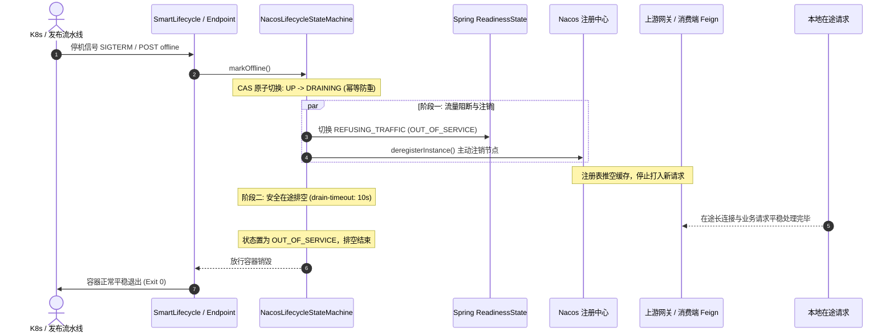

# ateng-cloud-nacos

Nacos 服务注册发现与动态配置中心基础设施构件，全面支持 Spring Boot 3 原生 `spring.config.import` 规范，内置容器多网卡精准绑定、多维元数据增强、60s 平滑预热、无损上下线治理与零破坏安全配置热更。

---

## 维度零：特性与公共 API 全景速查矩阵

### 1. 核心类与门面接口

| 类 / 接口 | 类型 | 核心职责 | 默认行为 / 装配条件 |
| :--- | :--- | :--- | :--- |
| `AtengNacosAutoConfiguration` | 自动装配类 | Nacos 基础设施自动装配总入口 | 当 `ateng.cloud.nacos.enabled=true` 时激活 |
| `AtengNacosProperties` | 配置属性类 | 强类型映射配置前缀 `ateng.cloud.nacos` | 默认开启，排空 `10s`，预热 `60s` |
| `NacosMetadataProvider` | 核心门面接口 | 收集全量元数据快照并支持填充至注册目标 | 默认实现为 `DefaultNacosMetadataProvider` |
| `NacosMetadataCustomizer` | 扩展点 SPI | 业务按需增量改写或注入自定义实例元数据 | `@FunctionalInterface`，支持 `Ordered` 排序 |
| `NacosNetworkAddressDetector` | 网络智能探测器 | 自动清洗虚拟网卡并绑定首选私网 IP | 默认忽略 `docker0`、`cni*` 等桥接网卡 |
| `NacosDiscoveryPropertiesPostProcessor` | 属性后置处理器 | 注册前将检测 IP、集群与元数据注入 NacosDiscoveryProperties | 条件装配于 `NacosDiscoveryProperties` |
| `NacosLifecycleStateMachine` | 状态机管理器 | 原子驱动双阶段优雅下线排空与上线恢复 | 状态流转 `UP` -> `DRAINING` -> `OUT_OF_SERVICE` |
| `NacosGracefulShutdownLifecycle` | 生命周期钩子 | `SmartLifecycle` 最高优先级（`PHASE_MAX`）排空钩子 | 容器停机最先触发注销与排空 |
| `NacosServiceEndpoint` | Actuator 端点 | `/actuator/nacos-service` 专属运维与状态端点 | 支持读写分离与外部流水线主动摘牌 |

### 2. 配置属性速查表 (`ateng.cloud.nacos.*`)

| 配置项 | 类型 | 默认值 | 详细业务说明 |
| :--- | :--- | :--- | :--- |
| `ateng.cloud.nacos.enabled` | `boolean` | `true` | 是否激活 ateng-cloud Nacos 治理增强 |
| `ateng.cloud.nacos.drain-timeout` | `Duration` | `10s` | 实例优雅下线在途请求排空安全窗口时限 |
| `ateng.cloud.nacos.zone` | `String` | `""` | 默认物理机房 / 可用区标识（如 `beijing-az1`） |
| `ateng.cloud.nacos.cluster` | `String` | `""` | 默认集群标识（如 `default-cluster`） |
| `ateng.cloud.nacos.metadata.startup-time` | `boolean` | `true` | 是否自动注入 JVM 启动毫秒时间戳 |
| `ateng.cloud.nacos.metadata.warmup-duration` | `Duration` | `60s` | 平滑启动预热窗口时长（供负载均衡动态升权） |
| `ateng.cloud.nacos.metadata.version` | `String` | `""` | 应用版本号（为空时自动从 Environment 读取） |
| `ateng.cloud.nacos.metadata.env` | `String` | `""` | 运行时环境标识（为空时自动对齐 Spring Profile） |
| `ateng.cloud.nacos.metadata.traffic-tag` | `String` | `""` | 全链路流量染色标记（如 `gray`） |
| `ateng.cloud.nacos.metadata.custom.*` | `Map<String, String>` | `{}` | 业务自定义元数据键值字典 |
| `ateng.cloud.nacos.network.network-interface` | `String` | `""` | 显式指定绑定的物理网卡名（如 `eth0`） |
| `ateng.cloud.nacos.network.preferred-networks` | `List<String>` | `[]` | 首选网段前缀列表（如 `["10.", "172.16."]`) |
| `ateng.cloud.nacos.network.ignored-interfaces` | `List<String>` | `["docker0", ...]` | 忽略的虚拟或桥接网卡正则黑名单 |
| `ateng.cloud.nacos.network.fail-on-loopback` | `boolean` | `false` | 仅侦测到 127.0.0.1 时是否 Fail-Fast 阻断启动 |
| `ateng.cloud.nacos.endpoint.enabled` | `boolean` | `true` | 是否暴露 `/actuator/nacos-service` 运维端点 |

---

## 维度一：最小起步体验

### 1. 引入依赖

```xml
<dependency>
    <groupId>io.github.atengk</groupId>
    <artifactId>ateng-cloud-nacos</artifactId>
</dependency>
<dependency>
    <groupId>org.springframework.boot</groupId>
    <artifactId>spring-boot-starter-actuator</artifactId>
</dependency>
```

### 2. 最小化配置 (`application.yml`)

```yaml
spring:
  application:
    name: demo-service
  cloud:
    nacos:
      server-addr: ${NACOS_SERVER_ADDR:127.0.0.1:8848}
      discovery:
        server-addr: ${spring.cloud.nacos.server-addr}

management:
  endpoints:
    web:
      exposure:
        include: health,info,nacos-service
  endpoint:
    health:
      show-details: always
      probes:
        enabled: true

ateng:
  cloud:
    nacos:
      enabled: true
      drain-timeout: 10s
      zone: beijing-az1
      cluster: default-cluster
      metadata:
        startup-time: true
        warmup-duration: 60s
        version: 1.0.0
        custom:
          team: core-platform
```

### 3. 获取实例元数据快照

注入 `NacosMetadataProvider` 即可获取经由框架清洗与 SPI 定制后的不可变元数据字典：

```java
@RestController
@RequestMapping("/api/nacos")
public class NacosMetadataDemoController {

    private final NacosMetadataProvider metadataProvider;

    public NacosMetadataDemoController(NacosMetadataProvider metadataProvider) {
        this.metadataProvider = metadataProvider;
    }

    @GetMapping("/metadata")
    public Result<Map<String, String>> getMetadata() {
        return Result.success(metadataProvider.getMetadata());
    }
}
```

---

## 维度二：生产扩展接管

### 1. 外部发布流水线 / K8s PreStop Hook 主动摘牌

发布平台或 K8s 可以在向 Pod 发送 `SIGTERM` 之前，通过 HTTP 调用主动下线端点，实现提前安全摘牌与在途排空：

```bash
# 1. 查询当前节点运行状态与元数据
curl http://localhost:8080/actuator/nacos-service

# 2. 主动发起下线与排空（同步阻塞等待 drain-timeout 完成后返回）
curl -X POST http://localhost:8080/actuator/nacos-service \
     -H "Content-Type: application/json" \
     -d '{"action": "offline"}'

# 3. 重新挂牌上线恢复接收流量
curl -X POST http://localhost:8080/actuator/nacos-service \
     -H "Content-Type: application/json" \
     -d '{"action": "online"}'
```

### 2. 实现 `NacosMetadataCustomizer` SPI 增量定制元数据

当下游微服务需要动态追加业务标签（如业务线、运维联系人、自定义特征码）时，声明 Spring Bean 实现 `NacosMetadataCustomizer` 接口即可：

```java
@Component
public class SampleMetadataCustomizer implements NacosMetadataCustomizer {

    @Override
    public void customize(Map<String, String> metadata) {
        metadata.put("demo-module", "sample-cloud-nacos");
        metadata.put("maintainer", "Ateng");
    }

    @Override
    public int getOrder() {
        return 100;
    }
}
```

---

## 维度三：核心生产边界与非功能语义

### 1. 零 502 无损下线双阶段状态机时序



1. **容器多网卡智能清洗防漂移**：
   - 框架默认自动清洗常见容器网络虚拟网卡（`docker0`、`flannel.*`、`cni.*`、`veth.*`、`vmnet.*`、`virbr.*`、`br-.*`）；
   - 优先绑定可路由的内网网段（`10.*`、`172.16~31.*`、`192.168.*`），从源头杜绝容器注册为宿主机虚拟网卡或 `127.0.0.1` 导致集群不可达。
2. **Kebab-Case 标准化元数据与平滑预热**：
   - 元数据键名严格遵循小写中划线格式：`startup-time`、`warmup-duration`、`version`、`env`、`zone`、`cluster`、`traffic-tag`；
   - 启动时自动注入 `startup-time` 启动时间戳与 `warmup-duration: 60s`，供调用端负载均衡器执行动态平滑爬升，彻底消除冷启动雪崩。
3. **K8s 停机协同与防强杀约束**：
   - 排空时间 `drain-timeout`（生产默认 10s）必须严格小于 Kubernetes Pod 配置的 `terminationGracePeriodSeconds`（建议设为 30s），预留充足缓冲防止被 K8s `SIGKILL` 强杀。
4. **100% 离线自洽单测铁律**：
   - 在单测环境（`spring.cloud.nacos.discovery.enabled: false`）下，优雅下线、探针联动与端点平滑降级（No-Op），保障 CI 流水线零外部物理依赖秒级全绿。

---

## 维度四：物理排版与代码全真验证

- **样例沙箱锚定**：上述代码与配置片段 100% 逆向提取自 [`sample-cloud-nacos`](../ateng-cloud-samples/sample-cloud-nacos) 真实运行工程。
- **自动化测试保证**：端到端覆盖于 `SampleCloudNacosApplicationTest`：
  - `testGetMetadataEndpoint`：断言校验 `startup-time`、`warmup-duration`、`zone` 及 SPI 定制标签均端到端正确生效；
  - `testGetActuatorNacosServiceEndpoint`：验证 `/actuator/nacos-service` 状态与元数据正确读取；
  - `testActuatorNacosServiceOfflineAndOnlineActions`：验证执行 offline 摘牌排空时，就绪探针立即切换为 `OUT_OF_SERVICE`，执行 online 时平稳恢复 `UP`。
