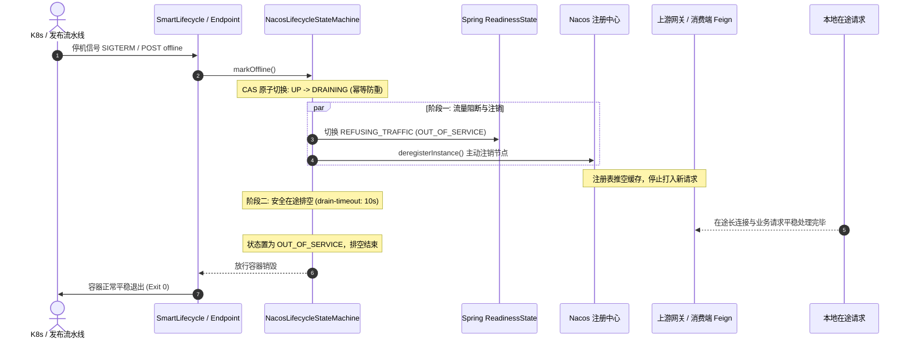

# ateng-cloud-nacos

Nacos 服务注册发现与现代动态配置中心基础设施构件，全面支持 Spring Boot 3 原生 `spring.config.import` 规范，内置容器多网卡精准绑定、多维元数据增强、60s 平滑预热、同机房可用区亲和路由、gRPC 长连接事件感知与自愈、无损上下线治理、单例不可变安全配置热更、敏感属性星号脱敏屏障与 Micrometer 全维监控标尺。

---

## 维度零：特性与公共 API 全景速查矩阵

### 1. 核心类与门面接口

| 类 / 接口 | 类型 | 核心职责 | 默认行为 / 装配条件 |
| :--- | :--- | :--- | :--- |
| `AtengNacosAutoConfiguration` | 自动装配类 | Nacos 基础设施自动装配总入口 | 当 `ateng.cloud.nacos.enabled=true` 时激活 |
| `AtengNacosProperties` | 配置属性类 | 强类型映射配置前缀 `ateng.cloud.nacos` | 默认开启，排空 `10s`，预热 `60s` |
| `NacosTemplate` | 核心门面类 | Nacos 注册发现、配置运维、泛型强类型订阅、机房亲和筛选与状态诊断对称门面 | 标配 `@ConditionalOnMissingBean`，空安全保底 |
| `NacosWarmupHelper` | 辅助计算类 | 集中计算节点启动预热窗口、已运行秒数、剩余倒计时与完成状态 | 提供给 Actuator、健康检查器与度量管理器复用 |
| `NacosHealthChecker` | 启动诊断器 | 全景健康就绪诊断器，检测 `spring.config.import`、网卡绑定探测、回环高危告警、元数据全量快照、gRPC 通信与 K8s 排空防强杀预警 | 标配 `@ConditionalOnMissingBean`，启动即时自检 |
| `NacosConfigHealthChecker` | 诊断兼容类 | 校验配置中心连接与属性源导入状态 | 向后兼容门面 |
| `SingletonImmutabilityGuard` | 架构守卫 | `BeanFactoryPostProcessor` 容器启动扫描，严禁业务单例标注 `@RefreshScope` | 标配开启，违规直接 Fail-Fast 阻断应用启动 |
| `NacosConfigRefreshEngine` | 热更引擎 | 严格收敛于 `@ConfigurationProperties` 增量热绑，广播变更事件与链路追踪 | 驱动配置安全热更，维持 MDC 与异常隔离 |
| `SafeConfigRefreshEvent` | 应用事件类 | 携带配置变更集、新旧对比明细及 `traceId` 的强类型 Spring 事件 | 继承 `ApplicationEvent`，脱敏边界自动掩码 |
| `SafeConfigRefreshFailureEvent` | 领域事件类 | 配置热更属性增量重绑、校验或监听器执行失败时广播的强类型领域事件，携带错误描述、因果链与 MDC traceId | 继承 `ApplicationEvent`，异常不击穿容器 |
| `ConfigChangeItem` | 数据值对象 | 封装单项配置键、变更前旧值、变更后新值及变更类型 | 遵循“内存真明文”，`toString()` 输出脱敏掩码 |
| `ConfigChangeType` | 枚举类 | 配置变更类型：`ADDED`、`MODIFIED`、`DELETED` | 精准描述属性生命周期变化 |
| `NacosConfigChangeListener` | 扩展点 SPI | 支持按属性前缀（`getPrefix()`）过滤与按优先级排序的受管监听器 | 业务解耦声明，异常受到独立屏障隔离 |
| `ConfigMasker` | 安全工具类 | 自动识别 `password`、`secret`、`token`、`key` 等敏感特征键并执行掩码 | 100% 复用 `ateng-boot-core` 通用脱敏原语 |
| `NacosConnectionManager` | 连接管理器 | 统一管控 Nacos gRPC 客户端长连接监听与状态上报 | 随应用生命周期启动探测与注销释放 |
| `NacosConnectionEventListener` | 事件桥接器 | 将 Nacos 原生通信状态与 ServerList 事件转化为 Spring 强类型领域事件 | 条件装配于 `NacosConnectionManager` |
| `NacosConnectionEvent` | 领域事件类 | 描述 Nacos 长连接连接、断开与重连恢复的应用事件 | 包含通信模块、连接状态、服务端地址与客户端名 |
| `AtengNacosLoadBalancerClientConfiguration` | 负载均衡配置 | 针对微服务客户端注入同机房亲和与平滑预热选择器 | `@LoadBalancerClients` 默认规范配置 |
| `ZonePreferenceServiceInstanceListSupplier` | 负载均衡提供者 | 实现同机房（Zone Affinity）优先路由（支持 `ateng.cloud.nacos.zone` 与 `spring.cloud.loadbalancer.zone`），本区无实例时平滑降级全量 | 装饰底层 `ServiceInstanceListSupplier` |
| `NacosWarmupLoadBalancer` | 负载均衡器 | 基于节点启动时间的 60s 线性平滑加权预热 LoadBalancer | 标配保底底噪权重，杜绝冷启动雪崩 |
| `InstanceWeightCalculator` | 扩展点 SPI | 候选实例有效权重介入与动态调谐扩展点 | `@FunctionalInterface` 标配 `@ConditionalOnMissingBean` |
| `AdaptiveInstanceWeightCalculator` | 动态加权器 | 基于节点 CPU/内存系统负载的自适应阶梯阻尼平滑降权计算器 | 条件装配于 `adaptive-weight.enabled=true` |
| `NacosMetricsManager` | 监控管理器 | 向 Micrometer / Prometheus 导出 7 组核心运行、长连接、预热与热更度量标尺 | 条件装配于 `MeterRegistry`，支持平滑降级 |
| `NacosMetadataProvider` | 核心门面接口 | 收集全量元数据快照并支持填充至注册目标 | 默认实现为 `DefaultNacosMetadataProvider` |
| `NacosMetadataCustomizer` | 扩展点 SPI | 业务按需增量改写或注入自定义实例元数据 | `@FunctionalInterface`，支持 `Ordered` 排序 |
| `NacosNetworkAddressDetector` | 网络智能探测器 | 自动清洗虚拟网卡并绑定首选私网 IP，输出结构化 `NetworkAddressResult` | 默认忽略 `docker0`、`cni*` 等桥接网卡 |
| `NetworkAddressResult` | 数据值对象 | 封装侦测到的物理网卡名称、宿主 IP 与回环地址标记 | 不可变值对象，用于自检与审计 |
| `NacosDiscoveryPropertiesPostProcessor` | 属性后置处理器 | 注册前将检测 IP、集群与元数据注入 NacosDiscoveryProperties | 条件装配于 `NacosDiscoveryProperties` |
| `NacosLifecycleStateMachine` | 状态机管理器 | 原子驱动双阶段优雅下线排空与上线恢复 | 状态流转 `UP` -> `DRAINING` -> `OUT_OF_SERVICE` |
| `NacosGracefulShutdownLifecycle` | 生命周期钩子 | `SmartLifecycle` 最高优先级（`PHASE_MAX`）排空钩子 | 容器停机最先触发注销与排空 |
| `NacosServiceEndpoint` | Actuator 端点 | `/actuator/nacosService` 专属运维与状态端点 | 展示实例元数据、预热倒计时、受管监听器与热更状态 |
| `ZoneAffinityInstanceFilter` | 路由过滤器 | 机房 (Zone) 就近亲和与跨区平滑容灾降级过滤器 | 标配 `@ConditionalOnMissingBean` |
| `NacosConfigConstants` | 常量规约类 | Nacos 配置导入前缀、默认分组与三层配置 Data ID 推荐命名规约 | 开箱即用通用常量 |
| `NacosResultCode` | 错误码枚举 | Nacos 统一业务错误码 (`4101~4106`，归属 `NETWORK_RPC`) | 底层异常因果转译映射 |

---

### 2. NacosTemplate 核心门面 API 速查表

| 方法签名 | 返回类型 | 功能说明与生产语义 | 离线自洽保底行为 |
| :--- | :--- | :--- | :--- |
| `getConfig(dataId [, group])` | `String` | 读取指定配置集文本内容（未找到或离线时返回 null） | 离线保底返回 `null` |
| `getConfig(dataId [, group, timeout, format], targetType)` | `<T> T` | 强类型泛型读取配置集，自动执行 YAML/JSON 反序列化 | 离线保底返回 `null` |
| `findConfig(dataId [, group])` | `Optional<String>` | 弹性读取指定配置集内容（不存在或离线时返回 empty） | 保底返回 `Optional.empty()` |
| `findConfig(dataId [, group, timeout, format], targetType)` | `<T> Optional<T>` | 强类型弹性读取配置集，自动执行反序列化 | 保底返回 `Optional.empty()` |
| `subscribeConfig(dataId [, group, format], targetType, callback)` | `<T> AutoCloseable` | 编程式泛型订阅动态配置，反序列化后回调，自动透传 MDC 与生命周期注销 | 离线平滑注册空句柄 |
| `publishConfig(dataId [, group], content [, type])` | `boolean` | 发布或全量覆盖指定配置集内容 | 离线保底返回 `false` |
| `publishConfigCas(dataId [, group], content, casMd5 [, type])` | `boolean` | 基于配置内容 MD5 执行 CAS 乐观锁并发安全发布 | 离线保底返回 `false` |
| `removeConfig(dataId [, group])` | `boolean` | 物理移除指定的 Nacos 配置集 | 离线保底返回 `false` |
| `addConfigListener(dataId [, group], listener)` | `void` | 动态注册底层 Nacos 原生配置监听器回调 | 具备因果异常转译，离线平滑 No-Op |
| `removeConfigListener(dataId [, group], listener)` | `void` | 动态注销底层 Nacos 原生配置监听器回调 | 具备因果异常转译，离线平滑 No-Op |
| `ensureConfigAvailable()` | `void` | 强校验配置中心就绪状态，不可用时抛出业务异常 | 离线抛出 `NACOS_CONFIG_DISABLED` |
| `ensureDiscoveryAvailable()` | `void` | 强校验服务发现就绪状态，不可用时抛出业务异常 | 离线抛出 `NACOS_DISCOVERY_DISABLED` |
| `refreshConfig(changedKeys)` | `SafeConfigRefreshEvent` | 声明式按属性键集合触发安全热更与 `@ConfigurationProperties` 重绑 | 返回强类型刷新事件对象 |
| `isConfigAvailable()` | `boolean` | 判断当前 Nacos 配置中心客户端是否就绪可用 | 离线返回 `false` |
| `isDiscoveryAvailable()` | `boolean` | 判断当前 Nacos 服务发现客户端是否就绪可用 | 离线返回 `false` |
| `getConfigServerStatus()` | `String` | 获取当前配置中心服务端通信状态（如 `UP`、`DOWN`） | 离线返回 `"DOWN"` |
| `getNamingServerStatus()` | `String` | 获取当前服务发现注册中心通信状态（如 `UP`、`DOWN`） | 离线返回 `"DOWN"` |
| `getAllInstances(serviceName [, groupName])` | `List<Instance>` | 查询指定服务全量实例列表（含未通过健康检查实例） | 保底返回空集合 `[]` |
| `getHealthyInstances(serviceName [, groupName])` | `List<Instance>` | 查询指定服务通过健康检查的实例列表 | 保底返回空集合 `[]` |
| `getInstances(serviceName [, groupName])` | `List<Instance>` | 查询健康且可用实例（自动过滤 `weight <= 0.0` 与禁用节点） | 保底返回空集合 `[]` |
| `selectOneHealthyInstance(serviceName [, groupName])` | `Optional<Instance>` | 基于 Nacos 随机权重算法选举单个健康可用实例 | 保底返回 `Optional.empty()` |
| `subscribeInstances(serviceName [, groupName, clusters], callback)` | `AutoCloseable` | 编程式订阅微服务实例拓扑动态变更，首帧快照即时派发并自动注入 MDC 与异常屏障 | 离线平滑注册空句柄 |
| `getMyInstance()` | `Optional<Instance>` | 获取当前服务节点在 Nacos 注册的自身实例信息快照 | 保底返回 `Optional.empty()` |
| `getSameZoneInstances(serviceName [, groupName])` | `List<Instance>` | 查询机房（Zone）就近亲和健康实例，本区全宕平滑降级全集群 | 保底返回空集合 `[]` |
| `isUnderProtection(serviceName [, groupName])` | `boolean` | 检测目标服务集群是否触发过载保护阈值 | 保底返回 `false` |
| `setInstanceEnabled(serviceName, [groupName,] ip, port, enabled)` | `void` | 动态启用或禁用目标服务实例 | 离线平滑 No-Op |
| `updateInstanceWeight(serviceName, [groupName,] ip, port, weight)` | `void` | 动态调节实例权重（设为 `0.0` 流量隔离，负数抛错） | 离线平滑 No-Op |
| `registerMetadata(key, value)` | `void` | 动态为当前节点追加或覆盖元数据并立即向 Nacos 推送 | 离线平滑 No-Op |
| `removeMetadata(key)` | `void` | 动态从当前节点移除指定元数据并立即向 Nacos 推送 | 离线平滑 No-Op |
| `markOnline()` | `void` | 主动将当前服务挂牌上线并恢复 Spring 就绪探针 `UP` | 离线平滑 No-Op |
| `markOffline()` | `void` | 主动将当前服务优雅摘牌并执行 `drain-timeout` 停机排空 | 离线平滑 No-Op |

---

### 3. 配置属性速查表 (`ateng.cloud.nacos.*`)

| 配置项 | 类型 | 默认值 | 详细业务说明 |
| :--- | :--- | :--- | :--- |
| `ateng.cloud.nacos.enabled` | `boolean` | `true` | 是否激活 ateng-cloud Nacos 治理增强 |
| `ateng.cloud.nacos.drain-timeout` | `Duration` | `10s` | 实例优雅下线在途请求排空安全窗口时限 |
| `ateng.cloud.nacos.zone` | `String` | `""` | 默认物理机房 / 可用区标识（如 `beijing-az1`） |
| `ateng.cloud.nacos.cluster` | `String` | `""` | 默认集群标识（如 `default-cluster`） |
| `ateng.cloud.nacos.config.enabled` | `boolean` | `true` | 是否激活 Nacos 动态配置中心治理增强 |
| `ateng.cloud.nacos.config.timeout` | `Duration` | `3s` | 客户端配置运维操作默认超时时限 |
| `ateng.cloud.nacos.config.default-group` | `String` | `DEFAULT_GROUP` | 默认配置分组名称 |
| `ateng.cloud.nacos.config.check-on-startup` | `boolean` | `true` | 启动阶段是否执行配置中心连接与导入自检诊断 |
| `ateng.cloud.nacos.config.enforce-bean-immutability` | `boolean` | `true` | 是否强制开启业务单例不可变性守卫（严禁 `@RefreshScope` 滥用） |
| `ateng.cloud.nacos.loadbalancer.enabled` | `boolean` | `true` | 是否激活 Nacos 客户端负载均衡增强 |
| `ateng.cloud.nacos.loadbalancer.client-supplier-enabled` | `boolean` | `true` | 是否在客户端子上下文中激活默认服务实例提供者（为 `false` 时允许上层如网关复合责任链接管） |
| `ateng.cloud.nacos.loadbalancer.zone-affinity` | `boolean` | `true` | 是否开启同机房可用区（Zone Affinity）优先调度 |
| `ateng.cloud.nacos.loadbalancer.warmup` | `boolean` | `true` | 是否开启平滑启动预热（Startup Preheating）动态权重调度 |
| `ateng.cloud.nacos.loadbalancer.warmup-floor-weight-ratio` | `double` | `0.10` | 启动预热期间保底底噪权重比例（默认 10%，防止冷启动完全饥饿） |
| `ateng.cloud.nacos.loadbalancer.adaptive-weight.enabled` | `boolean` | `false` | 是否激活基于节点系统资源指标（CPU/内存负载）的自适应动态加权调度 |
| `ateng.cloud.nacos.loadbalancer.adaptive-weight.min-floor-weight-ratio` | `double` | `0.10` | 过载保底底噪权重比例（默认 10%，杜绝节点权重直接归零导致调度饥饿） |
| `ateng.cloud.nacos.loadbalancer.adaptive-weight.medium-load-threshold` | `double` | `0.70` | 中等负载阈值（超过该阈值开始平滑轻度降权） |
| `ateng.cloud.nacos.loadbalancer.adaptive-weight.high-load-threshold` | `double` | `0.85` | 高负载过载阈值（超过该阈值开始重度降权） |
| `ateng.cloud.nacos.loadbalancer.adaptive-weight.damping-ratio` | `double` | `0.15` | 权重调谐阶梯阻尼防抖比例（波动未超该阈值时保持平稳，避免频繁震荡） |
| `ateng.cloud.nacos.loadbalancer.adaptive-weight.sample-interval` | `Duration` | `5s` | 动态权重调谐采样评估周期（收敛高频计算开销） |
| `ateng.cloud.nacos.metrics.enabled` | `boolean` | `true` | 是否导出 Nacos 治理与热更 Micrometer 监控指标 |
| `ateng.cloud.nacos.metadata.startup-time` | `boolean` | `true` | 是否自动注入 JVM 启动毫秒时间戳 |
| `ateng.cloud.nacos.metadata.warmup-duration` | `Duration` | `60s` | 平滑启动预热窗口时长（供负载均衡动态升权） |
| `ateng.cloud.nacos.metadata.version` | `String` | `""` | 应用版本号（为空时自动从 Environment 读取） |
| `ateng.cloud.nacos.metadata.env` | `String` | `""` | 运行时环境标识（为空时自动对齐 Spring Profile） |
| `ateng.cloud.nacos.metadata.traffic-tag` | `String` | `""` | 全链路流量染色标记（如 `gray`） |
| `ateng.cloud.nacos.metadata.custom.*` | `Map<String, String>` | `{}` | 业务自定义元数据键值字典 |
| `ateng.cloud.nacos.network.network-interface` | `String` | `""` | 显式指定绑定的物理网卡名（如 `eth0`） |
| `ateng.cloud.nacos.network.preferred-networks` | `List<String>` | `[]` | 首选网段前缀列表（如 `["10.", "172.16."]`) |
| `ateng.cloud.nacos.network.ignored-interfaces` | `List<String>` | `["docker0", ...]` | 忽略的虚拟或桥接网卡正则黑名单 |
| `ateng.cloud.nacos.network.fail-on-loopback` | `boolean` | `true` | 仅侦测到 127.0.0.1 时是否 Fail-Fast 阻断启动 |
| `ateng.cloud.nacos.endpoint.enabled` | `boolean` | `true` | 是否暴露 `/actuator/nacosService` 运维端点 |

---

### 4. Micrometer 核心监控标尺矩阵

| 指标名称 | 类型 | 标签 Tag | 描述说明与数值含义 |
| :--- | :--- | :--- | :--- |
| `nacos.grpc.connection.status` | Gauge | `service` | Nacos gRPC 长连接与配置中心连通状态（`1.0`: UP/正常，`0.0`: DOWN/断连） |
| `nacos.grpc.disconnect.total` | Counter | `service` | Nacos gRPC 长连接异常断开累计次数计数器 |
| `nacos.config.refresh.total` | Counter | `service` | 动态配置安全热更累计触发总次数（随每次刷新递增） |
| `nacos.config.refresh.failure` | Counter | `service` | 动态配置安全热更失败累计计数（重绑异常或监听器抛错触发） |
| `nacos.instances.healthy` | Gauge | `service` | 当前微服务在 Nacos 注册中心已注册的健康可用实例数 |
| `nacos.lifecycle.state` | Gauge | `service` | 当前节点优雅生命周期状态（`1.0`: UP/在线，`0.0`: OUT_OF_SERVICE/已下线排空） |
| `nacos.instance.warmup.remaining.seconds` | Gauge | `service` | 当前节点启动平滑预热剩余秒数（预热完成后归 `0.0`） |

---

## 维度一：最小起步体验

### 1. 引入依赖

```xml
<dependency>
    <groupId>io.github.atengk</groupId>
    <artifactId>ateng-cloud-nacos</artifactId>
</dependency>
<dependency>
    <groupId>io.github.atengk</groupId>
    <artifactId>ateng-boot-encrypt</artifactId>
</dependency>
<dependency>
    <groupId>org.springframework.cloud</groupId>
    <artifactId>spring-cloud-starter-loadbalancer</artifactId>
</dependency>
<dependency>
    <groupId>org.springframework.boot</groupId>
    <artifactId>spring-boot-starter-actuator</artifactId>
</dependency>
```

### 2. 现代三层配置导入规范 (`application.yml`)

彻底摒弃过时的 `bootstrap.yml`，全域统一遵循 Spring Boot 3 标准 `spring.config.import` 规范。推荐遵循三层配置继承拓扑：

```yaml
server:
  port: 8080

spring:
  application:
    name: sample-cloud-nacos
  profiles:
    active: ${SPRING_PROFILES_ACTIVE:test}
  config:
    import:
      # 1. 弹性探测本地真实凭据配置（物理缺失时静默跳过，保障 CI 离线自洽）
      - "optional:classpath:application-local.yml"
      # 2. 共享公共基础配置（如微服务通用超时、线程池默认参数）
      - "optional:nacos:shared-common.yaml?group=DEFAULT_GROUP&refreshEnabled=true"
      # 3. 共享中间件与数据源配置（如共享 Redis、RabbitMQ 集群连接）
      - "optional:nacos:shared-infrastructure.yaml?group=DEFAULT_GROUP&refreshEnabled=true"
      # 4. 当前微服务应用专用配置（按应用名与当前激活 Profile 隔离）
      - "optional:nacos:${spring.application.name}-${spring.profiles.active}.yaml?group=DEFAULT_GROUP&refreshEnabled=true"
  cloud:
    nacos:
      server-addr: ${NACOS_SERVER_ADDR:127.0.0.1:8848}
      discovery:
        server-addr: ${spring.cloud.nacos.server-addr}
        enabled: false # 默认离线关闭外部物理发现连接，保障 CI 100% 离线自洽
      config:
        server-addr: ${spring.cloud.nacos.server-addr}
        enabled: false

ateng:
  boot:
    encrypt:
      enabled: true # 开启密文配置自动透明解密
  cloud:
    nacos:
      enabled: true
      zone: beijing-az1
      cluster: default-cluster
      metadata:
        startup-time: true
        warmup-duration: 60s
        version: 1.0.0
        custom:
          team: core-platform
      loadbalancer:
        enabled: true
        zone-affinity: true
        warmup: true

demo:
  config:
    title: "Nacos Cloud Platform"
    secret-key: "ENC(ydS/bhIcoogPc1a6V/whVwUR54CsaUtyWWu9LgIZai9jksDqNO2g5yRaprANGUdt8biXgfIE)"
    timeout: 5s
    pool-size: 20
```

### 3. 编程式泛型强类型动态配置订阅 (`DemoTypedSubscriptionService.java`)

100% 逆向提取自样例工程。使用 `NacosTemplate.subscribeConfig` 泛型门面，自动反序列化并绑定生命周期：

```java
@Service
public class DemoTypedSubscriptionService {

    private static final Logger log = LoggerFactory.getLogger(DemoTypedSubscriptionService.class);

    public static final String DATA_ID_TRADE_RULE = "trade-rule.json";

    private final NacosTemplate nacosTemplate;
    private final AtomicInteger notificationCount = new AtomicInteger(0);
    private final AtomicReference<TradeRuleConfig> currentRule = new AtomicReference<>();
    private final AtomicReference<String> lastTraceId = new AtomicReference<>("");
    private AutoCloseable subscriptionHandle;

    public DemoTypedSubscriptionService(NacosTemplate nacosTemplate) {
        this.nacosTemplate = nacosTemplate;
    }

    @PostConstruct
    public void init() {
        // 编程式订阅 trade-rule.json 泛型强类型配置集，自动挂载 MDC traceId 穿透与异常屏障
        try {
            this.subscriptionHandle = nacosTemplate.subscribeConfig(
                    DATA_ID_TRADE_RULE,
                    "DEFAULT_GROUP",
                    TradeRuleConfig.class,
                    this::onTradeRuleUpdated
            );
            log.info("[DemoTypedSubscriptionService] 成功注册 '{}' 泛型强类型动态配置订阅句柄", DATA_ID_TRADE_RULE);
        } catch (Exception ex) {
            log.warn("[DemoTypedSubscriptionService] 初始化动态配置订阅跳过 (离线或无可用配置中心): {}", ex.getMessage());
        }
    }

    @PreDestroy
    public void destroy() {
        if (subscriptionHandle != null) {
            try {
                subscriptionHandle.close();
                log.info("[DemoTypedSubscriptionService] 已安全注销 '{}' 动态配置订阅句柄", DATA_ID_TRADE_RULE);
            } catch (Exception ex) {
                log.warn("Error closing subscription: {}", ex.getMessage());
            }
        }
    }

    public void onTradeRuleUpdated(TradeRuleConfig rule) {
        int count = notificationCount.incrementAndGet();
        currentRule.set(rule);
        String traceId = MDC.get("traceId");
        lastTraceId.set(traceId != null ? traceId : "");
        log.info("[DemoTypedSubscriptionService] 收到交易规则动态变更通知 #{}, traceId={}, ruleName={}, limit={}",
                count, traceId, rule.getRuleName(), rule.getMaxLimit());
    }

    public TradeRuleConfig getCurrentRule() {
        return currentRule.get();
    }
}
```

### 4. 客户端负载均衡亲和调度演示 (`NacosLoadBalancerDemoController.java`)

```java
@RestController
@RequestMapping("/api/nacos/loadbalancer")
public class NacosLoadBalancerDemoController {

    private final ObjectProvider<LoadBalancerClient> loadBalancerClientProvider;

    public NacosLoadBalancerDemoController(ObjectProvider<LoadBalancerClient> loadBalancerClientProvider) {
        this.loadBalancerClientProvider = loadBalancerClientProvider;
    }

    /**
     * 根据负载均衡选择器挑选最优服务实例
     */
    @GetMapping("/choose")
    public Result<InstanceVO> chooseInstance(@RequestParam(defaultValue = "sample-cloud-nacos") String serviceName) {
        LoadBalancerClient loadBalancerClient = loadBalancerClientProvider.getIfAvailable();
        if (loadBalancerClient == null) {
            return Result.success(null);
        }
        ServiceInstance chosen = loadBalancerClient.choose(serviceName);
        return Result.success(chosen != null ? InstanceVO.fromServiceInstance(chosen) : null);
    }
}
```

### 5. 单例不可变配置属性 POJO (`DemoConfigProperties.java`)

业务配置属性统一使用 `@ConfigurationProperties` 承载，热更新时仅增量重新绑定属性对象，坚决不物理销毁单例 Bean：

```java
@Component
@ConfigurationProperties(prefix = "demo.config")
public class DemoConfigProperties {

    private String title = "Default Title";
    private String secretKey = "";
    private Duration timeout = Duration.ofSeconds(5);
    private int poolSize = 10;

    public String getTitle() { return title; }
    public void setTitle(String title) { this.title = title; }
    public String getSecretKey() { return secretKey; }
    public void setSecretKey(String secretKey) { this.secretKey = secretKey; }
    public Duration getTimeout() { return timeout; }
    public void setTimeout(Duration timeout) { this.timeout = timeout; }
    public int getPoolSize() { return poolSize; }
    public void setPoolSize(int poolSize) { this.poolSize = poolSize; }
}
```

### 6. 业务 Controller 注入与强类型契约 (`NacosConfigDemoController.java`)

```java
@RestController
@RequestMapping("/api/nacos/config")
public class NacosConfigDemoController {

    private final DemoConfigProperties demoConfigProperties;
    private final NacosTemplate nacosTemplate;

    public NacosConfigDemoController(DemoConfigProperties demoConfigProperties,
                                     NacosTemplate nacosTemplate) {
        this.demoConfigProperties = demoConfigProperties;
        this.nacosTemplate = nacosTemplate;
    }

    /**
     * 读取当前业务配置（展示视图自动执行敏感星号脱敏）
     */
    @GetMapping("/current")
    public Result<DemoConfigVO> getCurrentConfig() {
        String maskedKey = ConfigMasker.mask("demo.config.secret-key", demoConfigProperties.getSecretKey());
        DemoConfigVO vo = new DemoConfigVO(
                demoConfigProperties.getTitle(),
                maskedKey,
                demoConfigProperties.getTimeout(),
                demoConfigProperties.getPoolSize()
        );
        return Result.success(vo);
    }

    /**
     * 读取内存中的真实解密明文（严格遵循“内存真明文”不变量）
     */
    @GetMapping("/secret")
    public Result<String> getRawSecret() {
        return Result.success(demoConfigProperties.getSecretKey());
    }

    /**
     * 模拟主动触发配置属性安全增量热更
     */
    @PostMapping("/simulate-refresh")
    public Result<SafeConfigRefreshVO> simulateRefresh(@Valid @RequestBody RefreshRequestDTO request) {
        SafeConfigRefreshEvent event = nacosTemplate.refreshConfig(request.getKeys());
        SafeConfigRefreshVO vo = new SafeConfigRefreshVO(
                event.getTraceId(),
                event.getChangedKeys(),
                event.getChangedKeys().size(),
                true
        );
        return Result.success(vo);
    }
}
```

---

## 维度二：生产扩展接管

### 1. 监听 `NacosConnectionEvent` 领域事件感知底层长连接状态

当需要解耦感知 Nacos 底层 gRPC 长连接断开与恢复（例如启动降级保底缓存、告警通知）时，编写标准 Spring `@EventListener`：

```java
@Component
public class DemoConnectionEventListener {

    private static final Logger log = LoggerFactory.getLogger(DemoConnectionEventListener.class);

    private final AtomicInteger eventCount = new AtomicInteger(0);
    private final AtomicReference<NacosConnectionEvent> lastEvent = new AtomicReference<>();

    @EventListener
    public void onNacosConnectionEvent(NacosConnectionEvent event) {
        int count = eventCount.incrementAndGet();
        lastEvent.set(event);
        log.info("[DemoConnectionEventListener] 监听到 Nacos 长连接事件 #{} [module={}, status={}, server={}]",
                count, event.getModuleType(), event.getStatus(), event.getServerAddress());
    }

    public int getEventCount() {
        return eventCount.get();
    }

    public NacosConnectionEvent getLastEvent() {
        return lastEvent.get();
    }
}
```

### 2. 实现 `NacosConfigChangeListener` SPI 进行精确前缀过滤

当特定业务模块仅关注自身配置域（如数据源、限流规则）的变更时，声明 Spring Bean 实现 `NacosConfigChangeListener` 接口：

```java
@Component
public class DemoNacosConfigChangeListener implements NacosConfigChangeListener {

    private static final Logger log = LoggerFactory.getLogger(DemoNacosConfigChangeListener.class);

    @Override
    public void onConfigChange(SafeConfigRefreshEvent event) {
        log.info("[DemoNacosConfigChangeListener] 收到前缀 'demo.config' 变更通知，traceId: {}, changedKeys: {}",
                event.getTraceId(), event.getChangedKeys());
        // 增量处理自身业务逻辑，单个监听器异常会被框架自动隔离，绝不阻断全局广播
    }

    @Override
    public String getPrefix() {
        return "demo.config"; // 仅当变更集包含以 demo.config 开头的属性时触发
    }

    @Override
    public int getOrder() {
        return 10; // 执行优先级，数值越小越优先执行
    }
}
```

### 3. 使用 Spring 原生 `@EventListener` 监听 `SafeConfigRefreshEvent`

微服务其他组件可以通过标准事件机制解耦感知全局配置刷新：

```java
@Component
public class DemoSafeRefreshEventListener {

    private static final Logger log = LoggerFactory.getLogger(DemoSafeRefreshEventListener.class);

    @EventListener
    public void onSafeRefresh(SafeConfigRefreshEvent event) {
        log.info("[DemoSafeRefreshEventListener] @EventListener 收到热更事件，traceId: {}, changedCount: {}",
                event.getTraceId(), event.getChangedKeys().size());
        // event.getMaskedChangeDetails() 自动返回脱敏后的安全明细字典
    }
}
```

### 4. Actuator 端点读取预热倒计时、受管监听器与运行状态

框架扩展了 `/actuator/nacosService` 端点，直观输出预热倒计时、受管监听器拓扑与最近一次热更状态：

```bash
curl http://localhost:8080/actuator/nacosService
```

响应 JSON 示例：

```json
{
  "status": "UP",
  "serviceName": "sample-cloud-nacos",
  "drainTimeout": "10s",
  "zone": "beijing-az1",
  "cluster": "default-cluster",
  "metadata": {
    "version": "1.0.0",
    "warmup-duration": "60s",
    "team": "core-platform",
    "framework": "ateng-cloud"
  },
  "warmupDuration": "60s",
  "warmupUptimeSeconds": 15,
  "warmupRemainingSeconds": 45,
  "warmupCompleted": false,
  "config": {
    "enforceBeanImmutability": true,
    "listeners": [
      {
        "class": "io.github.atengk.cloud.sample.nacos.config.DemoNacosConfigChangeListener",
        "prefix": "demo.config",
        "order": 10
      }
    ],
    "lastRefresh": {
      "traceId": "ee02496e9149d0f0d281b8bf07f5e876",
      "timestamp": 1793115496654,
      "changedKeys": [
        "demo.config.title",
        "demo.config.secret-key"
      ],
      "success": true,
      "durationMs": 12
    }
  }
}
```

### 5. 动态介入候选实例有效权重 (`InstanceWeightCalculator` SPI)

当需要基于业务规则（如 VIP 租户路由分、自定义健康指标）动态干预候选实例的权重时，可注册自定义 `InstanceWeightCalculator` Bean：

```java
@Configuration(proxyBeanMethods = false)
public class CustomWeightCalculatorConfiguration {

    @Bean
    public InstanceWeightCalculator customInstanceWeightCalculator() {
        return new InstanceWeightCalculator() {
            @Override
            public double calculateWeight(ServiceInstance instance, double currentWeight) {
                // 业务可根据节点特定元数据自定义干预实例权重
                if ("vip-service-node".equals(instance.getInstanceId())) {
                    return currentWeight * 1.5;
                }
                return currentWeight;
            }

            @Override
            public boolean isInstanceOverloaded(ServiceInstance instance) {
                // 自定义判断节点是否过载（用于全集群过载熔断回退均匀轮询）
                return "true".equals(instance.getMetadata().get("overloaded"));
            }
        };
    }
}
```

---

## 维度三：核心生产边界与非功能语义

### 1. 同机房可用区（Zone Affinity）优先路由与平滑容灾降级

- **同机房优先原则**：
  在多机房多活架构下，微服务调用优先在本机房（可用区）内闭环，跨机房调用存在网络延迟与专线成本。
- **降级容灾语义**：
  `ZonePreferenceServiceInstanceListSupplier` 优先过滤匹配 `metadata.zone` 等于当前客户端所在机房的实例；若本机房所有实例均宕机或未部署本可用区实例，**自动平滑降级为全集群全量健康实例**，杜绝硬切机房导致业务彻底不可用。

### 2. 平滑加权预热（Startup Preheating）数学模型与流量斜率

- **为什么必须启动预热？**
  微服务冷启动阶段，JIT 尚未即时编译、热点代码未充分优化、连接池尚未初始化完成。若瞬间导入全量权重流量，极易引发 CPU 飙高、线程池打满与级联超时。
- **动态权重计算数学模型**：
  设实例配置基准权重为 $w_{\text{base}}$（默认为 1），预热窗口时长为 $T$（默认 60s），实例已启动运行时间为 $t$：
  $$w(t) = \max\left(w_{\text{floor}}, \min\left(w_{\text{base}}, \left\lfloor w_{\text{base}} \times \left(\frac{t}{T}\right) \right\rfloor\right)\right)$$
  其中保底底噪权重 $w_{\text{floor}} = \max(1, \lfloor w_{\text{base}} \times 0.10 \rfloor)$。
- **流量斜率保护**：
  在前 60 秒内，权重随时间线性爬升，保底保持至少 10% 底噪流量以充分激发 JIT 编译；60 秒后恢复 100% 正常调度权重。

### 3. 单例 Bean 绝对不可变性铁律 (`@RefreshScope` 绝对禁令)

- **为什么严禁在 `@Service` / `@Repository` 标注 `@RefreshScope`？**
  `@RefreshScope` 的底层机制是在配置发生变更时，**从容器中强行物理销毁旧 Bean 实例并重新实例化**。在大流量生产环境下：
  1. 正在执行在途事务的线程其 Bean 被物理销毁，直接引发不可逆的事务断裂与连接池泄漏；
  2. 正在持有单机锁（`ReentrantLock`）或分布式锁的 Bean 被销毁，引发锁状态悬挂与并发脏写；
  3. 瞬时突发流量遭遇 Bean 重建，导致请求排队雪崩与 CPU 瞬时击穿。
- **框架架构级防御 (`SingletonImmutabilityGuard`)**：
  框架内置 `SingletonImmutabilityGuard`，在 Spring 容器启动阶段全量扫描所有 Bean 定义。凡发现任何标注了 `@Service` 或 `@Repository` 的业务单例同时标注了 `@RefreshScope`，**立即抛出 `IllegalStateException` 强行阻断应用启动**，彻底将隐患扼杀于发版部署前。
- **正规热更姿势**：配置动态热更必须严格收敛于 `@ConfigurationProperties` 纯属性 POJO 的增量重绑（通过受管 `ConfigurationPropertiesRebinder`），业务单例永不销毁。

### 4. 敏感脱敏防泄露与“内存真明文”不变量

- **敏感特征自动匹配**：
  `ConfigMasker` 自动对包含 `password`、`passwd`、`pwd`、`secret`、`token`、`credential`、`passphrase`、`private-key`、`privatekey` 或以 `key`、`auth` 结尾的配置键执行拦截。
- **内存真明文原则**：
  `ConfigChangeItem.getOldValue()` 与 `getNewValue()` 在内存中始终保留 100% 原始真实明文，确保下游业务逻辑消费真实凭据；仅在 `toString()`、日志审计、监控指标及 `getMaskedOldValue()`、`getMaskedNewValue()` 输出边界实施 `******` 掩码脱敏，杜绝明文凭据打印至控制台或外泄。

### 5. 全链路 MDC `traceId` 穿透与确定性清理

- 在配置热更广播流程或编程式泛型订阅回调启动时，框架自动检测 MDC 上下文。若当前线程无 `traceId`，自动生成 32 位唯一链路追踪标识并写入 MDC；
- 无论业务监听器执行成功或抛错，均在 `finally` 块中严格执行清理（若原线程已存在 `traceId` 则安全恢复），彻底杜绝跨线程池 ThreadLocal 脏读与内存污染。

### 6. Kubernetes 停机排空安全时限防强杀预警

- Kubernetes 默认的 `terminationGracePeriodSeconds` 为 30 秒；
- 若开发者在配置中配置的 `ateng.cloud.nacos.drain-timeout` 超过 25 秒（`MAX_RECOMMENDED_DRAIN_TIMEOUT`），`NacosHealthChecker` 在启动诊断阶段会输出 `WARN` 级别安全预警日志，提示排空时限过长可能在 Kubernetes 发送 `SIGKILL` 强杀前尚未完成连接清理，建议协同调大 Pod 的 `terminationGracePeriodSeconds`。

### 7. 零 502 无损下线双阶段状态机时序



### 8. 网络抖动防雪崩与长连接韧性感知

- Nacos 2.x/3.x 全面依托 gRPC 长连接实现双向通信与状态同步。在生产遭遇瞬时网络抖动、跨交换机闪断或集群节点主从倒换时，客户端面临长连接断开瞬态雪崩风险；
- 框架内置 `NacosConnectionEventListener`，底层自动向 Spring 容器广播强类型 `NacosConnectionEvent` 领域事件，同时在 `NacosMetricsManager` 中原子更新 `nacos.grpc.connection.status`（`1.0` 正常，`0.0` 断开）与累加 `nacos.grpc.disconnect.total` 计数器，驱动业务层无缝接入降级保护与精准告警。

### 9. 本地容灾快照磁盘可写性预检

- 在容器化环境（Docker / Kubernetes）中，当开启安全只读根文件系统（`readOnlyRootFilesystem: true`）且未挂载专用数据卷时，Nacos 客户端无法落盘缓存快照（Failover Snapshot），一旦遭遇网络隔离将导致本地容灾直接失效；
- `NacosHealthChecker` 在启动诊断阶段主动对本地快照目录执行创建与写入权限探针，若检测到只读不可写状态，立即输出格式化 `WARN` 引导告警，提示运维在 Pod Spec 中挂载 `emptyDir` 或存储卷。

### 10. 节点系统资源自适应加权与全集群过载熔断 (Adaptive Resource Weighting)

- **自适应降权机制**：
  当开启 `ateng.cloud.nacos.loadbalancer.adaptive-weight.enabled=true` 时，`AdaptiveInstanceWeightCalculator` 自动感知下游微服务实例元数据中的 CPU（`cpu-usage`、`cpu-load`）与内存（`memory-usage`）负载指标：
  - 负载 $\le 70\%$（`medium-load-threshold`）：健康节点，维持 100% 原始调度权重；
  - 负载处于 $70\% \sim 85\%$：中度过载，权重按线性阻尼曲线平滑衰减至 50%；
  - 负载 $> 85\%$（`high-load-threshold`）：重度过载，权重快速平滑衰减至保底底噪（默认 10%，`min-floor-weight-ratio`）；
- **阻尼防抖防震荡**：
  采样周期收敛为 5s~10s，且仅当负载波动超过 $\pm 15\%$（`damping-ratio`）阶梯门槛时才触发调谐，彻底消除微小波动引发的调度频繁摇摆；
- **全集群过载熔断兜底**：
  当全体可用实例均处于重度过载状态时，负载均衡器触发全集群过载熔断保护，自动安全回退为均匀轮询，坚决杜绝因算法过度敏感导致全网节点自我孤立引发 503 报警。

---

## 维度四：物理排版与代码全真验证

- **样例沙箱锚定**：上述代码与配置片段 100% 逆向提取自 [`sample-cloud-nacos`](../ateng-cloud-samples/sample-cloud-nacos) 真实运行工程。
- **自动化测试保证**：端到端覆盖于 `SampleCloudNacosApplicationTest`：
  - `testGetMetadataEndpoint`：断言校验 `startup-time`、`warmup-duration`、`zone` 及 SPI 定制标签均端到端正确生效；
  - `testGetActuatorNacosServiceEndpoint`：验证 `/actuator/nacosService` 状态、预热倒计时、元数据、单例不可变性守卫及受管监听器列表正确读取；
  - `testActuatorNacosServiceOfflineAndOnlineActions`：验证执行 offline 摘牌排空时，就绪探针立即切换为 `OUT_OF_SERVICE`，执行 online 时平稳恢复 `UP`；
  - `testNacosTemplateOpsEndpoints`：验证 `NacosTemplate` 健康实例查询、同机房亲和筛选、自身实例感知、保护阈值探测、实例启用/禁用状态与权重调节、动态元数据维护及主动上下线全链路离线平滑通过；
  - `testConfigTransparentDecryptionAndInMemoryPlaintext`：验证 `ateng-boot-encrypt` 远程密文配置 `ENC(...)` 透明解密，断言业务层获取到原始真实明文，而对外展示视图自动执行 `******` 掩码脱敏；
  - `testSimulateRefreshAndSpiAndEventListenerPropagation`：验证主动触发配置增量热更时，MDC `traceId` 成功穿透，`NacosConfigChangeListener` SPI 与 Spring `@EventListener` 双模成功接收事件；
  - `testSimulateRefreshValidationError`：验证 JSR-303 参数格式校验防卫（变更键名列表为空时 Fail-Fast 阻断并返回标准 `Result(code=400)`）；
  - `testTypedConfigSubscriptionAndMdcTracing`：验证 `subscribeConfig` 强类型泛型订阅全真反序列化与 MDC `traceId` 链路追踪穿透；
  - `testConnectionEventListening`：验证 `NacosConnectionEvent` gRPC 长连接领域事件发布与受管监听；
  - `testLoadBalancerZoneAffinity`：验证 Spring Cloud LoadBalancer 集成同机房（Zone Affinity）优先路由与平滑加权预热真实调度；
  - `testNacosMetricsAndHealthDiagnostics`：验证 Micrometer 全维监控度量标尺注册与 `NacosHealthChecker` 深水区安全自检防御。
