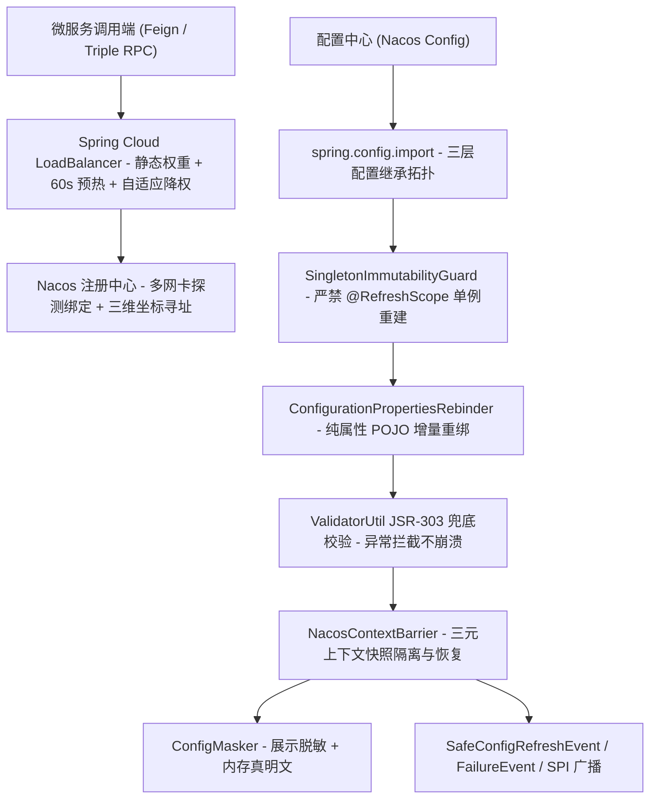
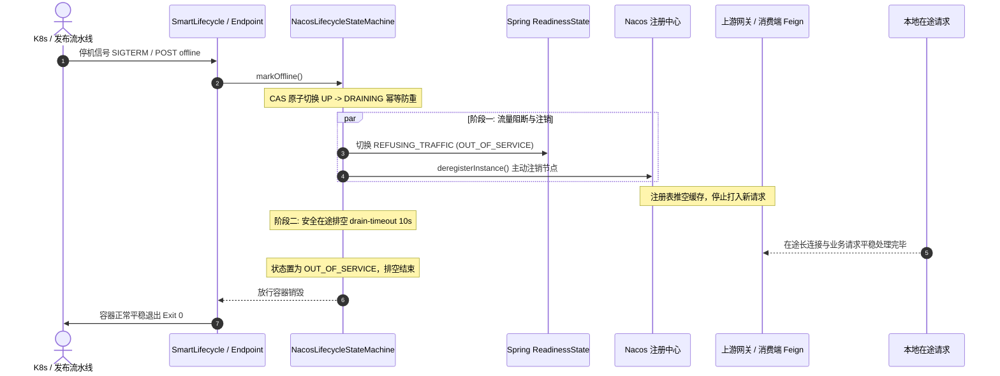

# ateng-cloud-nacos Nacos 服务注册与配置中心基础设施构件

> 面向企业级高可用分布式生产环境的 Nacos 2.x/3.x 注册发现与现代动态配置中心微服务基础设施 Starter 套件，全面对齐 Spring Boot 3 原生 `spring.config.import` 规范，内置容器多网卡精准探测、三维 `(serviceName, groupName, clusters)` 服务发现与亲和路由、`Class<T>` / `TypeReference<T>` 多格式配置强类型解析与订阅、静态基准权重常驻 + 60s 冷启动平滑预热 + 自适应负载降权、`<MDC traceId, UserContextHolder, TenantContextHolder>` 三元上下文隔离屏障、双阶段零 502 优雅下线治理、Safe Hot-Reload JSR-303 兜底校验、敏感属性星号脱敏屏障与 Micrometer 全维监控标尺。

---

## 0. 特性与公共 API 全景速查矩阵 (100% 覆盖)

### 0.1 核心组件、SPI 与事件领域模型

| 类 / 接口 | 类型 | 核心职责 | 默认行为 / 装配守卫 |
| :--- | :--- | :--- | :--- |
| `AtengNacosAutoConfiguration` | 自动装配类 | Nacos 注册发现与配置治理基础设施自动装配总入口 | `@AutoConfiguration`，当 `ateng.cloud.nacos.enabled=true` 时激活 |
| `AtengNacosProperties` | 配置属性类 | 强类型映射配置前缀 `ateng.cloud.nacos`（`Duration` 时限） | 默认开启，排空 `10s`，预热 `60s` |
| `NacosTemplate` | 核心门面类 | Nacos 三维服务发现、配置读写、复杂泛型订阅、机房亲和筛选与状态诊断对称门面 | 标配 `@ConditionalOnMissingBean`，空安全保底 |
| `NacosConfigParser` | 多格式解析引擎 | 支持 `Class<T>` 与 `TypeReference<T>` 的 YAML/JSON/Properties/TEXT 解码、语法预检 `validate` 与双向 `serialize` | 失败转译 `NACOS_CONFIG_PARSE_FAILED` / `NACOS_CONFIG_VALIDATION_FAILED` |
| `ConfigFormat` | 枚举类 | 动态配置文本格式枚举：`YAML`、`JSON`、`PROPERTIES`、`TEXT`，含 Data ID 后缀推断 | 未匹配扩展名兜底为 `TEXT` |
| `NacosConfigConstants` | 常量规约类 | Nacos 配置导入前缀、默认分组 `DEFAULT_GROUP` 与三层配置 `DataId` 命名规约 | 开箱即用通用常量 |
| `NacosContextBarrier` | 上下文隔离屏障 | 针对 `<MDC traceId, UserContextHolder, TenantContextHolder>` 的快照保存与 `finally` 对称恢复/清理 | 保持对 `traffic`/`seata` 模块零依赖 |
| `NacosWarmupHelper` | 辅助计算类 | 集中计算节点启动预热窗口时长、已运行秒数、剩余倒计时与完成状态 `WarmupStatus` | 供 Actuator、健康检查与指标管理器复用 |
| `NacosHealthChecker` | 启动诊断器 | 全景健康就绪诊断器，检测 `spring.config.import`、网卡绑定、回环告警、元数据快照、快照目录可写性与 K8s 排空预警 | 标配 `@ConditionalOnMissingBean`，启动即时自检 |
| `NacosConfigHealthChecker` | 诊断兼容类 | 校验配置中心连接与属性源导入状态 | 向后兼容配置诊断门面 |
| `SingletonImmutabilityGuard` | 架构守卫 | `BeanFactoryPostProcessor` 容器启动扫描，严禁 `@Service`/`@Repository` 单例标注 `@RefreshScope` | 标配开启，违规直接 `IllegalStateException` 阻断启动 |
| `NacosConfigRefreshEngine` | 安全热更引擎 | 仅增量重绑 `@ConfigurationProperties` 单例，执行 `ValidatorUtil` JSR-303 兜底校验，维护三元上下文与失败隔离 | 异常不击穿容器，失败广播 `SafeConfigRefreshFailureEvent` |
| `SafeConfigRefreshEvent` | 应用事件类 | 携带配置变更集、新旧对比明细及 `traceId` 的强类型 Spring 事件 | 继承 `ApplicationEvent`，脱敏边界自动掩码 |
| `SafeConfigRefreshFailureEvent` | 领域事件类 | 重绑失败、JSR-303 校验违例或监听器抛错时广播的强类型事件，携带 `cause` 链与上下文信息 | 继承 `ApplicationEvent`，联动端点与指标上报 |
| `ConfigChangeItem` | 数据值对象 | 封装单项配置键、变更前旧值、变更后新值及变更类型 | 遵循“内存真明文”，`toString()` 输出脱敏掩码 |
| `ConfigChangeType` | 枚举类 | 配置变更类型：`ADDED`、`MODIFIED`、`DELETED` | 精准描述属性生命周期变化 |
| `NacosConfigChangeListener` | 扩展点 SPI | 支持按属性前缀（`getPrefix()`）过滤与按 `getOrder()` 排序的受管监听器 | 业务解耦声明，异常受到独立屏障隔离 |
| `ConfigMasker` | 安全工具类 | 自动识别 `password`、`secret`、`token`、`key` 等敏感特征键并执行掩码 | 100% 复用 `ateng-boot-core` 脱敏原语 |
| `NacosConnectionManager` | 连接管理器 | 统一管控 Nacos gRPC 客户端长连接监听注册与状态上报 | 随应用生命周期启动探测与注销释放 |
| `NacosConnectionEventListener` | 事件桥接器 | 将 Nacos 原生通信状态与 ServerList 事件转化为 Spring 强类型领域事件 | 条件装配于 `NacosConnectionManager` |
| `NacosConnectionEvent` | 领域事件类 | 描述 Nacos gRPC 长连接连接、断开与重连恢复的应用事件 | 包含通信模块、连接状态、服务端地址与客户端名 |
| `AtengNacosLoadBalancerAutoConfiguration` | 负载均衡装配类 | 客户端负载均衡自动装配入口，注册 `@LoadBalancerClients` 与 `AdaptiveInstanceWeightCalculator` | 条件装配于 `LoadBalancerClientFactory` 与配置开关 |
| `AtengNacosLoadBalancerClientConfiguration` | 子上下文配置类 | 为每个微服务客户端子上下文装配 `ZonePreferenceServiceInstanceListSupplier` 与 `NacosWarmupLoadBalancer` | 每服务独立隔离 |
| `ZonePreferenceServiceInstanceListSupplier` | 负载均衡提供者 | 实现同机房（Zone Affinity）优先路由（`ateng.cloud.nacos.zone` / `spring.cloud.loadbalancer.zone`），本区全宕平滑降级全集群 | 装饰底层 `ServiceInstanceListSupplier` |
| `NacosWarmupLoadBalancer` | 负载均衡选择器 | 融合 `nacos.weight` 静态权重、60s 线性预热、自适应负载均衡与全集群过载熔断的平滑加权轮询器 | 等权且大于 0 自动退化为均匀轮询 |
| `InstanceWeightCalculator` | 扩展点 SPI | 候选实例有效权重介入、过载判定与动态调谐扩展点 | `@FunctionalInterface`，标配 `@ConditionalOnMissingBean` |
| `AdaptiveInstanceWeightCalculator` | 动态加权器 | 基于节点 CPU/内存系统负载的自适应阶梯阻尼平滑降权计算器 | 条件装配于 `adaptive-weight.enabled=true` |
| `NacosMetricsManager` | 监控管理器 | 向 Micrometer / Prometheus 导出 7 组核心连接、实例、预热与热更度量标尺 | 条件装配于 `MeterRegistry`，支持平滑降级 |
| `NacosMetadataProvider` / `DefaultNacosMetadataProvider` | 元数据门面/默认实现 | 收集全量标准化元数据快照并注入实例注册表 | 默认实现标配 `@ConditionalOnMissingBean` |
| `NacosMetadataCustomizer` / `DefaultNacosMetadataCustomizer` | 扩展点 SPI/保底实现 | 业务按需增量改写或注入自定义实例元数据 | `@FunctionalInterface`，支持 `Ordered` 排序 |
| `NacosNetworkAddressDetector` | 网络智能探测器 | 自动清洗虚拟网卡并绑定首选私网 IP，输出结构化 `NetworkAddressResult` | 默认忽略 `docker0`、`cni*` 等桥接网卡 |
| `NetworkAddressResult` | 数据值对象 | 封装侦测到的物理网卡名称、宿主 IP 与回环地址标记 | 不可变值对象，用于自检与审计 |
| `NacosDiscoveryPropertiesPostProcessor` | 属性后置处理器 | 注册前将探测 IP、集群与元数据注入 `NacosDiscoveryProperties` | 条件装配于 `NacosDiscoveryProperties` |
| `NacosLifecycleStateMachine` / `NacosInstanceLifecycleState` | 状态机/状态枚举 | CAS 原子驱动 `UP -> DRAINING -> OUT_OF_SERVICE` 双阶段优雅下线与上线恢复 | 并发防重与幂等保护 |
| `NacosGracefulShutdownLifecycle` | 生命周期钩子 | `SmartLifecycle` 最高优先级（`Integer.MAX_VALUE`）排空钩子 | 容器停机最先触发注销与排空 |
| `NacosServiceEndpoint` | Actuator 端点 | `/actuator/nacosService` 专属运维与状态端点 | 展示元数据、预热倒计时、受管监听器与最后刷新快照 |
| `ZoneAffinityInstanceFilter` | 路由过滤器 | 机房（Zone）就近亲和与跨区平滑容灾降级过滤器 | 标配 `@ConditionalOnMissingBean` |
| `NacosResultCode` | 错误码枚举 | Nacos 统一业务错误码（`4101~4108`，归属 `NETWORK_RPC`） | 底层异常因果转译映射 |

---

### 0.2 `NacosTemplate` 核心门面 API 速查表

| 方法签名 | 返回类型 | 功能说明与生产语义 | 离线自洽保底行为 |
| :--- | :--- | :--- | :--- |
| `getConfig(dataId [, groupName, timeout])` | `String` | 读取指定配置集文本内容（支持显式 `Duration` 超时） | 离线保底返回 `null` |
| `findConfig(dataId [, groupName, timeout])` | `Optional<String>` | 空安全查询指定配置集原文 | 保底返回 `Optional.empty()` |
| `getConfig(dataId [, groupName, timeout, format], Class<T> targetType)` | `<T> T` | 强类型反序列化单对象 POJO（按 `DataId` 后缀或显式 `ConfigFormat` 解码） | 离线或缺失返回 `null` |
| `getConfig(dataId [, groupName, timeout, format], TypeReference<T> typeReference)` | `<T> T` | 复杂泛型读取配置集（4 重载：支持 `List<Rule>`、`Map<String, Object>` 等） | 离线或缺失返回 `null` |
| `findConfig(dataId [, groupName, timeout, format], Class<T> targetType)` | `<T> Optional<T>` | 强类型 POJO 空安全查询 | 保底返回 `Optional.empty()` |
| `findConfig(dataId [, groupName, timeout, format], TypeReference<T> typeReference)` | `<T> Optional<T>` | 复杂泛型空安全查询（4 重载） | 保底返回 `Optional.empty()` |
| `subscribeConfig(dataId [, groupName, format], Class<T> targetType, callback)` | `<T> AutoCloseable` | 编程式强类型 POJO 配置订阅（3 重载：首帧快照、三元上下文隔离、异常屏障） | 离线返回空操作句柄 `() -> {}` |
| `subscribeConfig(dataId [, groupName, format], TypeReference<T> typeReference, callback)` | `<T> AutoCloseable` | 编程式复杂泛型配置订阅（3 重载：消除泛型擦除，受管注销与隔离屏障） | 离线返回空操作句柄 `() -> {}` |
| `validateConfig(content, format)` | `void` | 校验 YAML / JSON / Properties 语法树有效性 | 语法损坏抛出 `NACOS_CONFIG_VALIDATION_FAILED` |
| `publishConfig(dataId [, groupName], content [, format \| type])` | `boolean` | 发布或全量覆盖配置（发布前执行语法预检，支持 POJO 与原文） | 离线保底返回 `false` |
| `publishConfigCas(dataId [, groupName], content, casMd5 [, type])` | `boolean` | 基于配置内容 MD5 执行 CAS 乐观锁并发安全发布 | 离线保底返回 `false` |
| `removeConfig(dataId [, groupName])` | `boolean` | 物理移除指定的 Nacos 配置集 | 离线保底返回 `false` |
| `addConfigListener(dataId [, groupName], listener)` | `void` | 注册底层原生配置监听器 | 离线平滑 No-Op |
| `removeConfigListener(dataId [, groupName], listener)` | `void` | 注销底层原生配置监听器 | 离线平滑 No-Op |
| `refreshConfig(changedKeys [, dataId, group])` | `SafeConfigRefreshEvent` | 声明式触发配置热更、JSR-303 校验与事件广播 | 返回 `SafeConfigRefreshEvent` |
| `resolveConfigGroup(groupName)` | `String` | 解析生效配置分组（入参 -> 模块配置 -> Spring Cloud 配置 -> `DEFAULT_GROUP`） | 保底返回 `"DEFAULT_GROUP"` |
| `getConfigParser()` | `NacosConfigParser` | 获取内部多格式泛型解析引擎实例 | 始终返回有效单例 |
| `isConfigAvailable()` / `isDiscoveryAvailable()` | `boolean` | 检测 Nacos 配置中心 / 服务发现客户端是否启用并就绪 | 离线返回 `false` |
| `ensureConfigAvailable()` / `ensureDiscoveryAvailable()` | `void` | 强校验就绪状态 | 未就绪抛出 `NACOS_CONFIG_DISABLED` / `NACOS_DISCOVERY_DISABLED` |
| `getConfigServerStatus()` / `getNamingServerStatus()` | `String` | 获取服务端当前连通状态（`UP`、`DISCONNECTED`、`UNKNOWN`） | 客户端缺失返回 `"UNAVAILABLE"` |
| `getAllInstances(serviceName [, groupName] [, clusters])` | `List<Instance>` | 三维坐标（服务/分组/集群）查询全部已注册实例（4 重载，空集群透明降级） | 保底返回空集合 `[]` |
| `getHealthyInstances(serviceName [, groupName] [, clusters])` | `List<Instance>` | 三维坐标查询健康可用实例（4 重载，严格过滤 `weight <= 0.0` 与禁用节点） | 保底返回空集合 `[]` |
| `getInstances(serviceName [, groupName] [, clusters])` | `List<Instance>` | 三维坐标查询可用实例列表（4 重载，语义同 `getHealthyInstances`） | 保底返回空集合 `[]` |
| `selectOneHealthyInstance(serviceName [, groupName] [, clusters])` | `Optional<Instance>` | 三维坐标随机选取单个健康可用实例（4 重载） | 保底返回 `Optional.empty()` |
| `getSameZoneInstances(serviceName [, groupName] [, clusters])` | `List<Instance>` | 三维坐标机房（Zone Affinity）亲和筛选（4 重载，本区全宕降级目标集群） | 保底返回空集合 `[]` |
| `subscribeInstances(serviceName [, groupName] [, clusters], listener)` | `AutoCloseable` | 编程式实例拓扑动态订阅（4 重载：首帧快照、三元上下文隔离、异常屏障） | 离线触发空集合回调并返回 No-Op 句柄 |
| `getMyInstance()` | `Optional<Instance>` | 获取当前节点自身在 Nacos 注册中心中的实例快照 | 保底返回 `Optional.empty()` |
| `getServices(pageNo, pageSize [, groupName])` | `List<String>` | 分页检索指定分组下所有服务名称清单 | 保底返回空集合 `[]` |
| `isUnderProtection(serviceName [, groupName])` | `boolean` | 探测目标服务是否处于集群过载保护水位阈值之下 | 保底返回 `false` |
| `setInstanceEnabled(serviceName, [groupName,] ip, port, enabled)` | `void` | 动态启用或禁用目标服务实例 | 离线平滑 No-Op |
| `updateInstanceWeight(serviceName, [groupName,] ip, port, weight)` | `void` | 动态调节实例权重（设为 `0.0` 流量隔离，负数非法抛错） | 离线平滑 No-Op |
| `registerMetadata(key, value)` / `removeMetadata(key)` | `void` | 动态增删当前节点实例元数据并立即向 Nacos 推送同步 | 离线平滑 No-Op |
| `updateInstanceMetadata(serviceName, [groupName,] ip, port, metadata)` | `void` | 批量更新目标服务实例元数据（支持本节点与远端实例） | 离线平滑 No-Op |
| `isCurrentInstance(ip, port)` / `extractPureServiceName(serviceName)` | `boolean` / `String` | 判定是否当前实例、提取剥离分组前缀后的纯服务名 | 空安全返回 `false` / 原字符串 |
| `markOnline()` / `markOffline()` | `void` | 驱动当前节点恢复上线 `UP` 或执行双阶段优雅摘牌排空 | 离线平滑 No-Op |
| `getActiveSubscriptionCount()` / `destroy()` | `int` / `void` | 统计当前受管订阅句柄数；容器销毁时幂等自动释放全部配置与实例订阅 | 安全清空全部订阅句柄 |

---

### 0.3 配置属性速查表 (`ateng.cloud.nacos.*`)

| 配置项 | 类型 | 默认值 | 详细业务说明 |
| :--- | :--- | :--- | :--- |
| `ateng.cloud.nacos.enabled` | `boolean` | `true` | 是否激活 `ateng-cloud` Nacos 治理增强 |
| `ateng.cloud.nacos.drain-timeout` | `Duration` | `10s` | 实例优雅下线在途请求排空安全窗口时限 |
| `ateng.cloud.nacos.zone` | `String` | `""` | 默认物理机房 / 可用区标识（如 `beijing-az1`） |
| `ateng.cloud.nacos.cluster` | `String` | `""` | 默认集群标识（如 `default-cluster`） |
| `ateng.cloud.nacos.config.enabled` | `boolean` | `true` | 是否激活 Nacos 动态配置中心治理增强 |
| `ateng.cloud.nacos.config.timeout` | `Duration` | `3s` | 客户端配置运维操作默认超时时限 |
| `ateng.cloud.nacos.config.default-group` | `String` | `DEFAULT_GROUP` | 默认配置分组名称 |
| `ateng.cloud.nacos.config.check-on-startup` | `boolean` | `true` | 启动阶段是否执行配置中心连接与导入自检诊断 |
| `ateng.cloud.nacos.config.enforce-bean-immutability` | `boolean` | `true` | 是否强制开启业务单例不可变性守卫（严禁 `@RefreshScope` 滥用） |
| `ateng.cloud.nacos.loadbalancer.enabled` | `boolean` | `true` | 是否激活 Nacos 客户端负载均衡增强 |
| `ateng.cloud.nacos.loadbalancer.client-supplier-enabled` | `boolean` | `true` | 是否在客户端子上下文中激活默认服务实例提供者（网关场景可关闭让位上层链） |
| `ateng.cloud.nacos.loadbalancer.zone-affinity` | `boolean` | `true` | 是否开启同机房可用区（Zone Affinity）优先调度 |
| `ateng.cloud.nacos.loadbalancer.warmup` | `boolean` | `true` | 是否开启平滑启动预热（Startup Preheating）动态权重调度 |
| `ateng.cloud.nacos.loadbalancer.warmup-floor-weight-ratio` | `double` | `0.10` | 启动预热期间保底底噪权重比例（10%） |
| `ateng.cloud.nacos.loadbalancer.adaptive-weight.enabled` | `boolean` | `false` | 是否激活基于系统资源指标的自适应动态加权调度 |
| `ateng.cloud.nacos.loadbalancer.adaptive-weight.min-floor-weight-ratio` | `double` | `0.10` | 过载保底底噪权重比例（10%） |
| `ateng.cloud.nacos.loadbalancer.adaptive-weight.medium-load-threshold` | `double` | `0.70` | 中等负载阈值（70%） |
| `ateng.cloud.nacos.loadbalancer.adaptive-weight.high-load-threshold` | `double` | `0.85` | 高负载过载阈值（85%） |
| `ateng.cloud.nacos.loadbalancer.adaptive-weight.damping-ratio` | `double` | `0.15` | 权重调谐阶梯阻尼防抖比例（15%） |
| `ateng.cloud.nacos.loadbalancer.adaptive-weight.sample-interval` | `Duration` | `5s` | 动态权重调谐采样评估周期 |
| `ateng.cloud.nacos.metrics.enabled` | `boolean` | `true` | 是否导出 Nacos 治理与热更 Micrometer 监控指标 |
| `ateng.cloud.nacos.metadata.startup-time` | `boolean` | `true` | 是否自动注入 JVM 启动毫秒时间戳 |
| `ateng.cloud.nacos.metadata.warmup-duration` | `Duration` | `60s` | 平滑启动预热窗口时长 |
| `ateng.cloud.nacos.metadata.version` | `String` | `""` | 应用版本号（为空时自动从 `Environment` 探测） |
| `ateng.cloud.nacos.metadata.env` | `String` | `""` | 运行时环境标识（为空时自动对齐 Spring Profile） |
| `ateng.cloud.nacos.metadata.zone` | `String` | `""` | 元数据级机房标识覆盖（为空时对齐外层 `zone`） |
| `ateng.cloud.nacos.metadata.cluster` | `String` | `""` | 元数据级集群标识覆盖（为空时对齐外层 `cluster`） |
| `ateng.cloud.nacos.metadata.traffic-tag` | `String` | `""` | 全链路流量染色标记（如 `gray`） |
| `ateng.cloud.nacos.metadata.custom.*` | `Map<String, String>` | `{}` | 业务自定义元数据键值字典 |
| `ateng.cloud.nacos.network.network-interface` | `String` | `""` | 显式指定绑定的物理网卡名（如 `eth0`） |
| `ateng.cloud.nacos.network.preferred-networks` | `List<String>` | `[]` | 首选网段前缀列表（如 `["10.", "172.16."]`） |
| `ateng.cloud.nacos.network.ignored-interfaces` | `List<String>` | `["docker0", ...]` | 忽略的虚拟或桥接网卡正则黑名单（共 12 项容器/虚拟化默认规则） |
| `ateng.cloud.nacos.network.fail-on-loopback` | `boolean` | `true` | 仅侦测到 `127.0.0.1` 时是否 Fail-Fast 阻断启动 |
| `ateng.cloud.nacos.endpoint.enabled` | `boolean` | `true` | 是否暴露 `/actuator/nacosService` 运维端点 |

---

### 0.4 Micrometer 核心监控标尺矩阵

| 指标名称 | 类型 | 标签 Tag | 描述说明与数值含义 |
| :--- | :--- | :--- | :--- |
| `nacos.grpc.connection.status` | Gauge | `service` | Nacos gRPC 长连接与配置中心连通状态（`1.0`: UP/正常，`0.0`: DOWN/断连） |
| `nacos.grpc.disconnect.total` | Counter | `service` | Nacos gRPC 长连接异常断开累计次数计数器 |
| `nacos.config.refresh.total` | Counter | `service` | 动态配置安全热更累计触发总次数（随每次刷新递增） |
| `nacos.config.refresh.failure` | Counter | `service` | 动态配置安全热更失败累计计数（重绑异常、JSR-303 校验违例或监听器抛错触发） |
| `nacos.instances.healthy` | Gauge | `service` | 当前微服务在 Nacos 注册中心已注册的健康可用实例数 |
| `nacos.lifecycle.state` | Gauge | `service` | 当前节点优雅生命周期状态（`1.0`: UP/在线，`0.0`: OUT_OF_SERVICE/已下线排空） |
| `nacos.instance.warmup.remaining.seconds` | Gauge | `service` | 当前节点启动平滑预热剩余秒数（预热完成后归 `0.0`） |

---

### 0.5 `NacosResultCode` 业务错误码体系 (`4101~4108`)

| 错误码枚举常量 | Code | 异常语义 | 典型触发场景 |
| :--- | :---: | :--- | :--- |
| `NACOS_CLIENT_ERROR` | `4101` | Nacos 客户端通信异常 | 底层 gRPC/Naming/Config SDK 抛出 `NacosException` |
| `NACOS_SERVICE_NOT_FOUND` | `4102` | Nacos 服务实例不存在 | 目标服务节点未注册或实例元数据查询缺失 |
| `NACOS_OPERATION_FAILED` | `4103` | Nacos 运维操作执行失败 | 实例上下线、权重修改或元数据变更等非期望异常 |
| `NACOS_DISCOVERY_DISABLED` | `4104` | Nacos 服务注册与发现未启用 | 调用 `ensureDiscoveryAvailable()` 时客户端未激活 |
| `NACOS_CONFIG_OPERATION_FAILED` | `4105` | Nacos 配置中心运维操作执行失败 | 配置推送、CAS 发布、删除或监听维护异常 |
| `NACOS_CONFIG_DISABLED` | `4106` | Nacos 动态配置中心未启用 | 调用 `ensureConfigAvailable()` 时配置中心未激活 |
| `NACOS_CONFIG_PARSE_FAILED` | `4107` | Nacos 配置解析失败 | `NacosConfigParser` 通过 `Class<T>` 或 `TypeReference<T>` 反序列化失败或序列化失败 |
| `NACOS_CONFIG_VALIDATION_FAILED` | `4108` | Nacos 配置语法校验失败 | 发布配置前 `validateConfig()` 检出 YAML/JSON/Properties 语法损坏 |

---

## 1. 模块定位与 Maven 坐标

`ateng-cloud-nacos` 专职封装 Nacos 2.x/3.x 注册中心与动态配置中心在 Spring Cloud 微服务架构下的企业级治理能力。通过单向依赖消费 `ateng-boot-bom`，为全域微服务提供统一的节点三维拓扑寻址、复杂泛型配置热更与订阅、三元上下文快照隔离、网络探测以及静态权重 + 启动预热 + 自适应降权负载均衡底座。

```xml
<dependency>
    <groupId>io.github.atengk</groupId>
    <artifactId>ateng-cloud-nacos</artifactId>
</dependency>
```

> [!NOTE]
> 若需体验敏感配置密文解析与展示脱敏，协同引入 `ateng-boot-encrypt`；若需集成微服务客户端负载均衡与运维监控端点，协同引入 `spring-cloud-starter-loadbalancer` 与 `spring-boot-starter-actuator`；若需要触发 `Safe Hot-Reload` 全量 `@ConfigurationProperties` 的 JSR-303 校验兜底，引入 `spring-boot-starter-validation`（无实现时自动静默跳过）。

---

## 2. 核心架构与设计不变量

微服务基础设施在生产环境中面临网络抖动、线程池上下文污染、错误配置热更击穿容器与冷启动雪崩等极端挑战，本构件严守以下微服务专属架构铁律：



### 零 502 无损下线双阶段状态机时序



---

## 3. 动态配置中心与安全热更治理

### 3.1 现代三层配置导入规范与单例不可变守卫

全域统一遵循 Spring Boot 3 标准 `spring.config.import` 规范，彻底废弃过时的 `bootstrap.yml`。

#### 本特性专属 YAML 配置片段

```yaml
spring:
  config:
    import:
      # 1. 弹性探测本地真实凭据配置（物理缺失时静默跳过，保障 CI 离线自洽）
      - "optional:classpath:application-local.yml"
      # 2. 共享公共基础配置（通用超时、线程池默认参数）
      - "optional:nacos:shared-common.yaml?group=DEFAULT_GROUP&refreshEnabled=true"
      # 3. 共享中间件与数据源配置（共享 Redis、RabbitMQ 集群连接）
      - "optional:nacos:shared-infrastructure.yaml?group=DEFAULT_GROUP&refreshEnabled=true"
      # 4. 当前微服务应用专用配置（按应用名与环境 Profile 隔离）
      - "optional:nacos:${spring.application.name}-${spring.profiles.active}.yaml?group=DEFAULT_GROUP&refreshEnabled=true"

ateng:
  cloud:
    nacos:
      config:
        enabled: true # 是否激活 Nacos 动态配置中心治理增强
        check-on-startup: true # 启动阶段是否执行配置中心连接与导入自检诊断
        enforce-bean-immutability: true # 是否强制开启业务单例不可变性守卫（严禁 @RefreshScope 滥用）
```

#### 容灾与边界机制说明

- **为什么严禁在业务单例标注 `@RefreshScope`？**
  `@RefreshScope` 会在配置变更时强行物理销毁 Bean 实例并重新初始化。在生产环境下，这会导致正在执行事务的线程 Bean 被销毁引发事务断裂、持锁状态悬挂以及请求排队雪崩；
- **架构级防御 (`SingletonImmutabilityGuard`)**：
  框架内置容器启动扫描守卫。凡发现任何标注了 `@Service` 或 `@Repository` 的业务单例挂载了 `@RefreshScope`，立即抛出 `IllegalStateException` 强行阻断应用启动。

---

### 3.2 电商订单配置增量热更、JSR-303 校验兜底与敏感脱敏屏障

业务配置统一使用 `@ConfigurationProperties` 声明，热更时仅对纯属性 POJO 实施增量绑定并触发 `ValidatorUtil` JSR-303 校验兜底；内存保留真明文，展示层星号掩码脱敏。

#### 本特性专属 YAML 配置片段

```yaml
ateng:
  boot:
    encrypt:
      enabled: true # 开启密文配置自动透明解密

sample:
  order:
    config:
      freight-rate: 10.0 # 基础订单运费（元），要求 >= 0
      free-freight-threshold: 99.0 # 满额包邮门槛（元），要求 >= 0
      pay-channel-secret-key: "ENC(ydS/bhIcoogPc1a6V/whVwUR54CsaUtyWWu9LgIZai9jksDqNO2g5yRaprANGUdt8biXgfIE)" # 第三方支付通道通信加密密钥
      order-timeout: 30m # 未支付订单自动关闭时限（强类型 Duration 规范）
      max-items-per-order: 50 # 单笔订单最大购买商品件数上限，要求 >= 1
```

#### 实战业务代码示例 (逆向提取自 Sample)

```java
@Component
@ConfigurationProperties(prefix = "sample.order.config")
public class OrderConfigProperties {

    @NotNull(message = "freightRate must not be null")
    @PositiveOrZero(message = "freightRate must be zero or positive")
    private Double freightRate = 10.0;

    @NotNull(message = "freeFreightThreshold must not be null")
    @PositiveOrZero(message = "freeFreightThreshold must be zero or positive")
    private Double freeFreightThreshold = 99.0;

    private String payChannelSecretKey = "";

    @NotNull(message = "orderTimeout must not be null")
    private Duration orderTimeout = Duration.ofMinutes(30);

    @NotNull(message = "maxItemsPerOrder must not be null")
    @Min(value = 1, message = "maxItemsPerOrder must be at least 1")
    private Integer maxItemsPerOrder = 50;

    // Getters and Setters...
}
```

```java
@RestController
@RequestMapping("/sample/cloud/nacos/config")
public class NacosConfigController {

    private final OrderConfigProperties orderConfigProperties;
    private final NacosTemplate nacosTemplate;

    public NacosConfigController(OrderConfigProperties orderConfigProperties, NacosTemplate nacosTemplate) {
        this.orderConfigProperties = orderConfigProperties;
        this.nacosTemplate = nacosTemplate;
    }

    /**
     * 读取当前电商订单配置（展示视图自动执行敏感星号掩码脱敏）
     */
    @GetMapping("/current")
    public Result<OrderConfigVO> getCurrentConfig() {
        String maskedKey = ConfigMasker.mask("sample.order.config.pay-channel-secret-key", orderConfigProperties.getPayChannelSecretKey());
        OrderConfigVO vo = new OrderConfigVO(
                orderConfigProperties.getFreightRate(),
                orderConfigProperties.getFreeFreightThreshold(),
                maskedKey,
                orderConfigProperties.getOrderTimeout(),
                orderConfigProperties.getMaxItemsPerOrder()
        );
        return Result.success(vo);
    }

    /**
     * 读取内存中的真实解密明文（严格遵循“内存真明文”不变量）
     */
    @GetMapping("/secret")
    public Result<String> getRawSecret() {
        return Result.success(orderConfigProperties.getPayChannelSecretKey());
    }

    /**
     * 声明式主动触发配置属性安全增量热更
     */
    @PostMapping("/simulate-refresh")
    public Result<SafeConfigRefreshVO> simulateRefresh(@Valid @RequestBody RefreshRequestDTO request) {
        SafeConfigRefreshEvent event = nacosTemplate.refreshConfig(request.getKeys());
        return Result.success(new SafeConfigRefreshVO(event.getTraceId(), event.getChangedKeys(), event.getChangedKeys().size(), true));
    }
}
```

#### 容灾与边界机制说明

- **Safe Hot-Reload JSR-303 兜底校验**：
  即便配置类未额外标注 `@Validated`，`NacosConfigRefreshEngine` 在每次重绑后会扫描容器中全部 `@ConfigurationProperties` 单例（解包 AOP 代理），复用 `ateng-boot-core` 的 `ValidatorUtil.validate()` 进行约束校验；当遇到负数运费等非法变更时拦截异常，同步更新 `/actuator/nacosService`、递增 `nacos.config.refresh.failure` 计数并广播 `SafeConfigRefreshFailureEvent`，保护容器不被坏配置击穿；
- **内存真明文不变量与三元上下文屏障**：
  `ConfigChangeItem.getOldValue()` 与 `getNewValue()` 在内存中始终保留 100% 原始真实明文，仅在 `toString()`、日志审计与展示视图输出边界掩码脱敏；热更执行全程维持 `<MDC traceId, UserContextHolder, TenantContextHolder>` 快照并在 `finally` 块确定性还原或彻底清理。

---

### 3.3 双模配置变更监听 (SPI 与 Spring EventListener)

业务解耦感知配置变更提供两种范式：按属性前缀过滤的受管 SPI 接口与 Spring 原生事件广播。

#### 本特性专属 YAML 配置片段

```yaml
ateng:
  cloud:
    nacos:
      config:
        enabled: true
```

#### 实战业务代码示例 (逆向提取自 Sample)

```java
// 范式一：实现 NacosConfigChangeListener SPI 进行精确前缀过滤
@Component
public class DemoNacosConfigChangeListener implements NacosConfigChangeListener {

    private static final Logger log = LoggerFactory.getLogger(DemoNacosConfigChangeListener.class);

    @Override
    public void onConfigChange(SafeConfigRefreshEvent event) {
        log.info("[DemoNacosConfigChangeListener] 收到前缀 'sample.order.config' 变更通知，traceId: {}, changedKeys: {}",
                event.getTraceId(), event.getChangedKeys());
    }

    @Override
    public String getPrefix() {
        return "sample.order.config"; // 仅当变更集包含以 sample.order.config 开头的属性时触发
    }

    @Override
    public int getOrder() {
        return 10; // 执行优先级
    }
}

// 范式二：使用 Spring 原生 @EventListener 监听强类型事件
@Component
public class DemoSafeRefreshEventListener {

    private static final Logger log = LoggerFactory.getLogger(DemoSafeRefreshEventListener.class);

    @EventListener
    public void onSafeRefresh(SafeConfigRefreshEvent event) {
        log.info("[DemoSafeRefreshEventListener] 监听到配置热更事件，traceId: {}, changedCount: {}",
                event.getTraceId(), event.getChangedKeys().size());
    }
}
```

#### 容灾与边界机制说明

- **独立异常屏障**：每个 `NacosConfigChangeListener` SPI 的执行均受到独立 `try-catch` 屏障保护，单个监听器异常会被框架隔离并归集后转为 `SafeConfigRefreshFailureEvent`，绝不阻断后续监听器与全局事件广播。

---

### 3.4 编程式强类型与复杂泛型 (`TypeReference<T>`) 动态订阅

针对结构化复杂规则（如单条风控规则、多级规则列表 `List<TradeRuleConfig>` 与嵌套映射），通过 `NacosTemplate.subscribeConfig`（同时支持 `Class<T>` 与 Jackson `TypeReference<T>`）实现零泛型擦除反序列化、三元上下文隔离与生命周期受管注销。

#### 本特性专属 YAML 配置片段

```yaml
ateng:
  cloud:
    nacos:
      config:
        timeout: 3s
        default-group: DEFAULT_GROUP
```

#### 实战业务代码示例 (逆向提取自 Sample)

```java
@Service
public class DemoTypedSubscriptionService {

    private static final Logger log = LoggerFactory.getLogger(DemoTypedSubscriptionService.class);
    public static final String DATA_ID_TRADE_RULE = "trade-rule.json";
    public static final String DATA_ID_TRADE_RULES = "trade-rules.json";

    private final NacosTemplate nacosTemplate;
    private AutoCloseable subscriptionHandle;
    private AutoCloseable rulesSubscriptionHandle;

    public DemoTypedSubscriptionService(NacosTemplate nacosTemplate) {
        this.nacosTemplate = nacosTemplate;
    }

    @PostConstruct
    public void init() {
        try {
            // 1. 单对象 POJO 强类型订阅
            this.subscriptionHandle = nacosTemplate.subscribeConfig(
                    DATA_ID_TRADE_RULE, "DEFAULT_GROUP", TradeRuleConfig.class, this::onTradeRuleUpdated);

            // 2. 复杂泛型集合 List<TradeRuleConfig> 订阅（消除泛型擦除导致的 LinkedHashMap 强转异常）
            this.rulesSubscriptionHandle = nacosTemplate.subscribeConfig(
                    DATA_ID_TRADE_RULES,
                    "DEFAULT_GROUP",
                    new TypeReference<List<TradeRuleConfig>>() {},
                    this::onTradeRulesUpdated
            );
        } catch (Exception ex) {
            log.warn("[DemoTypedSubscriptionService] 初始化动态配置订阅跳过: {}", ex.getMessage());
        }
    }

    @PreDestroy
    public void destroy() {
        closeHandle(subscriptionHandle);
        closeHandle(rulesSubscriptionHandle);
    }

    public void onTradeRuleUpdated(TradeRuleConfig rule) {
        log.info("收到单条交易风控规则变更, traceId={}, ruleName={}", MDC.get("traceId"), rule.getRuleName());
    }

    public void onTradeRulesUpdated(List<TradeRuleConfig> rules) {
        log.info("收到多级风控规则列表变更, traceId={}, count={}", MDC.get("traceId"), rules.size());
    }
}
```

#### 容灾与边界机制说明

- **零泛型擦除与统一底座**：`NacosConfigParser` 底层通过 Jackson `JavaType` 统一承接 YAML、JSON、Properties 与 TEXT 格式到 `Class<T>` 或 `TypeReference<T>` 的解析，解析异常统一转译为携带原始 `cause` 链的 `BusinessException(NACOS_CONFIG_PARSE_FAILED)`；
- **`NacosContextBarrier` 三元隔离 + `AutoCloseable` 确定性注销**：每次首帧与增量推送回调均受三元上下文快照屏障与 `try-catch` 异常屏障保护，回调退出后后台线程原有或新增的 `MDC` / `UserContextHolder` / `TenantContextHolder` 100% 恢复或彻底清空；Spring 停机触发 `@PreDestroy` 或 `NacosTemplate.destroy()` 自动释放监听器，杜绝长连接泄漏。

---

### 3.5 配置热更异常隔离屏障与失败告警广播

#### 本特性专属 YAML 配置片段

```yaml
ateng:
  cloud:
    nacos:
      config:
        enabled: true
```

#### 实战业务代码示例 (逆向提取自 Sample)

```java
@Component
public class DemoConfigRefreshFailureEventListener {

    private static final Logger log = LoggerFactory.getLogger(DemoConfigRefreshFailureEventListener.class);

    @EventListener
    public void onSafeConfigRefreshFailure(SafeConfigRefreshFailureEvent event) {
        // 捕获重绑、JSR-303 校验或监听器失败完整因果链，驱动告警与应急处置
        log.warn("[告警通知] 检测到 Nacos 配置热更异常领域事件 [dataId='{}', group='{}', changedKeys={}, traceId='{}', error='{}']",
                event.getDataId(), event.getGroup(), event.getChangedKeys(), event.getTraceId(), event.getErrorMessage());
    }
}
```

#### 容灾与边界机制说明

- **异常不击穿原则**：属性重绑、JSR-303 校验违例或受管监听器抛出异常时，框架绝不任由异常击穿 Spring 容器或 Nacos 配置通知线程，而是统一广播携带完整 `cause` 链的 `SafeConfigRefreshFailureEvent`，递增 `nacos.config.refresh.failure` 计数并同步记入 `/actuator/nacosService` 的 `lastRefresh` 快照供运维排障。

---

## 4. 服务注册发现与无损上下线治理

### 4.1 多网卡精准探测与规范化实例元数据增强

在 Docker / Kubernetes 容器多网卡环境中，自动清洗虚拟网卡并绑定首选私网 IP，注入标准化多维元数据。

#### 本特性专属 YAML 配置片段

```yaml
ateng:
  cloud:
    nacos:
      zone: beijing-az1 # 物理机房可用区标识
      cluster: default-cluster # 集群标识
      metadata:
        startup-time: true # 自动注入 JVM 启动毫秒时间戳
        warmup-duration: 60s # 平滑启动预热窗口时长
        version: 1.0.0 # 应用版本号
        custom:
          team: core-platform # 业务自定义标签
      network:
        preferred-networks:
          - "10."
          - "192.168."
        ignored-interfaces:
          - "docker0"
          - "cni.*"
        fail-on-loopback: true # 仅侦测到 127.0.0.1 时 Fail-Fast 阻断启动
```

#### 实战业务代码示例 (逆向提取自 Sample)

```java
// 自定义元数据扩展点 SPI
@Component
public class SampleMetadataCustomizer implements NacosMetadataCustomizer {

    @Override
    public void customize(Map<String, String> metadata) {
        metadata.put("framework", "ateng-cloud");
        metadata.put("maintainer", "Ateng");
        metadata.put("demo-module", "sample-cloud-nacos");
    }

    @Override
    public int getOrder() {
        return 0;
    }
}
```

#### 容灾与边界机制说明

- **回环地址高危防御**：若未能探测到有效局域网 IP 回退至 `127.0.0.1`，会导致跨主机微服务通信瘫痪。在开启 `fail-on-loopback: true` 时，框架在启动阶段直接 Fail-Fast 阻断容器启动，防止带病上线。

---

### 4.2 `NacosTemplate` 三维服务发现与运维管理

通过核心门面 `NacosTemplate` 支持按 `(serviceName, groupName, clusters)` 三维寻址坐标对微服务全量/健康实例、机房亲和节点、自身注册状态及动态元数据进行全生命周期对称运维。

#### 本特性专属 YAML 配置片段

```yaml
ateng:
  cloud:
    nacos:
      enabled: true
```

#### 实战业务代码示例 (逆向提取自 Sample)

```java
@RestController
@RequestMapping("/sample/cloud/nacos/discovery")
public class NacosDiscoveryController {

    private final NacosTemplate nacosTemplate;
    private final NacosMetadataProvider metadataProvider;

    public NacosDiscoveryController(NacosTemplate nacosTemplate, NacosMetadataProvider metadataProvider) {
        this.nacosTemplate = nacosTemplate;
        this.metadataProvider = metadataProvider;
    }

    /**
     * 获取当前服务节点注入的所有元数据键值快照
     */
    @GetMapping("/metadata")
    public Result<Map<String, String>> getMetadata() {
        return Result.success(metadataProvider.getMetadata());
    }

    /**
     * 三维坐标查询指定服务的健康可用实例列表（支持 groupName 与 clusters 参数过滤）
     */
    @GetMapping("/instances")
    public Result<List<InstanceVO>> getInstances(
            @RequestParam(defaultValue = "sample-cloud-nacos") String serviceName,
            @RequestParam(required = false) String groupName,
            @RequestParam(required = false) List<String> clusters) {
        List<InstanceVO> list = nacosTemplate.getInstances(serviceName, groupName, clusters).stream()
                .map(InstanceVO::fromInstance)
                .collect(Collectors.toList());
        return Result.success(list);
    }

    /**
     * 三维坐标查询同机房亲和优先的健康实例列表
     */
    @GetMapping("/same-zone")
    public Result<List<InstanceVO>> getSameZoneInstances(
            @RequestParam(defaultValue = "sample-cloud-nacos") String serviceName,
            @RequestParam(required = false) String groupName,
            @RequestParam(required = false) List<String> clusters) {
        List<InstanceVO> list = nacosTemplate.getSameZoneInstances(serviceName, groupName, clusters).stream()
                .map(InstanceVO::fromInstance)
                .collect(Collectors.toList());
        return Result.success(list);
    }

    /**
     * 动态调节指定服务实例权重 (设为 0.0 可执行流量隔离)
     */
    @PostMapping("/instance/weight")
    public Result<Void> updateInstanceWeight(@RequestParam String serviceName, @RequestParam String ip, @RequestParam int port, @RequestParam double weight) {
        nacosTemplate.updateInstanceWeight(serviceName, ip, port, weight);
        return Result.success();
    }
}
```

#### 容灾与边界机制说明

- **空集群透明降级与保底契约**：当传入的 `clusters` 为 `null`、空列表或全部由空白字符串构成时，门面自动规范化并透明路由至无集群参数的底层 `NamingService` 方法；所有健康筛选统一过滤 `weight <= 0.0`、`enabled=false` 与不健康实例，无匹配时返回空集合 `Collections.emptyList()` 或 `Optional.empty()`；离线模式下运维写方法静默执行 No-Op。

---

### 4.3 双阶段优雅下线排空与 K8s 停机防强杀联动

#### 本特性专属 YAML 配置片段

```yaml
ateng:
  cloud:
    nacos:
      drain-timeout: 10s # 实例优雅下线在途请求排空安全窗口时限
```

#### 实战业务代码示例 (逆向提取自 Sample)

```java
// 主动将当前服务优雅摘牌并触发在途排空
nacosTemplate.markOffline();

// 主动将当前服务恢复挂牌上线
nacosTemplate.markOnline();
```

#### 容灾与边界机制说明

- **双阶段下线原子流转**：
  1. **阶段一（流量阻断）**：CAS 状态切换至 `DRAINING`，Spring Boot 就绪探针立即置为 `REFUSING_TRAFFIC` (`OUT_OF_SERVICE`) 并向 Nacos 注销节点；
  2. **阶段二（在途排空）**：挂起当前线程等待 `drain-timeout: 10s`，等待全网调用端同步注册表缓存并消化已接入的在途请求；
- **K8s 停机防强杀安全预警**：
  若开发者配置的 `drain-timeout` 超过 25 秒，`NacosHealthChecker` 会在启动自检输出 `WARN` 预警，提示排空时限过长可能在 Kubernetes 发送 `SIGKILL` 强杀前尚未完成连接清理，建议调大 Pod 的 `terminationGracePeriodSeconds`。

---

### 4.4 gRPC 长连接生命周期领域事件感知 (`NacosConnectionEvent`)

#### 本特性专属 YAML 配置片段

```yaml
ateng:
  cloud:
    nacos:
      enabled: true
```

#### 实战业务代码示例 (逆向提取自 Sample)

```java
@Component
public class DemoConnectionEventListener {

    private static final Logger log = LoggerFactory.getLogger(DemoConnectionEventListener.class);

    @EventListener
    public void onNacosConnectionEvent(NacosConnectionEvent event) {
        log.info("[DemoConnectionEventListener] 监听到 Nacos 长连接事件 [module={}, status={}, server={}]",
                event.getModuleType(), event.getStatus(), event.getServerAddress());
    }
}
```

#### 容灾与边界机制说明

- **长连接断开韧性自愈**：在瞬时网络闪断或集群主备切换时，框架自动将底层的连接状态转换为 Spring 强类型应用事件，同时原子更新 `nacos.grpc.connection.status` 与 `nacos.grpc.disconnect.total` 度量标尺，便于业务即时触发降级保护。

---

### 4.5 编程式微服务实例拓扑动态变更订阅

#### 本特性专属 YAML 配置片段

```yaml
ateng:
  cloud:
    nacos:
      enabled: true
```

#### 实战业务代码示例 (逆向提取自 Sample)

```java
@Service
public class DemoInstanceSubscriptionService {

    private static final Logger log = LoggerFactory.getLogger(DemoInstanceSubscriptionService.class);
    public static final String TARGET_SERVICE_NAME = "sample-cloud-nacos";

    private final NacosTemplate nacosTemplate;
    private AutoCloseable subscriptionHandle;

    public DemoInstanceSubscriptionService(NacosTemplate nacosTemplate) {
        this.nacosTemplate = nacosTemplate;
    }

    @PostConstruct
    public void init() {
        try {
            // 编程式订阅 sample-cloud-nacos 实例拓扑变更（可选传入分组与集群列表）
            this.subscriptionHandle = nacosTemplate.subscribeInstances(
                    TARGET_SERVICE_NAME,
                    this::onInstancesChanged
            );
            log.info("[DemoInstanceSubscriptionService] 成功注册 '{}' 实例拓扑动态变更订阅句柄", TARGET_SERVICE_NAME);
        } catch (Exception ex) {
            log.warn("[DemoInstanceSubscriptionService] 初始化实例动态订阅跳过 (离线保护): {}", ex.getMessage());
        }
    }

    @PreDestroy
    public void destroy() {
        if (subscriptionHandle != null) {
            try {
                subscriptionHandle.close();
            } catch (Exception ignored) {}
        }
    }

    public void onInstancesChanged(List<Instance> instances) {
        log.info("收到微服务实例拓扑变更通知, traceId={}, count={}",
                MDC.get("traceId"), instances != null ? instances.size() : 0);
    }
}
```

#### 容灾与边界机制说明

- **首帧即时派发与三元上下文隔离**：在注册监听时立即同步查询当前有效健康实例快照回调一次；全量回调均运行于 `NacosContextBarrier` 隔离屏障与异常捕获屏障之下，保障 `MDC`、`UserContextHolder` 与 `TenantContextHolder` 零线程池污染。

---

## 5. 客户端负载均衡与流量调谐

### 5.1 同机房可用区（Zone Affinity）优先路由与平滑容灾降级

在多可用区多活部署架构下，微服务调用优先在本机房（可用区）内闭环，降低跨机房网络延迟与专线带宽开销。

#### 本特性专属 YAML 配置片段

```yaml
ateng:
  cloud:
    nacos:
      zone: beijing-az1 # 本地所在机房可用区
      loadbalancer:
        enabled: true
        zone-affinity: true # 是否开启同机房可用区（Zone Affinity）优先调度
```

#### 实战业务代码示例 (逆向提取自 Sample)

```java
@RestController
@RequestMapping("/sample/cloud/nacos/loadbalancer")
public class NacosLoadBalancerController {

    private final ObjectProvider<LoadBalancerClient> loadBalancerClientProvider;

    public NacosLoadBalancerController(ObjectProvider<LoadBalancerClient> loadBalancerClientProvider) {
        this.loadBalancerClientProvider = loadBalancerClientProvider;
    }

    /**
     * 根据负载均衡选择器挑选最优服务实例
     */
    @GetMapping("/choose")
    public Result<InstanceVO> chooseInstance(@RequestParam(defaultValue = "sample-cloud-nacos") String serviceName) {
        LoadBalancerClient loadBalancerClient = loadBalancerClientProvider.getIfAvailable();
        if (loadBalancerClient == null) {
            return Result.success(null);
        }
        ServiceInstance chosen = loadBalancerClient.choose(serviceName);
        return Result.success(chosen != null ? InstanceVO.fromServiceInstance(chosen) : null);
    }
}
```

#### 容灾与边界机制说明

- **平滑降级容灾语义**：`ZonePreferenceServiceInstanceListSupplier` 优先过滤匹配 `metadata.zone` 等于当前客户端所在机房的实例；若本机房所有实例均宕机或未部署本可用区实例，**自动平滑降级为全集群全量健康实例**，杜绝硬切机房导致业务彻底不可用。

---

### 5.2 静态基准权重常驻、60s 启动平滑预热与 SWRR 调度模型

无论 `warmup` 或 `adaptive-weight` 开关状态如何，负载均衡选择器均始终解析实例元数据 `nacos.weight` 作为静态基准权重，并在高并发场景下平衡精度与零锁吞吐。

#### 本特性专属 YAML 配置片段

```yaml
ateng:
  cloud:
    nacos:
      metadata:
        startup-time: true # 注册时自动注入启动毫秒时间戳
        warmup-duration: 60s # 预热窗口时长
      loadbalancer:
        warmup: true # 是否开启平滑启动预热动态权重调度
        warmup-floor-weight-ratio: 0.10 # 启动预热期间保底底噪权重比例 (10%)
```

#### 动态权重计算与 SWRR 调度数学模型

微服务冷启动阶段，JIT 尚未即时编译、连接池未充分预热，瞬间导满全量流量极易引起级联超时。`NacosWarmupLoadBalancer` 采用以下统一数学计算模型：

1. **静态基准权重解析 (`nacos.weight`)**：设实例静态权重为 $w_{\text{base}}$（未配置默认 `1.0`），若 $w_{\text{base}} \le 0.0$ 则立即判定为摘流节点并返回 $0.0$，在后续混合调度中绝对不分配流量。
2. **连续线性平滑预热插值**：当 `warmup=true` 且节点运行时间 $0 \le t < T$（`uptime < warmupDuration`）时，先计算比例因子 $r(t)$，保底底噪比例 $r_{\text{floor}} = \text{warmupFloorWeightRatio}$（默认 `0.10`）：
   $$r(t) = \min\left(1.0, \max\left(r_{\text{floor}}, \; r_{\text{floor}} + (1.0 - r_{\text{floor}}) \times \frac{t}{T}\right)\right)$$
   $$w_{\text{eff}}(t) = w_{\text{base}} \times r(t)$$
   当 $t \ge T$ 或 `warmup=false` 时，$w_{\text{eff}}(t) = w_{\text{base}}$；若配置了 `InstanceWeightCalculator` SPI，再链式叠加调谐，最终按 $w_{\text{eff}} \ge 0.0$ 取非负值。
3. **整型量化与双模调度决策**：为确保 Nginx 平滑加权轮询（SWRR）无浮点误差并消除大整数溢出，每个实例的有效权重量化为：
   $$w_{\text{int}} = \min\left(10^6, \; \text{round}(w_{\text{eff}} \times 100)\right)$$
   - **极速等权路径**：当全部候选实例 $w_{\text{int}}$ 完全相等且总权重 $> 0$（例如关闭预热且静态权重相同时，或所有实例均已完成 60s 预热后），直接降级执行 `ThreadLocalRandom` 初始化的无锁原子均匀轮询；
   - **平滑加权轮询（SWRR）**：当存在权重差异（如 `nacos.weight` 不同或部分节点处于预热/降权期）时，执行 Nginx 平滑加权轮询（选出累计当前权重最大值后减去全量总权重），确保不同权重实例流量打散均匀平滑、绝不出现连续流量突刺。

---

### 5.3 基于系统负载指标的自适应动态加权调谐

#### 本特性专属 YAML 配置片段

```yaml
ateng:
  cloud:
    nacos:
      loadbalancer:
        adaptive-weight:
          enabled: true # 激活自适应动态加权调度
          min-floor-weight-ratio: 0.10 # 过载保底底噪权重比例 (10%)
          medium-load-threshold: 0.70 # 中等负载阈值 (70%)
          high-load-threshold: 0.85 # 高负载过载阈值 (85%)
          damping-ratio: 0.15 # 调谐阶梯阻尼防抖比例 (15%)
          sample-interval: 5s # 动态权重调谐采样评估周期
```

#### 实战业务代码示例 (逆向提取自 Sample)

```java
/**
 * 演示基于系统负载指标（CPU/内存）的自适应动态加权调谐
 */
@GetMapping("/calculate-weight")
public Result<Double> calculateWeight(
        @RequestParam(defaultValue = "1.0") double currentWeight,
        @RequestParam(defaultValue = "0.90") double cpuUsage,
        @RequestParam(defaultValue = "demo-inst-1") String instanceId,
        @RequestParam(defaultValue = "8080") int port) {
    InstanceWeightCalculator calculator = instanceWeightCalculatorProvider.getIfAvailable();
    if (calculator == null) {
        return Result.success(currentWeight);
    }
    DefaultServiceInstance instance = new DefaultServiceInstance(
            instanceId, "sample-cloud-nacos", "127.0.0.1", port, false,
            Map.of("cpu-usage", String.valueOf(cpuUsage), "nacos.weight", "1.0")
    );
    double calculated = calculator.calculateWeight(instance, currentWeight);
    return Result.success(calculated);
}
```

#### 容灾与边界机制说明

- **阻尼防抖防震荡**：采样周期收敛为 5s~10s，且仅当负载波动超过 `damping-ratio`（$\pm 15\%$）阶梯门槛时才触发调谐，消除微小波动引发的调度频繁摇摆；
- **全集群过载熔断兜底**：当全体可用实例均处于重度过载状态时，负载均衡器触发全集群过载熔断保护，自动安全回退为均匀轮询，坚决杜绝因算法过度敏感导致全网节点自我孤立引发 503。

---

## 6. 全维可观测性与健康自检

### 6.1 Actuator `/actuator/nacosService` 专属运维端点

#### 本特性专属 YAML 配置片段

```yaml
management:
  endpoints:
    web:
      exposure:
        include: health,info,nacosService
  endpoint:
    health:
      show-details: always
      probes:
        enabled: true

ateng:
  cloud:
    nacos:
      endpoint:
        enabled: true # 是否暴露 /actuator/nacosService 运维端点
```

#### 状态端点响应 JSON 示例

```bash
curl -s http://localhost:8080/actuator/nacosService
```

```json
{
  "status": "UP",
  "serviceName": "sample-cloud-nacos",
  "drainTimeout": "10s",
  "zone": "beijing-az1",
  "cluster": "default-cluster",
  "metadata": {
    "version": "1.0.0",
    "warmup-duration": "60s",
    "team": "core-platform",
    "framework": "ateng-cloud"
  },
  "warmupDuration": "60s",
  "warmupUptimeSeconds": 15,
  "warmupRemainingSeconds": 45,
  "warmupCompleted": false,
  "config": {
    "enforceBeanImmutability": true,
    "listeners": [
      {
        "class": "io.github.atengk.cloud.sample.nacos.config.DemoNacosConfigChangeListener",
        "prefix": "sample.order.config",
        "order": 10
      }
    ],
    "lastRefresh": {
      "traceId": "ee02496e9149d0f0d281b8bf07f5e876",
      "timestamp": 1793115496654,
      "changedKeys": [
        "sample.order.config.freight-rate",
        "sample.order.config.pay-channel-secret-key"
      ],
      "success": true,
      "errorMessage": null,
      "durationMs": 12
    }
  }
}
```

---

### 6.2 Micrometer 全维监控指标导出全景

#### 本特性专属 YAML 配置片段

```yaml
ateng:
  cloud:
    nacos:
      metrics:
        enabled: true # 是否导出 Nacos 治理与热更 Micrometer 监控指标
```

#### 监控告警指标 Prometheus PromQL 查询示例

- **Nacos gRPC 连接中断告警**：`nacos_grpc_connection_status{service="sample-cloud-nacos"} == 0`
- **动态配置热更失败率突增**：`rate(nacos_config_refresh_failure_total[5m]) > 0`
- **优雅下线状态排空跟踪**：`nacos_lifecycle_state{service="sample-cloud-nacos"} == 0`
- **冷启动节点平滑预热剩余秒数**：`nacos_instance_warmup_remaining_seconds{service="sample-cloud-nacos"}`

---

### 6.3 `NacosHealthChecker` 启动即时全景自检与快照探针

#### 本特性专属 YAML 配置片段

```yaml
ateng:
  cloud:
    nacos:
      config:
        check-on-startup: true
      network:
        fail-on-loopback: true
```

#### 启动阶段 ASCII 全景就绪横幅示例

```text
=================== [ateng-cloud-nacos 全景健康就绪诊断报告] ===================
 应用标识 (Application)    : sample-cloud-nacos
 服务端状态 (ServerStatus) : UNAVAILABLE
 网卡绑定 (NetworkBind)    : Interface=eth0, IP=192.168.1.100
 可用区机房 (Zone/Cluster) : Zone=beijing-az1, Cluster=default-cluster
 优雅停机 (DrainTimeout)   : 10s
 容灾快照 (SnapshotDisk)   : HEALTHY (Writable)
 启动预热 (WarmupStatus)   : Duration=60s, Remaining=57s, Completed=false
 动态配置 (ConfigSources)  : BYPASS (Active: 0, DefaultGroup: DEFAULT_GROUP)
 实例元数据拓扑 (Metadata) : {cluster=default-cluster, demo-module=sample-cloud-nacos, env=test, framework=ateng-cloud, maintainer=Ateng, startup-time=1793352385642, team=core-platform, version=1.0.0, warmup-duration=60s, zone=beijing-az1}
================================================================================
```

#### 容灾与边界机制说明

- **本地容灾快照磁盘可写性预检**：
  在 Kubernetes 环境下，当 Pod 启用安全只读文件系统（`readOnlyRootFilesystem: true`）且未挂载存储卷时，Nacos 客户端无法落盘缓存快照，一旦网络隔离容灾将失效。`NacosHealthChecker` 主动对本地快照目录执行可写性探针，不可写时显著输出 `WARN` 预警引导运维挂载持久化/临时存储卷（如 `emptyDir`）。

---

## 7. 生产环境避坑与高可用调优指南

在生产集群大规模落地 `ateng-cloud-nacos` 时，请重点核对以下 8 项高频架构红线与调优策略：

1. **K8s 优雅停机窗口与 `terminationGracePeriodSeconds` 对齐**：
   - `ateng.cloud.nacos.drain-timeout` 默认 `10s`，生产通常设置 `10s~20s`。必须保证 Kubernetes Pod 的 `terminationGracePeriodSeconds` 至少大于 `drain-timeout + Spring 容器销毁耗时 + 5s`（建议 `>= 35s`），并建议配合 K8s `preStop` Hook 调用 `POST /actuator/nacosService {"action":"offline"}`，避免业务尚未排空即遭 `SIGKILL` 强杀产生 502。
2. **严禁对 `@Service` / `@Repository` / `@RestController` 单例使用 `@RefreshScope`**：
   - 保持业务单例 100% 无状态且不触发热重构；动态配置统一绑定到纯 POJO `@ConfigurationProperties`，并通过 `NacosConfigChangeListener` SPI 或 `@EventListener(SafeConfigRefreshEvent.class)` 订阅变更副作用。
3. **热更 JSR-303 校验兜底与无 Provider 环境边界**：
   - 热更引擎在重绑后自动通过 `ValidatorUtil.validate()` 扫描容器内全部 `@ConfigurationProperties` 单例。**重要建议**：为所有关键配置属性（如费率、超时阈值、开关上限）标配 JSR-303 约束，并引入 `spring-boot-starter-validation`（无 Validation 实现的精简工程会自动跳过校验）。
4. **复杂泛型配置订阅必须使用 `TypeReference<T>`**：
   - 对 `List<Rule>`、`Map<String, Config>` 等泛型集合/字典结构，切勿传入 `List.class` 触发 Java 泛型擦除导致运行时 `ClassCastException: LinkedHashMap cannot be cast to ...`；务必使用 `new TypeReference<List<Rule>>() {}` 重载与 `NacosTemplate.subscribeConfig` / `findConfig`。
5. **异步回调与线程池上下文零污染防线**：
   - Nacos 客户端下发的配置与实例变更回调默认运行在 SDK 后台线程池。业务若自行派生子线程，须接入受管装饰器；若使用 `NacosTemplate.subscribeConfig` / `subscribeInstances`，框架自动通过 `NacosContextBarrier` 在回调出口恢复或清空 `<MDC traceId, UserContextHolder, TenantContextHolder>`，禁止直接跨模块读取非所属治理栈的隐式上下文。
6. **容器只读根文件系统下的容灾快照挂载**：
   - 容器开启 `readOnlyRootFilesystem: true` 时，务必为 `JM.SNAPSHOT.PATH`（通常为 `~/nacos/naming` 与 `~/nacos/config`）挂载 `emptyDir` 卷，否则 `NacosHealthChecker` 会在启动时提示快照目录不可写预警，断网期间本地容灾兜底失效。
7. **Nacos 3.x 服务端兼容提示与 OpenAPI 变更**：
   - 使用 Nacos 3.x 服务端时，原生已默认关闭旧版 HTTP v1 运维 OpenAPI；`NacosTemplate` 对部分遗留运维接口出现 501 / `no such api` 时已自动附带 `nacos-api-legacy-adapter` 插件指引，常规实例注册、发现、配置监听全量基于稳定 gRPC 长连接运行不受影响。
8. **网关集成时关闭重复客户端实例提供者**：
   - 在 `ateng-cloud-gateway` 等引入自定义全链路灰度责任链的响应式网关场景，建议配置 `ateng.cloud.nacos.loadbalancer.client-supplier-enabled=false`，避免与上层复合灰度 `ServiceInstanceListSupplier` 发生重复过滤或包装冲突。

---

## 8. 完整 YAML 配置属性清单 (全量速查附录)

以下为 `ateng-cloud-nacos` 提供的全量配置字典，与 `AtengNacosProperties` 逐字对齐，供生产环境按需调优与集中速查：

```yaml
ateng:
  cloud:
    nacos:
      enabled: true                          # 是否激活 ateng-cloud Nacos 治理增强
      drain-timeout: 10s                     # 实例优雅下线在途请求排空安全窗口时限
      zone: beijing-az1                      # 默认物理机房 / 可用区标识 (如 beijing-az1)
      cluster: default-cluster               # 默认集群标识
      config:
        enabled: true                        # 是否激活 Nacos 动态配置中心治理增强
        timeout: 3s                          # 客户端配置运维操作默认超时时限
        default-group: DEFAULT_GROUP         # 默认配置分组名称
        check-on-startup: true               # 启动阶段是否执行配置中心连接与导入自检诊断
        enforce-bean-immutability: true      # 是否强制开启业务单例不可变性守卫（严禁 @RefreshScope 滥用）
      loadbalancer:
        enabled: true                        # 是否激活 Nacos 客户端负载均衡增强
        client-supplier-enabled: true        # 是否在客户端子上下文中激活默认服务实例提供者
        zone-affinity: true                  # 是否开启同机房可用区（Zone Affinity）优先调度
        warmup: true                         # 是否开启平滑启动预热（Startup Preheating）动态权重调度
        warmup-floor-weight-ratio: 0.10      # 启动预热期间保底底噪权重比例 (10%)
        adaptive-weight:
          enabled: false                     # 是否激活基于系统资源指标的自适应动态加权调度
          min-floor-weight-ratio: 0.10       # 过载保底底噪权重比例 (10%)
          medium-load-threshold: 0.70        # 中等负载阈值 (70%)
          high-load-threshold: 0.85          # 高负载过载阈值 (85%)
          damping-ratio: 0.15                # 权重调谐阶梯阻尼防抖比例 (15%)
          sample-interval: 5s                # 动态权重调谐采样评估周期
      metrics:
        enabled: true                        # 是否导出 Nacos 治理与热更 Micrometer 监控指标
      metadata:
        startup-time: true                   # 是否自动注入 JVM 启动毫秒时间戳
        warmup-duration: 60s                 # 平滑启动预热窗口时长
        version: ""                          # 应用版本号 (为空时自动从 Environment 读取)
        env: ""                              # 运行时环境标识 (为空时自动对齐 Spring Profile)
        zone: ""                             # 元数据级机房标识覆盖 (为空时对齐外层 zone)
        cluster: ""                          # 元数据级集群标识覆盖 (为空时对齐外层 cluster)
        traffic-tag: ""                      # 全链路流量染色标记 (如 gray)
        custom: {}                           # 业务自定义元数据键值字典
      network:
        network-interface: ""                # 显式指定绑定的物理网卡名 (如 eth0)
        preferred-networks: []               # 首选网段前缀列表 (如 ["10.", "172.16."])
        ignored-interfaces:                  # 忽略的虚拟或桥接网卡正则黑名单
          - "docker0"
          - "flannel.*"
          - "cni.*"
          - "veth.*"
          - "vmnet.*"
          - "virbr.*"
          - "br-.*"
          - ".*vbox.*"
          - ".*virtualbox.*"
          - ".*vmware.*"
          - ".*hyper-v.*"
          - ".*vethernet.*"
        fail-on-loopback: true               # 仅侦测到 127.0.0.1 时是否 Fail-Fast 阻断启动
      endpoint:
        enabled: true                        # 是否暴露 /actuator/nacosService 运维端点
```

---

## 9. 物理排版与代码全真验证

- **样例沙箱锚定**：上述代码与配置片段 100% 逆向提取自 [`sample-cloud-nacos`](../ateng-cloud-samples/sample-cloud-nacos) 真实运行工程。
- **核心模块单元测试覆盖**：覆盖 `NacosTemplateTest`（三维坐标寻址、`Class<T>` / `TypeReference<T>` 配置与订阅重载、空集群降级、上下文隔离）、`NacosContextBarrierTest`、`NacosConfigParserTest`、`NacosConfigRefreshEngineTest`（JSR-303 校验拦截与因果链）、`NacosWarmupLoadBalancerTest`（含关闭预热与自适应开关后 `nacos.weight` 静态基准权重常驻验证）等全部 28 个测试类。
- **样例工程端到端覆盖**：端到端全量验证于 [`SampleCloudNacosApplicationTest`](../ateng-cloud-samples/sample-cloud-nacos/src/test/java/io/github/atengk/cloud/sample/nacos/SampleCloudNacosApplicationTest.java)（16 个双模自适应全容器场景，覆盖配置密文解密、单条/多级 `TypeReference` 风控规则订阅与 `ValidList` 校验拦截、三维 `(serviceName, groupName, clusters)` 发现路由、OrderConfig JSR-303 校验失败联动 `SafeConfigRefreshFailureEvent`、`/actuator/nacosService` 与 `nacos.config.refresh.failure` 计数、双阶段优雅排空以及自适应加权算法）。
