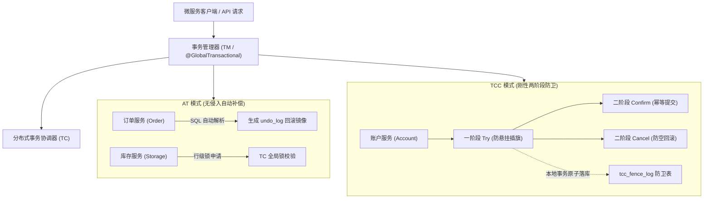
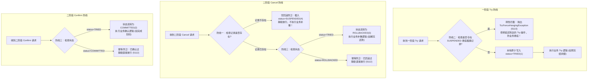
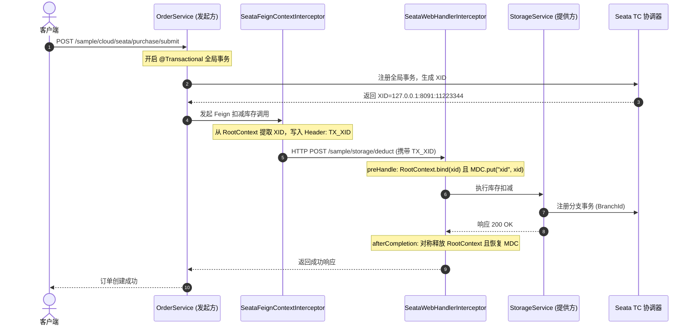

# ateng-cloud-seata 分布式事务增强底座

面向企业级高可用分布式生产环境的微服务分布式事务协调与数据一致性基础设施 Starter，单向依赖消费已发布的 `ateng-boot-bom`，专注于打造垂直正交、开箱即用、无侵入的分布式事务通用治理底座。

全面支持 Apache Seata 2.x 原生协议，内建 AT / TCC 双核事务模式驱动、TCC 防悬挂与幂等业务防卫屏障（TCC Fence）、跨进程 HTTP OpenFeign 与 Dubbo 3.3 RPC 双模 XID 对称透传、SLF4J MDC 全链路 XID 黄金关联、TransmittableThreadLocal 受管异步线程池上下文快照穿透、MyBatis-Plus 多租户内部表（`undo_log`、`tcc_fence_log`）动态放行与大小写清洗、Baomidou 动态数据源自动协同与假切源安全守卫、ANSI-SQL 标准 DDL 模板与按需自愈建表，以及 Sentinel 降级回滚强制防卫与异常因果转译机制。

---

## 0. 特性与公共 API 全景速查矩阵 (100% 覆盖)

### 0.1 核心类与门面接口

| 类 / 接口 | 类型 | 核心职责 | 默认行为 / 装配条件 |
| :--- | :--- | :--- | :--- |
| `AtengSeataAutoConfiguration` | 自动装配类 | 分布式事务增强底座自动装配总入口 | 当 `ateng.cloud.seata.enabled=true` 时激活 |
| `AtengSeataAutoConfiguration.SeataMarker` | 标记组件 | 分布式事务基础设施生效凭据组件 | 标配 `@ConditionalOnMissingBean` 注入容器 |
| `SeataProperties` | 强类型配置 | `ateng.cloud.seata.*` 根配置属性类 | 标配 `@ConfigurationProperties`，IDE 补全友好 |
| `SeataConstants` | 常量契约 | 配置前缀、XID 标头键名与内部系统表常量 | 定义 `TX_XID`、`xid` (MDC)、`undo_log`、`tcc_fence_log` |
| `SeataResultCode` | 强类型错误码 | 分布式事务专属响应错误码枚举（`5101` ~ `5114`） | 实现 `IResultCode`，严格遵循 `PERSISTENCE_TX` 规范 |
| `SeataFallbackDefense` | 降级防卫组件 | 全局事务熔断降级防卫机制核心门面 | 活跃全局事务下下游降级强制抛出 `5104` 阻断假提交 |
| `SeataAssert` | 语义化断言 | Seata 分布式事务上下文语义化断言工具类 | 提供静态与链式断言方法，快速校验事务状态 |
| `SeataFeignContextInterceptor` | 请求拦截器 | Feign 客户端跨进程出站 XID 透明透传拦截器 | 条件装配于 `feign.RequestInterceptor` 类路径存在时 |
| `SeataWebHandlerInterceptor` | 请求拦截器 | WebMVC 入站 XID 自动绑定与出口强制对称清理 | 条件装配于 Servlet Web 环境，联动同步 SLF4J MDC `xid` |
| `SeataWebMvcConfigurer` | MVC 配置器 | 注册 WebMVC 入站 XID 拦截器至拦截器链 | 标配 `@ConditionalOnWebApplication(type = SERVLET)` |
| `SeataDubboFilter` | RPC 过滤器 | Dubbo 3.3 RPC 全局事务 XID 透明穿透与自适应幂等防卫 | 消费端自动注入 Attachment，服务端自动绑定并清理 MDC |
| `SeataExceptionTranslationAspect` | 声明式切面 | 拦截全局事务与全局锁底层驱动异常并受控转译 | 拦截 `@GlobalTransactional` 与 `@GlobalLock` 方法 |
| `SeataExceptionTranslator` | 异常转译门面 | 识别锁冲突、超时与连接中断并转译为业务异常 | 保证原始因果链完整，转译为 `BusinessException` |
| `SeataAsyncContextSnapshotProvider` | 快照提供者 | 受管异步线程池 XID 上下文快照提供者 | 注册至 `ateng-boot-core` 的 `AsyncContextSnapshotProvider` SPI |
| `SeataTenantLineHandlerPostProcessor` | 后置处理器 | 自动为 `TenantLineHandler` 注入内部表排除保护 | 静态工厂方法注入，条件装配于 MyBatis-Plus 环境 |
| `SeataTenantLineHandlerWrapper` | 租户装饰器 | 租户处理器装饰器，动态放行内部事务日志表 | 拦截 `ignoreTable`，彻底杜绝多租户污染 `undo_log` 与防卫表 |
| `SeataDynamicDataSourcePropertiesCustomizer` | 属性定制器 | 协同动态数据源开启原生 Seata 代理与事务模式 | 条件装配于 `DynamicDataSourceProperties` 存在时 |
| `SeataDynamicDataSourceCoordinator` | 协同协调器 | 启动时自检物理连接池是否被 Seata 代理包装 | 条件装配于 `DynamicRoutingDataSource` 存在时 |
| `SeataDynamicDatasourceGuard` | 切源守卫 | 协调全局分布式事务跨库切源与拦截本地单连接假切源 | 默认开启；活跃全局 XID/`@DSTransactional`/`REQUIRES_NEW` 放行，假切源默认抛出 `5105`（false 则输出 WARN） |
| `SeataDynamicDatasourceGuardAspect` | 声明式切面 | 以 `Ordered.HIGHEST_PRECEDENCE` 优先级拦截 `@DS` 方法与类，先于切源压栈完成假切源校验 | 类路径存在 `DS` 与 `ProceedingJoinPoint` 且 `guard-enabled=true` 时装配 |
| `SeataGlobalLockAspect` | 声明式切面 | 拦截 `@GlobalLock` 声明式全局行级排他锁 | 标配 `@ConditionalOnClass(GlobalLock.class)` |
| `SeataGlobalLockTemplate` | 编程式模板 | 编程式高并发轻量全局排他锁防脏读执行模板 | 提供 `execute`、`executeWithRetry` 与 `executeWithoutResult` 门面接口 |
| `GlobalLockCallback<T>` | 函数式接口 | 全局排他锁业务代码执行回调接口 | 抛出 `Throwable` 支持捕获受管业务异常 |
| `TccFenceBarrier` | 业务防卫屏障 | TCC 两阶段防空回滚、防业务悬挂与幂等状态机 | 基于本地数据库日志表实现刚性原子防卫 |
| `SeataTccFenceTemplate` | 编程式模板 | 编程式 TCC Fence 业务防卫执行模板 | 提供 `executePrepare`、`executeCommit`、`executeRollback` |
| `TwoPhaseAction` | 业务契约接口 | TCC 两阶段动作标准契约接口 | 声明 `commit(actionContext)` 与 `rollback(actionContext)` |
| `TccFenceCallback<T>` | 函数式接口 | TCC 防卫屏障包裹下的单阶段业务操作回调 | 依托本地数据库事务保证状态流转与业务操作原子性 |
| `TccFenceRepository` | 扩展点 SPI | TCC 防卫日志仓储访问标准 SPI 接口 | 标配 `@ConditionalOnMissingBean` 支持平滑接管 |
| `JdbcTccFenceRepository` | 仓储实现 | 基于 JDBC 数据源的 TCC Fence 日志持久化仓储 | 默认基于 `DataSource` 自动装配，支持两阶段键集批量删除 |
| `InMemoryTccFenceRepository` | 仓储实现 | 纯内存自洽 TCC Fence 仓储实现 | 探测到无物理 `DataSource` 时的保底装配 |
| `TccFenceRecord` | 数据实体 | TCC Fence 日志记录模型实体 | 封装 `xid`, `branchId`, `actionName`, `status` |
| `TccFenceStatus` | 状态枚举 | TCC 分支事务执行状态枚举 | TRIED(1), COMMITTED(2), ROLLBACKED(3), SUSPENDED(4) |
| `TccFenceLogCleanScheduler` | 定时调度器 | TCC 防卫日志分级生命周期批量清理定时调度器 | 实现 `SmartLifecycle`，受管线程池驱动分级批量物理清理 |
| `TccFenceCleanResult` | 数据模型 | TCC 防卫日志分级清理结果摘要模型 | 记录终态删除条数、悬挂删除条数与总物理删除记录数 |
| `TccFenceTableInitializer` | 表初始化器 | TCC 防卫日志表结构按需自愈建表初始化器 | 条件装配于 `auto-init-table=true`，4 维兼容探测 |
| `TccFenceException` | 业务异常 | TCC 防卫屏障校验失败时抛出的受管业务异常 | 继承自 `BusinessException`，赋语义化错误码 |
| `TccFenceHangingException` | 业务异常 | 检测到业务悬挂风险（Try 延迟到达）时抛出 | 继承自 `TccFenceException`，明确告警悬挂阻断 |

---

### 0.2 配置属性速查表 (`ateng.cloud.seata.*`)

| 配置项 | 类型 | 默认值 | 详细业务说明 |
| :--- | :--- | :--- | :--- |
| `ateng.cloud.seata.enabled` | `boolean` | `true` | 是否开启 Seata 分布式事务增强底座 |
| `ateng.cloud.seata.tx.default-timeout` | `Duration` | `30s` | 全局事务默认超时时效，防止大事务或网络悬挂长时间阻塞连接池 |
| `ateng.cloud.seata.lock.retry-interval` | `Duration` | `50ms` | 全局排他锁获取重试等待间隔，避免高频自旋打爆 TC 节点网络 |
| `ateng.cloud.seata.lock.retry-times` | `int` | `30` | 全局排他锁获取最大重试次数（总计约 1.5 秒后 Fail-Fast 释放本地锁） |
| `ateng.cloud.seata.tcc.fence-enabled` | `boolean` | `true` | 是否开启 TCC 两阶段防空回滚、防业务悬挂与幂等业务防卫屏障 |
| `ateng.cloud.seata.tcc.clean-enabled` | `boolean` | `true` | 是否开启 TCC 防卫日志历史记录分级生命周期定时清理调度 |
| `ateng.cloud.seata.tcc.clean-period` | `Duration` | `1d` | TCC 防卫日志历史归档记录清理定时任务调度周期 |
| `ateng.cloud.seata.tcc.log-ttl` | `Duration` | `3d` | TCC 终态防卫日志（COMMITTED / ROLLBACKED）基础保留时效 |
| `ateng.cloud.seata.tcc.clean-batch-size` | `int` | `500` | TCC 防卫日志单批次物理清理最大记录数（防御长事务锁表） |
| `ateng.cloud.seata.tcc.suspended-retention-multiplier` | `int` | `3` | 悬挂防卫标记（SUSPENDED）超长保留倍数（默认 `3x logTtl` = 9 天） |
| `ateng.cloud.seata.tcc.auto-init-table` | `boolean` | `false` | 是否开启 TCC 防卫表自动安全自愈初始化建表（生产环境坚决默认 false） |
| `ateng.cloud.seata.tcc.table-name` | `String` | `"tcc_fence_log"` | TCC 防卫日志存储数据表名（联动多租户动态排除） |
| `ateng.cloud.seata.dynamic-datasource.enabled` | `boolean` | `true` | 是否开启 Baomidou dynamic-datasource 多数据源协同增强 |
| `ateng.cloud.seata.dynamic-datasource.mode` | `String` | `"AT"` | 动态数据源 Seata 事务代理模式（支持 `AT` 或 `XA`，默认 `AT`） |
| `ateng.cloud.seata.dynamic-datasource.auto-proxy` | `boolean` | `true` | 是否自动对 DynamicRoutingDataSource 中各物理连接池进行 Seata 代理包装 |
| `ateng.cloud.seata.dynamic-datasource.guard-enabled` | `boolean` | `true` | 是否开启假切源安全守卫与声明式 `@DS` 防卫切面 |
| `ateng.cloud.seata.dynamic-datasource.fail-on-false-switch` | `boolean` | `true` | 检测到 Spring 单连接假切源时是否抛出 `5105` 异常阻断执行（`false` 则降级为 `WARN` 告警） |

---

### 0.3 标准错误码契约对照表 (`SeataResultCode`)

| 错误码枚举 | 编码值 (`code`) | 物理 HTTP 映射 | 业务描述与阻断场景 |
| :--- | :--- | :--- | :--- |
| `SEATA_TRANSACTION_FAILED` | `5101` | `200 OK (Result) / 500` | 全局分布式事务执行失败，下游分支或业务断言回滚并已转译抛出 |
| `SEATA_LOCK_CONFLICT` | `5102` | `200 OK (Result) / 409` | 分布式全局行锁冲突：获取全局排他锁超时或竞争失败，避免脏写 |
| `SEATA_TC_UNAVAILABLE` | `5103` | `200 OK (Result) / 503` | 分布式事务协调器 (TC) 不可达、网络断连或超时，刚性 Fail-Fast 阻断 |
| `SEATA_DEGRADE_BLOCKED` | `5104` | `200 OK (Result) / 500` | 下游跨微服务调用触发熔断降级，全局活跃事务强制阻断原子回滚 |
| `SEATA_FALSE_DATASOURCE_SWITCH` | `5105` | `200 OK (Result) / 409` | Spring 单连接本地事务非法跨库假切源阻断（防静默忽略切源造成串库） |
| `TCC_FENCE_SUSPENDED` | `5110` | `200 OK (Result) / 409` | TCC 分支已被业务悬挂拦截：Cancel 先行到达并插旗阻断，延迟 Try 被拒绝 |
| `TCC_FENCE_EMPTY_ROLLBACK` | `5111` | `200 OK (Result) / 200` | TCC 分支已被空回滚拦截：一阶段 Try 未曾执行，二阶段 Cancel 静默放行 |
| `TCC_FENCE_DUPLICATE_CALL` | `5112` | `200 OK (Result) / 200` | TCC 分支重复调用已幂等放行：二阶段 Confirm 或 Cancel 重复调用安全返回 |
| `TCC_FENCE_RECORD_NOT_EXISTS` | `5113` | `200 OK (Result) / 500` | TCC 分支防卫记录不存在，非法进入二阶段流转 |
| `TCC_FENCE_STATE_ERROR` | `5114` | `200 OK (Result) / 500` | TCC 分支事务状态不合法，发生非预期的生命周期逆转 |

---

## 1. 模块定位与 Maven 坐标

### 1.1 分布式微服务一致性痛点与架构定位

在微服务分布式架构中，跨服务、跨数据库的业务操作（如电商下单：`Order` ➔ `Storage` ➔ `Account`）经常面临严峻的一致性挑战与资损风险：
1. **网络超时引发单边落库**：下游微服务执行成功但网络响应超时，上游重试导致库存与账户重复扣减；若上游放弃则产生单边脏数据；
2. **Sentinel 熔断降级假提交隐患**：跨微服务调用触发 Sentinel 降级时，默认 Fallback 若返回 Mock 假数据，将诱骗事务协调器误判业务成功并提交全局事务，导致灾难性的单边脏写与资损；
3. **多租户内部表穿透污染**：MyBatis-Plus 多租户拦截器盲目将 `tenant_id` 拼接入 Seata 系统的 `undo_log` 或 `tcc_fence_log`，导致日志检索失效，无法正确执行两阶段回滚并引发 SQL 崩溃；
4. **TCC 两阶段三大固有顽疾**：
   - **空回滚 (Empty Rollback)**：一阶段 Try 因网络分区未收到，协调器发起 Cancel，业务执行空补偿导致资金虚增；
   - **业务悬挂 (Hanging)**：Cancel 先于延迟的 Try 到达执行空回滚，随后迟到的 Try 成功预占资源且再也不会被 Cancel，造成资金永久冻结悬挂；
   - **重复调用 (Duplicate Call)**：网络抖动导致 Confirm 或 Cancel 多次重试，造成业务多次扣款或多次退款；
5. **动态数据源假切源串库**：在 Spring `@Transactional` 下切换数据源时，物理连接已被本地事务管理器绑定，造成切源静默失效并脏写主库。

`ateng-cloud-seata` 基于工业级标准深度封装，提供 AT 自动代理、TCC 屏障硬核防卫、全链路 XID 穿透与 SLF4J MDC 黄金关联、Sentinel 降级回滚强制防卫与假切源安全拦截，实现开箱即用的高可用分布式事务管控。

---

### 1.2 Maven 依赖坐标

在业务微服务工程的 `pom.xml` 中引入（版本由 `ateng-cloud-bom` 集中纳管，子模块免配 `<version>`）：

```xml
<dependency>
    <groupId>io.github.atengk</groupId>
    <artifactId>ateng-cloud-seata</artifactId>
</dependency>
```

---

## 2. 核心架构与设计不变量

### 2.1 AT / TCC 双核事务模型与架构拓扑

`ateng-cloud-seata` 深度整合 Apache Seata 2.x，提供两种互补的分布式事务模式，支持在同一应用中混用：



---

### 2.2 四道金融级容灾防线

为了杜绝任何可能的单边落库与资产损失，框架内建四道微服务专属防线：
1. **防线一：全链路 XID 跨跳对称穿透与 MDC 黄金关联**：基于 HTTP OpenFeign 与 Dubbo 3.3 RPC 自动出站注入与入站绑定，出口强制对称清理；MDC 绑定 `xid`，实现分布式链路可观测性闭环；
2. **防线二：TCC Fence 刚性业务屏障**：基于本地数据源日志表与状态机，彻底拦截空回滚、业务悬挂与重复调用；
3. **防线三：活跃事务下 Sentinel 降级强制回滚防卫**：当下游调用触发熔断降级时，严格识别当前活跃事务上下文，抛出 `5104` 阻断假提交；
4. **防线四：多租户与多数据源边界隔离**：动态清洗表名并放行 Seata 内部表，切源守卫拦截单连接假切源。

---

### 2.3 异常因果链传递与微服务回滚传导

框架遵循“**要么就地降级补偿，要么转换为业务异常向外抛出**”铁律，严禁吞咽异常：
- `SeataExceptionTranslator` 捕获底层驱动异常（如 `LockConflictException`、`TransactionException`），在模块边界转译为受管业务异常 `BusinessException`，分别赋予清晰语义化错误码（`5102`、`5103`）；
- 转译时必须完整保留原始异常因果链（`cause`），确保异常堆栈可追溯；
- 事务边界（TM）自动感知未捕获业务异常，并触发 TC 两阶段全量反向补偿回滚。

---

## 3. AT 模式分布式事务协同与数据源增强

### 3.1 采购提单两阶段分布式事务

#### ① 专属 YAML 配置片段

```yaml
ateng:
  cloud:
    seata:
      enabled: true
      tx:
        default-timeout: 30s # 全局事务超时时间，避免大事务长久锁表

# 原生 Seata 客户端配置
seata:
  enabled: true
  tx-service-group: default_tx_group
  service:
    vgroup-mapping:
      default_tx_group: default
    grouplist:
      default: 127.0.0.1:8091
```

#### ② 实战 Java 示例代码

以下代码 1:1 提取自经过全真测试的 `sample-cloud-seata` 场景工程源码：

**订单服务发起全局事务 (`OrderService.java`)**：
```java
package io.github.atengk.cloud.sample.seata.service;

import io.github.atengk.boot.core.util.BusinessAssert;
import org.apache.seata.core.context.RootContext;
import org.slf4j.Logger;
import org.slf4j.LoggerFactory;
import org.springframework.jdbc.core.JdbcTemplate;
import org.springframework.jdbc.support.GeneratedKeyHolder;
import org.springframework.jdbc.support.KeyHolder;
import org.springframework.stereotype.Service;
import org.springframework.transaction.annotation.Transactional;

import java.sql.PreparedStatement;
import java.sql.Statement;

@Service
public class OrderService {

    private static final Logger log = LoggerFactory.getLogger(OrderService.class);
    public static final int DEFAULT_UNIT_PRICE = 100;

    private final JdbcTemplate jdbcTemplate;
    private final StorageService storageService;
    private final AccountService accountService;

    public OrderService(JdbcTemplate jdbcTemplate, StorageService storageService, AccountService accountService) {
        this.jdbcTemplate = jdbcTemplate;
        this.storageService = storageService;
        this.accountService = accountService;
    }

    /**
     * 采购提单全流程分布式事务 (AT 模式)
     */
    @Transactional(rollbackFor = Exception.class)
    public Long createOrder(String userId, String commodityCode, int orderCount, boolean forceRollback) {
        int orderMoney = orderCount * DEFAULT_UNIT_PRICE;
        log.info("开启下单事务 (XID: [{}]): 用户 [{}], 商品 [{}], 数量 [{}], 强制回滚 [{}]",
                RootContext.getXID(), userId, commodityCode, orderCount, forceRollback);

        // 1. 扣减库存 (AT 模式分支一)
        storageService.deduct(commodityCode, orderCount);

        // 2. 扣减账户余额 (AT 模式分支二)
        accountService.debit(userId, orderMoney);

        // 3. 模拟异常触发两阶段自动回滚
        BusinessAssert.isFalse(forceRollback, "模拟业务异常，触发 Seata 分布式事务全链路原子回滚！");

        // 4. 创建订单记录
        return insertOrderRecord(userId, commodityCode, orderCount, orderMoney);
    }
}
```

**Web 接入层 Controller (`SeataPurchaseOrderController.java`)**：
```java
package io.github.atengk.cloud.sample.seata.controller;

import io.github.atengk.boot.core.model.Result;
import io.github.atengk.cloud.sample.seata.model.dto.PurchaseOrderDTO;
import io.github.atengk.cloud.sample.seata.model.vo.PurchaseOrderVO;
import io.github.atengk.cloud.sample.seata.service.AccountService;
import io.github.atengk.cloud.sample.seata.service.OrderService;
import io.github.atengk.cloud.sample.seata.service.StorageService;
import jakarta.validation.Valid;
import org.apache.seata.core.context.RootContext;
import org.springframework.validation.annotation.Validated;
import org.springframework.web.bind.annotation.PostMapping;
import org.springframework.web.bind.annotation.RequestBody;
import org.springframework.web.bind.annotation.RequestMapping;
import org.springframework.web.bind.annotation.RestController;

@Validated
@RestController
@RequestMapping("/sample/cloud/seata/purchase")
public class SeataPurchaseOrderController {

    private final OrderService orderService;
    private final StorageService storageService;
    private final AccountService accountService;

    public SeataPurchaseOrderController(OrderService orderService,
                                        StorageService storageService,
                                        AccountService accountService) {
        this.orderService = orderService;
        this.storageService = storageService;
        this.accountService = accountService;
    }

    @PostMapping("/submit")
    public Result<PurchaseOrderVO> submitPurchaseOrder(@Valid @RequestBody PurchaseOrderDTO dto) {
        Long orderId = orderService.createOrder(
                dto.getUserId(),
                dto.getCommodityCode(),
                dto.getCount(),
                Boolean.TRUE.equals(dto.getForceRollback())
        );

        PurchaseOrderVO vo = new PurchaseOrderVO();
        vo.setOrderId(orderId);
        vo.setUserId(dto.getUserId());
        vo.setCommodityCode(dto.getCommodityCode());
        vo.setCount(dto.getCount());
        vo.setOrderMoney(dto.getCount() * OrderService.DEFAULT_UNIT_PRICE);
        vo.setStockRemaining(storageService.getStock(dto.getCommodityCode()));
        vo.setBalanceRemaining(accountService.getBalance(dto.getUserId()));
        vo.setXid(RootContext.getXID() != null ? RootContext.getXID() : "HERMETIC_LOCAL_TX");
        vo.setStatus("COMMITTED");
        return Result.success(vo);
    }
}
```

#### ③ 核心机制与微服务容灾边界

- **两阶段自动反向补偿**：Seata Client 在一阶段通过拦截业务 SQL 解析前置镜像（Before Image）与后置镜像（After Image）并原子写入 `undo_log` 表；
- **脏写防卫**：一阶段本地事务提交前必须先向 TC 申请全局锁；若全局锁已被其他活跃事务持有，则等待自旋重试；超过重试时限后 Fail-Fast 释放本地锁，防止长事务阻塞；
- **二阶段原子收敛**：若业务抛出未受检异常或触发断言失败，TC 协调各分支数据源读取 `undo_log` 反向生成回滚 SQL，精准恢复数据。

---

### 3.2 动态多数据源协同与假切源安全守卫 (`False Datasource Switch Guard`)

#### ① 专属 YAML 配置片段

```yaml
ateng:
  cloud:
    seata:
      dynamic-datasource:
        enabled: true              # 开启 Baomidou dynamic-datasource 原生代理协同
        mode: AT                   # 事务代理模式：AT 或 XA
        auto-proxy: true           # 自动对连接池进行 SeataDataSourceProxy 包装
        guard-enabled: true        # 开启声明式 @DS 假切源安全守卫与切面
        fail-on-false-switch: true # 单连接假切源抛出 5105 阻断（false 则降级 WARN 放行）
```

#### ② 实战 Java 示例代码

以下代码 1:1 提取自 `sample-cloud-seata` 场景工程源码：

**声明式从库目标服务 (`SeataSlaveDatasourceService.java`) 与编排服务 (`SeataDatasourceGuardService.java`)**：
```java
@Service
public class SeataSlaveDatasourceService {

    @DS("slave")
    public String executeOnSlave() {
        return "slave";
    }
}
```

```java
@Service
public class SeataDatasourceGuardService {

    private final SeataSlaveDatasourceService slaveDatasourceService;

    public SeataDatasourceGuardService(SeataSlaveDatasourceService slaveDatasourceService) {
        this.slaveDatasourceService = slaveDatasourceService;
    }

    /**
     * 活跃 Seata 全局事务下合法放行 @DS("slave") 跨库切源
     */
    @Transactional(rollbackFor = Exception.class)
    public DatasourceGuardVO executeSwitchInGlobalTx(String xid) {
        RootContext.bind(xid);
        DynamicDataSourceContextHolder.push("master");
        try {
            String targetDs = slaveDatasourceService.executeOnSlave();
            return new DatasourceGuardVO("master", targetDs, RootContext.getXID(), true, "活跃全局事务放行");
        } finally {
            DynamicDataSourceContextHolder.clear();
            RootContext.unbind();
        }
    }

    /**
     * 普通 Spring 单物理连接本地事务下触发 @DS("slave") -> 自动拦截并抛出 5105
     */
    @Transactional(rollbackFor = Exception.class)
    public DatasourceGuardVO executeFalseSwitchInLocalTx() {
        DynamicDataSourceContextHolder.push("master");
        try {
            String targetDs = slaveDatasourceService.executeOnSlave();
            return new DatasourceGuardVO("master", targetDs, null, true, "未触发阻断");
        } finally {
            DynamicDataSourceContextHolder.clear();
        }
    }
}
```

#### ③ 核心机制与防假切源边界

- **前置最高优先级切面 (`SeataDynamicDatasourceGuardAspect`)**：实现 `Ordered` 返回 `Ordered.HIGHEST_PRECEDENCE` 并以 `@Around` 拦截 `@DS` 方法与类，确保在 Baomidou `DynamicDataSourceAnnotationInterceptor` 将新数据源压入线程栈之前，先基于当前 Spring 事务绑定的原始数据源完成风险校验（借助 `MethodClassKey` + `ConcurrentReferenceHashMap` 缓存解析「实现方法 → 声明方法 → 接口方法 → 目标类 → 声明类」层级注解）；
- **四重合法放行通道**：当存在活跃 Seata 全局事务（`RootContext.inGlobalTransaction()`）、处于 Baomidou `@DSTransactional` 多源协调事务、目标方法/类声明了 `@Transactional(propagation = Propagation.REQUIRES_NEW)` 独立事务、或目标数据源与当前事务已绑定数据源相同时，守卫自动放行；
- **5105 刚性阻断与降级策略**：若处于 Spring 单物理连接事务且发生跨库切换，`fail-on-false-switch=true`（默认）直接抛出 `BusinessException(SeataResultCode.SEATA_FALSE_DATASOURCE_SWITCH [5105])` 阻断并避免 `Log-and-Throw`；若配置为 `false` 则输出 `WARN` 降级日志并放行。

---

### 3.3 MyBatis-Plus 租户内部表动态排除

#### ① 专属 YAML 配置片段

```yaml
ateng:
  cloud:
    seata:
      tcc:
        table-name: tcc_fence_log # 声明防卫表表名，自动被多租户拦截器动态放行
```

#### ② 动态放行与大小写清洗机制

MyBatis-Plus 行级多租户插件（`TenantLineInnerInterceptor`）会无差别拦截所有 SQL 并强制追加 `AND tenant_id = ?` 条件：
- **深水区隐患**：Seata 官方的 `undo_log` 与 `tcc_fence_log` 属于中间件物理系统表，表中通常无 `tenant_id` 业务列。一旦被追加租户条件，将直接引发 SQL 语法异常或回滚查找失败；
- **装饰器动态放行**：`SeataTenantLineHandlerWrapper` 自动放行 `undo_log`、`tcc_fence_log` 以及自定义表名；
- **方言弹性清洗**：自动剥除表名中的反引号（`）、双引号（"）并统一转小写比对，支持大写方言（如 Oracle `TCC_FENCE_LOG`），实现零配置彻底免疫。

---

## 4. TCC 模式与刚性防卫屏障 TCC Fence

### 4.1 两阶段业务契约与防卫屏障执行

#### ① 专属 YAML 配置片段

```yaml
ateng:
  cloud:
    seata:
      tcc:
        fence-enabled: true     # 开启 TCC 两阶段刚性业务防卫屏障
        auto-init-table: false  # 生产环境推荐 DBA 手工建表 (开发环境可开启 true)
        table-name: tcc_fence_log
```

#### ② 实战 Java 示例代码

以下代码 1:1 提取自 `sample-cloud-seata` 场景工程源码：

**TCC 两阶段服务契约实现 (`AccountService.java`)**：
```java
package io.github.atengk.cloud.sample.seata.service;

import io.github.atengk.boot.core.util.BusinessAssert;
import io.github.atengk.cloud.seata.tcc.SeataTccFenceTemplate;
import io.github.atengk.cloud.seata.tcc.TwoPhaseAction;
import org.apache.seata.rm.tcc.api.BusinessActionContext;
import org.slf4j.Logger;
import org.slf4j.LoggerFactory;
import org.springframework.jdbc.core.JdbcTemplate;
import org.springframework.stereotype.Service;

@Service
public class AccountService implements TwoPhaseAction {

    private static final Logger log = LoggerFactory.getLogger(AccountService.class);

    private final JdbcTemplate jdbcTemplate;
    private final SeataTccFenceTemplate tccFenceTemplate;

    public AccountService(JdbcTemplate jdbcTemplate, SeataTccFenceTemplate tccFenceTemplate) {
        this.jdbcTemplate = jdbcTemplate;
        this.tccFenceTemplate = tccFenceTemplate;
    }

    /**
     * TCC 一阶段 Try：在 TCC Fence 屏障保护下执行扣款准备
     */
    public boolean prepareDebitTcc(BusinessActionContext actionContext, String userId, int money) throws Throwable {
        return tccFenceTemplate.executePrepare(actionContext, "AccountDebitTcc", () -> {
            log.info("TCC 一阶段 Try: 校验并扣减用户余额 [{}], 金额: [{}]", userId, money);
            int updated = jdbcTemplate.update(
                    "UPDATE account_tbl SET money = money - ? WHERE user_id = ? AND money >= ?",
                    money, userId, money
            );
            BusinessAssert.isTrue(updated > 0, "TCC 余额不足: %s", userId);
            return true;
        });
    }

    @Override
    public boolean commit(BusinessActionContext actionContext) {
        try {
            return tccFenceTemplate.executeCommit(actionContext, () -> {
                log.info("TCC 二阶段 Confirm: 确认用户扣款, 事务 [{}#{}]",
                        actionContext.getXid(), actionContext.getBranchId());
                return true;
            });
        } catch (Throwable t) {
            log.error("TCC 二阶段 Confirm 异常", t);
            return false;
        }
    }

    @Override
    public boolean rollback(BusinessActionContext actionContext) {
        try {
            return tccFenceTemplate.executeRollback(actionContext, () -> {
                String userId = (String) actionContext.getActionContext("userId");
                Object moneyObj = actionContext.getActionContext("money");
                Integer money = moneyObj instanceof Number ? ((Number) moneyObj).intValue() : null;
                log.info("TCC 二阶段 Cancel: 回滚补偿用户余额 [{}], 补回金额: [{}]", userId, money);
                if (userId != null && money != null) {
                    jdbcTemplate.update("UPDATE account_tbl SET money = money + ? WHERE user_id = ?", money, userId);
                }
                return true;
            });
        } catch (Throwable t) {
            log.error("TCC 二阶段 Cancel 异常", t);
            return false;
        }
    }
}
```

#### ③ TCC 屏障状态机与全流程流转图



---

### 4.2 空回滚拦截与防业务悬挂插旗

#### ① 专属 YAML 配置片段

```yaml
ateng:
  cloud:
    seata:
      tcc:
        fence-enabled: true
```

#### ② 防卫机制与实战代码

在 `SeataTccFenceController.java` 中演示防空回滚与防业务悬挂：

```java
@PostMapping("/empty-rollback")
public Result<TccActionVO> emptyRollback(@Valid @RequestBody TccDebitDTO dto) {
    String xid = resolveXid(dto);
    Long branchId = resolveBranchId(dto);
    BusinessActionContext context = createActionContext(xid, branchId, dto.getUserId(), dto.getMoney());

    // 未执行 Try，直接调用 Cancel -> 自动插入 SUSPENDED，静默跳过补偿
    boolean success = accountService.rollback(context);
    String recordStatus = tccFenceBarrier.getRepository()
            .findByXidAndBranchId(xid, branchId)
            .map(TccFenceRecord::getStatus)
            .map(Enum::name)
            .orElse("UNKNOWN");

    return Result.success(new TccActionVO(
            xid, branchId, dto.getUserId(), recordStatus,
            accountService.getBalance(dto.getUserId()),
            success ? "空回滚防卫成功：已插入 SUSPENDED 标记并静默跳过业务补偿" : "空回滚防卫失败"
    ));
}

@PostMapping("/hanging-defense")
public Result<TccActionVO> hangingDefense(@Valid @RequestBody TccDebitDTO dto) throws Throwable {
    String xid = resolveXid(dto);
    Long branchId = resolveBranchId(dto);
    BusinessActionContext context = createActionContext(xid, branchId, dto.getUserId(), dto.getMoney());

    // 1. Cancel 先行到达，触发空回滚占位插入 SUSPENDED
    accountService.rollback(context);
    // 2. 延迟 Try 随后到达 -> 屏障识别 SUSPENDED 标记，刚性拦截抛出 TccFenceHangingException (5110)
    accountService.prepareDebitTcc(context, dto.getUserId(), dto.getMoney());
    return Result.success();
}
```

- **空回滚防卫 (Anti-Empty-Rollback)**：一阶段 Try 未曾执行时收到 Cancel，屏障在本地事务中插入 `SUSPENDED` 标记并跳过补偿业务，杜绝资金虚增；
- **防业务悬挂 (Anti-Hanging)**：若网络滞后的 Try 在 Cancel 执行之后才到达，屏障检测到先期插入的 `SUSPENDED` 标记，立即阻断并抛出 `TccFenceHangingException (5110)`，杜绝资金永久悬挂。

---

### 4.3 二阶段幂等去重与防重放

#### ① 专属 YAML 配置片段

```yaml
ateng:
  cloud:
    seata:
      tcc:
        fence-enabled: true
```

#### ② 幂等机制与实战代码

在 `SeataTccFenceController.java` 中演示二阶段幂等去重：

```java
@PostMapping("/duplicate-commit")
public Result<TccActionVO> duplicateCommit(@Valid @RequestBody TccDebitDTO dto) throws Throwable {
    String xid = resolveXid(dto);
    Long branchId = resolveBranchId(dto);
    BusinessActionContext context = createActionContext(xid, branchId, dto.getUserId(), dto.getMoney());

    // 1. 正常执行一阶段 Try
    accountService.prepareDebitTcc(context, dto.getUserId(), dto.getMoney());
    // 2. 第一次与第二次 Confirm（模拟重传）-> 屏障检测到 COMMITTED 状态，幂等放行
    boolean firstCommit = accountService.commit(context);
    boolean secondCommit = accountService.commit(context);

    return Result.success(new TccActionVO(
            xid, branchId, dto.getUserId(), "COMMITTED",
            accountService.getBalance(dto.getUserId()),
            (firstCommit && secondCommit) ? "重复提交幂等放行成功，状态保持 COMMITTED 且资金不重复扣减" : "Confirm 异常"
    ));
}
```

- **二阶段幂等放行 (Idempotent Execution)**：网络抖动导致 Confirm 或 Cancel 多次重传时，状态校验直接命中 `COMMITTED` 或 `ROLLBACKED`，静默幂等放行，杜绝重复划扣与重复退款。

---

### 4.4 防卫日志分级生命周期与定时清理自愈

#### ① 专属 YAML 配置片段

```yaml
ateng:
  cloud:
    seata:
      tcc:
        clean-enabled: true                  # 开启防卫日志定时清理调度
        clean-period: 1d                     # 清理任务调度周期：每天执行 1 次
        log-ttl: 3d                          # 终态日志基础存活保留期：3 天
        clean-batch-size: 500                # 单批次物理删除条数，防御长事务锁表
        suspended-retention-multiplier: 3    # 悬挂防卫标记超长保留倍数：3x 即 9 天
        auto-init-table: false               # 生产环境默认 false，沙箱可开启自愈建表
```

#### ② 实战 Java 示例代码

在 `SeataTccFenceController.java` 中演示通过受管调度器 `TccFenceLogCleanScheduler#clean()` 触发分级物理清理：

```java
@PostMapping("/clean")
public Result<TccFenceCleanResult> cleanExpiredFenceLogs() {
    log.info("触发 TCC 防卫日志分级生命周期清理");
    return Result.success(cleanScheduler.clean());
}
```

#### ③ 分级生命周期策略与自愈机制

为杜绝 TCC 防卫日志无限膨胀压垮磁盘与查询性能，框架基于 Spring `SmartLifecycle` 提供受管分级清理调度器 (`TccFenceLogCleanScheduler`)：
1. **终态业务记录（`COMMITTED` 与 `ROLLBACKED`）**：
   - 保留期：`logTtl`（默认 3 天）；
   - 处理逻辑：超过保留期的记录已被 TC 最终裁决收敛，准时分批物理删除以释放空间；
2. **悬挂防卫标记（`SUSPENDED`）**：
   - 保留期：`logTtl * suspendedRetentionMultiplier`（默认 `3 x 3d` = 9 天）；
   - 核心防线：悬挂标记是一阶段迟到 Try 的唯一防护盾。极端网络抖动恢复后，迟到的 Try 可能在数天后重试到达；通过 3 倍超长窗口长效留存，坚决杜绝因日志过早被删导致迟到 Try 重新穿透执行的悬挂资损；
3. **活跃状态（`TRIED`）**：
   - **坚决永不删除**，保障未完成二阶段裁决的在途事务处于绝对保护中；
4. **ANSI-SQL 双阶段键集分批清理**：
   - 严格遵循 `cleanBatchSize`（默认 500）限制，采用两阶段主键定位删除，避免长事务造成物理行锁长时间挂起。

---

## 5. 高并发全局排他锁 Global Lock

### 5.1 声明式 `@GlobalLock` 防脏写

#### ① 专属 YAML 配置片段

```yaml
ateng:
  cloud:
    seata:
      enabled: true
      lock:
        retry-interval: 50ms # 全局锁重试间隔
        retry-times: 30      # 最大重试次数
```

#### ② 实战 Java 示例代码

在商品详情页库存查询、高频读取或无需全局事务回滚补偿的场景中，若直接标注 `@GlobalTransactional` 会带来生成 `undo_log` 与反向补偿镜像的高额开销。以下代码 `1:1` 提取自 `sample-cloud-seata` 场景工程：

**声明式使用 (`StorageService.java`)**：
```java
/**
 * 声明式 @GlobalLock 轻量全局排他锁防脏读
 *
 * @param commodityCode 商品编码
 * @param count         需求数量
 * @return 库存充裕返回 true
 */
@GlobalLock
public boolean checkAndLockStockDeclarative(String commodityCode, int count) {
    log.info("声明式 @GlobalLock 校验商品库存: [{}]", commodityCode);
    return getStock(commodityCode) >= count;
}
```

**Controller 端点 (`SeataGlobalLockController.java`)**：
```java
@GetMapping("/declarative-check")
public Result<Boolean> declarativeCheck(@RequestParam("commodityCode") String commodityCode,
                                       @RequestParam(value = "count", defaultValue = "1") Integer count) {
    log.info("执行声明式 @GlobalLock 库存校验: 商品 [{}], 数量 [{}]", commodityCode, count);
    boolean hasStock = storageService.checkAndLockStockDeclarative(commodityCode, count);
    return Result.success(hasStock);
}
```

#### ③ 核心机制与防脏读优势

- **运行机制**：仅在本地事务提交前向 TC 校验或申请该行记录的全局锁，若未发生冲突则直接提交本地事务；一旦检测到冲突立即抛出 `5102 (SEATA_LOCK_CONFLICT)`；
- **性能飞跃**：彻底免除 `undo_log` 镜像解析与反向日志落库，高并发读写吞吐提升 `3~5` 倍。

---

### 5.2 编程式 `SeataGlobalLockTemplate` 与退避重试

#### ① 专属 YAML 配置片段

```yaml
ateng:
  cloud:
    seata:
      lock:
        retry-interval: 50ms # 自旋重试退避间隔
        retry-times: 30      # 重试 30 次，总计约 1.5 秒后 Fail-Fast 阻断
```

#### ② 实战 Java 示例代码

**编程式模板与重试 (`StorageService.java`)**：
```java
/**
 * 编程式 SeataGlobalLockTemplate 校验并扣减商品库存（启用锁冲突退避重试）
 *
 * @param commodityCode 商品编码
 * @param count         扣减数量
 * @return 扣减成功返回 true
 * @throws Throwable 执行异常
 */
public boolean updateStockProgrammatic(String commodityCode, int count) throws Throwable {
    return globalLockTemplate.executeWithRetry(() -> {
        log.info("编程式 GlobalLock 模板带退避重试校验并扣减商品库存: [{}] 扣减 [{}]", commodityCode, count);
        int current = getStock(commodityCode);
        BusinessAssert.isTrue(current >= count, "库存不足: %s", commodityCode);
        jdbcTemplate.update("UPDATE storage_tbl SET count = count - ? WHERE commodity_code = ?", count, commodityCode);
        return true;
    });
}
```

**Controller 端点 (`SeataGlobalLockController.java`)**：
```java
@PostMapping("/programmatic-update")
public Result<Boolean> programmaticUpdate(@RequestParam("commodityCode") String commodityCode,
                                         @RequestParam(value = "count", defaultValue = "1") Integer count) throws Throwable {
    log.info("执行编程式 SeataGlobalLockTemplate#executeWithRetry 退避重试扣减库存: 商品 [{}], 数量 [{}]", commodityCode, count);
    boolean success = storageService.updateStockProgrammatic(commodityCode, count);
    return Result.success(success);
}
```

#### ③ 自旋退避与高并发竞争防御

- **自旋退避防雪崩**：在高并发行锁竞争下，基于配置的 `retryInterval`（默认 50ms）执行温和退避，坚决避免死循环自旋打爆 TC 节点网络；
- **确定性释放**：达到最大重试次数 `retryTimes`（默认 30 次）后快速失败并抛出 `5102`，释放本地事务，防止数据库连接池耗尽。

---

## 6. 全链路跨进程 XID 穿透与容灾防卫

### 6.1 OpenFeign 与 Dubbo 3.3 RPC 双模对称透传

#### ① 专属 YAML 配置片段

```yaml
ateng:
  cloud:
    seata:
      enabled: true # 开启后自动装配 Feign 拦截器与 Dubbo 过滤器
```

#### ② 跨进程透传时序图



#### ③ 对称清理与 Dubbo 自适应幂等防卫

- **入站 preHandle 绑定、出站 afterCompletion 确定性解绑**：严格遵循生命周期对称性，防止多租户与线程脏读污染；
- **Dubbo 3.3 RPC 自适应幂等防卫 (`SeataDubboFilter`)**：消费端自动注入 Attachment，服务端自动提取绑定；若外部框架已先期绑定相同 XID，过滤器激活自适应幂等防卫，静默放行并在方法出口处**不执行二次解绑**，彻底避免截断外层事务上下文；
- **本地 short-circuit**：识别 `injvm` 内存调用自动短路放行。

---

### 6.2 SLF4J MDC 黄金关联与受管异步线程池快照穿透

#### ① 专属 YAML 配置片段

`ateng-cloud-seata` 通过 `META-INF/services/io.github.atengk.boot.core.context.AsyncContextSnapshotProvider` 自动注册 `SeataAsyncContextSnapshotProvider`，与 HTTP/Dubbo 拦截器协同生效：

```yaml
ateng:
  cloud:
    seata:
      enabled: true # 开启 Web/Dubbo XID 透传、MDC "xid" 注入及受管异步 XID 快照穿透
```

#### ② 实战 Java 示例代码

微服务调用链中，`SeataWebHandlerInterceptor` 与 `SeataDubboFilter` 自动将当前活跃事务 `RootContext.getXID()` 同步写入 SLF4J MDC 键名 `xid`：

```text
2026-11-03T18:00:52.563+08:00 [xid:127.0.0.1:8091:202611038888] INFO [sample-cloud-seata] [main] i.g.a.c.s.seata.service.OrderService : 开启下单事务...
```

以下代码 `1:1` 提取自 `sample-cloud-seata` 场景工程 [`SeataAsyncPropagationController.java`](../ateng-cloud-samples/sample-cloud-seata/src/main/java/io/github/atengk/cloud/sample/seata/controller/SeataAsyncPropagationController.java)：

```java
@PostMapping("/propagate")
public Result<AsyncXidPropagationVO> propagateAsyncXid(@RequestParam(value = "xid", required = false) String xid) {
    String effectiveXid = StringUtils.hasText(xid)
            ? xid
            : "127.0.0.1:8091:async-xid-" + System.currentTimeMillis();

    boolean manuallyBound = false;
    String previousMdcXid = MDC.get(SeataConstants.MDC_KEY_XID);
    if (!RootContext.inGlobalTransaction()) {
        RootContext.bind(effectiveXid);
        manuallyBound = true;
    }
    String masterXid = RootContext.getXID();
    MDC.put(SeataConstants.MDC_KEY_XID, masterXid);
    log.info("主线程发起受管异步 XID 穿透演示: masterXid=[{}]", masterXid);

    try {
        CompletableFuture<AsyncXidPropagationVO> future = AsyncUtil.supply(() -> {
            String workerXid = RootContext.getXID();
            String workerMdcXid = MDC.get(SeataConstants.MDC_KEY_XID);
            boolean propagated = Objects.equals(masterXid, workerXid) && Objects.equals(masterXid, workerMdcXid);
            return new AsyncXidPropagationVO(
                    masterXid,
                    Thread.currentThread().getName(),
                    workerXid,
                    workerMdcXid,
                    propagated
            );
        });
        return Result.success(future.get(ASYNC_WAIT_SECONDS, TimeUnit.SECONDS));
    } catch (InterruptedException ex) {
        Thread.currentThread().interrupt();
        throw new BusinessException(SeataResultCode.SEATA_TRANSACTION_FAILED, "受管异步任务等待被中断", ex);
    } catch (TimeoutException | ExecutionException ex) {
        throw new BusinessException(SeataResultCode.SEATA_TRANSACTION_FAILED, "受管异步任务 XID 穿透执行失败", ex);
    } finally {
        if (StringUtils.hasText(previousMdcXid)) {
            MDC.put(SeataConstants.MDC_KEY_XID, previousMdcXid);
        } else {
            MDC.remove(SeataConstants.MDC_KEY_XID);
        }
        if (manuallyBound && RootContext.inGlobalTransaction()) {
            RootContext.unbind();
        }
    }
}
```

#### ③ 核心机制与上下文清零原则

- **SPI 自动挂载**：框架内建 `SeataAsyncContextSnapshotProvider` 实现 `ateng-boot-core` 的 `AsyncContextSnapshotProvider` SPI；
- **提交前快照捕获**：主线程通过 `AsyncUtil.supply(...)` 或受管 `ThreadPoolTaskExecutor` 提交任务前，自动捕获当前活跃 `RootContext.getXID()` 快照；
- **子线程恢复与强制清理**：工作线程执行前自动调用 `RootContext.bind(xid)` 并联动写入 SLF4J MDC `xid`；任务结束后在 `finally` 块中严格 `RootContext.unbind()` 并还原工作线程原有上下文与 MDC，彻底杜绝线程池复用导致的串行污染。

---

### 6.3 活跃事务下 Sentinel 熔断降级强制回滚防卫

#### ① 专属 YAML 配置片段

```yaml
ateng:
  cloud:
    seata:
      enabled: true
```

#### ② 实战 Java 示例代码

以下代码 `1:1` 提取自 `sample-cloud-seata` 场景工程 [`SeataFallbackDefenseController.java`](../ateng-cloud-samples/sample-cloud-seata/src/main/java/io/github/atengk/cloud/sample/seata/controller/SeataFallbackDefenseController.java) 与 [`OrderService.java`](../ateng-cloud-samples/sample-cloud-seata/src/main/java/io/github/atengk/cloud/sample/seata/service/OrderService.java)：

**Controller 演示端点 (`SeataFallbackDefenseController.java`)**：
```java
/**
 * 演示在活跃分布式事务下，下游触发熔断降级时强制抛出 5104 阻断假提交以保证全局回滚
 */
@PostMapping("/with-active-tx")
public Result<String> withActiveTransaction(
        @RequestParam(value = "userId", defaultValue = "user_fallback_001") String userId,
        @RequestParam(value = "commodityCode", defaultValue = "product_fallback_001") String commodityCode,
        @RequestParam(value = "count", defaultValue = "2") Integer count) {
    log.info("模拟在活跃全局事务下发起带熔断降级的下游调用: 用户 [{}], 商品 [{}]", userId, commodityCode);

    boolean manuallyBound = false;
    if (!RootContext.inGlobalTransaction()) {
        RootContext.bind("127.0.0.1:8091:fallback-test-tx-" + System.currentTimeMillis());
        manuallyBound = true;
    }

    try {
        orderService.createOrderWithDownstream(userId, commodityCode, count, () -> {
            throw new RuntimeException("Sentinel FlowException: 下游外部服务限流熔断");
        });
        return Result.success("执行完成（非预期，应被 5104 拦截）");
    } finally {
        if (manuallyBound && RootContext.inGlobalTransaction()) {
            RootContext.unbind();
        }
    }
}

/**
 * 演示在无分布式事务的普通调用下，下游触发熔断降级时平滑放行返回保底数据
 */
@PostMapping("/without-tx")
public Result<String> withoutTransaction(
        @RequestParam(value = "userId", defaultValue = "user_fallback_002") String userId,
        @RequestParam(value = "commodityCode", defaultValue = "product_fallback_002") String commodityCode,
        @RequestParam(value = "count", defaultValue = "2") Integer count) {
    log.info("模拟在无全局事务下发起带熔断降级的下游调用: 用户 [{}], 商品 [{}]", userId, commodityCode);

    if (RootContext.inGlobalTransaction()) {
        RootContext.unbind();
    }

    Long orderId = orderService.createOrderWithDownstream(userId, commodityCode, count, () -> {
        throw new RuntimeException("Sentinel FlowException: 下游外部服务限流降级");
    });

    return Result.success("当前无活跃全局分布式事务，下游调用平滑降级执行成功，订单暂存 ID: " + orderId);
}
```

**服务层防卫实现 (`OrderService.java`)**：
```java
@Transactional(rollbackFor = Exception.class)
public Long createOrderWithDownstream(String userId, String commodityCode, int orderCount, Runnable downstreamAction) {
    int orderMoney = orderCount * DEFAULT_UNIT_PRICE;
    storageService.deduct(commodityCode, orderCount);
    Long orderId = insertOrderRecord(userId, commodityCode, orderCount, orderMoney);

    try {
        if (downstreamAction != null) {
            downstreamAction.run();
        }
    } catch (Throwable cause) {
        // 关键防线：当处于活跃全局事务时刚性抛出 BusinessException(5104)，阻断假提交并触发全局回滚
        SeataFallbackDefense.failOnActiveTransaction("下游外部账户扣费服务", cause);
        log.info("无分布式全局事务，下游调用平滑降级执行");
    }

    return orderId;
}
```

#### ③ 防卫决策与设计依据

- **冲突根因**：Sentinel 熔断降级通常旨在“服务降级、放行兜底”。但在分布式事务中，Fallback 默认返回 Mock 假数据或 null，上游事务切面将误判下游已正常响应，进而向 TC 上报成功决议并提交全局事务，导致上游落库而下游实际未执行的严重单边脏写资损；
- **防卫机制**：`SeataFallbackDefense.failOnActiveTransaction` 感知当前执行线程的 `RootContext.getXID()`：
  - 若存在活跃全局事务，强制抛出受管业务异常 `BusinessException(SEATA_DEGRADE_BLOCKED, 5104)` 并完整传递原始根因；
  - 触发 Spring `@Transactional` 或 Seata 切面感知异常，驱动 TC 实施全链路两阶段原子回滚；
  - 若当前为无事务普通调用，则静默放行，保留原生 Sentinel 降级体验；
- **设计决策固化**：详见 [ADR-0009: 分布式事务增强、TCC 防悬挂屏障与跨进程协同架构设计](../docs/adr/0009-seata-distributed-transaction-and-tcc-fence-architecture.md)。

---

## 7. 生产环境避坑与高可用调优指南

### 7.1 动态数据源切换与本地事务顺序红线
- **避坑要点**：一旦 `@Transactional` 切面提前获取并绑定主库数据库连接，方法内部或下游再标注 `@DS("slave")` 也无法真实切换物理连接（Spring 单连接事务静默忽略数据源键变更）。若误在无全局事务保障下写偏目标库，将导致隐蔽的数据错库落盘。
- **生产调优建议**：始终在最外层（事务开启前）确定数据源，并强制保持默认 `ateng.cloud.seata.dynamic-datasource.guard-enabled=true` 与 `fail-on-false-switch=true`；当在本地事务内违规切源时立即抛出 `5105 (SEATA_FALSE_DATASOURCE_SWITCH)` Fail-Fast 阻断，结合 `@GlobalTransactional` + `SeataDynamicDataSourceProcessor` 在全局事务维度安全路由与代理各库分支。

### 7.2 热点库存行锁冲突与 `@GlobalLock` 取舍
- **避坑要点**：AT 模式会在一阶段生成 `undo_log` 并向 TC 申请行级全局锁；高并发只读校验或轻量排他读场景若滥用 `@GlobalTransactional`，会成倍放大 `undo_log` 写入与 TC 锁竞争延迟。
- **生产调优建议**：纯防脏读校验改用声明式 `@GlobalLock`，并发抢占更新改用 `SeataGlobalLockTemplate#executeWithRetry` 配合 `lock.retry-interval: 50ms` 与 `lock.retry-times: 30`（总上限约 `1.5s` 后快速失败释放连接池）；同时根据链路深度合理设置 `tx.default-timeout`（默认 `30s`），避免长事务拖垮数据库连接池。

### 7.3 `tcc_fence_log` 分级清理与自动建表守则
- **避坑要点**：若在生产环境开启 `tcc.auto-init-table: true`，低权限数据库账号会触发 DDL 报错或启动阻塞；若完全关闭清理任务，`tcc_fence_log` 日积月累将拖慢主键冲突检查甚至撑爆磁盘；反之若无差别短周期物理删除 `SUSPENDED(4)` 记录，又可能放过超迟到的悬挂 `Try` 请求。
- **生产调优建议**：生产环境坚守 `auto-init-table: false` 并通过 DBA 提前执行建表 DDL（保留 `gmt_modified` 与 `status` 联合索引）；启用 `clean-enabled: true`，保留默认值 `log-ttl: 3d`、`suspended-retention-multiplier: 3`（悬挂记录留存 `9d`）、`clean-batch-size: 500` 防长事务锁表；并联动 `SeataTenantProperties` 放行 `tcc_fence_log` 与 `undo_log`，防止多租户插件重写破坏主外键/唯一键语义。

### 7.4 活跃事务内熔断降级与受管并发防泄漏
- **避坑要点**：① 在 `@GlobalTransactional` 链路中对下游 Feign/Dubbo 调用配置 Sentinel Fallback 并“吞掉异常返回默认值”，会使 Seata 误判分支成功并错误提交全局事务；② 在事务内直接 `new Thread()` 或裸用 JDK `Executors`，会导致工作线程丢失 `XID` 与 `MDC xid`。
- **生产调优建议**：① 降级回调中统一调用 `SeataFallbackDefense.failOnActiveTransaction(serviceName, cause)`，在活跃事务下抛出 `5104` 强制全局回滚；② 异步并行统一使用 `ateng-boot-core` 的 `AsyncUtil` 或受管 `ThreadPoolTaskExecutor`，依托 `SeataAsyncContextSnapshotProvider` 自动完成主/子线程 XID & MDC 穿透与 `finally` 确定性清理。

---

## 8. 完整 YAML 配置属性清单 (全量速查附录)

### 8.1 全量生产配置模板 (`application.yml`)

```yaml
server:
  port: 8088

spring:
  application:
    name: sample-cloud-seata
  config:
    import:
      - optional:classpath:application-local.yml

# ateng-cloud-seata 生产级配置全景清单
ateng:
  cloud:
    seata:
      # 是否开启 Seata 分布式事务增强底座 (默认 true)
      enabled: true

      # 全局事务超时配置
      tx:
        # 全局事务默认超时时间 (默认 30s)
        default-timeout: 30s

      # 全局排他锁高并发配置
      lock:
        # 全局锁重试等待间隔 (默认 50ms)
        retry-interval: 50ms
        # 全局锁最大重试次数 (默认 30 次，总计约 1.5 秒后 Fail-Fast 释放本地锁)
        retry-times: 30

      # TCC 模式刚性防卫屏障配置
      tcc:
        # 是否开启 TCC 两阶段刚性业务防卫屏障 (默认 true)
        fence-enabled: true
        # 是否开启 TCC 防卫日志历史记录分级生命周期定时清理调度 (默认 true)
        clean-enabled: true
        # 清理任务定时调度执行周期 (默认 1 天)
        clean-period: 1d
        # 终态日志 (COMMITTED / ROLLBACKED) 基础保留期 (默认 3 天)
        log-ttl: 3d
        # 单批次物理清理最大记录数 (默认 500，防御长事务锁表)
        clean-batch-size: 500
        # 悬挂防卫标记 (SUSPENDED) 超长保留倍数 (默认 3x，即 3 x 3d = 9 天)
        suspended-retention-multiplier: 3
        # 是否开启 TCC 防卫表自动安全自愈初始化建表 (生产环境坚决默认 false，沙箱可开启 true)
        auto-init-table: false
        # TCC 防卫日志存储数据表名 (默认 tcc_fence_log，联动多租户自动放行)
        table-name: tcc_fence_log

      # Baomidou dynamic-datasource 动态数据源协同配置
      dynamic-datasource:
        # 是否开启动态数据源协同增强 (默认 true)
        enabled: true
        # 事务代理模式：AT 或 XA (默认 AT)
        mode: AT
        # 是否自动对 DynamicRoutingDataSource 中各物理连接池进行 SeataDataSourceProxy 包装 (默认 true)
        auto-proxy: true
        # 是否开启切源安全守卫 (默认 true)
        guard-enabled: true
        # 检测到 Spring 单连接假切源时是否抛出异常阻断执行 (默认 true)
        fail-on-false-switch: true

# 原生 Apache Seata 客户端配置
seata:
  enabled: true
  tx-service-group: default_tx_group
  service:
    vgroup-mapping:
      default_tx_group: default
    grouplist:
      default: 127.0.0.1:8091
```

---

### 8.2 生产数据库初始化表结构 (DDL)

```sql
-- 业务订单表
CREATE TABLE IF NOT EXISTS order_tbl (
    id BIGINT AUTO_INCREMENT PRIMARY KEY,
    user_id VARCHAR(64) NOT NULL,
    commodity_code VARCHAR(64) NOT NULL,
    count INT NOT NULL,
    money INT NOT NULL
);

-- 业务库存表
CREATE TABLE IF NOT EXISTS storage_tbl (
    id BIGINT AUTO_INCREMENT PRIMARY KEY,
    commodity_code VARCHAR(64) NOT NULL UNIQUE,
    count INT NOT NULL
);

-- 业务账户表
CREATE TABLE IF NOT EXISTS account_tbl (
    id BIGINT AUTO_INCREMENT PRIMARY KEY,
    user_id VARCHAR(64) NOT NULL UNIQUE,
    money INT NOT NULL
);

-- Seata TCC Fence 防卫日志表（拦截空回滚、业务悬挂与幂等放行）
CREATE TABLE IF NOT EXISTS `tcc_fence_log` (
    `xid` VARCHAR(128) NOT NULL COMMENT '全局事务唯一标识 XID',
    `branch_id` BIGINT NOT NULL COMMENT '分支事务唯一标识 branchId',
    `action_name` VARCHAR(64) NOT NULL COMMENT 'TCC 两阶段业务动作名称',
    `status` INT NOT NULL COMMENT '防卫状态: 1-TRIED, 2-COMMITTED, 3-ROLLBACKED, 4-SUSPENDED',
    `gmt_create` DATETIME(3) NOT NULL COMMENT '创建时间',
    `gmt_modified` DATETIME(3) NOT NULL COMMENT '最后更新时间',
    PRIMARY KEY (`xid`, `branch_id`),
    KEY `idx_tcc_fence_gmt_modified` (`gmt_modified`),
    KEY `idx_tcc_fence_status` (`status`)
) ENGINE=InnoDB DEFAULT CHARSET=utf8mb4 COLLATE=utf8mb4_bin COMMENT='Seata TCC 防悬挂与幂等业务防卫日志表';

-- Seata AT 模式 undo_log 回滚日志表（两阶段自动反向补偿）
CREATE TABLE IF NOT EXISTS `undo_log` (
    `id` BIGINT NOT NULL AUTO_INCREMENT COMMENT '自增主键',
    `branch_id` BIGINT NOT NULL COMMENT '分支事务 ID',
    `xid` VARCHAR(128) NOT NULL COMMENT '全局事务 XID',
    `context` VARCHAR(128) NOT NULL COMMENT '上下文信息',
    `rollback_info` LONGBLOB NOT NULL COMMENT '回滚快照信息',
    `log_status` INT NOT NULL COMMENT '回滚状态: 0-正常状态, 1-防重放状态',
    `log_created` DATETIME(6) NOT NULL COMMENT '创建时间',
    `log_modified` DATETIME(6) NOT NULL COMMENT '修改时间',
    PRIMARY KEY (`id`),
    UNIQUE KEY `ux_undo_log` (`xid`, `branch_id`)
) ENGINE=InnoDB DEFAULT CHARSET=utf8mb4 COLLATE=utf8mb4_bin COMMENT='Seata AT 模式分布式事务回滚日志表';
```

---

## 9. Sample-First 全真回归验证索引

本模块所有 Java 示例代码、YAML 配置片段与数据库 DDL，**100% 逆向提取自跑通的场景样例工程 [sample-cloud-seata](../ateng-cloud-samples/sample-cloud-seata) 真实源码与实测用例**，并受以下 `13` 大端到端全真集成测试套件 100% 离线自洽守护：

### 9.1 核心集成测试套件全景矩阵

| 场景测试套件类 | 关键验证用例 | 覆盖技术防线与核心强断言 |
| :--- | :--- | :--- |
| **[SampleSeataPurchaseOrderControllerTest](../ateng-cloud-samples/sample-cloud-seata/src/test/java/io/github/atengk/cloud/sample/seata/SampleSeataPurchaseOrderControllerTest.java)** | `testSubmitPurchaseOrder_Success`<br>`testSubmitPurchaseOrder_Rollback`<br>`testSubmitPurchaseOrder_InsufficientBalance_Rollback`<br>`testGetStockAndBalance`<br>`testSubmitPurchaseOrder_ValidationFailure` | 采购提单 Controller 端点 MockMvc 验证；AT 事务正向提交与反向回滚；余额不足与 JSR-303 参数校验 Fail-Fast |
| **[SampleSeataTccFenceControllerTest](../ateng-cloud-samples/sample-cloud-seata/src/test/java/io/github/atengk/cloud/sample/seata/SampleSeataTccFenceControllerTest.java)** | `testPrepareAndCommit`<br>`testPrepareAndRollback`<br>`testEmptyRollback`<br>`testHangingDefense`<br>`testDuplicateCommit`<br>`testValidationFailure`<br>`testCleanExpiredFenceLogsViaController` | TCC Controller 7 大端点 MockMvc 验证；空回滚插入 SUSPENDED；业务悬挂抛出 `5110`；重复提交幂等放行 `5112`；分级清理端点手动触发全链路闭合 |
| **[SampleSeataLockAndFallbackControllerTest](../ateng-cloud-samples/sample-cloud-seata/src/test/java/io/github/atengk/cloud/sample/seata/SampleSeataLockAndFallbackControllerTest.java)** | `testDeclarativeGlobalLockCheck`<br>`testProgrammaticGlobalLockUpdate`<br>`testFallbackWithActiveTransaction_AbortsFalseCommit`<br>`testFallbackWithoutTransaction_SmoothDegradation` | 全局锁 Controller（含 `executeWithRetry` 扣减及库存不足拦截）与降级防卫 Controller MockMvc 验证；活跃事务下 `5104` 强制阻断与无事务平滑降级 |
| **[SampleSeataGovernanceControllerTest](../ateng-cloud-samples/sample-cloud-seata/src/test/java/io/github/atengk/cloud/sample/seata/SampleSeataGovernanceControllerTest.java)** | `testAsyncXidPropagationViaController`<br>`testAllowDatasourceSwitchInGlobalTransaction`<br>`testBlockFalseDatasourceSwitchInLocalTransaction` | 受管异步线程池 `AsyncUtil` XID/MDC 黄金穿透 MockMvc 验证；全局事务下动态数据源切源放行与本地单连接假切源 `5105` 拦截 |
| **[SampleSeataDistributedTransactionIntegrationTest](../ateng-cloud-samples/sample-cloud-seata/src/test/java/io/github/atengk/cloud/sample/seata/SampleSeataDistributedTransactionIntegrationTest.java)** | `shouldCommitDistributedTransactionSuccessfully`<br>`shouldRollbackDistributedTransactionOnBusinessException`<br>`shouldRollbackDistributedTransactionOnStockInsufficient` | AT 模式底层服务组件测试；订单、库存、账户三节点正向原子提交与异常原子回滚 |
| **[SampleSeataGlobalLockIntegrationTest](../ateng-cloud-samples/sample-cloud-seata/src/test/java/io/github/atengk/cloud/sample/seata/SampleSeataGlobalLockIntegrationTest.java)** | `shouldExecuteDeclarativeGlobalLock`<br>`shouldExecuteProgrammaticGlobalLock`<br>`shouldExecuteConcurrentlyWithoutLeak` | `@GlobalLock` 声明式与编程式排他防脏读实测；高并发竞争下无 `undo_log` 开销的高性能排他校验与线程上下文零泄漏 |
| **[SampleSeataTccFenceIntegrationTest](../ateng-cloud-samples/sample-cloud-seata/src/test/java/io/github/atengk/cloud/sample/seata/SampleSeataTccFenceIntegrationTest.java)** | `shouldExecuteNormalTccCommit`<br>`shouldExecuteNormalTccRollback`<br>`shouldHandleEmptyRollback`<br>`shouldPreventBusinessHanging`<br>`shouldEnsureIdempotentExecution` | TCC 两阶段流转底座自验；空回滚防卫（插入 SUSPENDED）；业务悬挂拦截（抛出 `TccFenceHangingException`）；重复提交/回滚幂等放行 |
| **[SampleSeataFeignMdcIntegrationTest](../ateng-cloud-samples/sample-cloud-seata/src/test/java/io/github/atengk/cloud/sample/seata/SampleSeataFeignMdcIntegrationTest.java)** | `shouldInjectTxXidHeaderOnFeignRequest`<br>`shouldPropagateXidAndMdcInServerPipeline`<br>`shouldHandleNonTransactionalRequestNormally` | Feign 客户端透明注入 `TX_XID` 请求头；Web 入站自动提取绑定 XID 并同步 MDC `xid`；出口对称释放防污染 |
| **[SampleSeataDubboRpcIntegrationTest](../ateng-cloud-samples/sample-cloud-seata/src/test/java/io/github/atengk/cloud/sample/seata/SampleSeataDubboRpcIntegrationTest.java)** | `shouldPropagateXidOnConsumerSide`<br>`shouldBindAndRestoreOnProviderSide`<br>`shouldTriggerAdaptiveIdempotencyWhenAlreadyBound`<br>`shouldBypassInjvmProtocol` | Dubbo 消费端注入 Attachment；服务端绑定 XID 与 MDC；自适应幂等防卫（已绑定相同 XID 时静默放行并不二次解绑）；`injvm` 协议短路放行 |
| **[SampleSeataTccFenceCleanIntegrationTest](../ateng-cloud-samples/sample-cloud-seata/src/test/java/io/github/atengk/cloud/sample/seata/SampleSeataTccFenceCleanIntegrationTest.java)** | `shouldExecuteHierarchicalLogClean`<br>`shouldRespectBatchSizeLimit` | 分级生命周期批量清理：终态超期准时清理、悬挂长效留存超期清理、活跃状态永不清理；单批次数量严格限制 |
| **[SampleSeataTenantIntegrationTest](../ateng-cloud-samples/sample-cloud-seata/src/test/java/io/github/atengk/cloud/sample/seata/SampleSeataTenantIntegrationTest.java)** | `shouldIgnoreSeataInternalAndCustomTables`<br>`shouldRewriteSqlSelectAccurately` | MyBatis-Plus 多租户放行判定：系统表与动态自定义表免疫租户过滤；真实 SQL 重写校验（业务表拼接租户条件，系统表保持原样） |
| **[SampleSeataSentinelFallbackIntegrationTest](../ateng-cloud-samples/sample-cloud-seata/src/test/java/io/github/atengk/cloud/sample/seata/SampleSeataSentinelFallbackIntegrationTest.java)** | `shouldRollbackTransactionWhenDownstreamFallbackTriggeredInActiveTx`<br>`shouldAllowFallbackPeacefullyWhenNoActiveTx`<br>`shouldCommitNormallyWhenDownstreamSucceedsInActiveTx` | 对抗性用例：活跃全局事务下，下游触发熔断降级强制抛出 `5104` 阻断并原子回滚本地数据；普通无事务调用降级平滑放行并安全提交 |
| **[SampleSeataDualModeConfigIntegrationTest](../ateng-cloud-samples/sample-cloud-seata/src/test/java/io/github/atengk/cloud/sample/seata/SampleSeataDualModeConfigIntegrationTest.java)** | `shouldBindCalibratedSeataPropertiesAndJdbcRepository`<br>`shouldLoadOfflineStubOnlyWhenLocalProfileInactive` | 真实集群与离线桩双模环境校验：参数前缀正确绑定，非 `local` Profile 下加载离线事务桩并按配置装配 `JdbcTccFenceRepository` |

---

### 9.2 离线冒烟门禁与构建准出命令

本地日常与提交准出验证命令（100% 离线自洽沙箱，多线程并行加速）：

```bash
# 阶梯一：ateng-cloud-seata 模块单元测试 (145 个单测 100% PASS)
mvn test -pl ateng-cloud-seata -am -T 1C -nsu -B

# 阶梯二：sample-cloud-seata 场景工程端到端全真集成测试 (46 个集成测试 100% PASS)
mvn test -pl ateng-cloud-samples/sample-cloud-seata -am -T 1C -nsu -B

# 阶梯三：核心模块、场景工程与全家桶冒烟测试三模块联动准出验证 (145 + 46 + 2 = 193 个核心 Seata/冒烟用例 100% PASS)
mvn test -pl ateng-cloud-seata,ateng-cloud-samples/sample-cloud-seata,ateng-cloud-samples/sample-cloud-smoke-test -am -T 1C -nsu -B
```
