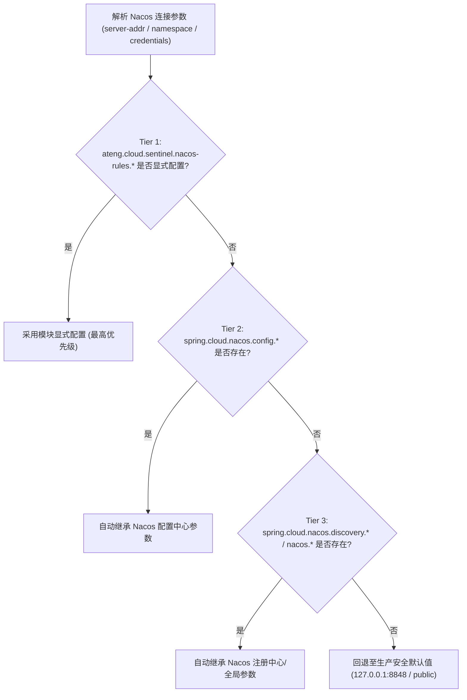
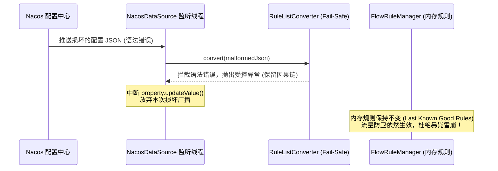

# ateng-cloud-sentinel

面向企业级分布式生产环境的 Spring Cloud Alibaba Sentinel 流量防卫、受管熔断降级、Nacos 规则持久化与全景自省治理 Starter，单向依赖消费已发布的 `ateng-boot-bom`，专注于打造垂直正交、开箱即用、无侵入的高可用微服务流量管控基础设施。

内置 WebMVC 入站限流、RESTful 动态路径监控树防爆清洗、白名单免检旁路跳过、多级调用源溯源防刷、OpenFeign 受管降级工厂代理、@SentinelResource 切面异常逃逸兜底防御、Nacos 四级连接自适应平滑继承与 5 大规则持久化防暴毙容错（Rule Fail-Safe Invariant），以及专职只读 Actuator 全景自省诊断端点（Sentinel Panorama Diagnostics）。

---

## 维度零：特性与公共 API 全景速查矩阵

### 1. 核心类与门面接口

| 类 / 接口 | 类型 | 核心职责 | 默认行为 / 装配条件 |
| :--- | :--- | :--- | :--- |
| `AtengSentinelAutoConfiguration` | 自动装配类 | Sentinel 流量防卫底座自动装配总入口 | 当存在 `BlockException` 且 `ateng.cloud.sentinel.enabled=true` 时激活 |
| `AtengSentinelNacosRuleAutoConfiguration` | 自动装配类 | Nacos 5 大规则全家桶约定动态持久化自动装配 | 当存在 `NacosDataSource` 且 `ateng.cloud.sentinel.nacos-rules.enabled=true` 时激活 |
| `AtengSentinelProperties` | 配置属性类 | 强类型映射配置前缀 `ateng.cloud.sentinel` | 默认开启，收敛阻断处理器、路径清洗、来源解析、切面兜底与自省端点配置 |
| `AtengSentinelNacosRuleProperties` | 配置属性类 | 强类型映射配置前缀 `ateng.cloud.sentinel.nacos-rules` | 默认关闭（保障离线自洽），支持 Nacos 连接参数四级平滑自适应继承 |
| `SentinelBlockCounter` | 核心计数器 | 轻量原子无锁阻断计数器，按规则细分统计阻断事件与最近一次快照上下文 | 标配 `@ConditionalOnMissingBean`，由阻断处理器与切面兜底原子联动 |
| `SentinelPanoramaEndpoint` | Actuator 端点 | Sentinel 全景健康与规则自省诊断端点 (`/actuator/sentinel-panorama`) | 标配 `@ConditionalOnClass(Endpoint.class)`，微秒级极速只读诊断 |
| `SentinelPanoramaReport` | 传输载荷 | 五维全景诊断结构化报告对象 Record（基础概览、脱敏数据源、内存规则、WebMVC配置、阻断指标） | 遵循零泄漏机密脱敏不变量，严格遮蔽密码与密钥凭据 |
| `AtengBlockExceptionHandler` | 核心处理器 | 统一 Spring MVC 阻断异常处理并物理对齐 HTTP 状态码，联动原子计数器 | 标配 `@ConditionalOnMissingBean`，实现 `BlockExceptionHandler` |
| `AtengUrlCleaner` | 核心清洗器 | RESTful 动态 URL 归一化清洗与白名单跳过，防范资源监控树内存无界膨胀与 OOM | 标配 `@ConditionalOnMissingBean`，实现 `UrlCleaner` |
| `AtengRequestOriginParser` | 核心解析器 | 四级调用来源溯源解析器，支持精细化授权与流控，支持客户端 IP 兜底 | 标配 `@ConditionalOnMissingBean`，实现 `RequestOriginParser` |
| `AtengFallbackFactory<T>` | 抽象基类 | 受管 Feign 降级工厂基类，动态代理并转译熔断异常保留原始因果链 | 开放钩子方法 `handleFallback` 支持业务保底扩展 |
| `SentinelBlockExceptionAdvice` | 全局切面兜底 | 全局捕获 `@SentinelResource` 逃逸的 `BlockException`，杜绝 500 误报 | 标配 `@ConditionalOnMissingBean`，基于 `@RestControllerAdvice` |
| `SentinelNacosRuleSubscriber` | 规则订阅管理器 | 基于约定 DataId 统一订阅监听 Flow、Degrade、ParamFlow、System、Authority 5 大规则 | 实现 `InitializingBean` 与 `DisposableBean`，落地 Rule Fail-Safe 防暴毙 |
| `NacosDataSourceFactory` | 扩展点 SPI | Sentinel Nacos 数据源构造工厂函数式接口 | 标配 `@ConditionalOnMissingBean`，支持下游通过 SPI 或测试桩无缝接管 |
| `DefaultNacosDataSourceFactory` | 默认工厂实现 | 生产级原生 `NacosDataSource` 构建实现类 | 默认注册，连接 Nacos 服务端并提供监听机制 |
| `SentinelResultCode` | 强类型错误码 | 统一定义 Sentinel 阻断业务错误码 (区段 4200~4299) | 实现 `IResultCode`，覆盖限流、降级、热点、系统、授权全场景 |
| `SentinelServletUtil` | 工具类 | 客户端真实 IP 解析辅助工具类 | 依次尝试 `X-Forwarded-For`、`X-Real-IP` 与 `RemoteAddr` 回溯解析 |
| `AtengSentinelEnvironmentPostProcessor` | 环境后置处理器 | 探测到 Classpath 存在 OpenFeign 时自动注入激活 `feign.sentinel.enabled=true` | 注册于 `META-INF/spring.factories` 与 `.imports` 双通道，支持业务显式覆盖 |

---

### 2. 配置属性速查表

#### 2.1 流量防卫增强配置 (`ateng.cloud.sentinel.*`)

| 配置项 | 类型 | 默认值 | 详细业务说明 |
| :--- | :--- | :--- | :--- |
| `ateng.cloud.sentinel.enabled` | `boolean` | `true` | 是否激活 ateng-cloud-sentinel 流量防卫增强底座 |
| `ateng.cloud.sentinel.block-handler.enabled` | `boolean` | `true` | 是否启用统一阻断异常处理器 `AtengBlockExceptionHandler` |
| `ateng.cloud.sentinel.block-handler.http-status-align` | `boolean` | `true` | 是否物理对齐 HTTP 状态码 (限流 429 / 降级 503；false 则返回 200 OK) |
| `ateng.cloud.sentinel.url-clean.enabled` | `boolean` | `true` | 是否启用 RESTful URL 路径归一化清洗器 |
| `ateng.cloud.sentinel.url-clean.number-replacement` | `String` | `"{id}"` | 路径中纯数字 ID 替换占位符（如将 `/users/1001` 替换为 `/users/{id}`） |
| `ateng.cloud.sentinel.url-clean.uuid-replacement` | `String` | `"{uuid}"` | 路径中 36 位 UUID 替换占位符（如将 `/orders/uuid` 替换为 `/orders/{uuid}`） |
| `ateng.cloud.sentinel.url-clean.exclude-patterns` | `List<String>` | `[]` | 排除路径 Ant 模式白名单列表（匹配路径直接跳过 Sentinel 资源监控树创建） |
| `ateng.cloud.sentinel.origin-parser.enabled` | `boolean` | `true` | 是否启用多级请求来源解析器 |
| `ateng.cloud.sentinel.origin-parser.origin-header` | `String` | `"X-Origin-Service"` | 第一优先级调用方服务标识请求头（支持兼容 `header-name`） |
| `ateng.cloud.sentinel.origin-parser.gateway-header` | `String` | `"X-Gateway-Caller"` | 第二优先级网关透传来源请求头 |
| `ateng.cloud.sentinel.origin-parser.default-origin` | `String` | `"default"` | 无来源标识且未启用 IP 保底时的默认回退来源标识 |
| `ateng.cloud.sentinel.origin-parser.enable-client-ip-fallback` | `boolean` | `true` | 当请求头缺失时是否自动回退提取真实客户端 IP 作为来源标识 |
| `ateng.cloud.sentinel.block-advice.enabled` | `boolean` | `true` | 是否启用 `@SentinelResource` 全局切面逃逸兜底拦截器 |
| `ateng.cloud.sentinel.block-advice.http-status-align` | `boolean` | `true` | 切面兜底拦截时是否物理对齐 HTTP 状态码 |
| `ateng.cloud.sentinel.endpoint.enabled` | `boolean` | `true` | 是否启用全景自省诊断端点 (`/actuator/sentinel-panorama`) |

#### 2.2 Nacos 动态规则数据源配置 (`ateng.cloud.sentinel.nacos-rules.*`)

| 配置项 | 类型 | 默认值 | 详细业务说明 |
| :--- | :--- | :--- | :--- |
| `ateng.cloud.sentinel.nacos-rules.enabled` | `boolean` | `false` | 是否启用 Nacos 规则全家桶约定动态持久化 (默认关闭保障离线自洽) |
| `ateng.cloud.sentinel.nacos-rules.server-addr` | `String` | `null` | Nacos 服务端连接地址 (四级自适应平滑继承：显式配置 $\to$ 配置中心 $\to$ 注册中心 $\to$ `127.0.0.1:8848`) |
| `ateng.cloud.sentinel.nacos-rules.namespace` | `String` | `null` | Nacos 命名空间 ID (四级自适应平滑继承：显式配置 $\to$ 配置中心 $\to$ 注册中心 $\to$ public 空字符串) |
| `ateng.cloud.sentinel.nacos-rules.group-id` | `String` | `"SENTINEL_GROUP"` | Nacos 配置分组 GroupId |
| `ateng.cloud.sentinel.nacos-rules.data-id-prefix` | `String` | `null` | Nacos DataId 前缀 (缺省时平滑回退至 `${spring.application.name}`) |
| `ateng.cloud.sentinel.nacos-rules.username` | `String` | `null` | Nacos 鉴权用户名 (四级自适应继承，诊断端点公开输出) |
| `ateng.cloud.sentinel.nacos-rules.password` | `String` | `null` | Nacos 鉴权密码 (四级自适应继承，诊断端点脱敏为 `******`) |
| `ateng.cloud.sentinel.nacos-rules.access-key` | `String` | `null` | 阿里云/RAM AccessKey (四级自适应继承，诊断端点脱敏为 `******`) |
| `ateng.cloud.sentinel.nacos-rules.secret-key` | `String` | `null` | 阿里云/RAM SecretKey (四级自适应继承，诊断端点脱敏为 `******`) |
| `ateng.cloud.sentinel.nacos-rules.flow.enabled` | `boolean` | `true` | 是否订阅流控规则 (DataId: `${prefix}-flow.json`) |
| `ateng.cloud.sentinel.nacos-rules.degrade.enabled` | `boolean` | `true` | 是否订阅熔断降级规则 (DataId: `${prefix}-degrade.json`) |
| `ateng.cloud.sentinel.nacos-rules.param-flow.enabled` | `boolean` | `true` | 是否订阅热点参数限流规则 (DataId: `${prefix}-param-flow.json`) |
| `ateng.cloud.sentinel.nacos-rules.system.enabled` | `boolean` | `true` | 是否订阅系统自适应保护规则 (DataId: `${prefix}-system.json`) |
| `ateng.cloud.sentinel.nacos-rules.authority.enabled` | `boolean` | `true` | 是否订阅来源访问控制规则 (DataId: `${prefix}-authority.json`) |

---

### 3. 标准错误码契约对照表 (`SentinelResultCode`)

| 错误码枚举 | 编码值 (`code`) | 物理 HTTP 状态码 | 业务描述与阻断场景 |
| :--- | :--- | :--- | :--- |
| `FLOW_LIMIT` | `4200` | `429 Too Many Requests` | 接口请求流量超过预设阈值，触发流控保护 |
| `DEGRADE` | `4201` | `503 Service Unavailable` | 下游服务异常比例、异常数或慢调用过载，触发熔断降级 |
| `PARAM_FLOW_LIMIT` | `4202` | `429 Too Many Requests` | 热点参数访问频度超限，触发热点参数限流 |
| `SYSTEM_BLOCK` | `4203` | `429 Too Many Requests` | 系统负载过高（CPU/Load/线程数/总体QPS超限），触发系统保护 |
| `AUTHORITY_BLOCK` | `4204` | `429 Too Many Requests` | 请求来源未命中白名单或命中黑名单，拒绝非法访问 |

---

## 维度一：最小起步体验 (Quick Start)

### 1. 引入 Maven 依赖

在微服务业务工程的 `pom.xml` 中引入（版本受管于 `ateng-cloud-bom`）：

```xml
<dependency>
    <groupId>io.github.atengk</groupId>
    <artifactId>ateng-cloud-sentinel</artifactId>
</dependency>
```

### 2. 生产推荐配置与自适应继承

在 `application.yml` 中声明（**完全免除重复硬编码 Nacos 连接地址**，1:1 提取自场景样例工程 `sample-cloud-sentinel`）：

```yaml
server:
  port: 8080

spring:
  application:
    name: sample-cloud-sentinel
  cloud:
    sentinel:
      transport:
        port: 8719
        dashboard: ""
      eager: true

ateng:
  cloud:
    sentinel:
      enabled: true
      block-handler:
        enabled: true
        http-status-align: true
      url-clean:
        enabled: true
        number-replacement: "{id}"
        uuid-replacement: "{uuid}"
        exclude-patterns:
          - "/actuator/**"
          - "/v3/api-docs/**"
      origin-parser:
        origin-header: "X-Origin-Service"
        gateway-header: "X-Gateway-From"
        default-origin: "gateway"
        enable-client-ip-fallback: true
      block-advice:
        enabled: true
        http-status-align: true
      endpoint:
        enabled: true
      # 可选：开启 Nacos 5 大规则自动持久化订阅 (自动继承已有 Nacos 地址)
      nacos-rules:
        enabled: true
        group-id: SENTINEL_GROUP
```

### 3. 开箱即用的业务控制器与声明式调用

```java
package io.github.atengk.cloud.sample.sentinel.controller;

import com.alibaba.csp.sentinel.annotation.SentinelResource;
import io.github.atengk.boot.core.model.Result;
import org.springframework.web.bind.annotation.*;

/**
 * 流量防卫场景实测控制器
 */
@RestController
@RequestMapping("/api/test")
public class SampleSentinelController {

    // 1. 普通 WebMVC 接口：自动由 CommonFilter 拦截，超限自动返回 429 与 FLOW_LIMIT
    @GetMapping("/flow")
    public Result<String> testFlow() {
        return Result.success("flow-pass");
    }

    // 2. 熔断降级实测：模拟故障抛出异常，触发熔断降级返回 503 与 DEGRADE
    @GetMapping("/degrade")
    public Result<String> testDegrade(@RequestParam(name = "fail", defaultValue = "false") boolean fail) {
        if (fail) {
            throw new IllegalStateException("Simulated business exception for degrade");
        }
        return Result.success("degrade-pass");
    }

    // 3. RESTful 接口：自动收敛清洗为 /api/test/users/{id}，防止内存无界泄露
    @GetMapping("/users/{id}")
    public Result<String> getUserById(@PathVariable("id") Long id) {
        return Result.success("user-" + id);
    }

    // 4. 来源访问控制：校验 X-Origin-Service / X-Gateway-From 标头白名单
    @GetMapping("/admin/secure")
    public Result<String> adminSecure() {
        return Result.success("admin-ok");
    }

    // 5. 注解切面方法：无需手写 blockHandler，异常逃逸时由切面统一捕获对齐
    @GetMapping("/annotation-resource")
    @SentinelResource(value = "custom-annotation-resource")
    public Result<String> testAnnotationResource() {
        return Result.success("annotation-resource-pass");
    }

    // 6. 热点参数限流：按参数值统计流控
    @GetMapping("/param-flow")
    @SentinelResource(value = "custom-param-resource")
    public Result<String> testParamFlow(@RequestParam("itemId") String itemId) {
        return Result.success("item-" + itemId);
    }
}
```

---

## 维度二：生产扩展接管 (Production Extensibility)

### 1. 自定义受管 Feign 降级工厂 (重写保底值)

框架提供 `AtengFallbackFactory<T>` 抽象基类。默认情况下，继承该类无需编写任何逻辑即可自动代理将熔断异常转译为语义化 `BusinessException(SentinelResultCode.DEGRADE, cause)`。

若业务需要为特定方法提供柔性保底值（如返回离线 Mock 数据），可通过重写受保护方法 `handleFallback` 优雅扩展（1:1 提取自 `sample-cloud-sentinel` 源码）：

```java
package io.github.atengk.cloud.sample.sentinel.client;

import io.github.atengk.cloud.sentinel.fallback.AtengFallbackFactory;
import org.springframework.stereotype.Component;

import java.lang.reflect.Method;

/**
 * 柔性受管 Feign 降级工厂 (重写 handleFallback 返回自定义保底业务数据)
 */
@Component
public class DemoCustomFallbackFactory extends AtengFallbackFactory<DemoCustomFeignClient> {

    @Override
    protected Object handleFallback(Method method, Object[] args, Throwable cause) throws Throwable {
        // 针对特定接口方法提供保底返回值，兼顾自适应解包契约安全
        if ("getRemoteOrder".equals(method.getName())) {
            Long orderId = (args != null && args.length > 0) ? (Long) args[0] : 0L;
            return "MockOrderFallback-" + orderId;
        }
        // 其余方法平滑委托给框架默认降级行为 (自动抛出携带原始 cause 的 BusinessException)
        return super.handleFallback(method, args, cause);
    }
}
```

配套声明式 FeignClient 接口定义：

```java
package io.github.atengk.cloud.sample.sentinel.client;

import org.springframework.cloud.openfeign.FeignClient;
import org.springframework.web.bind.annotation.GetMapping;
import org.springframework.web.bind.annotation.PathVariable;

@FeignClient(
    name = "demo-custom-client",
    url = "http://127.0.0.1:18099",
    fallbackFactory = DemoCustomFallbackFactory.class
)
public interface DemoCustomFeignClient {

    @GetMapping("/api/remote/order/{id}")
    String getRemoteOrder(@PathVariable("id") Long id);
}
```

### 2. 接管 Nacos 数据源构造 (SPI 替换 / 脱网测试桩)

通过实现 `NacosDataSourceFactory` 并在 Spring 容器中声明 Bean，可平滑接管框架的数据源构建逻辑（例如在单元测试中注入内存数据源）：

```java
@Configuration
public class CustomDataSourceConfig {

    @Bean
    public NacosDataSourceFactory nacosDataSourceFactory() {
        return new NacosDataSourceFactory() {
            @Override
            public <T> ReadableDataSource<String, T> createDataSource(
                    Properties properties, String groupId, String dataId, Converter<String, T> converter) {
                // 自定义构造逻辑或返回测试内存数据源
                return new MyCustomReadableDataSource<>(converter);
            }
        };
    }
}
```

### 3. 柔性降级响应契约切换 (关闭 HTTP 状态码物理对齐)

生产中部分遗留前端网关要求所有请求物理状态码均为 `200 OK`，只需在配置中关闭物理对齐开关：

```yaml
ateng:
  cloud:
    sentinel:
      block-handler:
        http-status-align: false  # 物理返回 200 OK，仅 Result 体现 code=4200
      block-advice:
        http-status-align: false
```

---

## 维度三：核心生产边界与非功能语义 (Production Boundaries)

### 1. Nacos 连接四级平滑自适应继承时序

在微服务已接入配置中心或注册中心的环境下，坚决杜绝在各业务微服务中重复硬编码 Nacos 连接参数。`AtengSentinelNacosRuleProperties` 建立以下四级平滑继承解析机制：



### 2. Rule Fail-Safe Invariant (规则防暴毙容错防线)

原生 Sentinel `NacosDataSource` 在收到配置中心推送的配置时，若反序列化转换器返回 `null` 或抛出未经防卫的异常，易触发 `FlowRuleManager.updateRules(emptyList)`，导致**在内存中彻底清空全部生效规则，引发整网流量穿透大雪崩**。

`ateng-cloud-sentinel` 落地 **Rule Fail-Safe Invariant**：
- `SentinelNacosRuleSubscriber.RuleListConverter` 捕获 JSON 语法错误并记录错误日志，显式抛出受控 `IllegalArgumentException`；
- Sentinel 监听器感知到转换异常后立即中断下游 `updateValue` 更新广播；
- **坚守 Last Known Good Rules 防线**：内存中已生效规则完整保留，限流与熔断持续运转，坚决杜绝规则被清空为 0。



### 3. Sentinel Panorama Diagnostics (全景诊断与零泄密凭据脱敏)

生产排查“某接口为何被拦截”或“规则是否在内存生效”常因缺乏开箱即用视图而极为繁琐。
`SentinelPanoramaEndpoint` 暴露 `/actuator/sentinel-panorama` 端点，输出微秒级只读全景诊断视图：

```json
{
  "status": "UP",
  "appName": "sample-cloud-sentinel",
  "sentinelVersion": "1.8.8",
  "timestamp": 1793258866760,
  "nacosRules": {
    "enabled": true,
    "prefix": "sample-cloud-sentinel",
    "groupId": "SENTINEL_GROUP",
    "serverAddr": "127.0.0.1:8848",
    "namespace": "public",
    "username": "nacos-admin",
    "password": "******",
    "accessKey": "******",
    "secretKey": "******",
    "subscribed": true,
    "dataSourceCount": 5,
    "dataSources": [
      "sample-cloud-sentinel-flow.json",
      "sample-cloud-sentinel-degrade.json",
      "sample-cloud-sentinel-param-flow.json",
      "sample-cloud-sentinel-system.json",
      "sample-cloud-sentinel-authority.json"
    ]
  },
  "inMemoryRules": {
    "totalRuleCount": 1,
    "flowRuleCount": 1,
    "degradeRuleCount": 0,
    "paramFlowRuleCount": 0,
    "systemRuleCount": 0,
    "authorityRuleCount": 0,
    "flowRules": [
      {
        "resource": "/api/test/flow",
        "limitApp": "default",
        "grade": 1,
        "count": 0.0,
        "strategy": 0,
        "controlBehavior": 0,
        "refResource": null,
        "warmUpPeriodSec": 10,
        "maxQueueingTimeMs": 500,
        "clusterMode": false
      }
    ]
  },
  "webMvcConfig": {
    "urlClean": {
      "enabled": true,
      "numberReplacement": "{id}",
      "uuidReplacement": "{uuid}",
      "excludePatternCount": 2,
      "excludePatterns": ["/actuator/**", "/v3/api-docs/**"]
    },
    "originParser": {
      "originHeader": "X-Origin-Service",
      "gatewayHeader": "X-Gateway-From",
      "defaultOrigin": "gateway",
      "enableClientIpFallback": true
    },
    "blockHandler": {
      "enabled": true,
      "httpStatusAlign": true
    },
    "blockAdvice": {
      "enabled": true,
      "httpStatusAlign": true
    }
  },
  "blockMetrics": {
    "totalBlocked": 1,
    "flowCount": 1,
    "degradeCount": 0,
    "paramFlowCount": 0,
    "systemCount": 0,
    "authorityCount": 0,
    "otherCount": 0,
    "lastBlockEvent": {
      "timestamp": 1793258866750,
      "resource": "/api/test/flow",
      "ruleType": "FLOW",
      "clientIp": "127.0.0.1",
      "message": "FlowException"
    }
  }
}
```

- **零泄密凭据脱敏不变量**：Nacos 连接密码、AccessKey 与 SecretKey 一律输出为 `******`，杜绝内网资产暴露；
- **非阻塞无锁架构**：指标 100% 读取自内存原子快照与只读管理器，微秒级极速响应，零外部网络 IO 与锁竞争。

### 4. RESTful 资源监控树防爆与白名单排除机制

在 Spring MVC 中，对于诸如 `/api/v1/orders/10001`、`/api/v1/orders/10002` 的 RESTful 接口，若原生 Sentinel 未做路径收敛，会将每个具体数字 URL 视为一个独立资源注册到 `ClusterNode` 监控树中，造成大量内存句柄无法回收，最终引发 JVM 堆内存 OOM 崩溃。

`AtengUrlCleaner` 实施**三层纵深防爆清洗**：
1. **第一层（白名单排除旁路）**：命中 `exclude-patterns`（如 `/actuator/**`、`/v3/api-docs/**`）直接返回空字符串 `""`，Sentinel 框架将绕过资源 Entry 创建，零内存开销；
2. **第二层（Spring MVC 模式提取）**：优先从当前请求的 `HandlerMapping.BEST_MATCHING_PATTERN_ATTRIBUTE` 属性中提取路由模式（如 `/api/v1/orders/{id}`），直接收敛为单一静态资源；
3. **第三层（正则兜底收敛）**：若脱离 Spring MVC 路由上下文，保底通过高性能预编译正则表达式，将 URL 路径片段中的纯数字与标准 36 位 UUID 替换为配置占位符（如 `{id}` 与 `{uuid}`）。

### 5. 阻断异常契约双重对齐 (Block Dual-Alignment Contract)

开源 Sentinel 默认阻断时仅输出裸文本（如 `"Blocked by Sentinel (flow limiting)"`），未与微服务标准的强类型契约自洽。

`ateng-cloud-sentinel` 遵循**双重对齐契约**：
- **物理传输层**：限流、热点、系统、授权统一对齐 `HTTP 429 Too Many Requests`；熔断降级统一对齐 `HTTP 503 Service Unavailable`；
- **业务载荷层**：统一输出 `application/json;charset=UTF-8` 格式的强类型 `Result<Void>` 结构体：
  ```json
  {
    "code": 4200,
    "msg": "服务流量过载，触发限流保护",
    "data": null,
    "timestamp": 1793258866760,
    "success": false
  }
  ```

### 6. Feign 熔断防呆自动注入与链式因果传递

原生 Spring Cloud OpenFeign 必须手动配置 `feign.sentinel.enabled=true` 才能激活熔断切面。开发者极易漏配导致熔断静默失效。

`AtengSentinelEnvironmentPostProcessor` 会在 Spring 容器启动前探测 Classpath：若检测到包含 `feign.Feign`，且用户未显式配置 `feign.sentinel.enabled`，则自动将其置为 `true`；若用户显式声明 `false`，则遵循用户意图不覆盖。在降级触发时，`AtengFallbackFactory` 完整保留原始因果链（`cause`），杜绝 Log-and-Throw 双重污染。

---

## 维度四：物理排版与代码全真验证

本模块所有 Java 示例代码与 YAML 配置片段均来自场景样例工程 [sample-cloud-sentinel](../ateng-cloud-samples/sample-cloud-sentinel) 的实测用例，并受以下端到端测试 100% 离线自洽守护：

- `SentinelWebFlowDegradeTest`：验证 WebMVC 入站 QPS 限流与异常降级阻断；
- `SentinelUrlCleanAuthorityTest`：验证 RESTful 路径清洗归一化、白名单排除跳过与多级调用源解析；
- `SentinelFeignFallbackTest`：验证 Feign 客户端熔断触发受管降级工厂代理与柔性保底，保留原始因果链；
- `SentinelAnnotationAdviceTest`：验证 `@SentinelResource` 注解逃逸切面拦截；
- `SentinelNacosRuleDynamicRefreshTest`：验证从脱网 Mock Nacos 动态推送 5 大规则 JSON，强断言规则被热加载，且在推送非法 JSON 时触发 Rule Fail-Safe 保持有效规则不暴毙；
- `SentinelPanoramaEndpointEndToEndTest`：验证只读端点 `/actuator/sentinel-panorama` 准确输出五维诊断视图与凭据脱敏，并在发生限流时实时递增原子阻断计数器。
