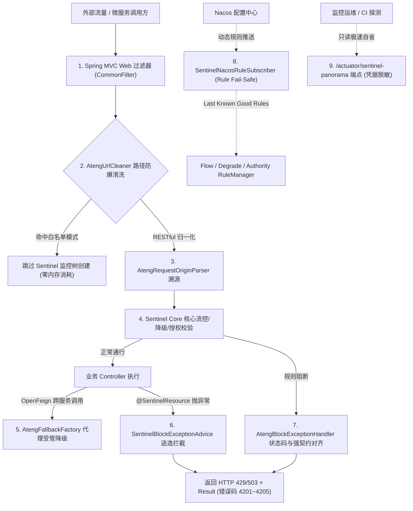
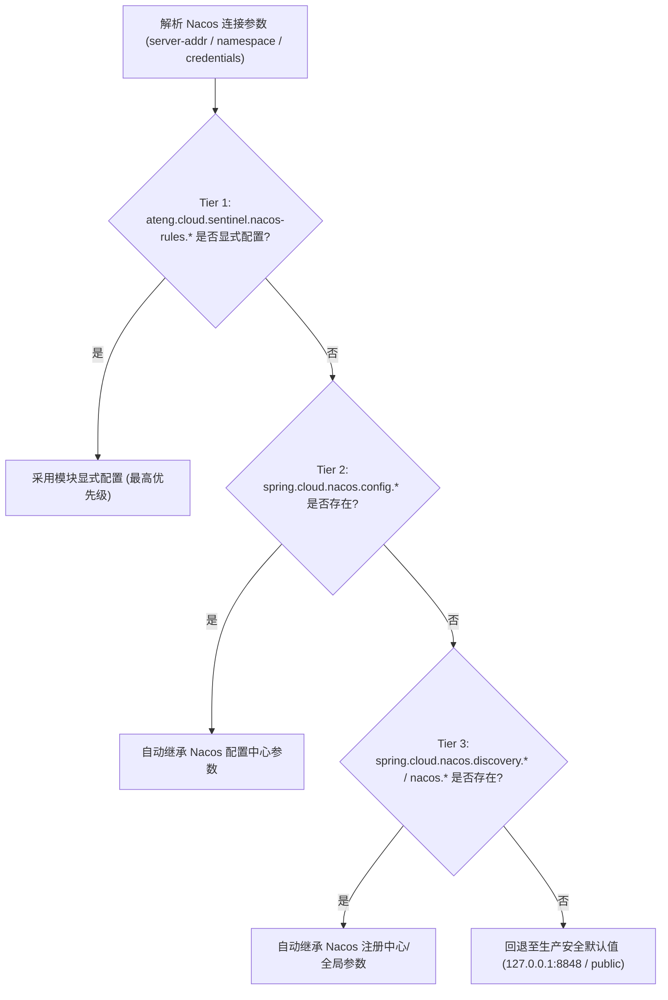
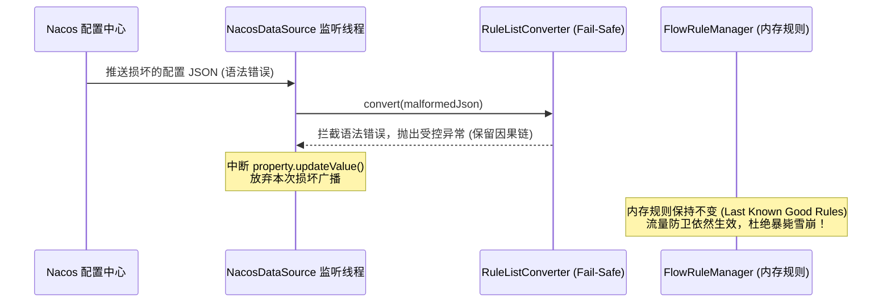

# ateng-cloud-sentinel 流量防卫与弹性熔断治理套件

> 面向企业级高可用分布式生产环境的 Spring Cloud Alibaba Sentinel 流量防卫、受管熔断降级、Nacos 规则持久化与全景自省治理 Starter，单向依赖消费已发布的 `ateng-boot-bom`，专注于打造垂直正交、开箱即用、无侵入的高可用微服务流量管控基础设施。

内置 WebMVC 入站限流、RESTful 动态路径监控树防爆清洗、白名单免检旁路跳过、多级调用源溯源防刷、OpenFeign 受管降级工厂代理、@SentinelResource 切面异常逃逸兜底防御、Nacos 四级连接自适应平滑继承与 5 大规则持久化防暴毙容错（Rule Fail-Safe Invariant），以及专职只读 Actuator 全景自省诊断端点（Sentinel Panorama Diagnostics）。

---

## 0. 特性与公共 API 全景速查矩阵 (100% 覆盖)

### 1. 核心类与门面接口

| 类 / 接口 | 类型 | 核心职责 | 默认行为 / 装配条件 |
| :--- | :--- | :--- | :--- |
| `AtengSentinelAutoConfiguration` | 自动装配类 | Sentinel 流量防卫底座自动装配总入口 | 当存在 `BlockException` 且 `ateng.cloud.sentinel.enabled=true` 时激活 |
| `AtengSentinelNacosRuleAutoConfiguration` | 自动装配类 | Nacos 5 大规则全家桶约定动态持久化自动装配 | 当存在 `NacosDataSource` 且 `ateng.cloud.sentinel.nacos-rules.enabled=true` 时激活 |
| `AtengSentinelProperties` | 配置属性类 | 强类型映射配置前缀 `ateng.cloud.sentinel` | 默认开启，收敛阻断处理器、路径清洗、来源解析、切面兜底与自省端点配置 |
| `AtengSentinelNacosRuleProperties` | 配置属性类 | 强类型映射配置前缀 `ateng.cloud.sentinel.nacos-rules` | 默认关闭（保障离线自洽），支持 Nacos 连接参数四级平滑自适应继承 |
| `SentinelBlockCounter` | 核心计数器 | 轻量原子无锁阻断计数器，按规则细分统计阻断事件与最近一次快照上下文 | 标配 `@ConditionalOnMissingBean`，由阻断处理器与切面兜底原子联动 |
| `SentinelPanoramaEndpoint` | Actuator 端点 | Sentinel 全景健康与规则自省诊断端点 (`/actuator/sentinel-panorama`) | 标配 `@ConditionalOnClass(Endpoint.class)`，微秒级极速只读诊断 |
| `SentinelPanoramaReport` | 传输载荷 | 五维全景诊断结构化报告对象 Record（基础概览、脱敏数据源、内存规则、WebMVC配置、阻断指标） | 遵循零泄漏机密脱敏不变量，严格遮蔽密码与密钥凭据 |
| `AtengBlockExceptionHandler` | 核心处理器 | 统一 Spring MVC 阻断异常处理并物理对齐 HTTP 状态码，联动原子计数器 | 标配 `@ConditionalOnMissingBean`，实现 `BlockExceptionHandler` |
| `AtengUrlCleaner` | 核心清洗器 | RESTful 动态 URL 归一化清洗与白名单跳过，防范资源监控树内存无界膨胀与 OOM | 标配 `@ConditionalOnMissingBean`，实现 `UrlCleaner` |
| `AtengRequestOriginParser` | 核心解析器 | 四级调用来源溯源解析器，支持精细化授权与流控，支持客户端 IP 兜底 | 标配 `@ConditionalOnMissingBean`，实现 `RequestOriginParser` |
| `AtengFallbackFactory<T>` | 抽象基类 | 受管 Feign 降级工厂基类，动态代理并转译熔断异常保留原始因果链 | 开放钩子方法 `handleFallback` 支持业务保底扩展 |
| `SentinelBlockExceptionAdvice` | 全局切面兜底 | 全局捕获 `@SentinelResource` 逃逸的 `BlockException`，杜绝 500 误报 | 标配 `@ConditionalOnMissingBean`，基于 `@RestControllerAdvice` |
| `SentinelNacosRuleSubscriber` | 规则订阅管理器 | 基于约定 DataId 统一订阅监听 Flow、Degrade、ParamFlow、System、Authority 5 大规则 | 实现 `InitializingBean` 与 `DisposableBean`，落地 Rule Fail-Safe 防暴毙 |
| `NacosDataSourceFactory` | 扩展点 SPI | Sentinel Nacos 数据源构造工厂函数式接口 | 标配 `@ConditionalOnMissingBean`，支持下游通过 SPI 或测试桩无缝接管 |
| `DefaultNacosDataSourceFactory` | 默认工厂实现 | 生产级原生 `NacosDataSource` 构建实现类 | 默认注册，连接 Nacos 服务端并提供监听机制 |
| `SentinelResultCode` | 强类型错误码 | 统一定义 Sentinel 阻断业务错误码 (区段 4201~4205) | 实现 `IResultCode`，覆盖限流、降级、热点、系统、授权全场景 |
| `SentinelServletUtil` | 工具类 | 客户端真实 IP 解析辅助工具类 | 依次尝试 `X-Forwarded-For`、`X-Real-IP` 与 `RemoteAddr` 回溯解析 |
| `AtengSentinelEnvironmentPostProcessor` | 环境后置处理器 | 探测到 Classpath 存在 OpenFeign 时自动注入激活 `feign.sentinel.enabled=true` | 注册于 `META-INF/spring.factories` 与 `.imports` 双通道，支持业务显式覆盖 |

---

### 2. 配置属性速查表

#### 2.1 流量防卫增强配置 (`ateng.cloud.sentinel.*`)

| 配置项 | 类型 | 默认值 | 详细业务说明 |
| :--- | :--- | :--- | :--- |
| `ateng.cloud.sentinel.enabled` | `boolean` | `true` | 是否激活 ateng-cloud-sentinel 流量防卫增强底座 |
| `ateng.cloud.sentinel.block-handler.enabled` | `boolean` | `true` | 是否启用统一阻断异常处理器 `AtengBlockExceptionHandler` |
| `ateng.cloud.sentinel.block-handler.http-status-align` | `boolean` | `true` | 是否物理对齐 HTTP 状态码 (限流 429 / 降级 503；false 则返回 200 OK) |
| `ateng.cloud.sentinel.url-clean.enabled` | `boolean` | `true` | 是否启用 RESTful URL 路径归一化清洗器 |
| `ateng.cloud.sentinel.url-clean.number-replacement` | `String` | `"{id}"` | 路径中纯数字 ID 替换占位符（如将 `/orders/1001` 替换为 `/orders/{id}`） |
| `ateng.cloud.sentinel.url-clean.uuid-replacement` | `String` | `"{uuid}"` | 路径中 36 位 UUID 替换占位符（如将 `/orders/uuid` 替换为 `/orders/{uuid}`） |
| `ateng.cloud.sentinel.url-clean.exclude-patterns` | `List<String>` | `[]` | 排除路径 Ant 模式白名单列表（匹配路径直接跳过 Sentinel 资源监控树创建） |
| `ateng.cloud.sentinel.origin-parser.enabled` | `boolean` | `true` | 是否启用多级请求来源解析器 |
| `ateng.cloud.sentinel.origin-parser.origin-header` | `String` | `"X-Origin-Service"` | 第一优先级调用方服务标识请求头（支持兼容 `header-name`） |
| `ateng.cloud.sentinel.origin-parser.gateway-header` | `String` | `"X-Gateway-Caller"` | 第二优先级网关透传来源请求头 |
| `ateng.cloud.sentinel.origin-parser.default-origin` | `String` | `"default"` | 无来源标识且未启用 IP 保底时的默认回退来源标识 |
| `ateng.cloud.sentinel.origin-parser.enable-client-ip-fallback` | `boolean` | `true` | 当请求头缺失时是否自动回退提取真实客户端 IP 作为来源标识 |
| `ateng.cloud.sentinel.block-advice.enabled` | `boolean` | `true` | 是否启用 `@SentinelResource` 全局切面逃逸兜底拦截器 |
| `ateng.cloud.sentinel.block-advice.http-status-align` | `boolean` | `true` | 切面兜底拦截时是否物理对齐 HTTP 状态码 |
| `ateng.cloud.sentinel.endpoint.enabled` | `boolean` | `true` | 是否启用全景自省诊断端点 (`/actuator/sentinel-panorama`) |

#### 2.2 Nacos 动态规则数据源配置 (`ateng.cloud.sentinel.nacos-rules.*`)

| 配置项 | 类型 | 默认值 | 详细业务说明 |
| :--- | :--- | :--- | :--- |
| `ateng.cloud.sentinel.nacos-rules.enabled` | `boolean` | `false` | 是否启用 Nacos 规则全家桶约定动态持久化 (默认关闭保障离线自洽) |
| `ateng.cloud.sentinel.nacos-rules.server-addr` | `String` | `null` | Nacos 服务端连接地址 (四级自适应平滑继承：显式配置 $\to$ 配置中心 $\to$ 注册中心 $\to$ `127.0.0.1:8848`) |
| `ateng.cloud.sentinel.nacos-rules.namespace` | `String` | `null` | Nacos 命名空间 ID (四级自适应平滑继承：显式配置 $\to$ 配置中心 $\to$ 注册中心 $\to$ public 空字符串) |
| `ateng.cloud.sentinel.nacos-rules.group-id` | `String` | `"SENTINEL_GROUP"` | Nacos 配置分组 GroupId |
| `ateng.cloud.sentinel.nacos-rules.data-id-prefix` | `String` | `null` | Nacos DataId 前缀 (缺省时平滑回退至 `${spring.application.name}`) |
| `ateng.cloud.sentinel.nacos-rules.username` | `String` | `null` | Nacos 鉴权用户名 (四级自适应继承，诊断端点公开输出) |
| `ateng.cloud.sentinel.nacos-rules.password` | `String` | `null` | Nacos 鉴权密码 (四级自适应继承，诊断端点脱敏为 `******`) |
| `ateng.cloud.sentinel.nacos-rules.access-key` | `String` | `null` | 阿里云/RAM AccessKey (四级自适应继承，诊断端点脱敏为 `******`) |
| `ateng.cloud.sentinel.nacos-rules.secret-key` | `String` | `null` | 阿里云/RAM SecretKey (四级自适应继承，诊断端点脱敏为 `******`) |
| `ateng.cloud.sentinel.nacos-rules.flow.enabled` | `boolean` | `true` | 是否订阅流控规则 (DataId: `${prefix}-flow.json`) |
| `ateng.cloud.sentinel.nacos-rules.degrade.enabled` | `boolean` | `true` | 是否订阅熔断降级规则 (DataId: `${prefix}-degrade.json`) |
| `ateng.cloud.sentinel.nacos-rules.param-flow.enabled` | `boolean` | `true` | 是否订阅热点参数限流规则 (DataId: `${prefix}-param-flow.json`) |
| `ateng.cloud.sentinel.nacos-rules.system.enabled` | `boolean` | `true` | 是否订阅系统自适应保护规则 (DataId: `${prefix}-system.json`) |
| `ateng.cloud.sentinel.nacos-rules.authority.enabled` | `boolean` | `true` | 是否订阅来源访问控制规则 (DataId: `${prefix}-authority.json`) |

---

### 3. 标准错误码契约对照表 (`SentinelResultCode`)

| 错误码枚举 | 编码值 (`code`) | 物理 HTTP 状态码 | 业务描述与阻断场景 |
| :--- | :--- | :--- | :--- |
| `FLOW_LIMIT` | `4201` | `429 Too Many Requests` | 服务流量过载，触发限流保护 |
| `DEGRADE` | `4202` | `503 Service Unavailable` | 服务暂时不可用，触发降级熔断 |
| `PARAM_FLOW_LIMIT` | `4203` | `429 Too Many Requests` | 热点参数访问频繁，触发限流保护 |
| `SYSTEM_BLOCK` | `4204` | `429 Too Many Requests` | 系统负载过高，触发保护机制 |
| `AUTHORITY_BLOCK` | `4205` | `429 Too Many Requests` | 访问源未授权，已被规则拦截 |

---

## 1. 模块定位与 Maven 坐标

`ateng-cloud-sentinel` 聚焦于为微服务应用提供从入站接入网关、内部服务 RPC/HTTP 调用到持久化配置中心的全链路流量管控能力。

在微服务项目的 `pom.xml` 中引入本 Starter（版本由 `ateng-cloud-bom` 集中纳管，子模块免配 `<version>`）：

```xml
<dependency>
    <groupId>io.github.atengk</groupId>
    <artifactId>ateng-cloud-sentinel</artifactId>
</dependency>
```

---

## 2. 核心架构与微服务防御不变量

Sentinel 在微服务架构中承担着核心容灾防线职能，确立以下微服务防御不变量：



### 2.1 阻断异常契约双重对齐 (Block Dual-Alignment Invariant)
- **物理传输层**：限流、热点、系统、授权统一物理对齐 `HTTP 429 Too Many Requests`；熔断降级统一物理对齐 `HTTP 503 Service Unavailable`；
- **业务载荷层**：统一输出 `application/json;charset=UTF-8` 格式的强类型 ``Result<Void>`` 结构体，业务错误码严格对齐 `SentinelResultCode` (4201~4205)。

### 2.2 Rule Fail-Safe Invariant (规则防暴毙容错防线)
- Nacos 动态推送规则若因运维误操作发布损坏的 JSON 语法，反序列化转换器坚决拦截并抛出受控异常中断广播；
- **坚守 Last Known Good Rules 防线**：内存中已生效规则完整保留，限流与熔断持续运转，坚决杜绝规则被清空为 0 引发流量击穿整网。

---

## 3. 入站流量防卫与 RESTful 监控树防爆

### 3.1 WebMVC 默认入站 QPS 限流 (高频秒杀提单防护)

在秒杀或抢购等高并发大促场景中，入站请求通过 Spring MVC 过滤器自动由 Sentinel 拦截，当 QPS 超过阈值时 Fail-Fast 阻断。

#### ① 本节专属 YAML 配置
```yaml
ateng:
  cloud:
    sentinel:
      enabled: true
      block-handler:
        enabled: true
        # 物理对齐 HTTP 状态码 (限流 429 / 降级 503)
        http-status-align: true
```

#### ② 面向实战的业务 Java 示例
（逆向提取自 [`SentinelSecKillFlowController.java`](../ateng-cloud-samples/sample-cloud-sentinel/src/main/java/io/github/atengk/cloud/sample/sentinel/controller/SentinelSecKillFlowController.java)）：

```java
@RestController
@RequestMapping("/sample/cloud/sentinel/seckill")
public class SentinelSecKillFlowController {

    @PostMapping("/order")
    public Result<SecKillResultVO> createOrder(@Valid @RequestBody SecKillOrderDTO orderDTO) {
        SecKillResultVO result = new SecKillResultVO(
                "SK-" + System.currentTimeMillis() + "-" + orderDTO.getProductId(),
                orderDTO.getUserId(),
                orderDTO.getProductId(),
                orderDTO.getCount(),
                "SUCCESS",
                LocalDateTime.now()
        );
        return Result.success(result);
    }
}
```

#### ③ 核心机制与微服务容灾边界
- **阻断行为**：流量超限时，`AtengBlockExceptionHandler` 统一输出 HTTP 429 与 ``Result.error(SentinelResultCode.FLOW_LIMIT)`` (4201)；
- **原子统计**：阻断事件触发后，底层轻量无锁 `SentinelBlockCounter` 自动原子累加流控阻断计数，并捕获最近一次拦截上下文。

---

### 3.2 RESTful 路径归一化清洗与监控树防爆

在 RESTful 架构中，`/orders/1001` 与 `/orders/1002` 若直接注册到 Sentinel，会将每个具体数字 URL 视为独立资源创建 `ClusterNode` 节点，导致监控树节点数急剧爆炸并引发 JVM 堆内存 OOM 崩溃。

#### ① 本节专属 YAML 配置
```yaml
ateng:
  cloud:
    sentinel:
      url-clean:
        enabled: true
        # 数字 ID 归一化收敛占位符
        number-replacement: "{id}"
        # 36 位 UUID 归一化收敛占位符
        uuid-replacement: "{uuid}"
```

#### ② 面向实战的业务 Java 示例
（逆向提取自 [`SentinelSecurityAuthorityController.java`](../ateng-cloud-samples/sample-cloud-sentinel/src/main/java/io/github/atengk/cloud/sample/sentinel/controller/SentinelSecurityAuthorityController.java)）：

```java
@RestController
@RequestMapping("/sample/cloud/sentinel/security")
public class SentinelSecurityAuthorityController {

    @GetMapping("/orders/{id}")
    public Result<SecurityOrderVO> getOrderById(@PathVariable("id") Long id) {
        SecurityOrderVO order = new SecurityOrderVO(
                id,
                "SO-" + id,
                10001L,
                new BigDecimal("299.00"),
                "PAID"
        );
        return Result.success(order);
    }
}
```

#### ③ 核心机制与微服务容灾边界
- **多层收敛**：`AtengUrlCleaner` 优先提取 Spring MVC `BEST_MATCHING_PATTERN_ATTRIBUTE` 路由模式，未命中时保底通过高性能预编译正则将纯数字或 UUID 替换为 `{id}` / `{uuid}`；
- **效果**：无论请求 `/orders/1001` 还是 `/orders/9999`，均归一化为 `/sample/cloud/sentinel/security/orders/{id}` 单一资源，彻底根除 OOM 风险。

---

### 3.3 白名单 Ant 路径免检旁路跳过

对于 Actuator 健康检查、探针拨测、静态资源及内部公开探测端点，频繁经过 Sentinel 拦截会带来无意义的锁与统计损耗。

#### ① 本节专属 YAML 配置
```yaml
ateng:
  cloud:
    sentinel:
      url-clean:
        exclude-patterns:
          - "/actuator/**"
          - "/v3/api-docs/**"
          - "/sample/cloud/sentinel/security/public/**"
```

#### ② 面向实战的业务 Java 示例
（逆向提取自 [`SentinelSecurityAuthorityController.java`](../ateng-cloud-samples/sample-cloud-sentinel/src/main/java/io/github/atengk/cloud/sample/sentinel/controller/SentinelSecurityAuthorityController.java)）：

```java
@RestController
@RequestMapping("/sample/cloud/sentinel/security")
public class SentinelSecurityAuthorityController {

    @GetMapping("/public/ping")
    public Result<String> ping() {
        return Result.success("pong");
    }
}
```

#### ③ 核心机制与微服务容灾边界
- **免检旁路机制**：`AtengUrlCleaner` 对匹配 `exclude-patterns` 的路径直接返回空字符串 `""`；
- **零开销执行**：Sentinel 拦截器检测到空资源名时直接跳过 `SphU.entry()` 资源树创建，零性能开销。

---

### 3.4 多级请求来源溯源与黑白名单访问控制

微服务内网环境中，敏感业务接口（如财务管理、运维仪表盘）必须严格限制仅允许经过认证的受信网关或指定微服务调用，防范绕过网关非法直连。

#### ① 本节专属 YAML 配置
```yaml
ateng:
  cloud:
    sentinel:
      origin-parser:
        enabled: true
        # 第一优先级服务来源标识头
        origin-header: "X-Origin-Service"
        # 第二优先级网关来源标识头
        gateway-header: "X-Gateway-From"
        # 缺省回退标识
        default-origin: "gateway"
        # 标头缺失时是否回退提取客户端 IP
        enable-client-ip-fallback: true
```

#### ② 面向实战的业务 Java 示例
（逆向提取自 [`SentinelSecurityAuthorityController.java`](../ateng-cloud-samples/sample-cloud-sentinel/src/main/java/io/github/atengk/cloud/sample/sentinel/controller/SentinelSecurityAuthorityController.java)）：

```java
@RestController
@RequestMapping("/sample/cloud/sentinel/security")
public class SentinelSecurityAuthorityController {

    @GetMapping("/admin/dashboard")
    public Result<String> adminDashboard() {
        return Result.success("管理员仪表盘数据已就绪");
    }
}
```

#### ③ 核心机制与微服务容灾边界
- **多级溯源时序**：`AtengRequestOriginParser` 依次读取 `X-Origin-Service` $\to$ `X-Gateway-From` $\to$ 真实客户端 IP（支持 `X-Forwarded-For`、`X-Real-IP`） $\to$ 默认值 `gateway`；
- **白名单阻断**：当来源未在 AuthorityRule 白名单列表（如来源为 `untrusted-caller`）时，直接阻断并返回 HTTP 429 与 `AUTHORITY_BLOCK` (4205)。

---

## 4. 声明式 OpenFeign 弹性熔断与受管降级工厂

### 4.1 Feign 熔断自动注入与防呆装配

原生 Spring Cloud OpenFeign 必须手动配置 `feign.sentinel.enabled=true` 才能激活熔断切面，开发者极易遗漏导致熔断静默失效。

#### ① 本节专属 YAML 配置
```yaml
# 默认无需任何配置，由 AtengSentinelEnvironmentPostProcessor 自动探测并注入 feign.sentinel.enabled=true
# 若业务显式需要关闭 Feign 熔断，可显式声明覆盖：
feign:
  sentinel:
    enabled: false
```

#### ② 核心机制与微服务容灾边界
- **环境后置探测**：`AtengSentinelEnvironmentPostProcessor` 探测 Classpath 中是否存在 `feign.Feign`；
- **防呆注入**：若未显式配置 `feign.sentinel.enabled`，框架自动注入 `feign.sentinel.enabled=true`，确保 SentinelInvocationHandler 切面生效。

---

### 4.2 默认受管降级代理与因果链转译

当远程依赖微服务发生宕机、超时或抛出未知异常时，原生 Feign 易引发级联雪崩或直接抛出未脱敏的底层异常堆栈。

#### ① 本节专属 YAML 配置
```yaml
feign:
  client:
    config:
      default:
        connectTimeout: 2000
        readTimeout: 3000
```

#### ② 面向实战的业务 Java 示例
（逆向提取自 [`RemotePaymentClient.java`](../ateng-cloud-samples/sample-cloud-sentinel/src/main/java/io/github/atengk/cloud/sample/sentinel/client/RemotePaymentClient.java) 与 [`SentinelPaymentDegradeController.java`](../ateng-cloud-samples/sample-cloud-sentinel/src/main/java/io/github/atengk/cloud/sample/sentinel/controller/SentinelPaymentDegradeController.java)）：

```java
// 1. 声明式 Feign 客户端挂载 PaymentFallbackFactory
@FeignClient(
        name = "remote-payment-service",
        url = "http://127.0.0.1:8080",
        fallbackFactory = PaymentFallbackFactory.class
)
public interface RemotePaymentClient {

    @PostMapping("/sample/cloud/sentinel/provider/payment/pay")
    Result<PaymentResultVO> requestPay(@Valid @RequestBody PaymentPayDTO payDTO);

    @GetMapping("/sample/cloud/sentinel/provider/payment/status/{payNo}")
    Result<PaymentResultVO> queryStatus(@PathVariable("payNo") String payNo, @RequestParam("fail") boolean fail);
}

// 2. 业务 Controller 发起调用
@RestController
@RequestMapping("/sample/cloud/sentinel/payment")
public class SentinelPaymentDegradeController {

    @Autowired
    private RemotePaymentClient remotePaymentClient;

    @PostMapping("/pay")
    public Result<PaymentResultVO> pay(@Valid @RequestBody PaymentPayDTO payDTO) {
        return remotePaymentClient.requestPay(payDTO);
    }
}
```

#### ③ 核心机制与微服务容灾边界
- **受管代理机制**：降级工厂继承 `AtengFallbackFactory<T>`，利用 CGLIB/JDK 动态代理拦截调用；
- **因果链传递铁律**：默认将调用异常转译为受管业务异常 `BusinessException(SentinelResultCode.DEGRADE)` 并完整携带原始 `cause`，由全局异常处理器统一映射为 HTTP 503。

---

### 4.3 柔性降级保底重写扩展

对于高可用要求极高的只读查询接口（如查询支付状态），当下游支付节点不可用时，不应向用户直接报错，而应返回离线保底 Mock 数据以提供柔性降级体验。

#### ① 本节专属 YAML 配置
```yaml
ateng:
  cloud:
    sentinel:
      enabled: true
```

#### ② 面向实战的业务 Java 示例
（逆向提取自 [`PaymentFallbackFactory.java`](../ateng-cloud-samples/sample-cloud-sentinel/src/main/java/io/github/atengk/cloud/sample/sentinel/client/PaymentFallbackFactory.java)）：

```java
@Component
public class PaymentFallbackFactory extends AtengFallbackFactory<RemotePaymentClient> {

    @Override
    protected Object handleFallback(Method method, Object[] args, Throwable cause) throws Throwable {
        // 针对 queryStatus 方法提供柔性 Mock 保底数据
        if ("queryStatus".equals(method.getName())) {
            String payNo = (args != null && args.length > 0 && args[0] != null) ? (String) args[0] : "PAY-FALLBACK";
            PaymentResultVO fallbackVO = new PaymentResultVO(
                    payNo,
                    "ORD-FALLBACK-001",
                    BigDecimal.ZERO,
                    "PROCESSING",
                    "支付服务熔断降级，已切换至异步对账保底查询"
            );
            return Result.success(fallbackVO);
        }
        // 其余方法平滑委托给基类默认受管降级逻辑 (抛出带 cause 的 BusinessException 4202 DEGRADE)
        return super.handleFallback(method, args, cause);
    }
}
```

#### ③ 核心机制与微服务容灾边界
- **钩子扩展**：通过重写 `handleFallback` 方法，针对特定读方法返回符合强契约的 ``Result<T>`` 保底值；
- **向后委托**：非保底方法直接调用 `super.handleFallback(method, args, cause)`，兼顾柔性保底与故障暴露。

---

## 5. `@SentinelResource` 切面异常逃逸兜底与热点限流

### 5.1 注解方法无 blockHandler 时的切面逃逸兜底拦截

在方法上标注 `@SentinelResource` 时，如果开发者漏配或未编写 `blockHandler`，Sentinel 会直接向调用栈抛出原生 `BlockException`，进而导致 Spring MVC 误报 HTTP 500 服务器内部错误。

#### ① 本节专属 YAML 配置
```yaml
ateng:
  cloud:
    sentinel:
      block-advice:
        enabled: true
        # 切面兜底是否物理对齐 HTTP 状态码
        http-status-align: true
```

#### ② 面向实战的业务 Java 示例
（逆向提取自 [`SentinelSecKillFlowController.java`](../ateng-cloud-samples/sample-cloud-sentinel/src/main/java/io/github/atengk/cloud/sample/sentinel/controller/SentinelSecKillFlowController.java)）：

```java
@RestController
@RequestMapping("/sample/cloud/sentinel/seckill")
public class SentinelSecKillFlowController {

    @GetMapping("/vip-channel")
    @SentinelResource(value = "seckill-vip-channel")
    public Result<String> vipChannel() {
        return Result.success("vip-pass");
    }
}
```

#### ③ 核心机制与微服务容灾边界
- **切面全局防线**：`SentinelBlockExceptionAdvice` 注册为 `@RestControllerAdvice` 全局控制器增强；
- **统一转译映射**：捕获所有从 `@SentinelResource` 逃逸的 `BlockException`，按其子类精准映射为 `SentinelResultCode`（`FlowException` $\to$ 4201, `DegradeException` $\to$ 4202 等），彻底杜绝 500 误报。

---

### 5.2 热点参数流控与动态阈值防卫

在秒杀活动中，某个特定爆款商品 ID 的并发访问量可能达到普通商品的数十倍。热点参数流控能够精准防卫该特定商品 ID，而不影响其他普通商品的正常访问。

#### ① 本节专属 YAML 配置
```yaml
ateng:
  cloud:
    sentinel:
      enabled: true
```

#### ② 面向实战的业务 Java 示例
（逆向提取自 [`SentinelSecKillFlowController.java`](../ateng-cloud-samples/sample-cloud-sentinel/src/main/java/io/github/atengk/cloud/sample/sentinel/controller/SentinelSecKillFlowController.java)）：

```java
@RestController
@RequestMapping("/sample/cloud/sentinel/seckill")
public class SentinelSecKillFlowController {

    @GetMapping("/product/{productId}")
    @SentinelResource(value = "seckill-product-hotspot")
    public Result<SecKillProductVO> getProductDetail(@PathVariable("productId") Long productId) {
        SecKillProductVO product = new SecKillProductVO(
                productId,
                "秒杀专享热销商品-" + productId,
                new BigDecimal("99.00"),
                500,
                "AVAILABLE"
        );
        return Result.success(product);
    }
}
```

#### ③ 核心机制与微服务容灾边界
- **参数槽位跟踪**：ParamFlowRule 针对索引 `paramIdx: 0`（即 `productId`）进行热点频度统计；
- **精准拦截**：普通商品 ID 访问正常放行，特定超限商品 ID 触发 `ParamFlowException` 并由切面兜底输出 HTTP 429 与 `PARAM_FLOW_LIMIT` (4203)。

---

## 6. Nacos 5 大规则持久化与 Rule Fail-Safe 防暴毙

### 6.1 Nacos 四级连接自适应平滑继承

微服务已接入 Nacos 配置中心或注册中心时，坚决杜绝在 Sentinel 配置中重复硬编码服务端地址与命名空间。

#### ① 本节专属 YAML 配置
```yaml
ateng:
  cloud:
    sentinel:
      nacos-rules:
        # 激活 Nacos 5 大规则全家桶约定动态订阅 (默认关闭保障离线自洽)
        enabled: true
        group-id: "SENTINEL_GROUP"
        # 缺省时自动使用 ${spring.application.name}
        data-id-prefix: "sample-cloud-sentinel"
```

#### ② 四级平滑继承解析机制


---

### 6.2 5 大规则全家桶约定动态持久化

基于“约定优于配置”法则，框架按固定后缀自动订阅 5 大数据源：

| 规则类型 | 默认订阅 DataId 命名约定 | 对应 Sentinel 规则管理器 |
| :--- | :--- | :--- |
| **流控规则 (Flow)** | `${dataIdPrefix}-flow.json` | `FlowRuleManager` |
| **熔断降级规则 (Degrade)** | `${dataIdPrefix}-degrade.json` | `DegradeRuleManager` |
| **热点参数规则 (ParamFlow)** | `${dataIdPrefix}-param-flow.json` | `ParamFlowRuleManager` |
| **系统保护规则 (System)** | `${dataIdPrefix}-system.json` | `SystemRuleManager` |
| **来源授权规则 (Authority)** | `${dataIdPrefix}-authority.json` | `AuthorityRuleManager` |

#### 全真 Nacos 配置 JSON 样例片段：
以 `${dataIdPrefix}-flow.json` 为例：
```json
[
  {
    "resource": "/sample/cloud/sentinel/seckill/vip-channel",
    "grade": 1,
    "count": 10.0,
    "limitApp": "default",
    "strategy": 0,
    "controlBehavior": 0
  }
]
```

---

### 6.3 Rule Fail-Safe Invariant 防暴毙容错防线

原生 Sentinel `NacosDataSource` 在收到配置中心推送时，若解析器抛出未受控异常或返回 null，容易将规则全量清空为 0，引发整网雪崩。



- **底层防卫机制**：`SentinelNacosRuleSubscriber.RuleListConverter` 捕获 JSON 语法解析错误并输出清晰告警，抛出受控 `IllegalArgumentException`；
- **坚守最后好规则**：Sentinel 监听器中断下游更新，已有生效规则 100% 驻留内存，绝不清空。

---

### 6.4 SPI 扩展接管数据源构造

框架提供 `NacosDataSourceFactory` 函数式接口，允许业务团队或测试环境通过声明 Bean 灵活接管数据源构建（如注入离线内存 Mock 数据源）：

```java
@TestConfiguration
public class MockNacosConfig {

    @Bean
    public NacosDataSourceFactory nacosDataSourceFactory() {
        return new NacosDataSourceFactory() {
            @Override
            public <T> ReadableDataSource<String, T> createDataSource(
                    Properties properties, String groupId, String dataId, Converter<String, T> converter) {
                // 返回自定义或内存测试数据源
                return new DynamicTestMockDataSource<>(converter);
            }
        };
    }
}
```

---

## 7. Sentinel Panorama 全景自省诊断与可观测性

### 7.1 `/actuator/sentinel-panorama` 只读极速全景自省端点

排查“某接口为何被限流”或“规则是否在内存生效”常因缺乏开箱即用视图而极为繁琐。`SentinelPanoramaEndpoint` 提供微秒级只读全景诊断视图。

#### ① 本节专属 YAML 配置
```yaml
management:
  endpoints:
    web:
      exposure:
        include: "*"
  endpoint:
    sentinelPanorama:
      enabled: true

ateng:
  cloud:
    sentinel:
      endpoint:
        enabled: true
```

#### ② 诊断端点输出结构化 JSON 报文
通过 `curl "http://localhost:8080/actuator/sentinel-panorama"` 获取：

```json
{
  "status": "UP",
  "appName": "sample-cloud-sentinel",
  "sentinelVersion": "1.8.8",
  "timestamp": 1793691225000,
  "nacosRules": {
    "enabled": true,
    "prefix": "sample-cloud-sentinel",
    "groupId": "SENTINEL_GROUP",
    "serverAddr": "127.0.0.1:8848",
    "namespace": "public",
    "username": "nacos-admin",
    "password": "******",
    "accessKey": "******",
    "secretKey": "******",
    "subscribed": true,
    "dataSourceCount": 5,
    "dataSources": [
      "sample-cloud-sentinel-flow.json",
      "sample-cloud-sentinel-degrade.json",
      "sample-cloud-sentinel-param-flow.json",
      "sample-cloud-sentinel-system.json",
      "sample-cloud-sentinel-authority.json"
    ]
  },
  "inMemoryRules": {
    "totalRuleCount": 1,
    "flowRuleCount": 1,
    "degradeRuleCount": 0,
    "paramFlowRuleCount": 0,
    "systemRuleCount": 0,
    "authorityRuleCount": 0,
    "flowRules": [
      {
        "resource": "/sample/cloud/sentinel/seckill/vip-channel",
        "limitApp": "default",
        "grade": 1,
        "count": 10.0,
        "strategy": 0,
        "controlBehavior": 0,
        "refResource": null,
        "warmUpPeriodSec": 10,
        "maxQueueingTimeMs": 500,
        "clusterMode": false
      }
    ]
  },
  "webMvcConfig": {
    "urlClean": {
      "enabled": true,
      "numberReplacement": "{id}",
      "uuidReplacement": "{uuid}",
      "excludePatternCount": 3,
      "excludePatterns": [
        "/actuator/**",
        "/v3/api-docs/**",
        "/sample/cloud/sentinel/security/public/**"
      ]
    },
    "originParser": {
      "originHeader": "X-Origin-Service",
      "gatewayHeader": "X-Gateway-From",
      "defaultOrigin": "gateway",
      "enableClientIpFallback": true
    },
    "blockHandler": {
      "enabled": true,
      "httpStatusAlign": true
    },
    "blockAdvice": {
      "enabled": true,
      "httpStatusAlign": true
    }
  },
  "blockMetrics": {
    "blockedTotal": 1,
    "totalBlocked": 1,
    "flowCount": 1,
    "degradeCount": 0,
    "paramFlowCount": 0,
    "systemCount": 0,
    "authorityCount": 0,
    "otherCount": 0,
    "lastBlockEvent": {
      "timestamp": 1793691224950,
      "resource": "/sample/cloud/sentinel/seckill/vip-channel",
      "ruleType": "FLOW",
      "clientIp": "127.0.0.1",
      "message": "FlowException"
    }
  }
}
```

---

### 7.2 零泄密凭据脱敏不变量

- **安全边界铁律**：`SentinelPanoramaReport` 遵循零泄漏凭据脱敏规范；
- **自动遮蔽**：对 Nacos 连接密码 (`password`)、阿里云 RAM `accessKey` 与 `secretKey` 一律自动脱敏为 `******`，防止敏感凭据在运维端点裸露。

---

### 7.3 原子无锁阻断计数器联动

- **非阻塞性能**：`SentinelBlockCounter` 采用 Java 原子累加器与无锁设计，微秒级极速统计；
- **全息捕获**：在请求被限流、降级或鉴权拦截的毫秒内，原子记录阻断类型、时间戳、资源路径及客户端 IP 快照，直观反映生产流量异动。

---

## 8. 完整 YAML 配置属性清单 (全量速查附录)

以下配置收录 `ateng-cloud-sentinel` 提供的全部配置属性，并标注生产推荐值：

```yaml
server:
  port: 8080

spring:
  application:
    name: sample-cloud-sentinel
  cloud:
    sentinel:
      transport:
        # Sentinel 控制台心跳端口
        port: 8719
        # Sentinel 控制台交互地址 (如 127.0.0.1:8080)
        dashboard: ""
      # 是否在启动时热加载所有规则
      eager: true

ateng:
  cloud:
    sentinel:
      # 是否激活流量防卫基础设施
      enabled: true
      block-handler:
        # 是否启用 Spring MVC 统一阻断处理器
        enabled: true
        # 是否物理对齐 HTTP 状态码 (限流 429 / 降级 503)
        http-status-align: true
      url-clean:
        # 是否启用 RESTful 路径清洗归一化
        enabled: true
        # 数字 ID 替换占位符
        number-replacement: "{id}"
        # 36 位 UUID 替换占位符
        uuid-replacement: "{uuid}"
        # 免检旁路白名单模式
        exclude-patterns:
          - "/actuator/**"
          - "/v3/api-docs/**"
          - "/sample/cloud/sentinel/security/public/**"
      origin-parser:
        # 是否启用多级调用源解析器
        enabled: true
        # 第一优先级服务来源请求头
        origin-header: "X-Origin-Service"
        # 第二优先级网关来源请求头
        gateway-header: "X-Gateway-From"
        # 缺省回退标识
        default-origin: "gateway"
        # 标头缺失时是否回退提取客户端 IP
        enable-client-ip-fallback: true
      block-advice:
        # 是否启用 @SentinelResource 切面异常逃逸兜底拦截器
        enabled: true
        # 切面拦截是否物理对齐 HTTP 状态码
        http-status-align: true
      endpoint:
        # 是否启用 /actuator/sentinel-panorama 全景自省诊断端点
        enabled: true
      nacos-rules:
        # 是否启用 Nacos 5 大规则约定持久化 (默认关闭保障离线自洽)
        enabled: false
        # Nacos 服务端连接地址 (四级自适应继承)
        server-addr: ""
        # Nacos 命名空间 ID (四级自适应继承)
        namespace: ""
        # Nacos 配置分组 GroupId
        group-id: "SENTINEL_GROUP"
        # Nacos DataId 前缀 (缺省时使用 ${spring.application.name})
        data-id-prefix: "sample-cloud-sentinel"
        # 鉴权凭据 (四级自适应继承)
        username: ""
        password: ""
        access-key: ""
        secret-key: ""
        # 5 大规则独立订阅开关
        flow:
          enabled: true
        degrade:
          enabled: true
        param-flow:
          enabled: true
        system:
          enabled: true
        authority:
          enabled: true
```

---

## 9. 物理排版与代码全真验证

本模块所有 Java 示例代码与 YAML 配置片段均来自场景样例工程 [sample-cloud-sentinel](../ateng-cloud-samples/sample-cloud-sentinel) 的实测用例，并受以下端到端测试 100% 离线自洽守护：

- [`SentinelWebFlowDegradeTest`](../ateng-cloud-samples/sample-cloud-sentinel/src/test/java/io/github/atengk/cloud/sample/sentinel/SentinelWebFlowDegradeTest.java)：验证 WebMVC 入站 QPS 限流与异常降级阻断；
- [`SentinelUrlCleanAuthorityTest`](../ateng-cloud-samples/sample-cloud-sentinel/src/test/java/io/github/atengk/cloud/sample/sentinel/SentinelUrlCleanAuthorityTest.java)：验证 RESTful 路径清洗归一化、白名单排除跳过与多级调用源解析；
- [`SentinelFeignFallbackTest`](../ateng-cloud-samples/sample-cloud-sentinel/src/test/java/io/github/atengk/cloud/sample/sentinel/SentinelFeignFallbackTest.java)：验证 Feign 客户端熔断触发受管降级工厂代理与柔性保底，保留原始因果链；
- [`SentinelAnnotationAdviceTest`](../ateng-cloud-samples/sample-cloud-sentinel/src/test/java/io/github/atengk/cloud/sample/sentinel/SentinelAnnotationAdviceTest.java)：验证 `@SentinelResource` 注解逃逸切面拦截与热点参数限流；
- [`SentinelNacosRuleDynamicRefreshTest`](../ateng-cloud-samples/sample-cloud-sentinel/src/test/java/io/github/atengk/cloud/sample/sentinel/SentinelNacosRuleDynamicRefreshTest.java)：验证从脱网 Mock Nacos 动态推送 5 大规则 JSON，强断言规则被热加载，且在推送非法 JSON 时触发 Rule Fail-Safe 保持有效规则不暴毙；
- [`SentinelPanoramaEndpointEndToEndTest`](../ateng-cloud-samples/sample-cloud-sentinel/src/test/java/io/github/atengk/cloud/sample/sentinel/SentinelPanoramaEndpointEndToEndTest.java)：验证只读端点 `/actuator/sentinel-panorama` 准确输出五维诊断视图与凭据脱敏，并在发生限流时实时递增原子阻断计数器。
