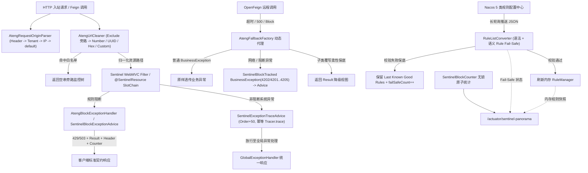

# ateng-cloud-sentinel 微服务流量防卫与受管熔断降级底座

面向生产级微服务的高可用流量防卫、弹性熔断降级与动态规则持久化底座（基于 Spring Cloud Alibaba Sentinel 2023 + Nacos）。

提供**“WebMVC 阻断双重对齐（HTTP 429/503 + `Result<Void>` + `Retry-After`）+ RESTful 路径归一化防 OOM（含十六进制与自定义正则）+ 多维调用溯源与租户回退 + Feign 受管降级代理（源头防重计数）+ Web 异常自动熔断追踪桥接 + Nacos 5 大规则 Fail-Safe 防暴毙订阅 + 全景无锁自省端点”**全链路防卫闭环。

> [!TIP]
> **端到端交互样例与双模验证沙箱**：完整 Controller 契约、压测脚本与离线/在线联调指引见 [`sample-cloud-sentinel/README.md`](../ateng-cloud-samples/sample-cloud-sentinel/README.md)；架构演进决策见 [ADR-0007](../docs/adr/0007-sentinel-traffic-defense-and-managed-fallback-architecture.md)，领域术语词典见 [`CONTEXT.md`](./CONTEXT.md)。

---

## 0. 特性与公共 API 全景速查矩阵

> 所有公共核心类、接口、配置属性与错误码均在此唯一对齐源码并全量曝光，保障零遗漏。

### 0.1 核心类与扩展点 SPI 清单

| 包路径 (`io.github.atengk.cloud.sentinel.*`) | 类 / 接口 / 注解名称 | 核心职责与拓展点定位 |
| :--- | :--- | :--- |
| `.autoconfigure` | `AtengSentinelAutoConfiguration` | 底座核心自动装配，注册计数、WebMVC 处理器、路径清洗器、来源解析器、切面兜底、异常追踪桥接与 Panorama 端点 |
| `.autoconfigure` | `AtengSentinelNacosRuleAutoConfiguration` | Nacos 5 大规则动态订阅自动装配，按 `nacos-rules.enabled=true` 条件激活 |
| `.env` | `AtengSentinelEnvironmentPostProcessor` | 环境后置处理器：自动探测 OpenFeign 激活 `feign.sentinel.enabled=true`，探测 Actuator 注入 `sentinel-panorama` 路径映射 |
| `.properties` | `AtengSentinelProperties` | 强类型根配置属性（`ateng.cloud.sentinel.*`），内含 `BlockHandlerProperties`、`UrlCleanProperties`、`CustomPattern`、`OriginParserProperties`、`BlockAdviceProperties`、`TraceProperties`、`EndpointProperties` |
| `.properties` | `AtengSentinelNacosRuleProperties` | Nacos 规则订阅强类型配置（`ateng.cloud.sentinel.nacos-rules.*`），含四级上下文继承与 `RuleItemProperties`（5 类规则后缀与开关） |
| `.handler` | `AtengBlockExceptionHandler` | Spring MVC `BlockExceptionHandler` 默认实现：429/503 状态码对齐、`Result<Void>`、`X-Sentinel-Block-Rule` 与 `Retry-After` 响应头输出 |
| `.cleaner` | `AtengUrlCleaner` | `UrlCleaner` 实现：支持数字、UUID、长十六进制串及自定义正则归一化（防高基数 URI OOM），并支持 Ant 白名单免检旁路 |
| `.parser` | `AtengRequestOriginParser` | `RequestOriginParser` 实现：按请求来源头 $\rightarrow$ 网关头 $\rightarrow$ 多租户上下文回退 $\rightarrow$ 客户端 IP 回退 $\rightarrow$ 默认兜底五级解析调用源 |
| `.advice` | `SentinelBlockExceptionAdvice` | `@RestControllerAdvice` + `HandlerExceptionResolver`（`HIGHEST_PRECEDENCE + 100`）：捕获逃逸 `BlockException`、动态代理/反射包装异常及出站受管 `BusinessException(SentinelResultCode)`（带源头防重守卫） |
| `.advice` | `SentinelExceptionTraceAdvice` | `HandlerExceptionResolver`（`HIGHEST_PRECEDENCE + 50`）：在全局异常切面消化前单次请求幂等执行 `Tracer.trace(ex)`，自动豁免 `BlockException`、4xx、常规 `BusinessException` 与自定义忽略异常 |
| `.fallback` | `AtengFallbackFactory<T>` | 泛型 JDK 动态代理 `FallbackFactory<T>` 基类：普通 `BusinessException` 原样透传、`BlockException` 精准映射、`SentinelBlockTracked` 源头计数防重、接口 `default` 方法放行、集合/`Optional`/基本类型空安全兜底 |
| `.fallback` | `SentinelBlockTracked` | 源头阻断计数标记接口：标识异常已在出站降级源头（如 `AtengFallbackFactory`）完成计数，供 `SentinelBlockExceptionAdvice` 防重判定 |
| `.datasource` | `SentinelNacosRuleSubscriber` | Nacos 5 大规则约定订阅器；内嵌静态转换器 `RuleListConverter<T>`，提供 JSON 语法与规则语义双重 `Rule Fail-Safe` 防暴毙机制 |
| `.datasource` | `NacosDataSourceFactory` | `@FunctionalInterface` 扩展点 SPI：抽象 Nacos `ReadableDataSource` 创建逻辑，支持测试桩或企业加密/灰度数据源接管 |
| `.datasource` | `DefaultNacosDataSourceFactory` | `NacosDataSourceFactory` 默认实现，直接构造官方 `NacosDataSource` |
| `.endpoint` | `SentinelBlockCounter` | 无锁原子阻断计数器与最近阻断快照容器，内含 `BlockEventSnapshot`（含 `timestamp`、`resource`、`ruleType`、`clientIp`、`message`、`traceId`、`origin`） |
| `.endpoint` | `SentinelPanoramaEndpoint` | Actuator 只读自省端点 `@Endpoint(id = "sentinelPanorama")`，统一映射 `/actuator/sentinel-panorama` |
| `.endpoint` | `SentinelPanoramaReport` | 五维全景诊断 JSON 报文根模型，内含 `NacosRulesReport`、`InMemoryRulesReport`、`WebMvcConfigReport`、`BlockMetricsReport` 及各类规则快照 Record |
| `.code` | `SentinelResultCode` | 强类型流量防卫业务错误码枚举（实现 `IResultCode`），严格划分至 `4201~4205` 网段 |
| `.util` | `SentinelServletUtil` | 底层无状态工具类：代理 IP 提取、安全来源与 MDC `traceId` 提取、因果链环检测解包、`BlockException` 与 `SentinelResultCode`/HTTP 状态转换及 JSON/头写出 |

### 0.2 配置属性与默认值全景字典

#### 0.2.1 核心防卫配置 (`ateng.cloud.sentinel.*`)

| 属性路径 | 类型 | 默认值 | 核心语义说明 |
| :--- | :--- | :--- | :--- |
| `ateng.cloud.sentinel.enabled` | `boolean` | `true` | 是否全局启用 Sentinel 流量防卫自动装配底座 |
| `ateng.cloud.sentinel.block-handler.enabled` | `boolean` | `true` | 是否启用统一 WebMVC 阻断异常处理器 `AtengBlockExceptionHandler` |
| `ateng.cloud.sentinel.block-handler.http-status-align` | `boolean` | `true` | 是否启用 HTTP 物理状态码对齐（Flow/Param/System/Authority=429，Degrade=503；`false` 返回 200） |
| `ateng.cloud.sentinel.block-handler.retry-after` | `Duration` | `PT0S` (0s) | 触发限流/熔断时附带的 `Retry-After` HTTP 响应头退避秒数（`<= 0` 不输出；兼容别名 `retry-after-seconds`） |
| `ateng.cloud.sentinel.url-clean.enabled` | `boolean` | `true` | 是否启用 RESTful 动态 URL 路径归一化防内存膨胀清洗器 |
| `ateng.cloud.sentinel.url-clean.number-replacement` | `String` | `"{id}"` | 纯数字路径段替换为的固定占位符 |
| `ateng.cloud.sentinel.url-clean.uuid-replacement` | `String` | `"{uuid}"` | 36 位标准带连字符 UUID 路径段替换为的固定占位符 |
| `ateng.cloud.sentinel.url-clean.hex-replacement` | `String` | `"{id}"` | 长度为 24 位或 32 位的十六进制路径段（如 MongoDB ObjectId / MD5）替换占位符 |
| `ateng.cloud.sentinel.url-clean.custom-patterns` | `List<CustomPattern>` | `[]` | 自定义路径正则清洗规则列表（优先于内置规则对完整路径生效）；每项含 `pattern` 与 `replacement`（默认 `"{custom}"`） |
| `ateng.cloud.sentinel.url-clean.exclude-patterns` | `List<String>` | `["/actuator/**", "/v3/api-docs/**", "/swagger-ui/**", "/doc.html", "/webjars/**", "/favicon.ico"]` | Ant 风格免检白名单路径集合；匹配后返回 `""` 旁路 Sentinel 资源统计与监控树 |
| `ateng.cloud.sentinel.origin-parser.enabled` | `boolean` | `true` | 是否启用多维请求调用源解析器 `AtengRequestOriginParser` |
| `ateng.cloud.sentinel.origin-parser.origin-header` | `String` | `"X-Origin-Service"` | 第一优先级读取的服务来源标识 HTTP 请求头名称（兼容旧键别名 `header-name`） |
| `ateng.cloud.sentinel.origin-parser.gateway-header` | `String` | `"X-Gateway-Caller"` | 第二优先级读取的网关调用来源 HTTP 请求头名称 |
| `ateng.cloud.sentinel.origin-parser.default-origin` | `String` | `"default"` | 全部分支均无法识别调用源时的兜底默认来源标识 |
| `ateng.cloud.sentinel.origin-parser.enable-client-ip-fallback` | `boolean` | `true` | 是否在请求头（与可选租户上下文）缺失时回退取客户端真实 IP 作为来源标识 |
| `ateng.cloud.sentinel.origin-parser.enable-tenant-fallback` | `boolean` | `false` | 是否启用多租户回退：从 `ateng-boot-core` `TenantContextHolder` 提取当前租户 ID（位于请求头之后、客户端 IP 之前） |
| `ateng.cloud.sentinel.origin-parser.tenant-prefix` | `String` | `"tenant:"` | 启用多租户回退后自动追加的来源前缀（例如租户 `t001` 解析为 `tenant:t001`） |
| `ateng.cloud.sentinel.block-advice.enabled` | `boolean` | `true` | 是否启用 `@SentinelResource` 切面逃逸与受管降级异常全局兜底处理器 `SentinelBlockExceptionAdvice` |
| `ateng.cloud.sentinel.block-advice.http-status-align` | `boolean` | `true` | 切面拦截兜底响应是否同样遵循 HTTP 429/503 状态码对齐策略 |
| `ateng.cloud.sentinel.block-advice.retry-after` | `Duration` | `PT0S` (0s) | 切面兜底响应附带的 `Retry-After` HTTP 响应头退避秒数（`<= 0` 不输出；兼容别名 `retry-after-seconds`） |
| `ateng.cloud.sentinel.trace.enabled` | `boolean` | `true` | 是否启用 `SentinelExceptionTraceAdvice` Web 异常自动熔断追踪桥接器 |
| `ateng.cloud.sentinel.trace.trace-business-exception` | `boolean` | `false` | 是否将常规业务异常 `BusinessException` 计入 Sentinel 熔断故障统计（携带 `SentinelResultCode` 的阻断异常始终豁免） |
| `ateng.cloud.sentinel.trace.ignore-exceptions` | `List<Class<? extends Throwable>>` | `[]` | 自定义豁免不计入熔断统计的异常类（含其子类）列表 |
| `ateng.cloud.sentinel.endpoint.enabled` | `boolean` | `true` | 是否暴露 `/actuator/sentinel-panorama` 五维全景诊断端点 |

#### 0.2.2 Nacos 动态规则订阅配置 (`ateng.cloud.sentinel.nacos-rules.*`)

| 属性路径 | 类型 | 默认值 | 核心语义说明 |
| :--- | :--- | :--- | :--- |
| `ateng.cloud.sentinel.nacos-rules.enabled` | `boolean` | `false` | 是否开启 Nacos 5 大规则动态持久化订阅（需显式置 `true` 激活） |
| `ateng.cloud.sentinel.nacos-rules.server-addr` | `String` | `null` | Nacos 地址；留空时按 `spring.cloud.nacos.config.server-addr` $\rightarrow$ `discovery` $\rightarrow$ `spring.cloud.nacos.server-addr` $\rightarrow$ `127.0.0.1:8848` 继承 |
| `ateng.cloud.sentinel.nacos-rules.namespace` | `String` | `null` | Nacos 命名空间 ID；留空按四级环境配置上下文自动继承 |
| `ateng.cloud.sentinel.nacos-rules.group-id` | `String` | `"SENTINEL_GROUP"` | Sentinel 规则所属 Nacos 分组 ID |
| `ateng.cloud.sentinel.nacos-rules.data-id-prefix` | `String` | `${spring.application.name}` | 规则配置文件前缀；留空自动回退读取 `${spring.application.name}`（均为空时最终兜底为 `"sentinel"`） |
| `ateng.cloud.sentinel.nacos-rules.username` | `String` | `null` | Nacos 认证用户名；留空按环境上下文自动继承 |
| `ateng.cloud.sentinel.nacos-rules.password` | `String` | `null` | Nacos 认证密码；留空自动继承，诊断端点自动脱敏为 `"******"` |
| `ateng.cloud.sentinel.nacos-rules.context-path` | `String` | `null` | Nacos 服务端上下文路径；留空自动继承 |
| `ateng.cloud.sentinel.nacos-rules.access-key` | `String` | `null` | 云上 MSE/ACM AccessKey；留空自动继承，诊断端点自动脱敏为 `"******"` |
| `ateng.cloud.sentinel.nacos-rules.secret-key` | `String` | `null` | 云上 MSE/ACM SecretKey；留空自动继承，诊断端点自动脱敏为 `"******"` |
| `ateng.cloud.sentinel.nacos-rules.flow.enabled` / `data-id-suffix` | `boolean` / `String` | `true` / `"-flow.json"` | 流控规则订阅开关与 DataId 后缀 |
| `ateng.cloud.sentinel.nacos-rules.degrade.enabled` / `data-id-suffix` | `boolean` / `String` | `true` / `"-degrade.json"` | 熔断降级规则订阅开关与 DataId 后缀 |
| `ateng.cloud.sentinel.nacos-rules.param-flow.enabled` / `data-id-suffix` | `boolean` / `String` | `true` / `"-param-flow.json"` | 热点参数规则订阅开关与 DataId 后缀 |
| `ateng.cloud.sentinel.nacos-rules.system.enabled` / `data-id-suffix` | `boolean` / `String` | `true` / `"-system.json"` | 系统自适应保护规则订阅开关与 DataId 后缀 |
| `ateng.cloud.sentinel.nacos-rules.authority.enabled` / `data-id-suffix` | `boolean` / `String` | `true` / `"-authority.json"` | 来源授权（黑白名单）规则订阅开关与 DataId 后缀 |

#### 0.2.3 Sentinel 专属强类型业务错误码与 HTTP 状态码映射 (`SentinelResultCode`)

| 枚举名 | 业务错误码 (`code`) | 默认提示信息 (`msg`) | 对齐 HTTP 状态码 | `X-Sentinel-Block-Rule` 响应头 |
| :--- | :--- | :--- | :--- | :--- |
| `FLOW_LIMIT` | `4201` | `"服务流量过载，触发限流保护"` | `429 Too Many Requests` | `FLOW` |
| `DEGRADE` | `4202` | `"服务暂时不可用，触发降级熔断"` | `503 Service Unavailable` | `DEGRADE` |
| `PARAM_FLOW_LIMIT` | `4203` | `"热点参数访问频繁，触发限流保护"` | `429 Too Many Requests` | `PARAM_FLOW` |
| `SYSTEM_BLOCK` | `4204` | `"系统负载过高，触发保护机制"` | `429 Too Many Requests` | `SYSTEM` |
| `AUTHORITY_BLOCK` | `4205` | `"访问源未授权，已被规则拦截"` | `429 Too Many Requests` | `AUTHORITY` |

---

## 1. 模块定位与 Maven 坐标

`ateng-cloud-sentinel` 是 `ateng-cloud` 微服务治理套件的边缘与进程内流量防卫底座，复用 `ateng-boot-bom` 底座（`ateng-boot-core` 的 `Result<T>`、`BusinessException`、`TenantContextHolder` 等原语），消除官方 Sentinel 接入中的散落文本响应、RESTful URL 爆炸、全局异常吞噬导致的熔断失效及 Nacos 配置冗余等工程痛点。

在目标微服务模块的 `pom.xml` 中直接引入坐标（版本号由父 POM / `ateng-cloud-bom` 统一纳管）：

```xml
<dependency>
    <groupId>io.github.atengk</groupId>
    <artifactId>ateng-cloud-sentinel</artifactId>
</dependency>
```

> [!NOTE]
> **可选生态依赖说明**：`spring-webmvc`、`spring-cloud-starter-openfeign` 与 `spring-boot-starter-actuator` 在本模块中均为 `<optional>true</optional>`。引入 `ateng-boot-web` 时自动激活 WebMVC 防卫与异常桥接能力；存在 OpenFeign 时自动激活 `feign.sentinel.enabled=true` 与 `AtengFallbackFactory<T>` 代理；存在 Actuator 时自动暴露 `/actuator/sentinel-panorama`。

---

## 2. 核心架构与微服务防御不变量



四大核心微服务防御不变量：

1. **HTTP + Result 双重对齐与退避头契约**：阻断响应除输出标准 JSON 包装体 `Result.fail(4201~4205, msg)` 外，默认强制对齐 HTTP 物理状态码 `429` / `503` 与 `X-Sentinel-Block-Rule` 头；配置 `retry-after` 后自动附加标准 `Retry-After`（秒）头，保障下游网关、浏览器与 Feign 重试器精确识别退避窗口。
2. **语法与语义双重 `Rule Fail-Safe` 防暴毙不变量**：Nacos 动态推送的任何 JSON 格式残缺、空元素、缺失 `resource` 或负值/非法 `count` 规则，均由转换器在前置验证阶段拦截阻断，严禁覆盖并保留内存中最后一次已知正确的规则集（Last Known Good Rules）。
3. **Web 异常自动熔断追踪与因果隔离不变量**：系统级故障异常由 `SentinelExceptionTraceAdvice` 在 `GlobalExceptionHandler` 吞噬前自动桥接给 Sentinel 异常比率/异常数熔断器；而 `BlockException`、客户端 4xx 参数校验错误与普通业务异常自动豁免，防止“业务校验失败引发全链路误熔断”。
4. **凭据零泄密（Zero-Secret）与防重原子统计不变量**：自省端点 `/actuator/sentinel-panorama` 对 Nacos `password`、`accessKey`、`secretKey` 恒定掩码输出 `"******"`；Feign 降级源头与 Web 兜底切面通过 `SentinelBlockTracked` 契约联动防重，杜绝单次失败重复记账。

---

## 3. 入站流量防卫、路径防爆与多维溯源

### 3.1 WebMVC 入站 QPS 限流与 HTTP/JSON 双重对齐

#### 1) 场景配置 (`application.yml`)

```yaml
ateng:
  cloud:
    sentinel:
      enabled: true
      block-handler:
        enabled: true
        http-status-align: true
        retry-after: 5s
```

#### 2) 业务代码（逆向提取自 `sample-cloud-sentinel`）

控制器无需侵入任何 `BlockException` 捕获逻辑，只需声明标准接口与 JSR-303 参数校验：

```java
@RestController
@RequestMapping("/sample/cloud/sentinel/seckill")
public class SentinelSecKillFlowController {

    @PostMapping("/order")
    public Result<SecKillResultVO> createOrder(@Valid @RequestBody SecKillOrderDTO orderDTO) {
        SecKillResultVO result = new SecKillResultVO(
                "SK-" + System.currentTimeMillis() + "-" + orderDTO.getProductId(),
                orderDTO.getUserId(),
                orderDTO.getProductId(),
                orderDTO.getCount(),
                "SUCCESS",
                LocalDateTime.now()
        );
        return Result.success(result);
    }
}
```

#### 3) 核心机制与防线解析

当请求 `/sample/cloud/sentinel/seckill/order` 触发入站流控时，`AtengBlockExceptionHandler` 从安全上下文提取客户端真实 IP、多维调用源（`origin`）与 MDC `traceId`，同步递增 `SentinelBlockCounter`，并输出 HTTP `429 Too Many Requests`、`X-Sentinel-Block-Rule: FLOW`、`Retry-After: 5`（当 `retry-after > 0`）与结构化 JSON 体 `{"code":4201,"msg":"服务流量过载，触发限流保护","data":null}`。若 `http-status-align: false`，则保留 HTTP `200` 以兼容仅识别业务码的旧版前端网关。

---

### 3.2 RESTful 动态路径防爆：十六进制归一化与自定义正则清洗

#### 1) 场景配置 (`application.yml`)

```yaml
ateng:
  cloud:
    sentinel:
      url-clean:
        enabled: true
        number-replacement: "{id}"
        uuid-replacement: "{uuid}"
        hex-replacement: "{id}"
        custom-patterns:
          - pattern: "/ORD-[A-Z0-9-]+(?=/|$)"
            replacement: "/{orderNo}"
```

#### 2) 业务代码（逆向提取自 `sample-cloud-sentinel`）

```java
@RestController
@RequestMapping("/sample/cloud/sentinel/security")
public class SentinelSecurityAuthorityController {

    @GetMapping("/orders/{id}")
    public Result<SecurityOrderVO> getOrderById(@PathVariable("id") Long id) {
        SecurityOrderVO vo = new SecurityOrderVO(
                id,
                "ORD-SEC-" + id,
                new BigDecimal("299.00"),
                "/sample/cloud/sentinel/security/orders/{id}"
        );
        return Result.success(vo);
    }
}
```

#### 3) 核心机制与防线解析

原生 Sentinel 对每个不同 URL 创建独立 `ClusterNode` 资源树节点，高频 RESTful 变参请求极易撑爆 JVM 堆内存。`AtengUrlCleaner` 对路径依次执行**“尾部斜杠归一化 $\rightarrow$ Ant 白名单旁路 $\rightarrow$ 当前请求上下文 Spring MVC 路由模板提取（防跨路径串扰、过滤 `/*` 与 `/**` 并二次校验白名单） $\rightarrow$ 预编译 `custom-patterns`（按配置顺序执行 `Matcher.replaceAll`） $\rightarrow$ 36 位带连字符 UUID（`uuid-replacement`） $\rightarrow$ 24/32 位纯十六进制串（`hex-replacement`） $\rightarrow$ 纯数字段（`number-replacement`）”**逐级收敛 URI（例如 `/orders/987654321/` $\rightarrow$ `/orders/{id}`，`/orders/ORD-2026-001` $\rightarrow$ `/orders/{orderNo}`），彻底消除高基数 OOM 风险。构造期对 `custom-patterns` 执行预编译与 Fail-Fast 校验（拦截非法正则语法、悬空转义 `\` 及越界或未定义的捕获组引用 `$1` / `${name}`），并对替换占位符做字面量转义保护，防止正则元字符破坏清洗结果。

---

### 3.3 Ant 路径白名单免检旁路

#### 1) 场景配置 (`application.yml`)

```yaml
ateng:
  cloud:
    sentinel:
      url-clean:
        exclude-patterns:
          - "/actuator/**"
          - "/v3/api-docs/**"
          - "/sample/cloud/sentinel/security/public/**"
```

> [!NOTE]
> 配置未显式覆盖 `exclude-patterns` 时，默认内置 `/actuator/**`、`/v3/api-docs/**`、`/swagger-ui/**`、`/doc.html`、`/webjars/**` 与 `/favicon.ico` 共 6 项高频探测/静态路径；如在项目中覆盖该数组，建议保留 `/actuator/**` 与文档路径以免健康探针被自身限流拦截。

#### 2) 业务代码（逆向提取自 `sample-cloud-sentinel`）

```java
@GetMapping("/public/ping")
public Result<String> publicPing() {
    return Result.success("public-pong");
}
```

#### 3) 核心机制与防线解析

命中 `exclude-patterns` 的路径经由 Spring `AntPathMatcher` 快速判定后由 `AtengUrlCleaner.clean(originUrl)` 返回空字符串 `""`。Sentinel WebMVC 过滤器识别空资源名后直接放行而不进入 `SphU.entry(...)` 与监控树构建流程，实现探针与健康检查接口的零资源污染与微秒级旁路。

---

### 3.4 多维调用源解析、多租户回退与黑白名单控制

#### 1) 场景配置 (`application.yml`)

```yaml
ateng:
  cloud:
    sentinel:
      origin-parser:
        enabled: true
        origin-header: "X-Origin-Service"
        gateway-header: "X-Gateway-Caller" # 样例工程中演示覆盖为 "X-Gateway-From"
        default-origin: "gateway"
        enable-client-ip-fallback: true
        enable-tenant-fallback: true
        tenant-prefix: "tenant:"
```

#### 2) 业务代码（逆向提取自 `sample-cloud-sentinel`）

```java
@GetMapping("/admin/dashboard")
public Result<String> adminDashboard() {
    return Result.success("admin-dashboard-access-granted");
}
```

#### 3) 核心机制与防线解析

`AtengRequestOriginParser` 严格按照五级优先级逐层探测来源标识并修剪首尾空白：

1. **内部直传服务来源头**（默认 `X-Origin-Service`，兼容旧键 `header-name`）
2. **网关透传调用者头**（默认 `X-Gateway-Caller`）
3. **多租户上下文回退**（`enable-tenant-fallback: true` 时读取 `ateng-boot-core` 的 `TenantContextHolder.getTenantId()`，非空时拼接 `tenant-prefix`，如 `tenant:t1001`，实现零请求头改造的多租户独立限流与黑名单封禁）
4. **客户端真实 IP 回退**（`enable-client-ip-fallback: true` 时按 `X-Forwarded-For` 首段 $\rightarrow$ `X-Real-IP` $\rightarrow$ `RemoteAddr` 提取）
5. **全局兜底标识**（`default-origin`）

结合 Sentinel `AuthorityRule` 白名单/黑名单鉴权，未授权来源将被拦截并返回 HTTP `429` + `AUTHORITY_BLOCK (4205)`。

---

## 4. OpenFeign 弹性熔断、受管降级与异常追踪桥接

### 4.1 零侵入 Feign 熔断防呆默认注入与全景自愈

#### 1) 场景配置 (`application.yml`)

无需额外配置 `feign.sentinel.enabled: true`（已由 `AtengSentinelEnvironmentPostProcessor` 在最低优先级注入，开发者仍可通过 `feign.sentinel.enabled: false` 按需关闭）：

```yaml
# 默认零配置自动激活 feign.sentinel.enabled=true，仅在需关闭时显式覆盖
feign:
  sentinel:
    enabled: true
```

#### 2) 业务代码（全局启动零代码侵入）

只要类路径存在 `org.springframework.cloud.openfeign.FeignClient`，Spring 容器在 `Environment` 阶段即注入低优先级 `MapPropertySource("atengSentinelDefaultProperties")`：同时为 `feign.sentinel.enabled` 设置 `"true"`，并为 `Endpoint` 类存在时的 Actuator 端点自动注册 `management.endpoints.web.path-mapping.sentinelPanorama=sentinel-panorama`。

#### 3) 核心机制与防线解析

传统 Spring Cloud Alibaba 项目极易因开发者漏配 `feign.sentinel.enabled=true` 导致 Feign 的 `@FeignClient(fallbackFactory = ...)` 形同虚设、异常直接雪崩穿透。`AtengSentinelEnvironmentPostProcessor` 以 `Ordered.LOWEST_PRECEDENCE` 注册默认属性源，既确保零配置下 100% 激活熔断器，又不抢占项目显式配置优先级。

---

### 4.2 AtengFallbackFactory 受管代理降级与异常精准分流

#### 1) 场景配置 (`application.yml`)

```yaml
ateng:
  cloud:
    sentinel:
      block-advice:
        enabled: true
        http-status-align: true
```

#### 2) 业务代码（逆向提取自 `sample-cloud-sentinel`）

```java
// 写扣款方法在 PaymentFallbackFactory 中直接委托父类默认受管降级策略（super.handleFallback）
// 1. 普通 BusinessException -> 原样透传（不被篡改为 DEGRADE）
// 2. Sentinel BlockException -> 精准映射 4201~4205，写入源头计数并包装 SentinelBlockTracked 防重
// 3. 超时/网络/5xx 故障 -> 转译为携带完整 cause 的 BusinessException(4202 DEGRADE)
return super.handleFallback(method, args, cause);
```

对应的 Controller 调用端无感知直接返回下游契约结果（出自 `SentinelPaymentDegradeController#pay`）：

```java
@PostMapping("/pay")
public Result<PaymentResultVO> pay(
        @Valid @RequestBody PaymentPayDTO payDTO,
        @RequestParam(name = "simulateTimeout", defaultValue = "false") boolean simulateTimeout,
        @RequestParam(name = "simulateError", defaultValue = "false") boolean simulateError) {
    return remotePaymentClient.payOrder(payDTO, simulateTimeout, simulateError);
}
```

#### 3) 核心机制与防线解析

`AtengFallbackFactory<T>` 通过 Spring `ResolvableType` 自动解析泛型 `<T>`（同时提供 `Class<T>` 显式构造器兼容匿名类）创建 JDK 动态代理，并在降级触发时执行**五重受管分派逻辑**：

1. **接口 `default` 默认方法与 `Object` 基类方法放行**：自动跳过 `toString`/`hashCode`/`equals` 并在目标实现为 `default` 方法时直接反射执行默认实现。
2. **下游普通 `BusinessException` 原样透传**：识别非 `SentinelResultCode` 的下游 `BusinessException` 时直接原样重新抛出，绝不被篡改为 `4202 DEGRADE` 掩盖业务语义（如库存不足、余额不足）。
3. **`BlockException` 精准映射与防重计数**：从 `cause` 因果链递归提取真实 `FlowException` / `DegradeException` / `ParamFlowException` 等并精准映射为 `4201~4205`；若容器已注入 `SentinelBlockCounter`，则在源头主动计数一次并抛出实现 `SentinelBlockTracked` 契约的异常包装，后续被 `SentinelBlockExceptionAdvice` 捕获时自动跳过二次计数。
4. **底层网络/超时故障保底转译**：无 `BlockException` 的其余 `Throwable`（如 Socket 超时、5xx 网关崩溃）统一转译为携带完整原始 `cause` 链的 `DEGRADE (4202)` `BusinessException`。
5. **自定义 `handleFallback` 返回 `null` 时的空安全兜底**：当接口返回类型为 `List`/`Set`/`Map`/`Collection`/`Iterable`/`Optional` 或 Java 基本类型时，自动兜底返回 `Collections.emptyList()`、`Optional.empty()` 或安全零值（`Result<T>` 除外，由上层按契约判定）。

---

### 4.3 声明式 Feign 客户端与柔性业务保底重写

#### 1) 场景配置 (`application.yml`)

```yaml
feign:
  client:
    config:
      default:
        connectTimeout: 2000
        readTimeout: 1000
```

#### 2) 业务代码（逆向提取自 `sample-cloud-sentinel`）

声明式 Feign 客户端与受管降级工厂定义：

```java
@FeignClient(
        name = "remote-payment-client",
        url = "${sentinel.payment.url:http://localhost:8080}",
        fallbackFactory = PaymentFallbackFactory.class
)
public interface RemotePaymentClient {

    @PostMapping("/sample/cloud/sentinel/provider/payment/pay")
    Result<PaymentResultVO> payOrder(
            @RequestBody PaymentPayDTO payDTO,
            @RequestParam(name = "simulateTimeout", defaultValue = "false") boolean simulateTimeout,
            @RequestParam(name = "simulateError", defaultValue = "false") boolean simulateError
    );

    @GetMapping("/sample/cloud/sentinel/provider/payment/status/{payNo}")
    Result<PaymentResultVO> queryPaymentStatus(
            @PathVariable("payNo") String payNo,
            @RequestParam(name = "simulateFail", defaultValue = "false") boolean simulateFail
    );
}
```

重写 `handleFallback` 实现“读接口柔性兜底、写接口严格抛 `DEGRADE(4202)`”的混合降级：

```java
@Component
public class PaymentFallbackFactory extends AtengFallbackFactory<RemotePaymentClient> {

    @Override
    protected Object handleFallback(Method method, Object[] args, Throwable cause) throws Throwable {
        // 为支付状态查询提供柔性保底值，避免直接抛出异常影响买家查询体验
        if ("queryPaymentStatus".equals(method.getName())) {
            String payNo = (args != null && args.length > 0 && args[0] != null) ? args[0].toString() : "UNKNOWN";
            log.warn("Payment status query fallback triggered for payNo='{}', cause='{}'", payNo,
                    cause != null ? cause.getMessage() : "unknown");
            return Result.success(PaymentResultVO.fallback(payNo, "第三方支付查询熔断降级，返回柔性保底数据"));
        }
        // 其余方法（如扣款 payOrder）平滑委托给框架默认降级行为：自动抛出携带原始 cause 的 BusinessException(4202 DEGRADE)
        return super.handleFallback(method, args, cause);
    }
}
```

Controller 调用端无感知接入：

```java
@RestController
@RequestMapping("/sample/cloud/sentinel/payment")
public class SentinelPaymentDegradeController {

    private final RemotePaymentClient remotePaymentClient;

    @Autowired
    public SentinelPaymentDegradeController(RemotePaymentClient remotePaymentClient) {
        this.remotePaymentClient = remotePaymentClient;
    }

    @PostMapping("/pay")
    public Result<PaymentResultVO> pay(
            @Valid @RequestBody PaymentPayDTO payDTO,
            @RequestParam(name = "simulateTimeout", defaultValue = "false") boolean simulateTimeout,
            @RequestParam(name = "simulateError", defaultValue = "false") boolean simulateError) {
        return remotePaymentClient.payOrder(payDTO, simulateTimeout, simulateError);
    }

    @GetMapping("/status/{payNo}")
    public Result<PaymentResultVO> queryStatus(
            @PathVariable("payNo") String payNo,
            @RequestParam(name = "simulateFail", defaultValue = "false") boolean simulateFail) {
        return remotePaymentClient.queryPaymentStatus(payNo, simulateFail);
    }
}
```

#### 3) 核心机制与防线解析

如上所示，扣款写接口 `payOrder` 走 `super.handleFallback` 自动在降级源头递增 `SentinelBlockCounter` 并上抛携带原始超时/异常因果链的 `DEGRADE(4202)`，最终由 `SentinelBlockExceptionAdvice` 对齐返回 HTTP `503` 与标准 `Result<Void>`；而读接口 `queryPaymentStatus` 则拦截并返回带 `fallback=true`、`status="DEGRADED"` 的柔性保底视图对象 `Result<PaymentResultVO>`，兼顾核心账务一致性与边缘查询可用性。

---

### 4.4 SentinelExceptionTraceAdvice Web 异常自动熔断追踪桥接

#### 1) 场景配置 (`application.yml`)

```yaml
ateng:
  cloud:
    sentinel:
      trace:
        enabled: true
        trace-business-exception: false
        ignore-exceptions:
          - java.lang.IllegalArgumentException
```

#### 2) 业务代码（逆向提取自 `sample-cloud-sentinel`）

Controller 完全**无需手写 `Tracer.trace(ex)`**，正常抛出系统或业务异常即可：

```java
@GetMapping("/circuit-breaker")
public Result<String> circuitBreaker(
        @RequestParam(name = "fail", defaultValue = "false") boolean fail,
        @RequestParam(name = "businessFail", defaultValue = "false") boolean businessFail) {
    if (businessFail) {
        throw new BusinessException(10001, "Simulated ordinary business exception");
    }
    if (fail) {
        throw new IllegalStateException("Simulated system exception for degrade circuit breaker");
    }
    return Result.success("circuit-breaker-pass");
}
```

#### 3) 核心机制与防线解析

在引入了全局异常处理器（如 `GlobalExceptionHandler`）的 Spring MVC 应用中，Sentinel 官方 `SentinelWebInterceptor` 往往在异常被 `@RestControllerAdvice` 吞噬并返回 JSON 响应体后才结束拦截，导致 Web 接口的 `DegradeRule`（异常比例/异常数熔断）长期静默不触发。

`SentinelExceptionTraceAdvice` 实现高优先级 `HandlerExceptionResolver`（`Ordered.HIGHEST_PRECEDENCE + 50`，先于 `ExceptionHandlerExceptionResolver` 与 `SentinelBlockExceptionAdvice` 执行）：

- **单次请求幂等桥接**：首次遇到非豁免系统故障异常时执行 `Tracer.trace(ex)` 并在请求属性打标 `TRACE_RECORDED_ATTRIBUTE`，随后恒返回 `null` 无损交还下游全局异常处理器渲染响应；进入熔断窗口后由 Sentinel 熔断器直接阻断并返回 `503 + DEGRADE(4202)`。
- **四重精准豁免防止误熔断**：① Sentinel 自身 `BlockException` 及代理包装异常；② Spring MVC 4xx 客户端与校验异常（4xx `ErrorResponse`、`BindException`、`HttpMessageNotReadableException`、`MethodArgumentTypeMismatchException`、`jakarta.validation.ValidationException`、标注 4xx `@ResponseStatus` 的异常）；③ `SentinelResultCode` 阻断异常（始终豁免）与默认豁免的普通 `BusinessException`（需将 `trace-business-exception: true` 时才计入）；④ 用户声明的 `ignore-exceptions` 异常子类。

---

## 5. `@SentinelResource` 切面逃逸防御与热点参数流控

### 5.1 切面阻断异常逃逸兜底与动态代理双重解包

#### 1) 场景配置 (`application.yml`)

```yaml
ateng:
  cloud:
    sentinel:
      block-advice:
        enabled: true
        http-status-align: true
        retry-after: 3s
```

#### 2) 业务代码（逆向提取自 `sample-cloud-sentinel`）

```java
@GetMapping("/vip-channel")
@SentinelResource(value = "seckill-vip-channel")
public Result<String> vipChannel() {
    return Result.success("vip-pass");
}
```

#### 3) 核心机制与防线解析

开发者使用 `@SentinelResource(value = "...")` 若未逐个填写 `blockHandler`，当触发规则时 `SentinelResourceAspect` 会抛出 `FlowException`；经过 AOP/Feign JDK 动态代理或反射调用层层传递后，常被 Spring 包装为 `UndeclaredThrowableException` 或 `InvocationTargetException` 进而被业务全局异常处理器误当作 `500 System Error` 捕获。

`SentinelBlockExceptionAdvice` 同时实现 `@RestControllerAdvice` 与 `HandlerExceptionResolver`（优先级 `Ordered.HIGHEST_PRECEDENCE + 100`，早于默认 `ExceptionHandlerExceptionResolver`）：

1. 优先通过带环检测的因果链递归解包提取受管 `BusinessException(SentinelResultCode)` 或真实 `BlockException`；
2. 对普通业务 `BusinessException`（非 `SentinelResultCode`）原样放行交回全局异常切面，绝不抢占通用异常体系；
3. 检查是否实现 `SentinelBlockTracked` 且 `isSourceCounted() == true`，已由 Feign 降级源头计数的异常严格跳过 `blockCounter.recordBlock(...)` 防止重复统计；
4. 统一输出 `429`/`503` 状态码、`X-Sentinel-Block-Rule`、`Retry-After` 头与 `Result.fail(4201~4205, msg)`。

---

### 5.2 热点参数流控防卫

#### 1) 场景配置 (`application.yml`)

只需开启默认装配底座（或通过 Nacos 下发 `-param-flow.json` 规则）：

```yaml
ateng:
  cloud:
    sentinel:
      block-advice:
        enabled: true
        http-status-align: true
```

#### 2) 业务代码（逆向提取自 `sample-cloud-sentinel`）

```java
@GetMapping("/product/{productId}")
@SentinelResource(value = "seckill-product-hotspot")
public Result<SecKillProductVO> getProductDetail(@PathVariable("productId") Long productId) {
    SecKillProductVO product = new SecKillProductVO(
            productId,
            "秒杀专享热销商品-" + productId,
            new BigDecimal("99.00"),
            500,
            "AVAILABLE"
    );
    return Result.success(product);
}
```

#### 3) 核心机制与防线解析

WebMVC 默认全局入口过滤器不支持提取 `@PathVariable` / 方法参数维度进行热点限流，结合 `@SentinelResource(value = "seckill-product-hotspot")` 与 `ParamFlowRule` 后，可在第 0 个参数（如爆款商品 ID `1001`）达到设定阈值时精准触发 `ParamFlowException`。逃逸的 `ParamFlowException` 由 `SentinelBlockExceptionAdvice` 捕获并映射为 HTTP `429 Too Many Requests`、`X-Sentinel-Block-Rule: PARAM_FLOW` 与业务码 `PARAM_FLOW_LIMIT (4203)`，避免整个商品详情接口被单一热点商品打死。

---

## 6. Nacos 5 大规则持久化与 Rule Fail-Safe 防暴毙

### 6.1 四级配置平滑继承与约定订阅拓扑

#### 1) 场景配置 (`application.yml`)

开启 Nacos 5 大规则动态订阅最简仅需 `enabled: true`（连接地址、命名空间、认证账号与 `context-path` 均可自动继承工程已有 `spring.cloud.nacos.*` 配置）：

```yaml
ateng:
  cloud:
    sentinel:
      nacos-rules:
        enabled: true
        group-id: SENTINEL_GROUP
        # server-addr / namespace / username / password / context-path / access-key / secret-key
        # 默认留空时按 config -> discovery -> spring.cloud.nacos -> 默认值 127.0.0.1:8848 继承
```

#### 2) 业务代码（零业务代码入侵，由 `AtengSentinelNacosRuleAutoConfiguration` 自动激活）

启用后，底座依据 `${data-id-prefix}`（默认自动回退为 `${spring.application.name}`，均为空时最终兜底为 `"sentinel"`）按约定 Suffix 并行订阅 5 份规则配置文件：

- `${prefix}-flow.json`（`FlowRule` 限流规则）
- `${prefix}-degrade.json`（`DegradeRule` 熔断降级规则）
- `${prefix}-param-flow.json`（`ParamFlowRule` 热点参数规则）
- `${prefix}-system.json`（`SystemRule` 系统保护规则）
- `${prefix}-authority.json`（`AuthorityRule` 来源授权规则）

#### 3) 核心机制与防线解析

`AtengSentinelNacosRuleProperties` 对 `serverAddr`、`namespace`、`username`、`password`、`contextPath`、`accessKey` 与 `secretKey` 均实施**四级优先级自适应解析**：显式 `ateng.cloud.sentinel.nacos-rules.*` $\rightarrow$ `spring.cloud.nacos.config.*` $\rightarrow$ `spring.cloud.nacos.discovery.*` $\rightarrow$ `spring.cloud.nacos.*`（`serverAddr` 最终兜底 `127.0.0.1:8848`）。此设计彻底消除了微服务端既配置 Nacos 注册/配置中心又重复拷贝明文密码到 Sentinel 数据源属性的运维负担。

---

### 6.2 5 大规则类型约定 DataId 与 JSON 结构样例

#### 1) 场景配置（Nacos Console 5 大规则 JSON 与子项开关）

可通过子项开关禁用不需要的规则类别或覆写后缀（减少 Nacos 监听连接数）：

```yaml
ateng:
  cloud:
    sentinel:
      nacos-rules:
        enabled: true
        data-id-prefix: sample-cloud-sentinel
        system:
          enabled: false
        authority:
          data-id-suffix: "-auth.json"
```

以下 5 类合法 JSON 规则按约定后缀发布至 `SENTINEL_GROUP` 即可实现秒级热推生效：

**规则 1：`${app}-flow.json`（流控规则）**

```json
[
  {
    "resource": "/sample/cloud/sentinel/seckill/order",
    "limitApp": "default",
    "grade": 1,
    "count": 20,
    "strategy": 0,
    "controlBehavior": 0
  }
]
```

**规则 2：`${app}-degrade.json`（熔断降级规则：`grade` 0=慢调用比例，1=异常比例，2=异常数）**

```json
[
  {
    "resource": "/sample/cloud/sentinel/payment/circuit-breaker",
    "grade": 1,
    "count": 0.5,
    "timeWindow": 10,
    "minRequestAmount": 5,
    "statIntervalMs": 10000
  }
]
```

**规则 3：`${app}-param-flow.json`（热点参数规则）**

```json
[
  {
    "resource": "seckill-product-hotspot",
    "grade": 1,
    "paramIdx": 0,
    "count": 5,
    "durationInSec": 1
  }
]
```

**规则 4：`${app}-system.json`（系统自适应规则）**

```json
[
  {
    "highestSystemLoad": 8.0,
    "highestCpuUsage": 0.85,
    "qps": 5000
  }
]
```

**规则 5：`${app}-authority.json`（来源授权规则：`strategy` 0=白名单，1=黑名单）**

```json
[
  {
    "resource": "/sample/cloud/sentinel/security/admin/dashboard",
    "limitApp": "admin-portal,gateway",
    "strategy": 0
  }
]
```

#### 2) 业务代码（逆向提取自 `sample-cloud-sentinel`：规则资源名与业务入口 1:1 对齐）

规则 JSON 中的 `resource` 与应用内 WebMVC 归一化路由或 `@SentinelResource` 资源名精确一一对应（无需修改业务代码即可热调整全部 5 维阈值）：

```java
// 1. 对应 ${app}-flow.json: "/sample/cloud/sentinel/seckill/order"
@PostMapping("/order")
public Result<SecKillResultVO> createOrder(@Valid @RequestBody SecKillOrderDTO orderDTO) { ... }

// 2. 对应 ${app}-param-flow.json: "seckill-product-hotspot"
@GetMapping("/product/{productId}")
@SentinelResource(value = "seckill-product-hotspot")
public Result<SecKillProductVO> getProductDetail(@PathVariable("productId") Long productId) { ... }
```

#### 3) 核心机制与防线解析

`SentinelNacosRuleSubscriber` 复用容器主 `ObjectMapper`（缺省自动新建副本）并关闭未知字段严格校验（`FAIL_ON_UNKNOWN_PROPERTIES=false`），兼容 Sentinel Dashboard 导出的包含扩展元数据字段的规则 JSON；容器停机时通过 `DisposableBean#destroy` 自动逐一关闭所有订阅数据源并清空本地集合，确保线程与长轮询句柄零泄漏。

---

### 6.3 语法与语义双重 Rule Fail-Safe 防暴毙机制

#### 1) 场景配置（底座内建强保障，无需额外开关）

当 Nacos 误推送包含语法错误（如缺少 `]`）或语义非法字段（如 `"resource": "   "`、`"count": -5`、`null` 元素）的配置文本时，`RuleListConverter` 自动介入。

#### 2) 业务代码（核心防御逻辑校验规则边界）

合法规则列表（如空 JSON / 空数组 `[]` 允许安全清空规则；非空列表逐条校验规则完整性）才允许进入 `FlowRuleManager`/`DegradeRuleManager` 等生效通道；任意一条规则非法即整批拒绝并保留当前内存中全部存量有效规则（Last Known Good Rules）。

#### 3) 核心机制与防线解析

传统 Sentinel Nacos 转换器遇到解析异常时要么吞掉异常直接清空现网全部限流规则，导致瞬间流量雪崩；要么静默失败无法告警排障。`RuleListConverter` 严格执行**语法 + 语义双重校验（Rule Fail-Safe Invariant）**：

- 校验元素非 `null`，并对 `FlowRule`、`DegradeRule`、`ParamFlowRule`、`AuthorityRule` 强制检查 `resource` 非空白；
- 对 `FlowRule`、`DegradeRule`、`ParamFlowRule` 强制检查阈值 `count` 为有限数值且 `>= 0`；
- 校验一旦失败：打印单行脱敏截取日志（防长载荷日志注入攻击），递增长寿命原子指标 `failSafeCount`，记录最近错误摘要 `lastFailSafeError`（仅保留安全排障消息不含明文长配置），并向 Sentinel 数据源层抛出 `IllegalArgumentException` 中止当前批次刷新，100% 保护现网存量生效规则不受污染。

---

### 6.4 自定义 NacosDataSourceFactory SPI 扩展

#### 1) 场景配置

无需额外 YAML 配置，直接通过 Spring Bean 覆盖默认 `DefaultNacosDataSourceFactory`。

#### 2) 业务代码（扩展 SPI 契约实现示例）

```java
@Configuration
public class CustomSentinelDataSourceConfiguration {

    @Bean
    public NacosDataSourceFactory customNacosDataSourceFactory() {
        return (properties, groupId, dataId, converter) -> {
            // 可在此处注入企业 KMS 凭据解密、灰度环境后缀路由或测试内存数据源桩
            return new NacosDataSource<>(properties, groupId, dataId, converter);
        };
    }
}
```

#### 3) 核心机制与防线解析

`AtengSentinelNacosRuleAutoConfiguration` 对 `NacosDataSourceFactory` 标配 `@ConditionalOnMissingBean`。生产环境可通过注入自定义工厂实现国密凭据解密或企业级加密数据中心对接；测试沙箱环境亦可直接替换为零网络 I/O 内存数据源桩，实现 100% 离线动态规则推送测试闭环。

---

## 7. Sentinel Panorama 全景自省诊断与可观测性

### 7.1 `/actuator/sentinel-panorama` 五维全景自省、Zero-Secret 脱敏与原子计数联动

#### 1) 场景配置 (`application.yml`)

```yaml
management:
  endpoints:
    web:
      exposure:
        include: "sentinelPanorama"

ateng:
  cloud:
    sentinel:
      endpoint:
        enabled: true
```

#### 2) 业务代码与真实响应契约（逆向对齐 `SentinelPanoramaReport` 与 `sample-cloud-sentinel`）

业务工程无需编写任何 Controller 代码；当开启 `endpoint.enabled=true` 且引入 `spring-boot-starter-actuator` 时，可通过注入 `SentinelPanoramaEndpoint` / `SentinelBlockCounter` 或直接请求 HTTP `GET http://localhost:8080/actuator/sentinel-panorama`（由 `AtengSentinelEnvironmentPostProcessor` 自动映射）读取五维结构化诊断报文（以下为基于 `sample-cloud-sentinel` 配置的完整序列化字段示例）：

```json
{
  "status": "UP",
  "appName": "sample-cloud-sentinel",
  "sentinelVersion": "1.8.8",
  "timestamp": 1763000000000,
  "nacosRules": {
    "enabled": true,
    "prefix": "sample-cloud-sentinel",
    "groupId": "SENTINEL_GROUP",
    "serverAddr": "127.0.0.1:8848",
    "namespace": "dev-ns",
    "username": "nacos",
    "password": "******",
    "accessKey": "******",
    "secretKey": "******",
    "subscribed": true,
    "dataSourceCount": 5,
    "dataSources": [
      "sample-cloud-sentinel-flow.json",
      "sample-cloud-sentinel-degrade.json",
      "sample-cloud-sentinel-param-flow.json",
      "sample-cloud-sentinel-system.json",
      "sample-cloud-sentinel-authority.json"
    ],
    "failSafeCount": 0,
    "lastFailSafeError": null
  },
  "inMemoryRules": {
    "flowRuleCount": 1,
    "degradeRuleCount": 0,
    "paramFlowRuleCount": 0,
    "systemRuleCount": 0,
    "authorityRuleCount": 0,
    "totalRuleCount": 1,
    "flowRules": [
      {
        "resource": "/sample/cloud/sentinel/seckill/vip-channel",
        "limitApp": "default",
        "grade": 1,
        "count": 0.0,
        "strategy": 0,
        "controlBehavior": 0,
        "refResource": null,
        "warmUpPeriodSec": 10,
        "maxQueueingTimeMs": 500,
        "clusterMode": false
      }
    ],
    "degradeRules": [],
    "paramFlowRules": [],
    "systemRules": [],
    "authorityRules": []
  },
  "webMvcConfig": {
    "urlClean": {
      "enabled": true,
      "numberReplacement": "{id}",
      "uuidReplacement": "{uuid}",
      "hexReplacement": "{id}",
      "customPatternCount": 0,
      "excludePatternCount": 3,
      "excludePatterns": [
        "/actuator/**",
        "/v3/api-docs/**",
        "/sample/cloud/sentinel/security/public/**"
      ]
    },
    "originParser": {
      "originHeader": "X-Origin-Service",
      "gatewayHeader": "X-Gateway-From",
      "defaultOrigin": "gateway",
      "enableClientIpFallback": true,
      "enableTenantFallback": false,
      "tenantPrefix": "tenant:"
    },
    "blockHandler": {
      "enabled": true,
      "httpStatusAlign": true,
      "retryAfterSeconds": 0
    },
    "blockAdvice": {
      "enabled": true,
      "httpStatusAlign": true,
      "retryAfterSeconds": 0
    }
  },
  "blockMetrics": {
    "blockedTotal": 1,
    "totalBlocked": 1,
    "flowCount": 1,
    "degradeCount": 0,
    "paramFlowCount": 0,
    "systemCount": 0,
    "authorityCount": 0,
    "otherCount": 0,
    "lastBlockEvent": {
      "timestamp": 1763000000123,
      "resource": "/sample/cloud/sentinel/seckill/vip-channel",
      "ruleType": "FLOW",
      "clientIp": "127.0.0.1",
      "message": "default",
      "traceId": "6f29c1a40b8e4d129c...",
      "origin": "smoke-caller"
    }
  }
}
```

#### 3) 核心机制与防线解析

- **非阻塞无锁自省架构**：`SentinelPanoramaEndpoint` 全部字段均直读 JVM 内存 `SentinelBlockCounter` 原子状态与 `*RuleManager.getRules()` 只读快照，绝不向外部 Nacos 或 Sentinel Dashboard 发起阻塞网络 I/O，微秒级响应保障线上高并发故障排查零雪崩风险（其中示例 `originParser.gatewayHeader` 展示的是 `sample-cloud-sentinel` 中显式配置的 `"X-Gateway-From"`，Starter 默认值为 `"X-Gateway-Caller"`）。
- **Zero-Secret 凭据自动脱敏不变量**：生成 `NacosRulesReport` 时，只要解析出的 `password`、`accessKey` 或 `secretKey` 非空即强制覆写为定长 `"******"`（未配置保留 `null`），`RuleListConverter` 日志与 `lastFailSafeError` 亦严禁包含明文凭据。
- **`SentinelBlockCounter` 原子计数与 `SentinelBlockTracked` 防重联动**：计数器基于无锁 `AtomicLong` 与 `AtomicReference<BlockEventSnapshot>` 构建，统一连接入站 `AtengBlockExceptionHandler`、切面 `SentinelBlockExceptionAdvice` 与出站 `AtengFallbackFactory`。当 Feign 在降级源头提前记账并上抛实现 `SentinelBlockTracked`（`isSourceCounted() == true`）的异常时，Web 切面识别标记后自动跳过二次累加，保证 `blockedTotal`、`totalBlocked` 与最近阻断快照（含 MDC `traceId` 与调用源 `origin`）1:1 精确一致。

---

## 8. 生产环境避坑与高可用调优指南

1. **避免手写 `@SentinelResource(blockHandler = ...)` 导致契约碎片化**：建议在绝大多数仅需标准 429/503 错误体响应的 `@SentinelResource` 方法上**省略 `blockHandler`**，直接由 `SentinelBlockExceptionAdvice` 全局兜底并自动上报 `SentinelBlockCounter` 与退避头；仅当需定制柔性保底数据（如返回推荐列表空缓存或静态页）时再编写局部 `blockHandler` 或 `AtengFallbackFactory#handleFallback`。
2. **排查 Web 接口异常数/比例熔断器不生效**：如果自行关闭了 `ateng.cloud.sentinel.trace.enabled=false`，而业务项目配置了 `@RestControllerAdvice` 全局异常拦截器，会导致 `SentinelWebInterceptor` 捕捉不到已吞噬的异常从而熔断失效。生产强烈建议保持 `trace.enabled=true`，并将预期内可控业务异常维持为 `BusinessException`（默认豁免不触发熔断）或列入 `trace.ignore-exceptions`。
3. **非幂等写接口严禁盲目开启 Feign 重试与 `Retry-After` 自旋**：结合 `ateng-cloud-feign` 防雪崩铁律，下游反馈 HTTP `429/503` 及 `Retry-After` 时，写请求（`POST`/`PUT`/`PATCH`）应立即快速失败或进入异步延迟队列补偿，严禁在同线程内 `Thread.sleep` 重试造成网关线程池耗尽。
4. **自定义 `exclude-patterns` 与 `custom-patterns` 的安全边界**：① 若项目显式声明 `ateng.cloud.sentinel.url-clean.exclude-patterns` 列表，YAML 数组合并语义会替换默认值，请务必显式保留 `"/actuator/**"` 与 API 文档路径；② 编写 `custom-patterns` 正则表达式避免使用存在灾难性回溯（ReDoS）风险的嵌套量词（如 `(a+)+`），建议以边界锚定精确约束有限字符集（如 `/ORD-[A-Z0-9-]+(?=/|$)`）。
5. **多租户隔离架构下的动态来源限流**：对于 B2B SaaS 应用，可在 Nacos `-authority.json` 或 `-flow.json` 中配合 `origin-parser.enable-tenant-fallback=true` 与 `tenant-prefix="tenant:"`，直接对高消耗租户 `limitApp: "tenant:vip_abuse_01"` 精准降速，彻底避免单个恶意租户拖垮同集群其他租户。
6. **Sentinel `eager: true` 预热与 Rule Fail-Safe 监控告警**：生产微服务建议开启 `spring.cloud.sentinel.eager=true` 加速控制台心跳过检与规则就绪；运维巡检平台应定时采集 `/actuator/sentinel-panorama` 的 `nacosRules.failSafeCount`，一旦数值大于 `0` 立即告警推送人员检查 Nacos 配置发布语法合法性。

---

## 9. 完整 YAML 配置属性清单 (全量速查附录)

```yaml
management:
  endpoints:
    web:
      exposure:
        include: "sentinelPanorama"

spring:
  cloud:
    sentinel:
      eager: true
      transport:
        port: 8719
        dashboard: YOUR_SENTINEL_DASHBOARD:8080

ateng:
  cloud:
    sentinel:
      enabled: true
      block-handler:
        enabled: true
        http-status-align: true
        retry-after: 0s
      url-clean:
        enabled: true
        number-replacement: "{id}"
        uuid-replacement: "{uuid}"
        hex-replacement: "{id}"
        custom-patterns: []
        exclude-patterns:
          - "/actuator/**"
          - "/v3/api-docs/**"
          - "/swagger-ui/**"
          - "/doc.html"
          - "/webjars/**"
          - "/favicon.ico"
      origin-parser:
        enabled: true
        origin-header: "X-Origin-Service"
        gateway-header: "X-Gateway-Caller"
        default-origin: "default"
        enable-client-ip-fallback: true
        enable-tenant-fallback: false
        tenant-prefix: "tenant:"
      block-advice:
        enabled: true
        http-status-align: true
        retry-after: 0s
      trace:
        enabled: true
        trace-business-exception: false
        ignore-exceptions: []
      endpoint:
        enabled: true
      nacos-rules:
        enabled: false
        server-addr: ${NACOS_SERVER_ADDR:127.0.0.1:8848}
        namespace: ${NACOS_NAMESPACE:}
        group-id: SENTINEL_GROUP
        data-id-prefix: ${spring.application.name}
        username: ${NACOS_USERNAME:}
        password: ${NACOS_PASSWORD:}
        context-path: ${NACOS_CONTEXT_PATH:}
        access-key: ${NACOS_ACCESS_KEY:}
        secret-key: ${NACOS_SECRET_KEY:}
        flow:
          enabled: true
          data-id-suffix: "-flow.json"
        degrade:
          enabled: true
          data-id-suffix: "-degrade.json"
        param-flow:
          enabled: true
          data-id-suffix: "-param-flow.json"
        system:
          enabled: true
          data-id-suffix: "-system.json"
        authority:
          enabled: true
          data-id-suffix: "-authority.json"
```

---

## 10. 双模实测验证索引

本模块严格遵守“离线 100% Mock/内存桩自洽 + 可选本地 `local` 真实环境双模联调”验证标准（测试源码与断言不作为正文代码展示，可通过下列索引定位自查）：

- **Starter 核心单元测试矩阵 (`ateng-cloud-sentinel/src/test/java`)**：覆盖自动装配 (`AtengSentinelAutoConfigurationTest`、`AtengSentinelNacosRuleAutoConfigurationTest`)、环境后置注入 (`AtengSentinelEnvironmentPostProcessorTest`)、处理器与切面防重 (`AtengBlockExceptionHandlerTest`、`SentinelBlockExceptionAdviceTest`、`SentinelExceptionTraceAdviceTest`)、代理降级 (`AtengFallbackFactoryTest`)、路径清洗与来源解析 (`AtengUrlCleanerTest`、`AtengRequestOriginParserTest`)、规则 Fail-Safe 与属性继承 (`AtengSentinelNacosRulePropertiesTest`、`SentinelNacosRuleSubscriberTest`)、自省端点与计数器 (`SentinelPanoramaEndpointTest`、`SentinelBlockCounterTest`) 及工具与错误码 (`SentinelServletUtilTest`、`SentinelResultCodeTest`)。
- **1:1 端到端沙箱集成测试 (`ateng-cloud-samples/sample-cloud-sentinel/src/test/java`)**：涵盖 Web 流控/热点/切面兜底 (`SentinelAnnotationAdviceTest`、`SentinelWebFlowDegradeTest`)、OpenFeign 混合降级 (`SentinelFeignFallbackTest`)、路径清洗与来源授权 (`SentinelUrlCleanAuthorityTest`)、Nacos 规则动态热刷新 (`SentinelNacosRuleDynamicRefreshTest`) 及诊断端点全链路闭环 (`SentinelPanoramaEndpointEndToEndTest`)。详见 [`sample-cloud-sentinel/README.md`](../ateng-cloud-samples/sample-cloud-sentinel/README.md)。
- **本地阶梯二准出回归命令**：

```bash
mvn test -pl ateng-cloud-sentinel,ateng-cloud-samples/sample-cloud-sentinel -am -T 1C -nsu -B
```
