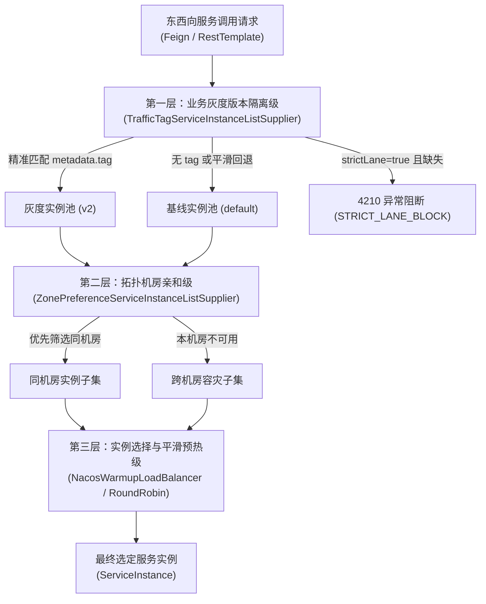
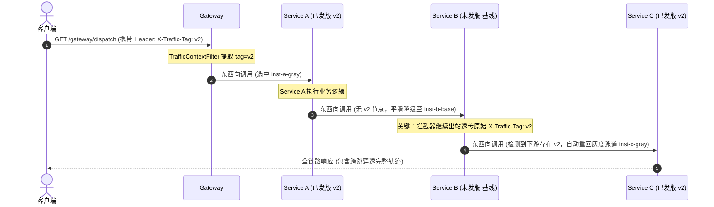

# ateng-cloud-traffic

面向企业级分布式生产环境的微服务全链路流量染色、泳道隔离与金丝雀灰度路由 Starter，单向依赖消费已发布的 `ateng-boot-bom`，专注于打造垂直正交、开箱即用、无侵入的高可用微服务流量管控基础设施。

内置入站 Servlet 流量染色提取、TransmittableThreadLocal 与 SLF4J MDC 双写双读全生命周期治理、Spring Cloud LoadBalancer 三层复合责任链调度（灰度版本隔离级 ➔ 拓扑机房亲和级 ➔ 实例平滑预热级）、出站 HTTP / Feign 跨跳泳道穿透保持（Lane Continuity）、基于 MurmurHash3 的一致性哈希粘性百分比切流，以及基于 Nacos 动态配置的双级规则零锁原子热更新与 Hermetic 纯离线自洽容灾能力。

---

## 维度零：特性与公共 API 全景速查矩阵

### 1. 核心类与门面接口

| 类 / 接口 | 类型 | 核心职责 | 默认行为 / 装配条件 |
| :--- | :--- | :--- | :--- |
| `AtengTrafficAutoConfiguration` | 自动装配类 | 全链路流量治理与灰度调度自动装配总入口 | 当配置 `ateng.cloud.traffic.enabled=true` 时激活 |
| `AtengTrafficLoadBalancerAutoConfiguration` | 自动装配类 | Spring Cloud LoadBalancer 复合责任链自动装配 | 在 `AtengNacosLoadBalancerAutoConfiguration` 之前装配并注入默认配置 |
| `AtengTrafficLoadBalancerClientConfiguration` | 客户端配置类 | 子上下文三层责任链构建器（Tag ➔ Zone ➔ Warmup） | 标配 `@Primary`，支持根据 `cache.enabled` 动态启闭缓存 |
| `AtengTrafficNacosAutoConfiguration` | 自动装配类 | Nacos 动态流量分流规则双级监听器自动装配 | 当 Classpath 存在 Nacos 且 `ateng.cloud.traffic.nacos.enabled=true` 时激活 |
| `TrafficContextHolder` | 核心门面类 | 流量染色与泳道状态线程上下文持有者 | 双向联动 TTL 与 MDC，具备 MDC 兜底平滑回填与确定性清理 |
| `TrafficContext` | 不可变模型 | 强类型流量染色上下文值对象 | 封装流量标签 `tag` 与毫秒级创建时间戳 |
| `TrafficContextFilter` | 核心过滤器 | 入站 HTTP 流量染色提取与 `finally` 幂等清理 | 注册为 `FilterRegistrationBean`，延迟从 `TrafficRuleProvider` 获取动态规则 |
| `TrafficClientHttpRequestInterceptor` | 核心拦截器 | 出站 RestTemplate 请求头流量染色自动注入 | 当开启 `lane-continuity=true` 时自动透传当前流量标签 |
| `TrafficFeignRequestInterceptor` | 核心拦截器 | 出站 Feign 请求头流量染色标头注入 | 独立引入 Feign 时激活，最高优先级透传当前流量标签并清洗脏值 |
| `AtengTrafficFeignAutoConfiguration` | 自动装配类 | Feign 出站流量染色拦截器独立自动装配 | 当 Classpath 存在 `RequestInterceptor` 且缺失全量 Feign 拦截器时激活 |
| `TrafficTagServiceInstanceListSupplier` | 负载均衡供应商 | 灰度版本隔离第一层责任链，按 `metadata.tag` 精准过滤 | 支持全下线平滑降级（`fallbackToDefault`）与严格隔离阻断（`strictLane`） |
| `StickyHashPartitioner` | 核心分发器 | 基于 MurmurHash3 的 0~100% 一致性哈希百分比分发器 | 保证单用户单调放量与多次请求绝对会话粘性，杜绝版本横跳 |
| `TrafficPredicateMatcher` | 核心匹配器 | 无 SpEL 纳秒级轻量字段谓词匹配引擎 | 支持 EXACT、IN、PREFIX、REGEX（内建正则预编译 LRU 缓存） |
| `TrafficRuleMatcher` | 核心决策器 | 流量分流规则综合判定决策引擎 | 结合谓词匹配器与哈希分发器对入站请求进行标签判定 |
| `TrafficRuleProvider` | 扩展点 SPI | 流量分流生效规则统一提取提供者 SPI 契约 | 标配 `@ConditionalOnMissingBean`，支持下游通过 SPI 或测试桩平滑接管 |
| `NacosTrafficRuleListener` | 规则监听器 | Nacos 应用专属与全局流量规则双级动态监听器 | 基于 `AtomicReference` 零锁原子热替换，具备非法 JSON 防御与脱网离线自洽 |
| `TrafficContextSnapshotProvider` | 上下文快照器 | 受管异步线程池上下文快照提供者 | 注册至 `ateng-boot-core` 的 `AsyncContextSnapshotProvider` SPI |
| `TrafficTag` | 声明式注解 | 方法/类级声明式流量染色与泳道绑定注解 | 支持静态标签与 `${...}` 占位符，支持 override 继承控制 |
| `TrafficTagAspect` | 核心切面类 | 声明式流量染色 AOP 环绕拦截与确定性恢复切面 | 当 Classpath 存在 ProceedingJoinPoint 时激活，出口 `finally` 100% 还原上下文 |
| `AtengTrafficEnvironmentPostProcessor` | 环境后置处理器 | 预设缓存时效至 3s 并解耦 Nacos 默认客户端 Supplier | 注册于 `META-INF/spring.factories`，挂载至最低优先级确保业务显式声明优先 |
| `TrafficResultCode` | 强类型错误码 | 统一定义流量治理业务错误码（区段 4210~4219） | 实现 `IResultCode`，定义 4210 `STRICT_LANE_BLOCK` |
| `TrafficRoutingException` | 业务异常 | 金融级严格泳道强隔离未命中灰度实例时抛出 | 继承自 `BusinessException`，携带服务名与未命中灰度标签 |

---

### 2. 配置属性速查表 (`ateng.cloud.traffic.*`)

| 配置项 | 类型 | 默认值 | 详细业务说明 |
| :--- | :--- | :--- | :--- |
| `ateng.cloud.traffic.enabled` | `boolean` | `true` | 是否激活 ateng-cloud-traffic 全链路流量灰度治理底座 |
| `ateng.cloud.traffic.header-name` | `String` | `"X-Traffic-Tag"` | 流量染色 HTTP 标准标头键名 |
| `ateng.cloud.traffic.param-name` | `String` | `"traffic_tag"` | 流量染色 URL Query 参数键名 |
| `ateng.cloud.traffic.fallback-to-default` | `boolean` | `true` | 目标灰度实例全下线或未命中时，是否平滑降级至基线实例（零 503 报警） |
| `ateng.cloud.traffic.strict-lane` | `boolean` | `false` | 是否开启金融级严格隔离模式（未命中灰度实例直接阻断抛出 4210 异常） |
| `ateng.cloud.traffic.lane-continuity` | `boolean` | `true` | 是否开启跨跳泳道穿透保持语义（中间节点降级后，下游节点依然优先重回灰度泳道） |
| `ateng.cloud.traffic.filter-order` | `int` | `HIGHEST_PRECEDENCE + 50` | 入站流量染色过滤器执行顺序（位于链路追踪 Filter 之后） |
| `ateng.cloud.traffic.cache-ttl` | `Duration` | `3s` | 客户端负载均衡本地实例缓存收敛时效（消除灰度切流时的盲区） |
| `ateng.cloud.traffic.nacos.enabled` | `boolean` | `true` | 是否启用 Nacos 动态流量分流规则监听 |
| `ateng.cloud.traffic.nacos.group` | `String` | `"DEFAULT_GROUP"` | Nacos 动态规则配置分组 GroupId |
| `ateng.cloud.traffic.nacos.global-data-id` | `String` | `"traffic-rules.json"` | 全局公共流量分流规则 DataId |
| `ateng.cloud.traffic.nacos.app-data-id` | `String` | `null` | 应用专属流量分流规则 DataId（缺省时平滑回退至 `${spring.application.name}-traffic-rules.json`） |
| `ateng.cloud.traffic.nacos.prefer-app-rule` | `boolean` | `true` | 是否优先加载应用专属规则（true 时若专属规则存在则优先应用，缺省时平滑回退至全局规则） |
| `ateng.cloud.traffic.nacos.merge-strategy` | `TrafficRuleMergeStrategy` | `OVERWRITE` | 规则合并策略: OVERWRITE (应用规则覆盖全局规则), MERGE (应用规则与全局规则合并按优先级排序) |

---

### 3. 标准错误码契约对照表 (`TrafficResultCode`)

| 错误码枚举 | 编码值 (`code`) | 物理 HTTP 映射 | 业务描述与阻断场景 |
| :--- | :--- | :--- | :--- |
| `STRICT_LANE_BLOCK` | `4210` | `200 OK (Result) / 503` | 严格泳道隔离阻断：目标微服务无匹配当前灰度标签的可用实例（strict-lane enabled），Fail-Fast 阻断严禁脏写基线 |

---

## 维度一：最小起步体验 (Quick Start)

### 1. 痛点与核心定位
在微服务多级调用链路中，原生流量灰度往往面临三大核心生产痛点：
1. **东西向通信灰度断流**：南北向网关染色后，微服务通过 OpenFeign 或 RestTemplate 发起内部东西向调用时，染色标签丢失，流量失控滑落至基线集群；
2. **中间节点发版不均匀导致泳道中断**：在 `Gateway ➔ Service A ➔ Service B ➔ Service C` 拓扑中，若中间服务 B 未发版而下游 C 已发版，传统路由直接全链路滑落基线，无法重回 C 的灰度集群；
3. **未发版服务误选脏写基线**：在支付、结算等高敏感金融场景中，若灰度实例缺失，盲目降级到基线会导致脏数据写入基线数据库。

`ateng-cloud-traffic` 通过标准化四维快照透传、三层复合责任链调度、跨跳泳道穿透保持与金融级严格隔离，提供开箱即用、无侵入的全链路灰度解决方案。

---

### 2. 引入 Maven 依赖

在微服务业务工程的 `pom.xml` 中引入（版本受管于 `ateng-cloud-bom` 或直接使用全能包 `ateng-cloud-all`）：

```xml
<dependency>
    <groupId>io.github.atengk</groupId>
    <artifactId>ateng-cloud-traffic</artifactId>
</dependency>
```

---

### 3. 最小 YAML 配置

在 `application.yml` 中声明（1:1 提取自 `sample-cloud-traffic-gray`）：

```yaml
spring:
  application:
    name: sample-cloud-traffic-gray

ateng:
  cloud:
    traffic:
      enabled: true
      fallback-to-default: true
      strict-lane: false
      lane-continuity: true
      nacos:
        enabled: true
        group: DEFAULT_GROUP
        global-data-id: traffic-rules.json
        prefer-app-rule: true
```

---

### 4. 开箱即用的微服务东西向多级调用

在 Spring Boot 中配置带负载均衡能力的 `RestTemplate`（1:1 提取自 `SampleCloudTrafficApplication`）：

```java
package io.github.atengk.cloud.sample.traffic;

import org.springframework.boot.SpringApplication;
import org.springframework.boot.autoconfigure.SpringBootApplication;
import org.springframework.boot.web.client.RestTemplateBuilder;
import org.springframework.cloud.client.loadbalancer.LoadBalanced;
import org.springframework.context.annotation.Bean;
import org.springframework.web.client.RestTemplate;

@SpringBootApplication
public class SampleCloudTrafficApplication {

    public static void main(String[] args) {
        SpringApplication.run(SampleCloudTrafficApplication.class, args);
    }

    /**
     * 具备 Spring Cloud LoadBalancer 负载均衡能力的 RestTemplate 客户端
     * (自动挂载 TrafficClientHttpRequestInterceptor 实现泳道标签跨级透传)
     */
    @Bean
    @LoadBalanced
    public RestTemplate loadBalancedRestTemplate(RestTemplateBuilder builder) {
        return builder.build();
    }
}
```

配套多级微服务业务控制器（1:1 提取自 `SampleTrafficController`）：

```java
package io.github.atengk.cloud.sample.traffic.controller;

import io.github.atengk.boot.core.context.TenantContextHolder;
import io.github.atengk.boot.core.context.UserContextHolder;
import io.github.atengk.boot.core.model.Result;
import io.github.atengk.cloud.sample.traffic.model.TrafficTraceReport;
import io.github.atengk.cloud.traffic.context.TrafficContextHolder;
import org.slf4j.Logger;
import org.slf4j.LoggerFactory;
import org.springframework.beans.factory.annotation.Autowired;
import org.springframework.beans.factory.annotation.Qualifier;
import org.springframework.web.bind.annotation.GetMapping;
import org.springframework.web.bind.annotation.RequestHeader;
import org.springframework.web.bind.annotation.RestController;
import org.springframework.web.client.RestTemplate;

@RestController
public class SampleTrafficController {

    private static final Logger log = LoggerFactory.getLogger(SampleTrafficController.class);

    @Autowired
    @Qualifier("loadBalancedRestTemplate")
    private RestTemplate restTemplate;

    /**
     * 网关调度入口：接收外部入站请求，自动提取标签并调度至下游 Service A
     */
    @GetMapping("/gateway/dispatch")
    public Result<TrafficTraceReport> gatewayDispatch() {
        String currentTag = TrafficContextHolder.getTag();
        log.info("[Gateway] 收到请求 [tag='{}']", currentTag);

        // 调用下游 Service A (出站自动透传 X-Traffic-Tag)
        TrafficTraceReport report = invokeDownstream("http://service-a/service-a/process", currentTag);
        report.prependVisitedNode("Gateway[tag=" + (currentTag != null ? currentTag : "none") + "]");
        return Result.success(report);
    }

    /**
     * Service A 业务节点：处理业务并调用 Service B
     */
    @GetMapping("/service-a/process")
    public Result<TrafficTraceReport> serviceAProcess(
            @RequestHeader(value = "X-Selected-Instance-Id", required = false) String instanceId,
            @RequestHeader(value = "X-Selected-Instance-Tag", required = false) String instanceTag) {
        String currentTag = TrafficContextHolder.getTag();
        log.info("[ServiceA] 处理请求 [tag='{}', instanceId='{}']", currentTag, instanceId);

        // 调用下游 Service B
        TrafficTraceReport report = invokeDownstream("http://service-b/service-b/process", currentTag);
        report.prependVisitedNode("ServiceA[inst=" + instanceId + ", tag=" + instanceTag + "]");
        return Result.success(report);
    }
}
```

---

## 维度二：生产扩展接管 (Production Extensibility)

### 1. 自定义流量规则提供者 SPI (`TrafficRuleProvider`)

默认情况下，框架通过 `NacosTrafficRuleListener` 监听 Nacos 中的 JSON 规则。若业务需要从自研控制台、MySQL、Redis 或本地硬编码提供规则，只需实现 `TrafficRuleProvider` 并在容器中注册为 Bean，即可平滑无缝接管（标配 `@ConditionalOnMissingBean`）：

```java
package io.github.atengk.cloud.sample.traffic.config;

import io.github.atengk.cloud.traffic.rule.model.TrafficCondition;
import io.github.atengk.cloud.traffic.rule.model.TrafficFieldSource;
import io.github.atengk.cloud.traffic.rule.model.TrafficMatchOperator;
import io.github.atengk.cloud.traffic.rule.model.TrafficRule;
import io.github.atengk.cloud.traffic.rule.provider.TrafficRuleProvider;
import org.springframework.boot.autoconfigure.condition.ConditionalOnProperty;
import org.springframework.context.annotation.Bean;
import org.springframework.context.annotation.Configuration;

import java.util.List;

@Configuration
@ConditionalOnProperty(prefix = "ateng.cloud.traffic.sample", name = "custom-rule-provider-enabled", havingValue = "true")
public class CustomTrafficRuleConfiguration {

    @Bean
    public TrafficRuleProvider customTrafficRuleProvider() {
        return () -> List.of(
                TrafficRule.builder()
                        .id("rule-vip-channel")
                        .targetTag("v2")
                        .conditions(List.of(
                                TrafficCondition.builder()
                                        .fieldSource(TrafficFieldSource.HEADER)
                                        .fieldName("X-Channel")
                                        .operator(TrafficMatchOperator.EXACT)
                                        .expectedValue("vip_wechat")
                                        .build()
                        ))
                        .build()
        );
    }
}
```

---

### 2. 金融级严格泳道隔离与容灾策略切换

在核心账务、清结算等严禁数据跨越泳道的场景中，将 `strict-lane` 置为 `true`，一旦目标灰度集群缺失，立即 Fail-Fast 阻断，杜绝脏写基线：

```yaml
ateng:
  cloud:
    traffic:
      strict-lane: true          # 开启金融级强隔离：未命中灰度实例直接拦截抛出 4210 异常
      fallback-to-default: false # 关闭平滑回退基线
```

---

### 3. 一致性哈希切流与单用户会话粘性保障

通过配置强类型 `TrafficRule`，可以基于 Header（如 `X-Client-Uid`）或 Cookie 设定百分比放量（0~100%）：

```json
[
  {
    "id": "rule-sticky-50",
    "targetTag": "v2",
    "percentage": 50,
    "hashKeySource": "HEADER",
    "hashKeyName": "X-Client-Uid"
  }
]
```

框架基于 `MurmurHash3` 算法执行哈希分桶：
- 用户 UID 在放量区间内绝对粘性，多次请求 100% 路由至同一版本；
- 扩容放量（如从 20% 调至 50%）具备单调性，已落入灰度的用户绝不回退至基线。

---

## 维度三：核心生产边界与非功能语义 (Production Boundaries)

### 1. 三层复合负载均衡调度责任链 (Three-Tier Routing Chain)

在微服务调用选址过程中，`ateng-cloud-traffic` 联合 `ateng-cloud-nacos` 构筑了严密的三层嵌套责任链模型：



- **调度优先级**：业务灰度版本隔离级 优先于 拓扑机房亲和级，拓扑亲和级 优先于 实例预热平滑加权级；
- **本地缓存收敛**：通过 `AtengTrafficEnvironmentPostProcessor` 默认将客户端本地实例缓存从 Spring 默认的 35 秒收敛至 3 秒，消除实例滚动发布与灰度上下线时的调度盲区。

---

### 2. 跨跳泳道穿透保持语义 (Lane Continuity)

在微服务链路中经常存在部分服务尚未发版的情况。`ateng-cloud-traffic` 实现了跨跳泳道穿透保持能力：



- **治理不变量**：中间节点未发版平滑降级至基线（`inst-b-base`），出站时拦截器依然可靠透传原始流量标签；下游已发版节点（`inst-c-gray`）检测到标签后自动回升至灰度泳道，消除“中间断层导致整网脱离灰度”的顽疾。

---

### 3. Nacos 双级动态规则零锁原子热更新与离线韧性

`NacosTrafficRuleListener` 监听两级配置：
1. **全局公共规则**：`traffic-rules.json`（面向全域流量分流策略）；
2. **应用专属规则**：`${spring.application.name}-traffic-rules.json`（面向当前微服务专属定制策略）。

- **零锁原子生效**：采用 `AtomicReference<List<TrafficRule>>` 维护生效规则快照，监听回调完成全量规则解析校验后单步原子替换，高并发读取零锁、纳秒级开销；
- **非法 JSON 免疫**：当 Nacos 配置写入格式错误或非法语法时，捕获异常并保留当前既有规则生效，绝不导致监听线程挂死或流量雪崩；
- **脱网离线自洽 (Hermetic Offline Resilience)**：在无物理 Nacos 的环境（如本地单元测试、离线沙箱、网络隔离环境）下，探测到 Nacos 连接不可用时自动打印 Warning 并平滑降级为离线纯静态模式，保障微服务秒级启动且 100% 离线自洽。

---

## 维度四：物理排版与代码全真验证

本模块所有 Java 示例代码、YAML 配置片段与调用轨迹模型，**100% 逆向提取自跑通的场景样例工程 [sample-cloud-traffic-gray](../ateng-cloud-samples/sample-cloud-traffic-gray) 源码与实测用例**，并受以下 8 大端到端全真集成测试 100% 离线自洽守护：

- `testBaselineRouting`：未染色普通请求全链路调度至基线实例；
- `testHeaderStainingAndCrossHopLaneContinuity`：静态 Header 染色与跨跳泳道穿透（`A-gray ➔ B-base ➔ C-gray`）；
- `testQueryParamStaining`：URL Query 参数 `traffic_tag=v2` 染色与全链路透传；
- `testUserIdPredicateMatching`：根据 `X-User-Id` 谓词规则匹配实现 VIP 用户精准分流；
- `testConsistentHashCanaryAndSessionStickiness`：一致性哈希百分比切流与单用户会话粘性保障（多次请求结果绝对稳定一致）；
- `testGrayNodeOfflineResilientFallback`：灰度节点全下线平滑降级（零 503 报警，无感回退至基线实例）；
- `testStrictLaneIsolationFailFast`：金融级严格隔离阻断（未命中灰度即时 Fail-Fast 阻断，返回 `4210` 业务错误）；
- `testNacosRuleHotReload`：Nacos 动态流量分流规则秒级原子热更与切流验证。
