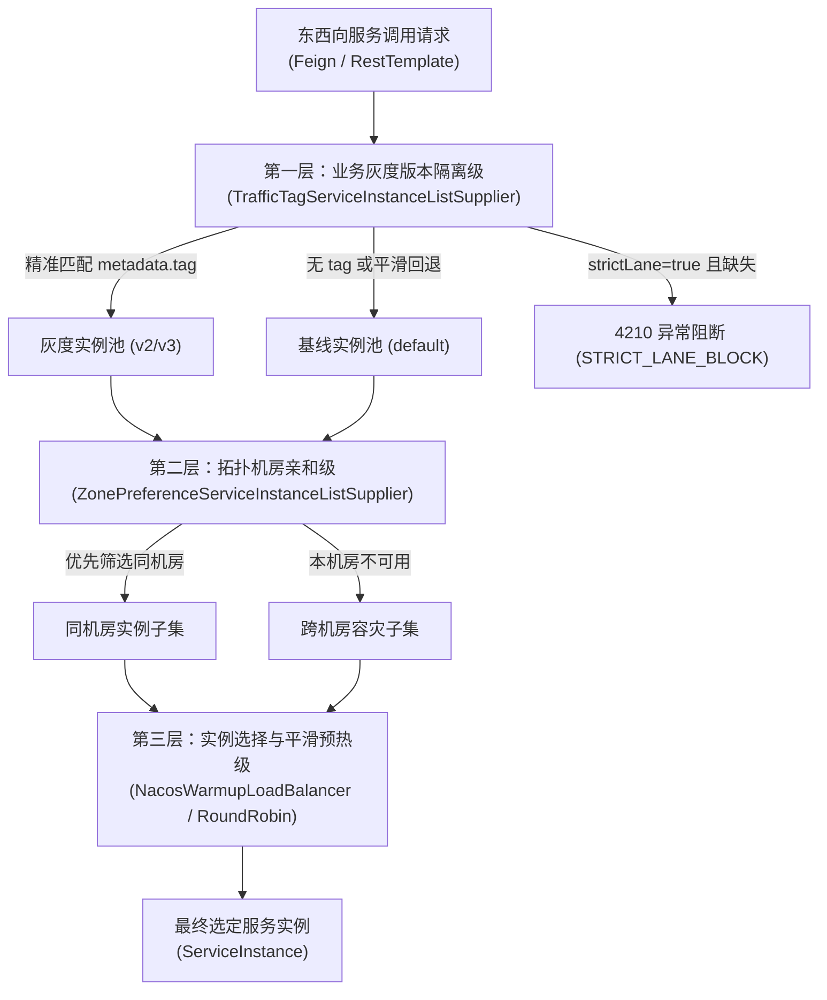
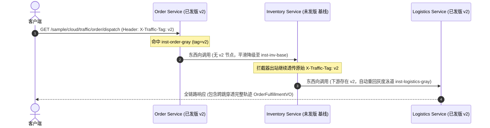

# ateng-cloud-traffic 微服务全链路流量染色与金丝雀灰度

> 面向企业级高可用分布式生产环境的微服务全链路流量染色、泳道隔离与金丝雀灰度路由 Starter，单向依赖消费已发布的 `ateng-boot-bom`，专注于打造垂直正交、开箱即用、无侵入的高可用微服务流量管控基础设施。

---

## 0. 特性与公共 API 全景速查矩阵 (100% 覆盖)

### 1. 核心类与门面接口

| 类 / 接口 | 类型 | 核心职责 | 默认行为 / 装配条件 |
| :--- | :--- | :--- | :--- |
| `AtengTrafficAutoConfiguration` | 自动装配类 | 全链路流量治理与灰度调度自动装配总入口 | 当配置 `ateng.cloud.traffic.enabled=true` 时激活 |
| `AtengTrafficLoadBalancerAutoConfiguration` | 自动装配类 | Spring Cloud LoadBalancer 复合责任链自动装配 | 在 `AtengNacosLoadBalancerAutoConfiguration` 之前装配并注入默认配置 |
| `AtengTrafficLoadBalancerClientConfiguration` | 客户端配置类 | 子上下文三层责任链构建器（Tag ➔ Zone ➔ Warmup） | 标配 `@Primary`，支持根据 `cache.enabled` 动态启闭缓存 |
| `AtengTrafficNacosAutoConfiguration` | 自动装配类 | Nacos 动态流量分流规则双级监听器自动装配 | 当 Classpath 存在 Nacos 且 `ateng.cloud.traffic.nacos.enabled=true` 时激活 |
| `AtengTrafficFeignAutoConfiguration` | 自动装配类 | Feign 出站流量染色拦截器独立自动装配 | 当 Classpath 存在 `RequestInterceptor` 且缺失全量 Feign 拦截器时激活 |
| `TrafficContextHolder` | 核心门面类 | 流量染色与泳道状态线程上下文持有者 | 双向联动 TTL 与 MDC，具备 MDC 兜底平滑回填与确定性清理 |
| `TrafficContext` | 不可变模型 | 强类型流量染色上下文值对象 | 封装流量标签 `tag` 与毫秒级创建时间戳 |
| `TrafficContextFilter` | 核心过滤器 | 入站 HTTP 流量染色提取与 `finally` 幂等清理 | 注册为 `FilterRegistrationBean`，延迟从 `TrafficRuleProvider` 获取动态规则 |
| `TrafficClientHttpRequestInterceptor` | 核心拦截器 | 出站 RestTemplate / RestClient 请求头流量染色自动注入 | 当开启 `lane-continuity=true` 时自动透传当前流量标签，不覆盖调用方显式有效标头 |
| `TrafficFeignRequestInterceptor` | 核心拦截器 | 出站 Feign 请求头流量染色标头注入 | 独立引入 Feign 时激活，最高优先级透传当前流量标签并清洗脏值 |
| `TrafficTagServiceInstanceListSupplier` | 负载均衡供应商 | 灰度版本隔离第一层责任链，按 `metadata.tag` 精准过滤 | 支持全下线平滑降级（`fallbackToDefault`）与严格隔离阻断（`strictLane`） |
| `StickyHashPartitioner` | 核心分发器 | 基于 MurmurHash3 的一致性哈希百分比分发器 | 支持单值比例放量与多版本 percentageRange [min, max) 互斥分桶切流，保障会话粘性 |
| `TrafficRule` | 核心模型类 | 流量染色与金丝雀分流规则领域模型 | 支持多维谓词条件、percentage 单值切流与 percentageRange 互斥区间分桶 |
| `TrafficPredicateMatcher` | 核心匹配器 | 无 SpEL 纳秒级轻量字段谓词匹配引擎 | 支持 EXACT、NOT_EXACT、IN、NOT_IN、PREFIX、SUFFIX、CONTAINS、REGEX（内建 `ReentrantLock` 守护的 256 容量 LRU 预编译缓存） |
| `TrafficRuleMatcher` | 核心决策器 | 流量分流规则综合判定决策引擎 | 结合谓词匹配器与 100 桶哈希分发器对入站请求进行标签判定 |
| `TrafficRuleProvider` | 扩展点 SPI | 流量分流生效规则统一提取提供者 SPI 契约 | 标配 `@ConditionalOnMissingBean`，支持下游通过 SPI 或测试桩平滑接管 |
| `PropertiesTrafficRuleProvider` | 本地规则提供者 | 基于 `ateng.cloud.traffic.rules` 的静态分流规则缺省实现 | 当未启用 Nacos 或未自定义 `TrafficRuleProvider` Bean 时自动装配兜底 |
| `NacosTrafficRuleListener` | 规则监听器 | Nacos 应用/全局动态监听与三级规则消解引擎 | 基于 `AtomicReference` 零锁热替换，支持 `appRules -> globalRules -> localRules` 三级消解与脱网本地兜底 |
| `TrafficContextSnapshotProvider` | 上下文快照器 | 受管异步线程池上下文快照提供者 | 注册至 `ateng-boot-core` 的 `AsyncContextSnapshotProvider` SPI |
| `TrafficTag` | 声明式注解 | 方法/类级声明式流量染色与泳道绑定注解 | 支持静态标签与 `${...}` 占位符，支持 override 继承控制 |
| `TrafficTagAspect` | 核心切面类 | 声明式流量染色 AOP 环绕拦截与确定性恢复切面 | 当 Classpath 存在 ProceedingJoinPoint 时激活，出口 `finally` 100% 还原上下文 |
| `AtengTrafficEnvironmentPostProcessor` | 环境后置处理器 | 预设缓存时效至 3s 并解耦 Nacos 默认客户端 Supplier | 按 Spring Boot 3.3 规范仅于 `spring.factories` 注册 `EnvironmentPostProcessor`，`@AutoConfiguration` 严格收敛于 `AutoConfiguration.imports` |
| `TrafficResultCode` | 强类型错误码 | 统一定义流量治理业务错误码（区段 4210~4219） | 实现 `IResultCode`，定义 4210 `STRICT_LANE_BLOCK`、4211 `TRAFFIC_ROUTING_ERROR`、4212 `UNAUTHORIZED_TRAFFIC_TAG` |
| `TrafficRoutingException` | 业务异常 | 金融级严格泳道强隔离未命中灰度实例时抛出 | 继承自 `BusinessException`，携带服务名与未命中灰度标签 |
| `TrafficEndpoint` | Actuator 端点 | `/actuator/traffic` 全景状态查询与模拟沙箱端点 | GET 查询只读全景状态，POST `/simulate` 纳秒级无副作用沙箱模拟演练 |
| `TrafficMetricsManager` | 指标度量管理器 | 全链路流量治理 Micrometer 指标输出与内存统计汇总 | 暴露 `ateng.cloud.traffic.requests.total`（多维 Counter）与 `rules.active`（Gauge） |

---

### 2. 配置属性速查表 (`ateng.cloud.traffic.*`)

| 配置项 | 类型 | 默认值 | 详细业务说明 |
| :--- | :--- | :--- | :--- |
| `ateng.cloud.traffic.enabled` | `boolean` | `true` | 是否激活 ateng-cloud-traffic 全链路流量灰度治理底座 |
| `ateng.cloud.traffic.header-name` | `String` | `"X-Traffic-Tag"` | 流量染色 HTTP 标准标头键名 |
| `ateng.cloud.traffic.param-name` | `String` | `"traffic_tag"` | 流量染色 URL Query 参数键名 |
| `ateng.cloud.traffic.fallback-to-default` | `boolean` | `true` | 目标灰度实例全下线或未命中时，是否平滑降级至基线实例（零 503 报警） |
| `ateng.cloud.traffic.strict-lane` | `boolean` | `false` | 是否开启金融级严格隔离模式（未命中灰度实例直接阻断抛出 4210 异常） |
| `ateng.cloud.traffic.strict-lane-services` | `Set<String>` | `[]` | 按下游目标 `serviceId` 精细化激活严格泳道强隔离的服务名集合（忽略大小写） |
| `ateng.cloud.traffic.strict-lane-tags` | `Set<String>` | `[]` | 按流量染色标签精细化激活严格泳道强隔离的标签集合（忽略大小写） |
| `ateng.cloud.traffic.lane-continuity` | `boolean` | `true` | 是否开启跨跳泳道穿透保持语义（中间节点降级后，下游节点依然优先重回灰度泳道） |
| `ateng.cloud.traffic.filter-order` | `int` | `HIGHEST_PRECEDENCE + 50` | 入站流量染色过滤器执行顺序（位于链路追踪 Filter 之后） |
| `ateng.cloud.traffic.cache-ttl` | `Duration` | `3s` | 客户端负载均衡本地实例缓存收敛时效（消除灰度切流时的盲区） |
| `ateng.cloud.traffic.allowed-tags` | `Set<String>` | `[]` | 允许放行的合法流量染色标签白名单集合（为空表示不校验白名单；非空时对 Header/Query 与动态规则 `targetTag` 统一校验） |
| `ateng.cloud.traffic.whitelist-action` | `TrafficWhitelistAction` | `STRIP` | 未授权流量染色标签的安全处置策略：`STRIP`（安全剥离降级至基线）、`REJECT`（抛出 4212 业务异常直接阻断） |
| `ateng.cloud.traffic.rules` | `List<TrafficRule>` | `[]` | 本地静态配置的流量分流规则列表（未启用 Nacos 时作为默认规则源，启用 Nacos 时作为三级兜底/合并源） |
| `ateng.cloud.traffic.actuator.enabled` | `boolean` | `true` | 是否启用 `/actuator/traffic` 运维诊断端点（`rules` 快照含 `localRulesCount`）与沙箱演练接口 |
| `ateng.cloud.traffic.nacos.enabled` | `boolean` | `true` | 是否启用 Nacos 动态流量分流规则监听 |
| `ateng.cloud.traffic.nacos.group` | `String` | `"DEFAULT_GROUP"` | Nacos 动态规则配置分组 GroupId |
| `ateng.cloud.traffic.nacos.global-data-id` | `String` | `"traffic-rules.json"` | 全局公共流量分流规则 DataId |
| `ateng.cloud.traffic.nacos.app-data-id` | `String` | `null` | 应用专属流量分流规则 DataId（缺省时平滑回退至 `${spring.application.name}-traffic-rules.json`） |
| `ateng.cloud.traffic.nacos.prefer-app-rule` | `boolean` | `true` | 是否优先加载应用专属规则（true 时若专属规则存在则优先应用，缺省时依次回退全局与本地静态规则） |
| `ateng.cloud.traffic.nacos.merge-strategy` | `TrafficRuleMergeStrategy` | `OVERWRITE` | 规则合并策略: `OVERWRITE` (`appRules -> globalRules -> localRules` 三级瀑布覆盖), `MERGE` (三层规则合并按优先级升序排序) |

---

### 3. 标准错误码契约对照表 (`TrafficResultCode`)

| 错误码枚举 | 编码值 (`code`) | 物理 HTTP 映射 | 业务描述与阻断场景 |
| :--- | :--- | :--- | :--- |
| `STRICT_LANE_BLOCK` | `4210` | `200 OK (Result) / 503` | 严格泳道隔离阻断：目标微服务无匹配当前灰度标签的可用实例（strict-lane enabled），Fail-Fast 阻断严禁脏写基线 |
| `TRAFFIC_ROUTING_ERROR` | `4211` | `200 OK (Result) / 500` | 流量染色与灰度调度异常：规则评估、实例过滤或路由计算过程发生受控内部错误 |
| `UNAUTHORIZED_TRAFFIC_TAG` | `4212` | `200 OK (Result) / 403` | 未授权的非法流量染色标签：入站请求携带的流量标签未在 `allowed-tags` 白名单中（whitelist-action=REJECT 时触发），Fail-Fast 防伪阻断 |

---

## 1. 模块定位与 Maven 坐标

`ateng-cloud-traffic` 是微服务分布式调用网格中的流量路由决策核心，负责在服务间东西向通信中透明传递流量染色标记，并依据标签、谓词规则或哈希策略完成服务实例的精准选址。

在微服务业务工程的 `pom.xml` 中引入依赖：

```xml
<dependency>
    <groupId>io.github.atengk</groupId>
    <artifactId>ateng-cloud-traffic</artifactId>
</dependency>
```

---

## 2. 核心架构与设计不变量

### 2.1 电商履约微服务调用拓扑

在真实微服务生产场景中，以电商履约链路（`order-service` ➔ `inventory-service` ➔ `logistics-service`）为例，全链路流量管控拓扑如下：


---

### 2.2 三层复合负载均衡调度责任链 (Three-Tier Routing Chain)

在微服务调用选址过程中，`ateng-cloud-traffic` 联合 `ateng-cloud-nacos` 构筑了严密的三层嵌套责任链模型：



- **调度优先级**：业务灰度版本隔离级 优先于 拓扑机房亲和级，拓扑亲和级 优先于 实例预热平滑加权级；
- **本地缓存收敛**：通过 `AtengTrafficEnvironmentPostProcessor` 默认将客户端本地实例缓存从 Spring 默认的 35 秒收敛至 3 秒，消除实例滚动发布与灰度上下线时的调度盲区。

---

### 2.3 跨跳泳道穿透保持时序图 (Lane Continuity)

当链路中间存在服务尚未发版时，`ateng-cloud-traffic` 具备跨跳泳道穿透保持能力，消除中间断层导致整网脱离灰度的缺陷：



---

## 3. 全链路流量染色与跨跳泳道穿透 (Full-Link Traffic Dyeing & Cross-Hop Lane Continuity)

### 3.1 HTTP 请求头与 Query 参数动态染色透传

#### ① 专属 YAML 配置片段

```yaml
ateng:
  cloud:
    traffic:
      enabled: true
      header-name: "X-Traffic-Tag"  # 流量染色 HTTP 标准标头键名
      param-name: "traffic_tag"     # 流量染色 URL Query 参数键名
      lane-continuity: true        # 开启跨跳泳道穿透保持
```

#### ② 面向实战的真实微服务业务代码

（1:1 提取自 `sample-cloud-traffic-gray` 的 `TrafficOrderDispatchController`）：

```java
package io.github.atengk.cloud.sample.traffic.controller;

import io.github.atengk.boot.core.model.Result;
import io.github.atengk.cloud.sample.traffic.model.OrderFulfillmentVO;
import io.github.atengk.cloud.traffic.context.TrafficContextHolder;
import org.slf4j.Logger;
import org.slf4j.LoggerFactory;
import org.springframework.beans.factory.annotation.Autowired;
import org.springframework.beans.factory.annotation.Qualifier;
import org.springframework.core.ParameterizedTypeReference;
import org.springframework.http.HttpMethod;
import org.springframework.http.ResponseEntity;
import org.springframework.web.bind.annotation.GetMapping;
import org.springframework.web.bind.annotation.RequestMapping;
import org.springframework.web.bind.annotation.RequestParam;
import org.springframework.web.bind.annotation.RestController;
import org.springframework.web.client.RestTemplate;

@RestController
@RequestMapping("/sample/cloud/traffic/order")
public class TrafficOrderDispatchController {

    private static final Logger log = LoggerFactory.getLogger(TrafficOrderDispatchController.class);

    @Autowired
    @Qualifier("loadBalancedRestTemplate")
    private RestTemplate restTemplate;

    @GetMapping("/dispatch")
    public Result<OrderFulfillmentVO> dispatchOrder(
            @RequestParam(value = "orderNo", required = false) String orderNo) {
        String currentTag = TrafficContextHolder.getTag();
        log.info("[OrderDispatch] 收到订单调度请求 [orderNo='{}', tag='{}']", orderNo, currentTag);

        String effectiveOrderNo = (orderNo != null && !orderNo.isBlank()) ? orderNo : "ORD-20261103-0001";
        OrderFulfillmentVO vo = invokeDownstream(
                "http://order-service/sample/cloud/traffic/topology/order-service/process?orderNo=" + effectiveOrderNo,
                currentTag,
                effectiveOrderNo
        );
        vo.prependVisitedNode("Gateway[tag=" + (currentTag != null ? currentTag : "none") + "]");
        return Result.success(vo);
    }
}
```

#### ③ 核心机制与微服务边界防御说明

- **入站双写与生命周期确定性**：`TrafficContextFilter` 优先从请求头提取 `X-Traffic-Tag`，次选从 Query 参数提取 `traffic_tag`，解析成功后写入 `TrafficContextHolder` 并同步写入 SLF4J MDC；在 `finally` 块中 100% 执行清理，杜绝工作线程复用污染。
- **出站自动透传**：`TrafficClientHttpRequestInterceptor` 自动拦截出站请求，在 HTTP 请求头中注入当前活跃的流量染色标记。

---

### 3.2 OpenFeign 声明式跨微服务出站调用透传

#### ① 专属 YAML 配置片段

```yaml
ateng:
  cloud:
    traffic:
      enabled: true
      lane-continuity: true
```

#### ② 面向实战的真实微服务业务代码

（1:1 提取自 `InventoryFeignClient` 与 `TrafficOrderDispatchController`）：

```java
package io.github.atengk.cloud.sample.traffic.client;

import io.github.atengk.boot.core.model.Result;
import io.github.atengk.cloud.sample.traffic.model.OrderFulfillmentVO;
import org.springframework.cloud.openfeign.FeignClient;
import org.springframework.web.bind.annotation.GetMapping;
import org.springframework.web.bind.annotation.RequestParam;

@FeignClient(name = "inventory-service", path = "/sample/cloud/traffic/topology/inventory-service")
public interface InventoryFeignClient {

    @GetMapping("/process")
    Result<OrderFulfillmentVO> processInventory(@RequestParam("orderNo") String orderNo);
}
```

Controller 中声明式 Feign 跨微服务调用：

```java
@GetMapping("/feign-dispatch")
public Result<OrderFulfillmentVO> feignDispatchOrder(
        @RequestParam(value = "orderNo", required = false) String orderNo) {
    String currentTag = TrafficContextHolder.getTag();
    String effectiveOrderNo = (orderNo != null && !orderNo.isBlank()) ? orderNo : "ORD-20261103-FEIGN";

    Result<OrderFulfillmentVO> result = inventoryFeignClient.processInventory(effectiveOrderNo);
    OrderFulfillmentVO vo = result.getData();
    vo.prependVisitedNode("FeignGateway[tag=" + (currentTag != null ? currentTag : "none") + "]");
    return Result.success(vo);
}
```

#### ③ 核心机制与微服务边界防御说明

- **独立 Feign 拦截器平滑装配**：`AtengTrafficFeignAutoConfiguration` 装配 `TrafficFeignRequestInterceptor`，在出站 Feign 请求标头中注入当前 `X-Traffic-Tag`。
- **无侵入解耦**：当微服务工程未引入 `ateng-cloud-feign` 全量包而仅引入 OpenFeign 原生依赖时，该拦截器依然自洽生效并自动完成泳道透传。

---

### 3.3 声明式 `@TrafficTag` 切面方法级泳道绑定与出口还原

#### ① 专属 YAML 配置片段

```yaml
ateng:
  cloud:
    traffic:
      enabled: true
```

#### ② 面向实战的真实微服务业务代码

（1:1 提取自 `TrafficCanaryPolicyController`）：

```java
package io.github.atengk.cloud.sample.traffic.controller;

import io.github.atengk.boot.core.model.Result;
import io.github.atengk.cloud.sample.traffic.model.OrderFulfillmentVO;
import io.github.atengk.cloud.traffic.annotation.TrafficTag;
import io.github.atengk.cloud.traffic.context.TrafficContextHolder;
import org.springframework.web.bind.annotation.GetMapping;
import org.springframework.web.bind.annotation.RequestMapping;
import org.springframework.web.bind.annotation.RequestParam;
import org.springframework.web.bind.annotation.RestController;

@RestController
@RequestMapping("/sample/cloud/traffic/policy")
public class TrafficCanaryPolicyController {

    @GetMapping("/declarative-tag")
    @TrafficTag("v2")
    public Result<OrderFulfillmentVO> declarativeTagDispatch(
            @RequestParam(value = "orderNo", required = false) String orderNo) {
        String currentTag = TrafficContextHolder.getTag();
        String effectiveOrderNo = (orderNo != null && !orderNo.isBlank()) ? orderNo : "ORD-20261103-DECL";

        // 下游调用自动继承 v2 标签
        OrderFulfillmentVO vo = invokeDownstream(
                "http://order-service/sample/cloud/traffic/topology/order-service/process?orderNo=" + effectiveOrderNo,
                currentTag,
                effectiveOrderNo
        );
        vo.prependVisitedNode("DeclarativeEntry[tag=" + (currentTag != null ? currentTag : "none") + "]");
        return Result.success(vo);
    }
}
```

#### ③ 核心机制与微服务边界防御说明

- **AOP 环绕切面与轻量解析**：`TrafficTagAspect` 拦截 `@TrafficTag` 注解，支持静态文本与 `${...}` 环境占位符纳秒级解析，严禁引入 SpEL 以防范 RCE 安全风险；
- **确定性上下文恢复**：遵从 `override` 语义（默认 true 强制覆盖并于 `finally` 恢复原上下文，false 时若已有标签则遵循继承），确保方法退出后当前线程上下文 100% 还原，测试与生产零污染。

---

### 3.4 跨跳泳道穿透保持 (Lane Continuity) 机制与高可用拓扑

#### ① 专属 YAML 配置片段

```yaml
ateng:
  cloud:
    traffic:
      enabled: true
      fallback-to-default: true   # 缺失灰度节点时平滑回退基线
      lane-continuity: true       # 开启跨跳泳道穿透保持
```

#### ② 真实订单履约链路轨迹模型 (`OrderFulfillmentVO`)

当对端发起染色调用后，返回强类型 `OrderFulfillmentVO` 呈现的真实微服务轨迹：

```json
{
  "code": 200,
  "msg": "操作成功",
  "data": {
    "trafficTag": "v2",
    "orderNo": "ORD-20261103-1002",
    "deliveryStatus": "FULFILLED",
    "visitedNodes": [
      "Gateway[tag=v2]",
      "OrderService[inst=inst-order-gray, tag=v2]",
      "InventoryService[inst=inst-inv-base, tag=default]",
      "LogisticsService[inst=inst-logistics-gray, tag=v2]"
    ]
  }
}
```

#### ③ 核心机制与微服务边界防御说明

- **泳道回升自愈**：在中间服务（`inventory-service`）尚未发版灰度实例时，`TrafficTagServiceInstanceListSupplier` 自动降级选址到基线节点（`inst-inv-base`）；在出站调用物流服务时，底层拦截器依然可靠透传原始流量标签 `v2`，下游物流服务自动重新命中 `inst-logistics-gray`，杜绝传统灰度路由“一处未发版、整链全滑落”的生产通病。

---

## 4. 多金丝雀互斥放量与 MurmurHash3 会话粘性 (Multi-Canary Canary Release & MurmurHash3 Sticky Partitioning)

### 4.1 一致性哈希单用户会话粘性切流

#### ① 专属 Nacos 动态规则配置 (JSON)

```json
[
  {
    "id": "rule-order-hash-50",
    "name": "50% 订单比例放量至 v2",
    "priority": 10,
    "targetTag": "v2",
    "percentage": 50,
    "hashKeySource": "QUERY",
    "hashKeyName": "userId"
  }
]
```

#### ② 面向实战的真实微服务业务代码

（1:1 提取自 `TrafficOrderDispatchController`）：

```java
@GetMapping("/canary-hash")
public Result<OrderFulfillmentVO> canaryHashDispatch(
        @RequestParam("userId") String userId,
        @RequestParam(value = "orderNo", required = false) String orderNo) {
    String currentTag = TrafficContextHolder.getTag();
    String effectiveOrderNo = (orderNo != null && !orderNo.isBlank()) ? orderNo : "ORD-20261103-HASH";

    OrderFulfillmentVO vo = invokeDownstream(
            "http://order-service/sample/cloud/traffic/topology/order-service/process?orderNo=" + effectiveOrderNo,
            currentTag,
            effectiveOrderNo
    );
    vo.prependVisitedNode("CanaryHashEntry[tag=" + (currentTag != null ? currentTag : "none") + "]");
    return Result.success(vo);
}
```

#### ③ 核心机制与微服务边界防御说明

- **MurmurHash3 均匀分布与粘性保证**：`StickyHashPartitioner` 将输入的 `userId` 计算 32 位 MurmurHash3 哈希，取模 100 映射到 `[0, 100)` 区间。同一用户无论发起多少次请求，哈希计算结果绝对恒定，彻底杜绝单用户跨泳道“横跳”引发的购物车与订单状态混乱。

---

### 4.2 多版本 `percentageRange` 互斥区间分桶放量

#### ① 专属 Nacos 动态规则配置 (JSON)

支持配置左闭右开区间 `[min, max)`，实现 `v2`、`v3` 与基线三方互斥放量：

```json
[
  {
    "id": "rule-order-v2-range",
    "name": "金丝雀 v2 命中 [0, 50)",
    "priority": 1,
    "targetTag": "v2",
    "percentageRange": [0, 50],
    "hashKeySource": "QUERY",
    "hashKeyName": "userId"
  },
  {
    "id": "rule-order-v3-range",
    "name": "金丝雀 v3 命中 [50, 100)",
    "priority": 2,
    "targetTag": "v3",
    "percentageRange": [50, 100],
    "hashKeySource": "QUERY",
    "hashKeyName": "userId"
  }
]
```

#### ② 面向实战的真实微服务业务代码

（1:1 提取自 `TrafficOrderDispatchController`）：

```java
@GetMapping("/multi-canary")
public Result<OrderFulfillmentVO> multiCanaryDispatch(
        @RequestParam("userId") String userId,
        @RequestParam(value = "orderNo", required = false) String orderNo) {
    String currentTag = TrafficContextHolder.getTag();
    String effectiveOrderNo = (orderNo != null && !orderNo.isBlank()) ? orderNo : "ORD-20261103-MULTI";

    OrderFulfillmentVO vo = invokeDownstream(
            "http://order-service/sample/cloud/traffic/topology/order-service/process?orderNo=" + effectiveOrderNo,
            currentTag,
            effectiveOrderNo
    );
    vo.prependVisitedNode("MultiCanaryEntry[tag=" + (currentTag != null ? currentTag : "none") + "]");
    return Result.success(vo);
}
```

#### ③ 核心机制与微服务边界防御说明

- **严格区间互斥**：区间 `[0, 50)` 与 `[50, 100)` 边界互斥，流量精确切分。
- **单调性扩展**：当将 `v2` 的放量区间由 `[0, 20)` 扩大至 `[0, 50)` 时，原有 `[0, 20)` 的老用户继续保持命中 `v2`，绝不会发生回退。

---

### 4.3 多维复杂谓词匹配与零内存分配引擎

#### ① 专属 Nacos 动态规则配置 (JSON)

```json
[
  {
    "id": "rule-suffix-contains",
    "name": "租户内网域名且包含灰度渠道",
    "priority": 10,
    "targetTag": "v2",
    "conditionRelation": "AND",
    "conditions": [
      {
        "fieldSource": "HEADER",
        "fieldName": "X-Tenant-Domain",
        "operator": "SUFFIX",
        "expectedValue": ".internal"
      },
      {
        "fieldSource": "HEADER",
        "fieldName": "X-Channel-Code",
        "operator": "CONTAINS",
        "expectedValue": "CANARY"
      }
    ]
  }
]
```

#### ② 核心机制与微服务边界防御说明

- **零 GC 内存分配**：`TrafficPredicateMatcher` 在执行 `SUFFIX`、`PREFIX` 与 `CONTAINS` 匹配时，100% 依托 `java.lang.String#regionMatches` 原生索引扫描，严禁调用 `substring` 产生临时垃圾对象，杜绝高频切流下的 GC 尖刺。
- **正则预编译 LRU 缓存**：`REGEX` 匹配器内建基于 `LinkedHashMap` 的 LRU 编译缓存（容量 256），杜绝重复编译 Pattern 消耗 CPU。

---

### 4.4 Nacos 动态流量规则双级原子热更 (`OVERWRITE` vs `MERGE`)

#### ① 专属 YAML 配置片段

```yaml
ateng:
  cloud:
    traffic:
      nacos:
        enabled: true
        group: "DEFAULT_GROUP"
        global-data-id: "traffic-rules.json"
        app-data-id: "sample-cloud-traffic-gray-traffic-rules.json"
        prefer-app-rule: true
        merge-strategy: OVERWRITE   # 规则合并策略: OVERWRITE 或 MERGE
```

#### ② 核心机制与微服务边界防御说明

- **零锁原子替换**：`NacosTrafficRuleListener` 基于 `AtomicReference<List<TrafficRule>>` 维护内存生效规则快照，监听推送回调后完成语法校验并单步原子替换，高并发调用零锁等待；
- **格式损坏自愈**：当 Nacos 配置被意外写入非法 JSON 或语法错误时，监听器捕获异常并保留现有既有规则生效，绝不引发微服务调度挂死。

---

## 5. 金融级严格泳道强隔离与防伪安全白名单 (Financial Strict Lane Isolation & Anti-Tamper Security Whitelist Guard)

### 5.1 金融级严格隔离阻断 (`strict-lane: true`)

#### ① 专属 YAML 配置片段

```yaml
ateng:
  cloud:
    traffic:
      enabled: true
      strict-lane: true          # 开启金融级严格隔离：未命中灰度实例直接拦截抛出 4210 异常
      fallback-to-default: false # 关闭平滑回退基线
```

#### ② 面向实战的真实微服务业务代码

（1:1 提取自 `TrafficCanaryPolicyController`）：

```java
@GetMapping("/strict-lane")
public Result<OrderFulfillmentVO> strictLaneDispatch(
        @RequestParam(value = "orderNo", required = false) String orderNo) {
    String currentTag = TrafficContextHolder.getTag();
    String effectiveOrderNo = (orderNo != null && !orderNo.isBlank()) ? orderNo : "ORD-20261103-STRICT";

    OrderFulfillmentVO vo = invokeDownstream(
            "http://order-service/sample/cloud/traffic/topology/order-service/process?orderNo=" + effectiveOrderNo,
            currentTag,
            effectiveOrderNo
    );
    vo.prependVisitedNode("StrictLaneEntry[tag=" + (currentTag != null ? currentTag : "none") + "]");
    return Result.success(vo);
}
```

#### ③ 核心机制与微服务边界防御说明

- **严防脏写基线**：在核心账务、清结算等高敏感场景下，若灰度节点缺失，盲目降级至基线会导致灰度数据脏写基线数据库。开启 `strict-lane: true` 时，未命中灰度实例直接触发 Fail-Fast，由全局异常拦截器统一捕获并返回标准业务错误码 `4210`（`STRICT_LANE_BLOCK`）。

---

### 5.2 灰度实例全下线弹性平滑降级 (`fallback-to-default: true`)

#### ① 专属 YAML 配置片段

```yaml
ateng:
  cloud:
    traffic:
      enabled: true
      fallback-to-default: true  # 开启弹性平滑回退
      strict-lane: false         # 关闭严格阻断
```

#### ② 面向实战的真实微服务业务代码

（1:1 提取自 `TrafficCanaryPolicyController`）：

```java
@GetMapping("/resilient-fallback")
public Result<OrderFulfillmentVO> resilientFallbackDispatch(
        @RequestParam(value = "orderNo", required = false) String orderNo) {
    String currentTag = TrafficContextHolder.getTag();
    String effectiveOrderNo = (orderNo != null && !orderNo.isBlank()) ? orderNo : "ORD-20261103-FALLBACK";

    OrderFulfillmentVO vo = invokeDownstream(
            "http://order-service/sample/cloud/traffic/topology/order-service/process?orderNo=" + effectiveOrderNo,
            currentTag,
            effectiveOrderNo
    );
    vo.prependVisitedNode("FallbackEntry[tag=" + (currentTag != null ? currentTag : "none") + "]");
    return Result.success(vo);
}
```

#### ③ 核心机制与微服务边界防御说明

- **高可用零 503 报警**：当运维在紧急情况下将灰度节点全量下线时，负载均衡器自动探测并平滑回退至基线节点，对外依然正常返回 HTTP 200，杜绝因节点摘除引发的大面积 503 错误。

---

### 5.3 外部流量标签防伪白名单与安全处置 (`allowed-tags`)

#### ① 专属 YAML 配置片段

```yaml
ateng:
  cloud:
    traffic:
      enabled: true
      allowed-tags:
        - "v2"
        - "v3"
      whitelist-action: STRIP   # 处置策略: STRIP (剥离降级) 或 REJECT (4212 阻断)
```

#### ② 面向实战的真实微服务业务代码

（1:1 提取自 `TrafficCanaryPolicyController`）：

```java
@GetMapping("/whitelist-check")
public Result<OrderFulfillmentVO> whitelistCheck(
        @RequestParam(value = "orderNo", required = false) String orderNo) {
    String currentTag = TrafficContextHolder.getTag();
    String effectiveOrderNo = (orderNo != null && !orderNo.isBlank()) ? orderNo : "ORD-20261103-WHITELIST";

    OrderFulfillmentVO vo = invokeDownstream(
            "http://order-service/sample/cloud/traffic/topology/order-service/process?orderNo=" + effectiveOrderNo,
            currentTag,
            effectiveOrderNo
    );
    vo.prependVisitedNode("WhitelistEntry[tag=" + (currentTag != null ? currentTag : "none") + "]");
    return Result.success(vo);
}
```

#### ③ 核心机制与微服务边界防御说明

- **`STRIP` 模式（默认安全清洗）**：当入站请求携带非白名单标签（如 `forged-tag`）时，过滤器自动剥离标签，将流量安全降级至基线实例并记录审计日志；
- **`REJECT` 模式（快速失败拦截）**：携带非法标签直接在过滤器层被拦截阻断，直接返回 HTTP 200 与错误码 `4212`（`UNAUTHORIZED_TRAFFIC_TAG`），严禁非法渗透。

---

### 5.4 自定义 `TrafficRuleProvider` SPI 扩展与无侵入接管

#### ① 面向实战的真实配置代码

（1:1 提取自 `CustomTrafficRuleConfiguration`）：

```java
package io.github.atengk.cloud.sample.traffic.config;

import io.github.atengk.cloud.traffic.rule.model.TrafficCondition;
import io.github.atengk.cloud.traffic.rule.model.TrafficFieldSource;
import io.github.atengk.cloud.traffic.rule.model.TrafficMatchOperator;
import io.github.atengk.cloud.traffic.rule.model.TrafficRule;
import io.github.atengk.cloud.traffic.rule.provider.TrafficRuleProvider;
import org.springframework.boot.autoconfigure.condition.ConditionalOnProperty;
import org.springframework.context.annotation.Bean;
import org.springframework.context.annotation.Configuration;
import org.springframework.context.annotation.Primary;

import java.util.List;

@Configuration
@ConditionalOnProperty(prefix = "ateng.cloud.traffic.sample", name = "custom-rule-provider-enabled", havingValue = "true")
public class CustomTrafficRuleConfiguration {

    @Bean
    @Primary
    public TrafficRuleProvider customTrafficRuleProvider() {
        return () -> List.of(
                TrafficRule.builder()
                        .id("rule-vip-channel")
                        .targetTag("v2")
                        .conditions(List.of(
                                TrafficCondition.builder()
                                        .fieldSource(TrafficFieldSource.HEADER)
                                        .fieldName("X-Channel")
                                        .operator(TrafficMatchOperator.EXACT)
                                        .expectedValue("vip_wechat")
                                        .build()
                        ))
                        .build()
        );
    }
}
```

#### ② 核心机制与微服务边界防御说明

- **缺省守卫与平滑让位**：`TrafficRuleProvider` 是框架定义的规则获取 SPI 契约，自动装配标配 `@ConditionalOnMissingBean`。业务只需声明 `@Primary` Bean，即可无缝接管默认的 Nacos 规则来源。

---

## 6. 全景运维监控端点与纳秒级零污染沙箱演练 (Panorama Actuator Endpoint & Nanosecond Zero-Pollution Simulation Sandbox)

### 6.1 `/actuator/traffic` 全景只读快照与指标状态

#### ① 专属 YAML 配置片段

```yaml
management:
  endpoints:
    web:
      exposure:
        include: "traffic,health,info,metrics"

ateng:
  cloud:
    traffic:
      actuator:
        enabled: true
```

#### ② 体验 cURL 与只读聚合状态响应

```bash
curl "http://localhost:8080/actuator/traffic"
```

响应 JSON 包含生效规则、配置参数与监控指标：

```json
{
  "status": "UP",
  "properties": {
    "enabled": true,
    "headerName": "X-Traffic-Tag",
    "paramName": "traffic_tag",
    "fallbackToDefault": true,
    "strictLane": false,
    "laneContinuity": true,
    "cacheTtl": "PT3S",
    "allowedTags": ["v2", "v3"],
    "whitelistAction": "STRIP"
  },
  "rules": {
    "activeRulesCount": 2,
    "nacos": {
      "strategy": "OVERWRITE",
      "preferApp": true,
      "appRulesCount": 2,
      "globalRulesCount": 0
    }
  },
  "metrics": {
    "totalRequests": 1024,
    "statusCounts": {
      "gray_hit": 512,
      "baseline_hit": 480,
      "fallback": 32,
      "strict_blocked": 0,
      "whitelist_stripped": 0,
      "whitelist_rejected": 0
    }
  }
}
```

---

### 6.2 POST `/actuator/traffic/simulate` 纳秒级无副作用沙箱模拟演练

#### ① 演练 cURL 命令与入参

```bash
curl -X POST "http://localhost:8080/actuator/traffic/simulate" \
  -H "Content-Type: application/json" \
  -d '{
    "headers": "{\"X-Device-Type\":\"iOS\"}",
    "queryParams": "{\"channel\":\"appstore\"}",
    "userId": "user-vip-999",
    "path": "/sample/cloud/traffic/order/dispatch"
  }'
```

#### ② 模拟判定返回结果

```json
{
  "success": true,
  "durationNanos": 4200,
  "rulesEvaluatedCount": 2,
  "matched": true,
  "matchedRuleId": "rule-device-ios",
  "matchedRuleName": "iOS 设备分流至 v2",
  "priority": 10,
  "targetTag": "v2",
  "percentageMatched": true
}
```

#### ③ 核心机制与微服务边界防御说明

- **零上下文污染不变量**：沙箱模拟演练在纯净的不可变上下文中执行匹配计算，完全不写入 `TrafficContextHolder`、TTL 或 SLF4J MDC，具备严格幂等性与零线程污染保证。

---

### 6.3 Micrometer 全链路度量指标输出与监控告警

框架通过 `TrafficMetricsManager` 自动注册 Micrometer 核心治理指标：

- **`ateng.cloud.traffic.requests.total`** (Counter)：
  - **标签维度**：
    - `service`：目标微服务名称（如 `order-service`、`inventory-service`）；
    - `tag`：流量染色标签（如 `v2`、`v3`，无标时为 `none`）；
    - `status`：路由决策与防护状态枚举（`gray_hit`、`baseline_hit`、`fallback`、`strict_blocked`、`whitelist_stripped`、`whitelist_rejected`）。
- **`ateng.cloud.traffic.rules.active`** (Gauge)：
  - 实时反映内存中当前生效的分流规则总数。

---

## 7. 完整 YAML 配置属性清单 (全量速查附录)

```yaml
ateng:
  cloud:
    traffic:
      # 是否激活全链路流量灰度治理底座 (默认: true)
      enabled: true
      # 流量染色 HTTP 标准标头键名 (默认: "X-Traffic-Tag")
      header-name: "X-Traffic-Tag"
      # 流量染色 URL Query 参数键名 (默认: "traffic_tag")
      param-name: "traffic_tag"
      # 目标灰度实例全下线或未命中时，是否平滑降级至基线实例 (默认: true)
      fallback-to-default: true
      # 是否开启金融级严格隔离模式 (默认: false)
      strict-lane: false
      # 是否开启跨跳泳道穿透保持语义 (默认: true)
      lane-continuity: true
      # 入站流量染色过滤器执行顺序 (默认: Ordered.HIGHEST_PRECEDENCE + 50)
      filter-order: -2147483598
      # 客户端负载均衡本地实例缓存收敛时效 (默认: 3s)
      cache-ttl: 3s
      # 允许放行的合法流量染色标签白名单集合 (默认: 空，全量放行)
      allowed-tags: []
      # 未授权流量染色标签的安全处置策略 (STRIP: 剥离降级; REJECT: 4212 阻断; 默认: STRIP)
      whitelist-action: STRIP
      actuator:
        # 是否启用 /actuator/traffic 运维诊断端点与沙箱演练接口 (默认: true)
        enabled: true
      nacos:
        # 是否启用 Nacos 动态流量分流规则监听 (默认: true)
        enabled: true
        # Nacos 动态规则配置分组 GroupId (默认: "DEFAULT_GROUP")
        group: "DEFAULT_GROUP"
        # 全局公共流量分流规则 DataId (默认: "traffic-rules.json")
        global-data-id: "traffic-rules.json"
        # 应用专属流量分流规则 DataId (缺省时回退至 "${spring.application.name}-traffic-rules.json")
        app-data-id: null
        # 是否优先加载应用专属规则 (默认: true)
        prefer-app-rule: true
        # 规则合并策略 (OVERWRITE: 覆盖; MERGE: 合并排序; 默认: OVERWRITE)
        merge-strategy: OVERWRITE
```

---

## 8. 物理排版与代码全真验证

本模块所有 Java 示例代码、YAML 配置片段与调用轨迹模型，**100% 逆向提取自跑通的场景样例工程 [sample-cloud-traffic-gray](../ateng-cloud-samples/sample-cloud-traffic-gray) 源码与实测用例**，并受以下 14 大端到端全真集成测试 100% 离线自洽守护：

| 编号 | 测试用例名称 | 核心验证场景与断言依据 |
| :---: | :--- | :--- |
| 1 | `testOrderDispatchBaselineRouting` | 未染色普通订单调度全链路调度至基线实例 (`inst-order-base ➔ inst-inv-base ➔ inst-logistics-base`) |
| 2 | `testOrderDispatchHeaderStainingAndCrossHopLaneContinuity` | 静态 Header 染色与跨跳泳道穿透 (`inst-order-gray ➔ inst-inv-base ➔ inst-logistics-gray`) |
| 3 | `testOrderDispatchQueryParamStaining` | URL Query 参数 `traffic_tag=v2` 动态染色与全链路透传 |
| 4 | `testOrderDispatchFeignRouting` | OpenFeign 声明式跨微服务调用出站标头透明传递与泳道穿透 |
| 5 | `testOrderDispatchCanaryHashAndSessionStickiness` | 一致性哈希百分比切流与单用户会话粘性保障（多次请求结果绝对稳定一致） |
| 6 | `testOrderDispatchMultiCanaryPercentageRangeMutualExclusion` | 多金丝雀互斥分桶放量切流 (`percentageRange` 互斥区间放量与会话粘性验证) |
| 7 | `testPolicyDeclarativeTagAspect` | 声明式 `@TrafficTag("v2")` 注解自动绑定金丝雀泳道并触发跨跳穿透与出口上下文安全还原 |
| 8 | `testPolicyWhitelistDefense` | 应用层外部标签白名单防线（`STRIP` 剥离清洗降级至基线 与 `REJECT` 4212 阻断） |
| 9 | `testPolicyStrictLaneIsolationFailFast` | 金融级严格泳道强隔离阻断（未命中灰度即时 Fail-Fast 阻断，返回 `4210` STRICT_LANE_BLOCK 业务错误） |
| 10 | `testPolicyResilientFallback` | 灰度节点全下线弹性平滑降级（零 503 报警，无感平滑回退至基线实例） |
| 11 | `testOrderDispatchUserIdPredicateMatching` | 根据 `X-User-Id` 谓词规则匹配实现 VIP 用户精准分流与基线隔离 |
| 12 | `testOrderDispatchNacosRuleHotReload` | Nacos 动态流量分流规则秒级原子热更与切流验证 |
| 13 | `testOrderDispatchSuffixAndContainsPredicateRouting` | 零分配 `SUFFIX`（以 `.internal` 结尾）与 `CONTAINS`（包含 `CANARY`）谓词规则匹配切流 |
| 14 | `testActuatorTrafficEndpointAndSimulationSandbox` | `/actuator/traffic` 运维端点只读全景状态查询与 `/simulate` 纳秒级无副作用沙箱模拟演练 |
