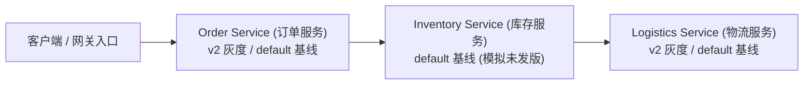
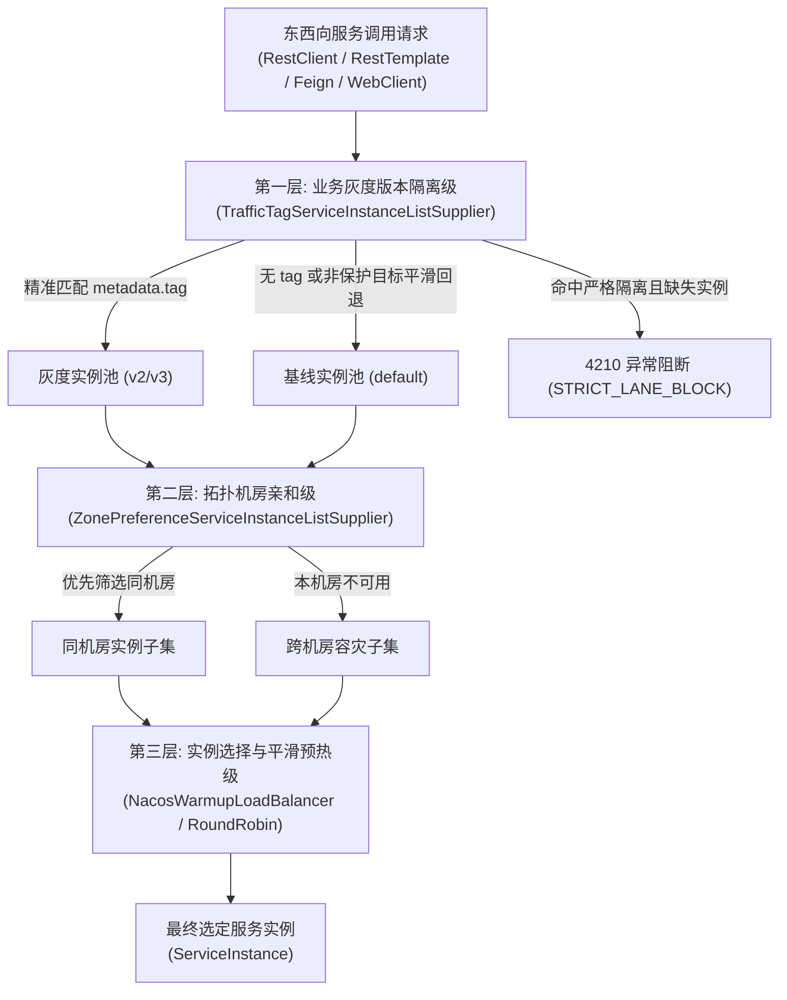
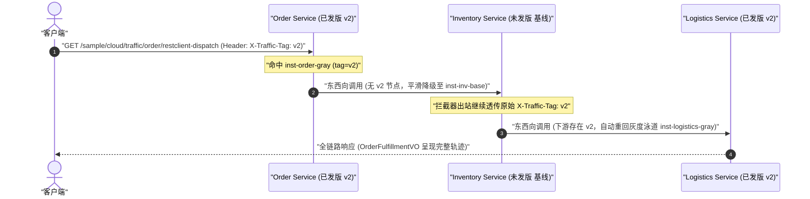

# ateng-cloud-traffic 微服务全链路流量染色与金丝雀灰度

> 面向企业级高可用分布式生产环境的微服务全链路流量染色、多粒度泳道隔离、双栈规则评估与金丝雀灰度路由 Starter，单向依赖消费已发布的 `ateng-boot-bom`，专注于打造垂直正交、开箱即用、无侵入的高可用微服务流量管控基础设施。

---

## 0. 特性与公共 API 全景速查矩阵 (100% 覆盖)

### 1. 核心类、门面与扩展模型 (`45` 个公共类型 100% 全量覆盖)

| 类 / 接口 / 枚举 | 类型 | 核心职责 | 默认行为 / 装配条件 |
| :--- | :--- | :--- | :--- |
| `AtengTrafficAutoConfiguration` | 自动装配类 | 全链路流量治理、Servlet 过滤器与同步客户端自动装配总入口 | 注册于 `AutoConfiguration.imports`，`ateng.cloud.traffic.enabled=true`（默认）激活 |
| `AtengTrafficReactiveAutoConfiguration` | 自动装配类 | WebFlux 响应式过滤器与 `WebClientCustomizer` 自动装配 | 仅在 `REACTIVE` 环境且存在 `WebFilter`/`WebClient` 时激活，与 Servlet 物理隔离 |
| `AtengTrafficLoadBalancerAutoConfiguration` | 自动装配类 | Spring Cloud LoadBalancer 复合责任链自动装配 | 在 `AtengNacosLoadBalancerAutoConfiguration` 之前装配并注入默认客户端配置 |
| `AtengTrafficLoadBalancerClientConfiguration` | 客户端配置类 | 子上下文三层责任链构建器（Tag ➔ Zone ➔ Warmup） | 标配 `@Primary`，支持根据 `cache.enabled` 动态启闭缓存 |
| `AtengTrafficNacosAutoConfiguration` | 自动装配类 | Nacos 动态流量分流规则双级监听器自动装配 | 存在 `NacosTemplate` 且 `ateng.cloud.traffic.nacos.enabled=true` 时激活 |
| `AtengTrafficFeignAutoConfiguration` | 自动装配类 | Feign 出站流量染色拦截器独立自动装配 | 存在 `feign.RequestInterceptor` 且缺失全量 Feign 拦截器时激活 |
| `AtengTrafficEnvironmentPostProcessor` | 环境后置处理器 | 预设客户端实例缓存 `cache-ttl` 至 `3s` 并解耦 Nacos 默认客户端 Supplier | 声明于 `EnvironmentPostProcessor.imports`（兼容 Spring Boot 3.3 于 `spring.factories` 仅保留该条目），`@AutoConfiguration` 收敛于 `AutoConfiguration.imports` |
| `AtengTrafficProperties` | 强类型配置类 | `ateng.cloud.traffic.*` 主配置属性与服务/标签级严格隔离判断原语 | 绑定 `header-name`、`strict-lane-services`、`strict-lane-tags`、`rules` 等 |
| `TrafficNacosProperties` | 强类型配置类 | `ateng.cloud.traffic.nacos.*` Nacos 双级监听与合并策略属性 | 绑定 `group`、`global-data-id`、`app-data-id`、`prefer-app-rule`、`merge-strategy` |
| `TrafficActuatorProperties` | 强类型配置类 | `ateng.cloud.traffic.actuator.*` 诊断与沙箱端点开关配置 | 默认 `enabled=true` |
| `TrafficWhitelistAction` | 安全策略枚举 | 未授权流量染色标签的安全处置策略枚举 | 定义 `STRIP`（剥离降级基线，默认）与 `REJECT`（4212 快速阻断） |
| `TrafficConstants` | 公共常量类 | 流量标头、Query 参数、配置前缀与基线归一化常量集中定义 | `HEADER_TRAFFIC_TAG="X-Traffic-Tag"`、`PARAM_TRAFFIC_TAG="traffic_tag"` 等 |
| `TrafficResultCode` | 强类型错误码 | 实现 `IResultCode`，统一定义 `4210~4219` 流量治理业务错误码 | 含 `4210`、`4211`、`4212`（详见第 `0.3` 节对照表） |
| `TrafficRoutingException` | 受管业务异常 | 继承 `BusinessException`，严格泳道隔离未命中灰度实例时抛出 | 携带目标 `serviceId` 与未命中灰度 `tag` |
| `TrafficContextHolder` | 核心门面类 | 流量染色与泳道状态线程上下文持有者 | 双向联动 TTL 与 SLF4J MDC，具备 MDC 兜底回填与 `finally` 确定性清理 |
| `TrafficContext` | 不可变值对象 | 强类型流量染色上下文快照 | 封装 `tag`、`laneName`、`matchedRule` 与扩展元数据 `metadata`，存入 Reactor Context 与 TTL |
| `TrafficContextSnapshotProvider` | 异步快照器 | 实现 `AsyncContextSnapshotProvider` SPI 实现受管线程池穿透 | 通过 `ServiceLoader` 与 Spring Bean 双渠道自动装配 |
| `TrafficInboundTagResolver` | 传输无关解析器 | 收敛 `Header ➔ Query ➔ Dynamic Rule` 三级染色与白名单纵深守卫 | 被 Servlet 与 WebFlux 过滤器复用，消除双栈评估语义分叉 |
| `TrafficContextFilter` | Servlet 过滤器 | Servlet 入站 HTTP 流量染色评估、MDC 双写与 `finally` 清理 | 仅在 `SERVLET` 应用注册，延迟从 `TrafficRuleProvider` 读取活跃规则 |
| `ReactiveTrafficContextWebFilter` | WebFlux 过滤器 | WebFlux 入站流量染色评估、下游 Header 改写/清洗与 Reactor Context 写入 | `REJECT` 时构造 4212 UTF-8 JSON 并通过 `doOnDiscard` 安全释放 Netty `DataBuffer` |
| `TrafficClientHttpRequestInterceptor` | 同步出站拦截器 | `RestTemplate` 与 Spring 6 `RestClient` 共享出站请求头透传拦截器 | 开启 `lane-continuity=true` 时自动注入当前 `tag`，不覆盖调用方显式有效标头 |
| `TrafficExchangeFilterFunction` | 响应式出站拦截器 | `WebClient` 跨调度器线程出站流量染色透传过滤器 | 优先经 `Mono.deferContextual` 读取 `TrafficContext`，兜底 `TrafficContextHolder` |
| `TrafficFeignRequestInterceptor` | Feign 拦截器 | OpenFeign 出站流量染色标头透传拦截器 | 独立引入 Feign 时激活，最高优先级透传有效标签并清洗脏值 |
| `TrafficTagServiceInstanceListSupplier` | 负载均衡过滤器 | 三层复合调度第一层，按 `metadata.tag` 精准过滤灰度实例 | 支持平滑降级（`fallbackToDefault`）与全局/服务/标签多粒度强隔离（`4210`） |
| `TrafficTag` | 声明式注解 | 方法/类级声明式流量染色与泳道绑定注解 | 支持静态文本与 `${...}` 占位符及 `override` 继承控制 |
| `TrafficTagAspect` | 声明式切面类 | `@TrafficTag` AOP 环绕拦截与 `finally` 确定性上下文还原 | 仅解析字面量与 `${...}` 占位符，严禁 SpEL 以防 RCE |
| `TrafficEvaluationContext` | 评估上下文接口 | 规则评估抽象视图与 `resolveUserId`/`TenantId`/`ClientIp` 公共辅助 | 统一屏蔽 Servlet 与 Reactive 底层请求对象差异 |
| `ServletTrafficEvaluationContext` | Servlet 评估适配 | 基于 `HttpServletRequest` 的无分配评估上下文实现 | 延迟按需解析请求头、Query、Cookie、Path、UserId、TenantId 与客户端 IP |
| `ReactiveTrafficEvaluationContext` | Reactive 评估适配 | 基于 `ServerHttpRequest` 的无分配响应式评估上下文实现 | 适配 WebFlux 响应式入口与 Reactor 上下文身份提取 |
| `SimpleTrafficEvaluationContext` | 内存模拟评估上下文 | 基于不可变属性快照的纯净规则评估上下文 | 用于 `/actuator/traffic/simulate` 零副作用沙箱模拟与单测 |
| `TrafficRule` | 规则领域模型 | 支持多维谓词、`percentage` 与 `percentageRange` 的切流规则模型 | 按 `priority` 升序评估（数值越小优先级越高） |
| `TrafficCondition` | 谓词条件模型 | 单条属性匹配条件，封装字段来源、操作符、期望值与大小写敏感度 | 支持单值 `expectedValue` 与多值集合 `expectedValues` |
| `TrafficConditionRelation` | 条件逻辑枚举 | 多条件组合逻辑操作符枚举 | 支持 `AND`（默认，全量匹配）与 `OR`（任一匹配） |
| `TrafficFieldSource` | 字段来源枚举 | 谓词匹配与哈希种子的请求字段来源枚举 | 含 `HEADER`、`QUERY`、`COOKIE`、`PATH`、`USER_ID`、`TENANT_ID`、`IP` |
| `TrafficMatchOperator` | 谓词操作符枚举 | 无 SpEL 原生高性能谓词匹配操作符枚举 | 含 `EXACT`、`NOT_EXACT`、`IN`、`NOT_IN`、`PREFIX`、`SUFFIX`、`CONTAINS`、`REGEX` |
| `TrafficRuleMergeStrategy` | 规则合并策略枚举 | 三级规则来源消解与合并策略枚举 | `OVERWRITE`（应用 ➔ 全局 ➔ 本地瀑布覆盖）与 `MERGE`（三层合并排序） |
| `TrafficPredicateMatcher` | 轻量谓词匹配器 | 纯原生零额外堆分配字符串匹配与反向排除匹配引擎 | `REGEX` 内建 `ReentrantLock` 守护的 256 容量 LRU 预编译缓存，防虚拟线程 Pinning |
| `TrafficRuleMatcher` | 规则决策引擎 | 综合评估谓词条件与 100 桶一致性哈希放量的决策引擎 | 过滤未启用规则并按 `priority` 排序后返回首个命中规则与 `targetTag` |
| `StickyHashPartitioner` | 粘性哈希分发器 | 基于 100 桶（`0~99`）的百分比单用户会话粘性切流分发器 | 统一支撑单值 `percentage` 与半开区间 `percentageRange [min, max)`，零横跳 |
| `MurmurHash3` | 一致性哈希算法 | 无状态 32 位 MurmurHash3（x86_32）本地哈希算法实现 | 零外部依赖，保证离散分布均匀性与跨平台哈希确定性 |
| `TrafficRuleProvider` | 规则提供者 SPI | 流量分流规则统一读取契约接口 | 标配 `@ConditionalOnMissingBean`，支持业务方声明 `@Primary` 平滑接管 |
| `PropertiesTrafficRuleProvider` | 本地规则提供者 | 基于 `ateng.cloud.traffic.rules` 的静态保底规则缺省实现 | 未启用 Nacos 时作为默认 `TrafficRuleProvider` 生效 |
| `NacosTrafficRuleListener` | Nacos 规则引擎 | 应用/全局 Nacos 动态监听与三级规则消解（App ➔ Global ➔ Local） | `AtomicReference` 无锁原子替换，异常 JSON 自动保持旧快照，脱网自动兜底 |
| `TrafficEndpoint` | Actuator 端点 | `/actuator/traffic` 只读全景诊断与 `POST /simulate` 沙箱演练端点 | 返回生效规则计数（含 `localRulesCount`）、配置、指标及模拟命中与 `hashBucket` |
| `TrafficMetricsManager` | 度量指标管理器 | 全链路 Micrometer 指标埋点与内部计数器汇总管理器 | 输出 `ateng.cloud.traffic.requests.total` Counter 与 `rules.active` Gauge |

---

### 2. 配置属性速查表 (`ateng.cloud.traffic.*`)

| 配置项 | 类型 | 默认值 | 详细业务说明 |
| :--- | :--- | :--- | :--- |
| `ateng.cloud.traffic.enabled` | `boolean` | `true` | 是否激活 `ateng-cloud-traffic` 全链路流量灰度治理底座 |
| `ateng.cloud.traffic.header-name` | `String` | `"X-Traffic-Tag"` | 流量染色 HTTP 标准标头键名（支持 `resolveHeaderName()` 缺省兜底） |
| `ateng.cloud.traffic.param-name` | `String` | `"traffic_tag"` | 流量染色 URL Query 参数键名（支持 `resolveParamName()` 缺省兜底） |
| `ateng.cloud.traffic.fallback-to-default` | `boolean` | `true` | 目标灰度实例全下线或未命中时，是否平滑降级至基线实例（零 503 报警） |
| `ateng.cloud.traffic.strict-lane` | `boolean` | `false` | 是否开启全局金融级严格隔离模式（未命中灰度实例直接阻断抛出 `4210` 异常） |
| `ateng.cloud.traffic.strict-lane-services` | `Set<String>` | `[]` | 按下游目标 `serviceId` 精细化激活严格泳道强隔离的服务名集合（忽略大小写） |
| `ateng.cloud.traffic.strict-lane-tags` | `Set<String>` | `[]` | 按流量染色标签精细化激活严格泳道强隔离的标签集合（忽略大小写） |
| `ateng.cloud.traffic.lane-continuity` | `boolean` | `true` | 是否开启跨跳泳道穿透保持语义（中间节点降级后，下游节点依然优先重回灰度泳道） |
| `ateng.cloud.traffic.filter-order` | `int` | `HIGHEST_PRECEDENCE + 50` | 入站流量染色过滤器执行顺序（位于链路追踪 Filter 之后） |
| `ateng.cloud.traffic.cache-ttl` | `Duration` | `3s` | 客户端负载均衡本地实例缓存收敛时效（消除灰度切流时的盲区） |
| `ateng.cloud.traffic.allowed-tags` | `Set<String>` | `[]` | 允许放行的合法流量染色标签白名单集合（非空时对 Header/Query 与动态规则 `targetTag` 统一校验） |
| `ateng.cloud.traffic.whitelist-action` | `TrafficWhitelistAction` | `STRIP` | 未授权流量染色标签的安全处置策略：`STRIP`（安全剥离降级基线）、`REJECT`（`4212` 阻断） |
| `ateng.cloud.traffic.rules` | `List<TrafficRule>` | `[]` | 本地静态配置的流量分流规则列表（未启用 Nacos 时作为默认源，启用 Nacos 时作三级兜底/合并源） |
| `ateng.cloud.traffic.actuator.enabled` | `boolean` | `true` | 是否启用 `/actuator/traffic` 运维诊断端点与沙箱演练接口 |
| `ateng.cloud.traffic.nacos.enabled` | `boolean` | `true` | 是否启用 Nacos 动态流量分流规则监听 |
| `ateng.cloud.traffic.nacos.group` | `String` | `"DEFAULT_GROUP"` | Nacos 动态规则配置分组 GroupId |
| `ateng.cloud.traffic.nacos.global-data-id` | `String` | `"traffic-rules.json"` | 全局公共流量分流规则 DataId |
| `ateng.cloud.traffic.nacos.app-data-id` | `String` | `null` | 应用专属流量分流规则 DataId（缺省时平滑回退至 `${spring.application.name}-traffic-rules.json`） |
| `ateng.cloud.traffic.nacos.prefer-app-rule` | `boolean` | `true` | 是否优先加载应用专属规则（`true` 时存在专属规则优先采用，缺省时依次回退全局与本地静态规则） |
| `ateng.cloud.traffic.nacos.merge-strategy` | `TrafficRuleMergeStrategy` | `OVERWRITE` | 三级规则合并策略：`OVERWRITE`（`app -> global -> local` 瀑布覆盖）、`MERGE`（三层合并并按优先级升序排序） |

---

### 3. 标准错误码契约对照表 (`TrafficResultCode`)

| 错误码枚举 | 编码值 (`code`) | 物理 HTTP 映射 | 业务描述与阻断场景 |
| :--- | :--- | :--- | :--- |
| `STRICT_LANE_BLOCK` | `4210` | `200 OK (Result) / 503` | 严格泳道隔离阻断：命中全局 `strict-lane`、受保护 `strict-lane-services` 或 `strict-lane-tags` 但下游无匹配灰度实例，Fail-Fast 阻断严禁脏写基线 |
| `TRAFFIC_ROUTING_ERROR` | `4211` | `200 OK (Result) / 500` | 流量染色与灰度调度异常：规则评估、参数校验或路由计算过程发生受控业务异常 |
| `UNAUTHORIZED_TRAFFIC_TAG` | `4212` | `200 OK (Result) / 403` | 未授权的非法流量染色标签：入站请求或规则产出的标签未在 `allowed-tags` 白名单中（`whitelist-action=REJECT` 时触发），Fail-Fast 防伪阻断 |

---

## 1. 模块定位与 Maven 坐标

`ateng-cloud-traffic` 是微服务分布式调用网格中的流量路由决策与泳道染色核心，负责在双栈入口完成规则评估与白名单防卫、在东西向同步（`RestTemplate` / Spring 6 `RestClient` / OpenFeign）与响应式（WebFlux `WebClient`）通信中透明传递流量染色标记，并依据多粒度隔离策略完成服务实例的精准选址。

在微服务业务工程的 `pom.xml` 中引入依赖（版本由 `ateng-cloud-bom` / 根 `pom.xml` 统一纳管）：

```xml
<dependency>
    <groupId>io.github.atengk</groupId>
    <artifactId>ateng-cloud-traffic</artifactId>
</dependency>
```

> 若在纯响应式网关或 WebFlux 服务中启用响应式双栈能力，仅需工程已引入 `spring-boot-starter-webflux`（`spring-webflux` 在 `ateng-cloud-traffic` 中以 `optional=true` 保持物理隔离，严禁混入 `ateng-boot-web`）。

---

## 2. 核心架构与设计不变量

### 2.1 电商履约微服务调用拓扑

以真实电商履约链路（`order-service` ➔ `inventory-service` ➔ `logistics-service`）为领域原型，全链路流量管控拓扑如下：



### 2.2 三层复合负载均衡调度责任链 (Three-Tier Routing Chain)

在微服务调用选址过程中，`ateng-cloud-traffic` 联合 `ateng-cloud-nacos` 构筑了严密的三层嵌套责任链模型：



- **调度优先级**：业务灰度版本隔离级 优先于 拓扑机房亲和级，拓扑亲和级 优先于 实例预热平滑加权级；
- **本地缓存收敛**：`AtengTrafficEnvironmentPostProcessor` 通过 `EnvironmentPostProcessor.imports` 与 `spring.factories`（Spring Boot 3.3 `EnvironmentPostProcessorApplicationListener` 兼容保留）预设客户端实例缓存 `cache-ttl` 为 `3s`，消除实例滚动上下线时的调度盲区；全部 `@AutoConfiguration` 严格收敛于 `AutoConfiguration.imports`。

### 2.3 跨跳泳道穿透保持时序图 (Lane Continuity)

当中间微服务尚未发版时，`ateng-cloud-traffic` 具备跨跳泳道穿透保持能力，消除中间断层导致整链脱离灰度的通病：



### 2.4 双栈物理隔离评估架构 (`Dual-Stack Traffic Evaluation`)

- **Servlet 阻塞栈**：`TrafficContextFilter` 使用 `ServletTrafficEvaluationContext` 调用 `TrafficInboundTagResolver`，写入 `TrafficContextHolder`（TTL + SLF4J MDC），并于 `finally` 块 100% 幂等清理；出站分别由 `TrafficClientHttpRequestInterceptor`（定制 `RestTemplate` 与 Spring 6 `RestClient`）及 `TrafficFeignRequestInterceptor`（OpenFeign）自动透传。
- **WebFlux 响应式栈**：`AtengTrafficReactiveAutoConfiguration` 仅在 `REACTIVE` 运行时激活，通过 `ReactiveTrafficContextWebFilter`（适配 `ReactiveTrafficEvaluationContext`）复用同一 `TrafficInboundTagResolver`，并将合法标签同时写入改写后的 `ServerHttpRequest` 标头与 Reactor `Context`（剥离或基线化时清理伪造标头）；出站 `TrafficExchangeFilterFunction` 通过 `Mono.deferContextual` 读取 `TrafficContext` 实现跨 Netty / `Schedulers` 线程边界零丢失透传。

---

## 3. 全链路流量染色与双栈东西向透传 (Full-Link Traffic Dyeing & Dual-Stack Propagation)

### 3.1 HTTP 请求头与 Query 参数动态染色透传

#### ① 专属 YAML 配置片段

```yaml
ateng:
  cloud:
    traffic:
      enabled: true
      header-name: "X-Traffic-Tag"  # 流量染色 HTTP 标准标头键名
      param-name: "traffic_tag"     # 流量染色 URL Query 参数键名
      lane-continuity: true         # 开启跨跳泳道穿透保持
```

#### ② 面向实战的真实微服务业务代码

（1:1 提取自 `sample-cloud-traffic-gray` 的 `TrafficOrderDispatchController#dispatchOrder`）：

```java
@GetMapping("/dispatch")
public Result<OrderFulfillmentVO> dispatchOrder(
        @RequestParam(value = "orderNo", required = false) String orderNo) {
    String effectiveOrderNo = TrafficDownstreamClientSupport.normalizeOrderNo(orderNo, "ORD-20261103-9001");
    String currentTag = TrafficContextHolder.getTag();

    log.info("[OrderDispatch] 收到订单调度请求 [orderNo='{}', tag='{}', userId='{}', tenantId='{}']",
            effectiveOrderNo, currentTag, UserContextHolder.getUserId(), TenantContextHolder.getTenantId());

    OrderFulfillmentVO vo = TrafficDownstreamClientSupport.invokeTopologyService(
            restTemplate, "order-service", currentTag, effectiveOrderNo);
    vo.prependVisitedNode("Gateway[tag=" + (currentTag != null ? currentTag : "none") + "]");
    return Result.success(vo);
}
```

#### ③ 核心机制与微服务边界防御说明

- **三级提取与基线归一**：`TrafficInboundTagResolver` 按 `Header ➔ Query ➔ Dynamic Rule` 顺序评估；若入站标头值为 `default`、`baseline` 或 `none`（忽略大小写），统一视为基线无标流量并剥离。
- **对称清理铁律**：`TrafficContextFilter` 在 `try/finally` 中强制清理 `TrafficContextHolder` 与 SLF4J MDC，防止 Tomcat 工作线程池复用造成跨请求灰度串扰。

---

### 3.2 Spring 6 `RestClient` 东西向灰度调度与轨迹观测

#### ① 专属 YAML 与负载均衡客户端装配

```yaml
ateng:
  cloud:
    traffic:
      enabled: true
      lane-continuity: true
      fallback-to-default: true
```

（1:1 提取自 `SampleCloudTrafficApplication`）：

```java
@Bean
@LoadBalanced
public RestClient.Builder loadBalancedRestClientBuilder(ObjectProvider<RestClientCustomizer> customizers) {
    SimpleClientHttpRequestFactory requestFactory = new SimpleClientHttpRequestFactory();
    requestFactory.setConnectTimeout(Duration.ofSeconds(3));
    requestFactory.setReadTimeout(Duration.ofSeconds(10));
    RestClient.Builder builder = RestClient.builder().requestFactory(requestFactory);
    customizers.orderedStream().forEach(customizer -> customizer.customize(builder));
    return builder;
}

@Bean
public RestClient loadBalancedRestClient(
        @Qualifier("loadBalancedRestClientBuilder") RestClient.Builder builder) {
    return builder.build();
}
```

#### ② 面向实战的真实微服务业务代码

（1:1 提取自 `TrafficOrderDispatchController#restClientDispatch`）：

```java
@GetMapping("/restclient-dispatch")
public Result<OrderFulfillmentVO> restClientDispatch(
        @RequestParam(value = "orderNo", required = false) String orderNo) {
    String effectiveOrderNo = TrafficDownstreamClientSupport.normalizeOrderNo(orderNo, "ORD-20261113-RC");
    String currentTag = TrafficContextHolder.getTag();

    log.info("[RestClientDispatch] 收到 Spring 6 RestClient 订单调度请求 [orderNo='{}', tag='{}', userId='{}', tenantId='{}']",
            effectiveOrderNo, currentTag, UserContextHolder.getUserId(), TenantContextHolder.getTenantId());

    Result<OrderFulfillmentVO> body = restClient.get()
            .uri(ORDER_SERVICE_URI_TEMPLATE, effectiveOrderNo)
            .retrieve()
            .body(TrafficDownstreamClientSupport.ORDER_FULFILLMENT_TYPE);
    OrderFulfillmentVO vo = (body != null && body.getData() != null)
            ? body.getData()
            : TrafficDownstreamClientSupport.buildEmptyFulfillmentVO(currentTag, effectiveOrderNo);
    vo.prependVisitedNode("RestClientGateway[tag=" + (currentTag != null ? currentTag : "none") + "]");
    return Result.success(vo);
}
```

#### ③ 核心机制与微服务边界防御说明

- **统一出站拦截复用**：`AtengTrafficAutoConfiguration` 通过 `trafficRestClientCustomizer` 将无状态 `TrafficClientHttpRequestInterceptor` 注入所有受管 `RestClient.Builder`，与 `RestTemplate` 共享同一套出站染色透传与“不覆盖调用方显式有效标头”守卫。
- **全链路轨迹可观测**：当调用携带 `X-Traffic-Tag: v2` 时，返回强类型 `OrderFulfillmentVO` 明确记录 `RestClientGateway[tag=v2] ➔ OrderService[inst=inst-order-gray, tag=v2] ➔ InventoryService[inst=inst-inv-base, tag=default] ➔ LogisticsService[inst=inst-logistics-gray, tag=v2]`。

---

### 3.3 OpenFeign 声明式跨微服务出站调用透传

#### ① 专属 YAML 配置片段

```yaml
ateng:
  cloud:
    traffic:
      enabled: true
      lane-continuity: true
```

#### ② 面向实战的真实微服务业务代码

（1:1 提取自 `InventoryFeignClient` 与 `TrafficOrderDispatchController#feignDispatch`）：

```java
@FeignClient(name = "inventory-service", path = "/sample/cloud/traffic/topology/inventory-service")
public interface InventoryFeignClient {

    @GetMapping("/process")
    Result<OrderFulfillmentVO> processOrder(
            @RequestParam(value = "orderNo", required = false) String orderNo,
            @RequestHeader(value = "X-Selected-Instance-Id", required = false) String instanceId,
            @RequestHeader(value = "X-Selected-Instance-Tag", required = false) String instanceTag);
}
```

```java
@GetMapping("/feign-dispatch")
public Result<OrderFulfillmentVO> feignDispatch(
        @RequestParam(value = "orderNo", required = false) String orderNo) {
    String currentTag = TrafficContextHolder.getTag();
    String currentUserId = UserContextHolder.getUserId();
    String currentTenantId = TenantContextHolder.getTenantId();

    log.info("[FeignDispatch] 收到声明式 Feign 订单调度请求 [orderNo='{}', tag='{}', userId='{}', tenantId='{}']",
            orderNo, currentTag, currentUserId, currentTenantId);

    String effectiveOrderNo = (orderNo != null && !orderNo.isBlank()) ? orderNo : "ORD-20261103-FEIGN";
    OrderFulfillmentVO vo;
    if (inventoryFeignClient != null) {
        Result<OrderFulfillmentVO> result = inventoryFeignClient.processOrder(effectiveOrderNo, null, null);
        vo = (result != null && result.getData() != null) ? result.getData() : new OrderFulfillmentVO();
    } else {
        vo = new OrderFulfillmentVO();
    }
    vo.prependVisitedNode("FeignGateway[tag=" + (currentTag != null ? currentTag : "none") + "]");
    if (vo.getOrderNo() == null) {
        vo.setOrderNo(effectiveOrderNo);
    }
    return Result.success(vo);
}
```

#### ③ 核心机制与微服务边界防御说明

- **独立 Feign 拦截器平滑让位**：`AtengTrafficFeignAutoConfiguration` 通过 `@ConditionalOnMissingBean(name = "feignContextPropagationInterceptor")` 条件装配 `TrafficFeignRequestInterceptor`，在仅引入 OpenFeign 的轻量服务中自洽透传，在引入全量 `ateng-cloud-feign` 时无缝让位由全量上下文拦截器统一处理。

---

### 3.4 WebFlux 响应式双栈评估与 `WebClient` 跨调度器透传

#### ① 专属 YAML 配置片段

```yaml
ateng:
  cloud:
    traffic:
      enabled: true
      header-name: "X-Traffic-Tag"
      param-name: "traffic_tag"
      lane-continuity: true
      allowed-tags:
        - "v2"
        - "v3"
      whitelist-action: REJECT
```

#### ② 面向实战的响应式装配与调用模式

在纯 WebFlux 服务或网关中，`AtengTrafficReactiveAutoConfiguration` 自动激活 `ReactiveTrafficContextWebFilter` 与 `trafficWebClientCustomizer`（挂载 `TrafficExchangeFilterFunction`），业务只需直接注入受管 `WebClient.Builder`（如与 Reactor LoadBalancer 协同）：

```java
WebClient client = webClientBuilder.build();
Mono<String> downstreamResult = client.get()
        .uri("http://order-service/sample/cloud/traffic/topology/order-service/process?orderNo=ORD-REACTIVE-01")
        .publishOn(Schedulers.boundedElastic())
        .retrieve()
        .bodyToMono(String.class);
```

#### ③ 核心机制与微服务边界防御说明

- **物理隔离与双通道绑定**：`ReactiveTrafficContextWebFilter` 将合法评估结果同时写入改写后的 `ServerHttpRequest` 标头与 Reactor `Context`（存储 `TrafficContext.class`）；若标签被剥离或归基线，**强制剔除客户端伪造的 `X-Traffic-Tag` 标头**防止下游透传泄漏。
- **跨调度器零丢失与防堆外 OOM**：`TrafficExchangeFilterFunction` 通过 `Mono.deferContextual` 从 Reactor `Context` 提取 `TrafficContext`（兜底 `TrafficContextHolder`），在 `Schedulers.boundedElastic()` 等异步切换线程后仍稳定注入出站标头（不覆盖显式标头）；`4212` 拒绝响应体通过 `Mono.fromSupplier(...).doOnDiscard(DataBuffer.class, DataBufferUtils::release)` 确保连接异常关闭或取消订阅时 `Netty DataBuffer` 零泄漏。

---

### 3.5 声明式 `@TrafficTag` 切面方法级泳道绑定与出口还原

#### ① 专属 YAML 配置片段

```yaml
ateng:
  cloud:
    traffic:
      enabled: true
```

#### ② 面向实战的真实微服务业务代码

（1:1 提取自 `TrafficCanaryPolicyController#declarativeTagDispatch`）：

```java
@GetMapping("/declarative-tag")
@TrafficTag("v2")
public Result<OrderFulfillmentVO> declarativeTagDispatch(
        @RequestParam(value = "orderNo", required = false) String orderNo) {
    return dispatchPolicyOrder(orderNo, "ORD-20261103-DECL", "DeclarativeEntry");
}
```

#### ③ 核心机制与微服务边界防御说明

- **轻量占位符解析与零 RCE**：`TrafficTagAspect` 支持常量标签与 `${...}` 配置占位符（经 `Environment` 解析），严禁引入 SpEL 以杜绝远程代码执行风险。
- **确定性上下文恢复**：遵循 `override` 语义（默认 `true` 覆盖并于 `finally` 还原前置快照，`false` 时若已有活跃标签则沿用既有泳道）。

---

### 3.6 跨跳泳道穿透保持 (`Lane Continuity`) 与 `OrderFulfillmentVO` 轨迹

#### ① 专属 YAML 配置片段

```yaml
ateng:
  cloud:
    traffic:
      enabled: true
      fallback-to-default: true   # 缺失灰度节点时平滑回退基线
      lane-continuity: true       # 开启跨跳泳道穿透保持
```

#### ② 真实订单履约链路轨迹模型 (`OrderFulfillmentVO`)

```json
{
  "code": 200,
  "msg": "操作成功",
  "data": {
    "orderNo": "ORD-20261103-1002",
    "trafficTag": "v2",
    "deliveryStatus": "FULFILLED",
    "status": "SUCCESS",
    "visitedNodes": [
      "Gateway[tag=v2]",
      "OrderService[inst=inst-order-gray, tag=v2]",
      "InventoryService[inst=inst-inv-base, tag=default]",
      "LogisticsService[inst=inst-logistics-gray, tag=v2]"
    ]
  }
}
```

#### ③ 核心机制与微服务边界防御说明

- **泳道自愈回升**：当中间服务（`inventory-service`）尚未发布 `v2` 实例时，`TrafficTagServiceInstanceListSupplier` 自动回退选中基线节点（`inst-inv-base`）；`lane-continuity=true` 确保出站调用下游物流服务时继续携带原始 `X-Traffic-Tag: v2`，使 `logistics-service` 自动重回 `inst-logistics-gray` 灰度泳道。

---

## 4. 多金丝雀互斥放量、反向排除谓词与三级规则热更

### 4.1 一致性哈希单用户会话粘性切流

#### ① 专属动态规则配置 (JSON)

```json
[
  {
    "id": "rule-order-hash-50",
    "name": "50% 订单比例放量至 v2",
    "priority": 10,
    "targetTag": "v2",
    "percentage": 50,
    "hashKeySource": "QUERY",
    "hashKeyName": "userId"
  }
]
```

#### ② 面向实战的真实微服务业务代码

（1:1 提取自 `TrafficOrderDispatchController#canaryHashDispatch`）：

```java
@GetMapping("/canary-hash")
public Result<OrderFulfillmentVO> canaryHashDispatch(
        @RequestParam("userId") String userId,
        @RequestParam(value = "orderNo", required = false) String orderNo) {
    try {
        UserContextHolder.setUserId(userId);
        return dispatchOrder(orderNo);
    } finally {
        UserContextHolder.clear();
    }
}
```

#### ③ 核心机制与微服务边界防御说明

- **MurmurHash3 100 桶均匀粘性**：`StickyHashPartitioner` 计算 `MurmurHash3` 并线性映射至 `[0, 100)` 桶空间；同一用户哈希桶号恒定，彻底消除刷新与多步请求间的泳道横跳。

---

### 4.2 多版本 `percentageRange` 互斥区间分桶放量

#### ① 专属动态规则配置 (JSON)

```json
[
  {
    "id": "rule-order-v2-range",
    "name": "金丝雀 v2 命中 [0, 50)",
    "priority": 1,
    "targetTag": "v2",
    "percentageRange": [0, 50],
    "hashKeySource": "QUERY",
    "hashKeyName": "userId"
  },
  {
    "id": "rule-order-v3-range",
    "name": "金丝雀 v3 命中 [50, 100)",
    "priority": 2,
    "targetTag": "v3",
    "percentageRange": [50, 100],
    "hashKeySource": "QUERY",
    "hashKeyName": "userId"
  }
]
```

#### ② 面向实战的真实微服务业务代码

（1:1 提取自 `TrafficOrderDispatchController#multiCanaryDispatch`）：

```java
@GetMapping("/multi-canary")
public Result<OrderFulfillmentVO> multiCanaryDispatch(
        @RequestParam("userId") String userId,
        @RequestParam(value = "orderNo", required = false) String orderNo) {
    try {
        UserContextHolder.setUserId(userId);
        return dispatchOrder(orderNo);
    } finally {
        UserContextHolder.clear();
    }
}
```

#### ③ 核心机制与微服务边界防御说明

- **单值与区间同基零横跳**：`percentage` 与 `percentageRange [min, max)` 均共享同一 100 桶（`0~99`）一致性坐标空间，`percentage=50` 等价于 `percentageRange=[0, 50)`；扩缩容区间时，已覆盖桶位用户严格单调保留不回退。

---

### 4.3 正向/反向排除谓词（`NOT_EXACT` / `NOT_IN` / `SUFFIX` / `CONTAINS`）与零分配引擎

#### ① 专属动态规则配置 (JSON)

（与 `SampleCloudTrafficIntegrationTest#testOrderDispatchNotExactAndNotInExclusionPredicate` 1:1 对齐）：

```json
[
  {
    "id": "rule-exclusion-demo",
    "name": "非内部运维且非黑名单租户进入 v2 泳道",
    "priority": 10,
    "targetTag": "v2",
    "conditionRelation": "AND",
    "conditions": [
      {
        "fieldSource": "PATH",
        "operator": "EXACT",
        "expectedValue": "/sample/cloud/traffic/order/exclusion-predicate"
      },
      {
        "fieldSource": "HEADER",
        "fieldName": "X-Biz-Channel",
        "operator": "NOT_EXACT",
        "expectedValue": "internal-ops"
      },
      {
        "fieldSource": "HEADER",
        "fieldName": "X-Tenant-Code",
        "operator": "NOT_IN",
        "expectedValue": "tenant-black-1,tenant-black-2"
      }
    ]
  }
]
```

#### ② 面向实战的真实微服务业务代码

（1:1 提取自 `TrafficOrderDispatchController#exclusionPredicateDispatch`）：

```java
@GetMapping("/exclusion-predicate")
public Result<OrderFulfillmentVO> exclusionPredicateDispatch(
        @RequestParam(value = "orderNo", required = false) String orderNo) {
    String effectiveOrderNo = TrafficDownstreamClientSupport.normalizeOrderNo(orderNo, "ORD-20261113-EXCL");
    String currentTag = TrafficContextHolder.getTag();

    log.info("[ExclusionDispatch] 收到反向排除谓词切流请求 [orderNo='{}', tag='{}']",
            effectiveOrderNo, currentTag);

    OrderFulfillmentVO vo = TrafficDownstreamClientSupport.invokeTopologyService(
            restTemplate, "order-service", currentTag, effectiveOrderNo);
    vo.prependVisitedNode("ExclusionEntry[tag=" + (currentTag != null ? currentTag : "none") + "]");
    return Result.success(vo);
}
```

#### ③ 核心机制与微服务边界防御说明

- **反向排除语义明确**：`NOT_EXACT` 与 `NOT_IN` 直接复用 `!EXACT` 与 `!IN` 对称逻辑；当请求缺失该字段（`actualValue == null`）且排除集合不含 `null` 时判定为“不属于排除集合（`true`）”，因此在单边/入口路由场景推荐搭配 `PATH` 条件精准限定生效入口，防止内部 RPC 跳因缺省 Header 被重新染色。
- **零内存分配与无 Pinning 正则缓存**：`PREFIX`/`SUFFIX`/`CONTAINS` 底层依赖 `String#regionMatches` 原生索引扫描；`REGEX` 内建 `ReentrantLock` 保护的 256 容量 LRU 缓存，消除虚拟线程 Carrier Pinning 与正则重复编译开销。

---

### 4.4 三级规则消解 (`Hierarchical Rule Resolution`) 与 Nacos 原子热更

#### ① 专属 YAML 配置片段（含本地静态保底规则 `ateng.cloud.traffic.rules`）

（1:1 提取自 `sample-cloud-traffic-gray/src/main/resources/application.yml`）：

```yaml
ateng:
  cloud:
    traffic:
      nacos:
        enabled: true
        group: "DEFAULT_GROUP"
        global-data-id: "traffic-rules.json"
        prefer-app-rule: true
        merge-strategy: OVERWRITE   # OVERWRITE (瀑布覆盖) 或 MERGE (三层合并排序)
      rules:
        - id: "rule-local-canary-fallback"
          name: "本地静态保底灰度规则"
          priority: 100
          target-tag: "v2"
          condition-relation: AND
          conditions:
            - field-source: HEADER
              field-name: "X-Local-Canary"
              operator: EXACT
              expected-value: "enabled"
```

#### ② 面向实战的真实微服务业务代码

（1:1 提取自 `TrafficCanaryPolicyController#hierarchicalRulesDispatch`）：

```java
@GetMapping("/hierarchical-rules")
public Result<OrderFulfillmentVO> hierarchicalRulesDispatch(
        @RequestParam(value = "orderNo", required = false) String orderNo) {
    return dispatchPolicyOrder(orderNo, "ORD-20261113-HIER", "HierarchicalRuleEntry");
}
```

#### ③ 核心机制与微服务边界防御说明

- **三级瀑布与并存双策略**：`OVERWRITE` 模式严格按 `appRules ➔ globalRules ➔ localRules` 非空瀑布优先匹配（应用或全局动态规则非空时整体接管，二者皆空时平滑退回 `ateng.cloud.traffic.rules`）；`MERGE` 模式将三层规则合并并按 `priority` 升序评估。
- **零锁原子替换与损坏自愈**：`NacosTrafficRuleListener` 通过 `AtomicReference<List<TrafficRule>>` 实现无锁读取与热替；遭遇非法 JSON 推送时捕获异常并保有旧快照，未引入 Nacos 时由 `PropertiesTrafficRuleProvider` 自动承接本地静态规则。

---

## 5. 多粒度严格泳道隔离与防伪安全白名单

### 5.1 全局与细粒度严格泳道强隔离 (`strict-lane` / `strict-lane-services` / `strict-lane-tags`)

#### ① 专属 YAML 配置片段

```yaml
ateng:
  cloud:
    traffic:
      enabled: true
      strict-lane: false               # 全局开关关闭，启用下方精细化隔离矩阵
      strict-lane-services:
        - "order-service"              # 仅核心订单服务缺失灰度实例时 4210 阻断
      strict-lane-tags:
        - "vip-v3"                     # 仅重要压测/VIP 标签缺失灰度实例时 4210 阻断
      fallback-to-default: true        # 非受保护服务或普通标签仍保持平滑降级
```

#### ② 面向实战的真实微服务业务代码

（1:1 提取自 `TrafficCanaryPolicyController#strictLaneByServiceDispatch`、`strictLaneByTagDispatch` 与 `TrafficDownstreamClientSupport`）：

```java
@GetMapping("/strict-lane-service")
public Result<OrderFulfillmentVO> strictLaneByServiceDispatch(
        @RequestParam(value = "targetService", defaultValue = "order-service") String targetService,
        @RequestParam(value = "orderNo", required = false) String orderNo) {
    String normalizedService = TrafficDownstreamClientSupport.validateTopologyService(targetService);
    String effectiveOrderNo = TrafficDownstreamClientSupport.normalizeOrderNo(orderNo, "ORD-20261113-STRICT-SVC");
    String currentTag = TrafficContextHolder.getTag();
    log.info("[PolicyController] 服务级严格隔离入口执行 [targetService='{}', currentTag='{}']",
            normalizedService, currentTag);

    OrderFulfillmentVO vo = TrafficDownstreamClientSupport.invokeTopologyService(
            restTemplate, normalizedService, currentTag, effectiveOrderNo);
    vo.prependVisitedNode("StrictServiceEntry[service=" + normalizedService
            + ", tag=" + (currentTag != null ? currentTag : "none") + "]");
    return Result.success(vo);
}

@GetMapping("/strict-lane-tag")
public Result<OrderFulfillmentVO> strictLaneByTagDispatch(
        @RequestParam(value = "orderNo", required = false) String orderNo) {
    return dispatchPolicyOrder(orderNo, "ORD-20261113-STRICT-TAG", "StrictTagEntry");
}
```

#### ③ 核心机制与微服务边界防御说明

- **三选一命中即强隔离**：`AtengTrafficProperties#isStrictLaneRequired(serviceId, tag)` 综合判定 `strictLane || strictLaneServices(忽略大小写) || strictLaneTags(忽略大小写)`；命中保护条件且无匹配灰度实例时，立即抛出 `TrafficRoutingException`（错误码 `4210 STRICT_LANE_BLOCK`），严防核心账务数据脏写基线库；同一拓扑中未列入强隔离列表的非核心服务依然允许平滑降级基线。

---

### 5.2 灰度实例全下线弹性平滑降级 (`fallback-to-default: true`)

#### ① 专属 YAML 配置片段

```yaml
ateng:
  cloud:
    traffic:
      enabled: true
      fallback-to-default: true
      strict-lane: false
```

#### ② 面向实战的真实微服务业务代码

（1:1 提取自 `TrafficCanaryPolicyController#resilientFallbackDispatch`）：

```java
@GetMapping("/resilient-fallback")
public Result<OrderFulfillmentVO> resilientFallbackDispatch(
        @RequestParam(value = "orderNo", required = false) String orderNo) {
    return dispatchPolicyOrder(orderNo, "ORD-20261103-FALLBACK", "FallbackEntry");
}
```

#### ③ 核心机制与微服务边界防御说明

- **零 503 报警保障**：当非严格隔离服务的灰度实例被全部摘除时，负载均衡选择器平滑回退至基线稳定节点并记录降级指标（`fallback`），确保端到端 HTTP 200 正常返回。

---

### 5.3 外部流量标签防伪白名单与纵深安全校验 (`allowed-tags`)

#### ① 专属 YAML 配置片段

```yaml
ateng:
  cloud:
    traffic:
      enabled: true
      allowed-tags:
        - "v2"
        - "v3"
      whitelist-action: STRIP   # STRIP (剥离降级) 或 REJECT (4212 阻断)
```

#### ② 面向实战的真实微服务业务代码

（1:1 提取自 `TrafficCanaryPolicyController#whitelistCheck`）：

```java
@GetMapping("/whitelist-check")
public Result<OrderFulfillmentVO> whitelistCheck(
        @RequestParam(value = "orderNo", required = false) String orderNo) {
    return dispatchPolicyOrder(orderNo, "ORD-20261103-WHITELIST", "WhitelistEntry");
}
```

#### ③ 核心机制与微服务边界防御说明

- **纵深双通道守卫**：不仅对外部入站 HTTP Header / Query 进行白名单校验，还对动态规则匹配产出的 `targetTag` 执行二次白名单核验（Servlet 与 WebFlux 共用 `TrafficInboundTagResolver`），防止规则误配穿透安全防线；`REJECT` 模式下直接返回 `4212`（`UNAUTHORIZED_TRAFFIC_TAG`）。

---

### 5.4 自定义 `TrafficRuleProvider` SPI 扩展与无侵入接管

#### ① 专属激活配置片段

```yaml
ateng:
  cloud:
    traffic:
      sample:
        custom-rule-provider-enabled: true
```

#### ② 面向实战的真实配置代码

（1:1 提取自 `CustomTrafficRuleConfiguration`）：

```java
@Configuration
@ConditionalOnProperty(prefix = "ateng.cloud.traffic.sample", name = "custom-rule-provider-enabled", havingValue = "true")
public class CustomTrafficRuleConfiguration {

    @Bean
    @Primary
    public TrafficRuleProvider customTrafficRuleProvider() {
        return () -> List.of(
                TrafficRule.builder()
                        .id("rule-vip-channel")
                        .targetTag("v2")
                        .conditions(List.of(
                                TrafficCondition.builder()
                                        .fieldSource(TrafficFieldSource.HEADER)
                                        .fieldName("X-Channel")
                                        .operator(TrafficMatchOperator.EXACT)
                                        .expectedValue("vip_wechat")
                                        .build()
                        ))
                        .build()
        );
    }
}
```

#### ③ 核心机制与微服务边界防御说明

- **缺省让位契约**：框架内置规则提供者均标配 `@ConditionalOnMissingBean(TrafficRuleProvider.class)`，业务侧声明 `@Primary TrafficRuleProvider` 即可无缝接入数据库、Redis 或自研配置中心。

---

## 6. 全景运维监控端点与纳秒级零污染沙箱演练

### 6.1 `/actuator/traffic` 全景只读快照与指标状态

#### ① 专属 YAML 配置片段

```yaml
management:
  endpoints:
    web:
      exposure:
        include: "health,info,traffic"
  endpoint:
    traffic:
      enabled: true

ateng:
  cloud:
    traffic:
      actuator:
        enabled: true
```

#### ② 体验 cURL 与真实只读聚合快照

```bash
curl "http://localhost:8080/actuator/traffic"
```

```json
{
  "status": "UP",
  "properties": {
    "enabled": true,
    "headerName": "X-Traffic-Tag",
    "paramName": "traffic_tag",
    "fallbackToDefault": true,
    "strictLane": false,
    "strictLaneServices": [],
    "strictLaneTags": [],
    "laneContinuity": true,
    "cacheTtl": "PT3S",
    "allowedTags": [],
    "whitelistAction": "STRIP"
  },
  "rules": {
    "activeRulesCount": 1,
    "activeRules": [
      {
        "id": "rule-local-canary-fallback",
        "name": "本地静态保底灰度规则",
        "priority": 100,
        "targetTag": "v2"
      }
    ],
    "localRulesCount": 1,
    "nacos": {
      "strategy": "OVERWRITE",
      "preferApp": true,
      "appRulesCount": 0,
      "globalRulesCount": 0
    }
  },
  "metrics": {
    "totalRequests": 1,
    "statusCounts": {
      "gray_hit": 1,
      "baseline_hit": 0,
      "fallback": 0,
      "strict_blocked": 0,
      "whitelist_stripped": 0,
      "whitelist_rejected": 0
    }
  }
}
```

#### ③ 核心机制与微服务边界防御说明

- **实时拓扑与三层规则审计**：端点只读暴露生效属性、Nacos/本地规则各层级数量（含 `localRulesCount`）以及 `TrafficMetricsManager` 累计统计，方便发布系统在切流前后快速核验配置生效状态。

---

### 6.2 `POST /actuator/traffic/simulate` 纳秒级无副作用沙箱模拟演练

#### ① 演练 cURL 命令与入参

```bash
curl -X POST "http://localhost:8080/actuator/traffic/simulate" \
  -H "Content-Type: application/json" \
  -d '{
    "headers": "{\"X-Local-Canary\":\"enabled\"}",
    "queryParams": "{\"channel\":\"appstore\"}",
    "userId": "user-vip-999",
    "path": "/sample/cloud/traffic/policy/hierarchical-rules"
  }'
```

#### ② 模拟判定返回结果

```json
{
  "success": true,
  "durationNanos": 4200,
  "rulesEvaluatedCount": 1,
  "matched": true,
  "matchedRuleId": "rule-local-canary-fallback",
  "matchedRuleName": "本地静态保底灰度规则",
  "priority": 100,
  "targetTag": "v2",
  "hitCondition": {
    "relation": "AND",
    "conditions": [
      {
        "source": "HEADER",
        "field": "X-Local-Canary",
        "operator": "EXACT",
        "expected": "enabled",
        "actual": "enabled",
        "hit": true
      }
    ]
  },
  "hashKey": "user-vip-999",
  "hashBucket": 38,
  "whitelistAllowed": true
}
```

#### ③ 核心机制与微服务边界防御说明

- **零线程上下文污染不变量**：演练引擎构建纯净 `SimpleTrafficEvaluationContext` 并执行 100 桶预计算（输出 `hashBucket`），全程不读写 `TrafficContextHolder`、TTL 或 SLF4J MDC。

---

### 6.3 Micrometer 全链路度量指标输出

`TrafficMetricsManager` 自动向 `MeterRegistry` 注册以下标准指标，也可通过 `getMetricsSummary()`（即 `/actuator/traffic` 中 `metrics` 节点）查询累计统计：

- **`ateng.cloud.traffic.requests.total`** (`Counter`)：按 `service`（目标服务）、`tag`（染色标签，无标为 `none`）与 `status`（`gray_hit`、`baseline_hit`、`fallback`、`strict_blocked`、`whitelist_stripped`、`whitelist_rejected`）维度聚合；
- **`ateng.cloud.traffic.rules.active`** (`Gauge`)：实时反映当前内存中活跃的分流规则数量。

---

## 7. 生产环境避坑与高可用调优指南

1. **WebFlux 网关与 Servlet 物理隔离红线**：响应式网关引入 `ateng-cloud-traffic` 时**严禁**同时引入 `ateng-boot-web` 或 `spring-boot-starter-web`；一旦类路径出现 Servlet 容器，Spring Boot 默认按 `SERVLET` 推导并使 `AtengTrafficReactiveAutoConfiguration` 自动让位。
2. **反向排除谓词（`NOT_EXACT` / `NOT_IN`）缺省字段语义与入口限定**：当请求完全未携带目标 Header 时，`NOT_EXACT`/`NOT_IN` 按“不在排除集内”判定为 `true`；在单机模拟或多跳共享规则拓扑中，务必为反向排除规则附加 `PATH` 条件限定仅在公网/网关入口触发评估，避免下游内部调用因未转发业务标头被二次染色。
3. **全局严格隔离 vs 细粒度严格隔离选型**：`strict-lane: true` 会保护所有下游调用，一旦基础中间件服务未发版灰度实例即引发 `4210` 阻断；推荐生产仅对核心账务/下单服务或核心压测标签配置 `strict-lane-services` 与 `strict-lane-tags`，兼顾防脏写与全链平滑降级。
4. **三级规则 `OVERWRITE` 与 `MERGE` 防误覆盖**：默认 `OVERWRITE` 模式下，只要 Nacos 推送了非空应用或全局规则 JSON，本地 YAML 中的 `ateng.cloud.traffic.rules` 将让位不再参与评估；若期望本地固定基线分流规则与 Nacos 动态灰度规则长期并存，需显式设置 `nacos.merge-strategy: MERGE` 并规划好 `priority` 数值区间。
5. **100 桶一致性哈希调优**：同一业务放量演化从 `percentage: 20` 升级至 `percentageRange: [0, 50)` 时请保持 `hashKeySource` 与 `hashKeyName` 不变，确保既有灰度用户 100% 平滑留存。

---

## 8. 完整 YAML 配置属性清单 (全量速查附录)

```yaml
ateng:
  cloud:
    traffic:
      # 是否激活全链路流量灰度治理底座 (默认: true)
      enabled: true
      # 流量染色 HTTP 标准标头键名 (默认: "X-Traffic-Tag")
      header-name: "X-Traffic-Tag"
      # 流量染色 URL Query 参数键名 (默认: "traffic_tag")
      param-name: "traffic_tag"
      # 目标灰度实例全下线或未命中时，是否平滑降级至基线实例 (默认: true)
      fallback-to-default: true
      # 是否开启全局金融级严格隔离模式 (默认: false)
      strict-lane: false
      # 按下游目标服务名精细化激活严格泳道隔离的服务集合 (默认: 空)
      strict-lane-services: []
      # 按流量染色标签精细化激活严格泳道隔离的标签集合 (默认: 空)
      strict-lane-tags: []
      # 是否开启跨跳泳道穿透保持语义 (默认: true)
      lane-continuity: true
      # 入站流量染色过滤器执行顺序 (默认: Ordered.HIGHEST_PRECEDENCE + 50)
      filter-order: -2147483598
      # 客户端负载均衡本地实例缓存收敛时效 (默认: 3s)
      cache-ttl: 3s
      # 允许放行的合法流量染色标签白名单集合 (默认: 空，全量放行)
      allowed-tags: []
      # 未授权流量染色标签的安全处置策略 (STRIP: 剥离降级; REJECT: 4212 阻断; 默认: STRIP)
      whitelist-action: STRIP
      # 本地静态配置的流量分流规则列表 (默认: 空)
      rules: []
      actuator:
        # 是否启用 /actuator/traffic 运维诊断端点与沙箱演练接口 (默认: true)
        enabled: true
      nacos:
        # 是否启用 Nacos 动态流量分流规则监听 (默认: true)
        enabled: true
        # Nacos 动态规则配置分组 GroupId (默认: "DEFAULT_GROUP")
        group: "DEFAULT_GROUP"
        # 全局公共流量分流规则 DataId (默认: "traffic-rules.json")
        global-data-id: "traffic-rules.json"
        # 应用专属流量分流规则 DataId (缺省时回退至 "${spring.application.name}-traffic-rules.json")
        app-data-id: null
        # 是否优先加载应用专属规则 (默认: true)
        prefer-app-rule: true
        # 三级规则合并策略 (OVERWRITE: 瀑布覆盖; MERGE: 合并排序; 默认: OVERWRITE)
        merge-strategy: OVERWRITE
```

---

## 9. Sample-First 全真回归验证索引

本模块文档所有 Java 示例、YAML 配置与调用轨迹均 1:1 逆向提取自已跑通的场景样例工程 [sample-cloud-traffic-gray](../ateng-cloud-samples/sample-cloud-traffic-gray/README.md)，并受以下 19 项离线全真集成测试（`SampleCloudTrafficIntegrationTest` 18 项 + `CustomTrafficRuleProviderIntegrationTest` 1 项）、`ateng-cloud-traffic` 170 项单元测试及 [sample-cloud-smoke-test](../ateng-cloud-samples/sample-cloud-smoke-test/README.md) 冒烟测试同步守护：

| 编号 | 测试用例名称 | 核心验证场景与断言依据 |
| :---: | :--- | :--- |
| 1 | `testOrderDispatchBaselineRouting` | 未染色普通订单调度全链路调度至基线实例（`inst-order-base ➔ inst-inv-base ➔ inst-logistics-base`） |
| 2 | `testOrderDispatchHeaderStainingAndCrossHopLaneContinuity` | 静态 Header 染色与跨跳泳道穿透（`inst-order-gray ➔ inst-inv-base ➔ inst-logistics-gray`） |
| 3 | `testOrderDispatchQueryParamStaining` | URL Query 参数 `traffic_tag=v2` 动态染色与全链路透传 |
| 4 | `testOrderDispatchRestClientPropagationAndTrajectory` | Spring 6 `RestClient` 东西向灰度调度透传与 `OrderFulfillmentVO` 轨迹返回 |
| 5 | `testOrderDispatchFeignRouting` | OpenFeign 声明式跨微服务调用出站标头透明传递与泳道穿透 |
| 6 | `testOrderDispatchCanaryHashAndSessionStickiness` | 一致性哈希百分比切流与单用户会话粘性保障 |
| 7 | `testOrderDispatchMultiCanaryPercentageRangeMutualExclusion` | 多金丝雀 `percentageRange` 互斥分桶放量与会话粘性验证 |
| 8 | `testOrderDispatchNotExactAndNotInExclusionPredicate` | `NOT_EXACT` 与 `NOT_IN` 反向排除谓词精准分流与黑名单回退基线 |
| 9 | `testOrderDispatchUserIdPredicateMatching` | 根据 `X-User-Id` 谓词规则匹配实现 VIP 用户精准分流与基线隔离 |
| 10 | `testOrderDispatchNacosRuleHotReload` | Nacos 动态流量分流规则秒级原子热更与回退验证 |
| 11 | `testOrderDispatchSuffixAndContainsPredicateRouting` | 零分配 `SUFFIX` 与 `CONTAINS` 谓词规则匹配切流 |
| 12 | `testPolicyDeclarativeTagAspect` | 声明式 `@TrafficTag("v2")` 注解绑定泳道并触发跨跳穿透与出口还原 |
| 13 | `testPolicyWhitelistDefense` | 应用层外部标签白名单防线（`STRIP` 剥离清洗与 `REJECT` 4212 阻断） |
| 14 | `testPolicyStrictLaneIsolationFailFast` | 全局严格泳道强隔离阻断（未命中灰度返回 `4210` `STRICT_LANE_BLOCK`） |
| 15 | `testPolicyGranularStrictLaneByServiceAndTag` | 按服务名（`strict-lane-services`）与按标签（`strict-lane-tags`）细粒度严格泳道隔离 |
| 16 | `testPolicyHierarchicalRuleResolutionAndMerge` | 三级规则消解（`App ➔ Global ➔ Local YAML`）`OVERWRITE` 与 `MERGE` 闭环验证 |
| 17 | `testPolicyResilientFallback` | 灰度节点全下线弹性平滑降级（零 503 报警，无感平滑回退至基线） |
| 18 | `testActuatorTrafficEndpointAndSimulationSandbox` | `/actuator/traffic` 全景查询与 `/simulate` 纳秒级无副作用沙箱模拟演练 |
| 19 | `testCustomTrafficRuleProviderTakesEffect` | 自定义 `@Primary TrafficRuleProvider` SPI 扩展无侵入接管分流规则生效验证 |
