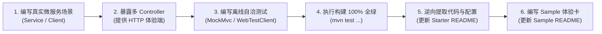

# 微服务工业级文档与样例工程标准规范 (Cloud Documentation & Sample Specification)

## 1. 核心定位与设计哲学 (Mission & Scope)

在 `ateng-cloud` 微服务基础设施框架中，**文档与样例工程（Sample）是连接微服务通用治理能力与业务开发者的第一生命线**。如果文档说得不清不楚、微服务配置与调用代码脱节、示例充斥着脱离现实的单元测试桩，微服务治理底座将沦为不可用的“黑盒”。

本规范确立 `ateng-cloud` 所有微服务子模块文档（`ateng-cloud-*/README.md`）与配套样例工程（`ateng-cloud-samples/sample-cloud-*`）的工业级工程标准与双向锚定体系，作为代码审查（`/code-review`）的一票否决红线（Red Card Block）。

---

## 2. 微服务 Starter 模块 `README.md` 规范 (The Starter Document Invariant)

微服务子模块根目录下的 `README.md` 是该模块对外唯一权威的**“全功能契约真理源”**。每个微服务 Starter 的 `README.md` 必须严格遵循以下全局结构骨架与内容规范：

### 2.1 标准大纲骨架 (Standard Outline Architecture)

```markdown
# ateng-cloud-<module> <微服务中文功能全称>

> 一句话核心价值宣言：阐明核心微服务技术栈与面向的企业级高可用分布式生产场景。

---

## 0. 特性与公共 API 全景速查矩阵 (100% 覆盖)

## 1. 模块定位与 Maven 坐标

## 2. 核心架构与设计不变量 (微服务调用拓扑 / 容灾防线 / 核心原理)

## 3. <业务能力领域大章一> (按领域聚合收敛)
   ### 3.1 <核心子特性A>
   ### 3.2 <核心子特性B>

## 4. <业务能力领域大章二> (按领域聚合收敛)
   ...

## N. 完整 YAML 配置属性清单 (全量速查附录)
```

---

### 2.2 章节“三要素就近闭环”铁律 (Co-located 3-Element Invariant)

**【红线阻断项】** 严禁出现“正文只讲 Java 代码怎么调用，而关键微服务配置却扔在几百行后文末”的脱节现象！

每个具体的微服务特性章节（二级或三级小节），必须且只能在**当前屏幕内**实现以下“三要素”自洽闭环：

1. **本节专属 YAML 配置片段**：
   - 仅展示当前微服务特性所需的关键配置项（含 Nacos 配置中心或本地基础配置）；
   - 标配清晰的中文单行注释与生产合理默认值；
   - 键名必须与 `@ConfigurationProperties` 类字段逐字对齐。
2. **面向实战的业务 Java 示例**：
   - 展示如何通过注解或微服务门面调用该特性；
   - 代码必须 100% 逆向提取自已在 Sample 中跑通的真实微服务业务代码。
3. **核心机制与微服务边界防御说明**：
   - 显式讲透底层机制（如连接超时、读超时禁重试、双模解包、降级 fallback、MDC 上下文穿透、流量染色标记透传等）；
   - 提示微服务生产注意事项，消除非功能黑盒。

> **注**：文档末尾的《完整 YAML 配置属性清单》仅作为全量属性的集中速查字典，**绝对严禁**作为该模块配置的唯一暴露点！

---

### 2.3 “能力领域大章”收敛架构 (Capability Domain Aggregation)

**【红线阻断项】** 严禁因为开发批次不同而在文档末尾随意追加零碎的小章节！

必须按微服务技术领域或业务主线将同类功能收敛为**一级大章**，并在大章下合理划分二级小节。例如：
- **正确示范**：
  - `第 3 章：声明式 HTTP 客户端与弹性容灾`（下设：3.1 客户端声明式接口定义、3.2 双模智能剥壳与因果转译、3.3 写接口禁重试与读超时熔断降级）
  - `第 4 章：全链路四维上下文穿透与金丝雀灰度`（下设：4.1 四维快照跨进程透传、4.2 金丝雀染色标记拦截、4.3 优雅出口清理）
- **错误反例**：
  - 第 3 章讲 Feign 客户端，第 8 章讲写接口禁重试，第 10 章又讲超时降级，结构七零八落。

---

### 2.4 真实微服务业务语义场景驱动 (Real-World Business Semantics)

**【红线阻断项】** 坚决严禁将单元测试中的测试桩代码（Test Stubs）无脑复制到文档中！

- **反面教材（禁止出现在文档中）**：
  - 变量命名如 `key1`、`value1`、`test/123456`；
  - 返回生硬的测试字符串如 `"RPC_SUCCESS"`、`"MOCK_FALLBACK"`；
  - 纯为测试而编写的无意义调用链路。
- **正面范式（必须演化为真实高频微服务生产拓扑）**：
  - **服务注册与配置**（`nacos`）：电商动态运费费率热更（`FreightRateConfig`）、无损上下线状态机探测；
  - **声明式远程调用**（`feign`）：订单服务跨进程调用商品中心查询库存详情（`ProductDetailVO`）、用户中心授权验证；
  - **高性能 RPC 撮合**（`dubbo`）：高频交易撮合与清结算服务（`TradeBillingDubboService`）；
  - **云原生网关接入**（`gateway`）：统一公网入口动态路由匹配、Sa-Token 鉴权穿透 `Same-Token`、Netty 2MB 载荷硬防爆；
  - **流量防卫与降级**（`sentinel`）：秒杀高频接口 100 QPS 限流、三方支付接口 50% 错误率熔断；
  - **全链路流量染色**（`traffic`）：金丝雀灰度发布，请求头带 `X-Traffic-Tag: v2` 自动路由至灰度节点；
  - **分布式事务协调**（`seata`）：电商采购提单事务（创建订单 + 扣减库存 + 扣减余额），跨微服务两阶段提交与补偿回滚。

---

## 3. 微服务 Sample 样例工程规范 (The Sample Engineering Invariant)

微服务场景样例工程（`ateng-cloud-samples/sample-cloud-*`）是面向开发者的**“最小可运行微服务沙箱与开箱体验工程”**。为了让开发者“启动即可直接验证与交互”，必须遵守以下铁律：

### 3.1 全面 Web 体验化与依赖标准

1. **统一引入 Web 底座（网关除外）**：
   - 普通微服务 Sample（`nacos`, `feign`, `dubbo`, `sentinel`, `traffic`, `seata`）统一在 `pom.xml` 中引入 `io.github.atengk:ateng-boot-web`；
   - 原生具备强类型 `Result<T>` 响应包装、JSR-303 参数校验、全链路 MDC `traceId` 追踪与统一异常拦截能力。
2. **【网关纯洁性特例】**：
   - 网关样例工程（`sample-cloud-gateway`）**严格禁止引入 `ateng-boot-web`（Servlet 阻塞栈）**；
   - 必须保持基于 Spring WebFlux 纯响应式架构，通过响应式路由及 Handler 提供体验。
3. **启动即调试**：
   - 开发者启动应用后，能够直接在浏览器或使用 cURL 发起 HTTP 请求体验微服务交互。

---

### 3.2 多 Controller 领域拆分与暴露边界

能做成 Controller 接口的功能必须**全量暴露**，并按业务能力拆分为多个高内聚的 Controller，**严禁编写单一臃肿的 Controller**：

1. **Controller 拆分命名**：
   - 必须按功能领域拆分，例如在 `sample-cloud-feign` 中：
     - `FeignOrderConsumerController`：演示声明式订单跨服务查询与四维上下文透传；
     - `FeignFallbackController`：演示写超时禁重试防重复落库与熔断降级。
2. **接口契约与路由规范**：
   - **路由前缀**：统一采用 `/sample/cloud/<module>/<feature>/<action>` 语义化命名空间；
   - **响应契约**：接口一律显式返回强类型 `Result<T>`；
   - **自解释文档**：Controller 类与方法必须标注清晰的 JavaDoc，便于直接生成 Swagger 或供开发者查阅。

---

### 3.3 Sample 模块 `README.md` 四段式极简体验卡模板

Sample 自身的 `README.md` 必须从“长篇技术文档”彻底松绑，**严禁重复堆砌 Starter 的全景矩阵与底层原理**，统一定位为**“启动与接口体验卡”**，严格采用以下四段式模板：

````markdown
# sample-cloud-<module> <微服务场景全称>体验工程

> 专注于演示与自验 `<module>` 核心微服务特性在真实分布式场景下的开箱使用。

---

## 1. 快速启动与服务端口

- **默认 HTTP 端口**：`8080` (可在 `application.yml` 中修改)
- **启动方式**：
  ```bash
  # 方式一：IDE 中运行 SampleCloud<Module>Application.java 的 main 方法
  # 方式二：命令行启动
  mvn spring-boot:run -pl ateng-cloud-samples/sample-cloud-<module>
  ```

---

## 2. 运行环境与双模切换

- **默认/CI 模式**：内置离线内存桩与自洽配置，无需启动外部 Nacos/Sentinel 中间件即可启动运行与跑通测试；
- **Local 真实模式**：若需连接真实物理注册中心或网关，复制 `src/main/resources/application-local.example.yml` 为 `application-local.yml` 并填入真实连接串，启动自动生效（该文件已被 Git 忽略，CI 零风险）。

---

## 3. 核心 Controller 接口与一键体验

应用启动后，可通过以下 cURL 命令或浏览器直接发起调用体验：

| 功能场景 | Controller 类 | 请求方式与路径 | 快速体验 cURL 命令 |
| :--- | :--- | :--- | :--- |
| **声明式远程调用与透传** | `FeignOrderConsumerController` | `GET /sample/cloud/feign/order/{id}` | `curl "http://localhost:8080/sample/cloud/feign/order/ORD-1001"` |
| **读超时熔断降级演示** | `FeignFallbackController` | `GET /sample/cloud/feign/timeout-fallback` | `curl "http://localhost:8080/sample/cloud/feign/timeout-fallback"` |

---

## 4. 全真自动化回归命令

```bash
mvn test -pl ateng-cloud-<module>,ateng-cloud-samples/sample-cloud-<module> -am -T 1C -nsu -B
```

> 详细原理机制、配置清单与扩展定制，请参阅核心 Starter 文档：[ateng-cloud-<module> README](../../ateng-cloud-<module>/README.md)。
````

---

## 4. “Sample-First” 逆向研发流与审查红线 (Review Redlines)

任何新微服务特性的研发或存量特性的重构，必须严格按照以下顺序流动：



### 🚨 微服务审查一票否决红线 (Red Card Checklist)

在 `/code-review` 审查中，凡触碰以下任一缺陷，直接出具 Red Card 阻断本次交付准出：

1. **【配置脱节红线】**：Starter 模块 README 章节中仅有 Java 代码，未就近提供该特性专属的 YAML 配置说明；
2. **【章节散落红线】**：同一微服务技术领域的功能因为编写批次不同被切分为分散的多章，未进行聚合收敛；
3. **【测试桩生搬红线】**：文档或 Sample 中充斥着 `test/123`、`RPC_SUCCESS` 等无现实意义的单元测试桩，未演进为真实微服务场景模型；
4. **【缺少 Controller 交互红线】**：Sample 工程仅有后台测试而无 Controller 接口，启动后无法通过 HTTP 交互体验（网关除外）；或将所有功能塞在单一庞大 Controller 中；
5. **【网关响应式污染红线】**：网关模块或网关 Sample 引入了 `ateng-boot-web`（Servlet 阻塞栈）；
6. **【Sample 文档膨胀红线】**：Sample 工程的 `README.md` 未遵循四段式极简体验卡模板，存在冗余的原理抄录或全景表格；
7. **【伪代码脑补红线】**：文档中的 Java 示例代码或配置未真实在 Sample 中编译通过并验证。
