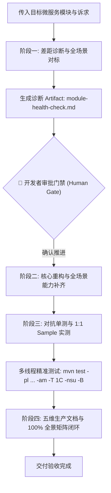

# 微服务模块加固与全场景演进规范 (Module Hardening & Scenario Expansion SOP)

> 💡 **极简对话调用契约**：
> 在会话中直接引用本规范并传入目标模块名（及可选关注点）即可启动全流程：
> `@docs/agents/module-hardening-and-expansion.md <module-name> [optional-focus]`
> *示例：`@docs/agents/module-hardening-and-expansion.md feign 补齐双模智能解包与因果异常转译`*

本规范作为 `ateng-cloud` 官方工程标准之一，专职规范**存量微服务子模块从 1 到 N 的工业级深度体检、主流场景对标、缺失能力补齐、鲁棒性加固与交付文档闭环**。凡对既有微服务中间件模块进行重构或演进，一律受本协议强制约束。

*(注：若需从 0 到 1 孵化全新模块，请参阅 [微服务模块孵化与扩展通用标准](./modular-extensibility.md)。)*

---

## 1. 演进原则与场景全覆盖定位

1. **行业全场景覆盖 (Full-Scenario Coverage)**：
   - 子模块必须对标微服务业界成熟方案（如 Nacos 配置无损上下线对标官方的最佳实践、Feign 对标 Spring Cloud OpenFeign 高并发防雪崩调用、Dubbo 3.3 对标 Triple/gRPC 生产调优等）；
   - 主动推演并覆盖排名前 80%~90% 的企业级典型高频生产场景，杜绝“代码漂亮但微服务实战捉襟见肘”的半残 Starter。
2. **原生算力挖掘优先与零臃肿底座 (Native-First & Zero-Bloat)**：
   - 优先基于当前模块已纳管的底层驱动及 JDK 17 / Spring 6 原生算力实现高级场景，严禁为了覆盖边缘场景无脑引入第三方大包；
   - 复杂扩展场景通过专职 SPI 扩展点暴露，确保底座极速轻量。
3. **对称完备与开箱即用 (Symmetric & Out-of-the-Box)**：
   - 门面 API 必须读写对称、出入栈对称，提供声明式注解或高阶门面，确保业务微服务接入层一句话开箱即用。

---

## 2. 核心红线与成熟度铁律 (Review Redlines)

执行本 SOP 时，触碰任一红线直接触发代码审查红牌阻断：

1. **7 大微服务专属架构铁律**：
   - **网关纯响应式隔离**：`ateng-cloud-gateway` 严禁引入 `ateng-boot-web`（Servlet 阻塞栈）；
   - **全链路四维上下文穿透**：RPC/MQ 跨网络通信必须透明穿透四维上下文与流量染色标头并在出口严格清理；
   - **Feign 读超时禁重试防雪崩**：非幂等写接口读超时绝对禁止重试；
   - **零信任内网防穿透**：内部微服务强制开启 `Same-Token` 校验；
   - **Nacos 加载与 `@RefreshScope` 禁令**：统一使用 `spring.config.import`，业务单例严禁 `@RefreshScope`；
   - **S3 预签名直传旁路**：大文件严禁经由网关或微服务内存中转；
   - **100% 离线自洽单测**：单测严禁强依赖运行中的注册中心。
2. **九道通用成熟度防线**：对称语义完备、边界 Fail-Fast、确定性清理、环境宿主中立、严格无状态受管并发、生产配置防悬挂、因果异常体系、零臃肿底座收敛、对抗性极限用例守护。
3. **BOM 依赖统管铁律**：严禁在子模块 `pom.xml` 中声明裸 `<version>` 标签；依赖必须在根 `pom.xml` 或 `ateng-cloud-bom` 集中纳管。
4. **干净 Diff 守卫**：严禁对无关历史代码进行大面积排版或格式化重排，保持 Git Diff 干净最小。
5. **回滚止损准则**：若重构导致大面积次生报错且连续排查受阻，必须立即使用 `git checkout` 回滚至干净状态，退回设计树重新推导方案，严禁盲目向错误方向叠加补丁。

---

## 3. 四阶段流水线标准协议 (The 4-Phase Pipeline)



### 阶段一：差距诊断与全场景对标 (Gap Analysis & Health Check)
- 深度体检目标模块现有源码、自动装配与配置属性；
- 产出诊断报告，列举生产缺失场景与加固建议；
- 挂起等待开发者确认方可进入编码。

### 阶段二：核心重构与全场景能力补齐 (Refactoring & Capability Expansion)
- 编码实现缺失能力与高阶场景；
- 严格遵循 7 大微服务铁律与九道成熟度防线。

### 阶段三：对抗单测与 1:1 Sample 实测 (Hermetic Tests & Sample-First)
- 在模块内部编写白盒与对抗单测，100% 离线自洽；
- 在对应的 `sample-cloud-<scenario>` 中编写端到端真实场景用例：
  - 普通微服务统一引入 `ateng-boot-web` 并按领域拆分暴露多个规范的 `@RestController`（网关除外，严格维持 Spring WebFlux 纯响应式）；
  - 代码全面演化为具有现实微服务业务意义的高频生产模型（用户中心、订单中心、库存服务、秒杀限流、金丝雀灰度等），杜绝测试桩代码；
  - Sample 自身 `README.md` 极度精简为四段式“启动与接口体验卡”（详见 [documentation-specification.md](./documentation-specification.md)）；
- 执行多线程精准测试命令验证端到端全绿通过：
  ```bash
  mvn test -pl ateng-cloud-[MODULE_NAME],ateng-cloud-samples/sample-cloud-[MODULE_NAME] -am -T 1C -nsu -B
  ```

### 阶段四：五维生产文档与 100% 全景矩阵闭环 (5D Docs & Panorama Matrix)
- 遵循 [documentation-specification.md](./documentation-specification.md) 全面更新子模块 `README.md`；
- **全景矩阵 100% 收录**：以标准 Markdown 表格收录该模块所有门面类、公共方法、核心注解、配置项与扩展点 SPI；
- **三要素就近闭环**：每个特性章节必须在当前屏幕内同时提供专属 YAML 配置、真实微服务实战代码与容灾边界机制；
- **能力大章收敛**：同类功能按微服务业务领域收敛为一级大章，下设二级小节，禁止跨批次零碎散落；
- 从跑通的 Sample 源码与实测输出中 1:1 逆向提取示例，文末 YAML 配置仅作为全量速查附录。

---

## 4. 交付准出校验单 (Exit Criteria)

执行本 SOP 结束前，必须逐项自检并满足以下条件：
- [ ] 阶段一《微服务全场景矩阵》与设计树经开发者明确确认；
- [ ] 批准的缺失场景功能与核心 API 重构完成，7 大微服务铁律与九道成熟度防线无红线触碰；
- [ ] 普通微服务 Sample 引入 `ateng-boot-web` 并按领域拆分暴露多 Controller 接口（网关严格维持 WebFlux 纯响应式）；
- [ ] Sample `README.md` 遵循四段式极简体验卡模板，Starter `README.md` 遵循三要素就近闭环与能力大章收敛；
- [ ] 场景与示例代码以真实微服务拓扑命名与建模，杜绝 `RPC_SUCCESS` 等单测试桩生搬；
- [ ] 定向精准多线程测试（单测 + 场景 Sample）全部 PASS（BUILD SUCCESS）；
- [ ] 子模块 `README.md` 包含 100% 覆盖度的全景速查矩阵，示例代码完全真实可运行；
- [ ] 领域词汇表 `CONTEXT.md` 与全局 `CONTEXT-MAP.md` 同步更新完毕。
