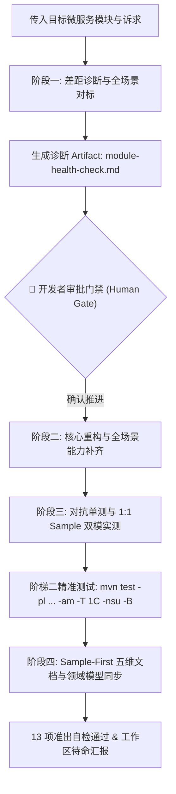

# 微服务模块加固与全场景演进规范 (Module Hardening & Scenario Expansion SOP)

> 💡 **极简对话调用契约**：
> `@docs/agents/module-hardening-and-expansion.md <module-name> [optional-focus]`
> *示例：`@docs/agents/module-hardening-and-expansion.md feign 补齐双模智能解包与因果异常转译`*

本规范专职约束 `ateng-cloud` **存量微服务子模块从 1 到 N 的工业级深度体检、主流场景对标、缺失能力补齐、鲁棒性加固与文档闭环**。

*(注：若需从 0 到 1 孵化全新模块，请参阅 [微服务模块孵化与扩展通用标准](./modular-extensibility.md)。)*

---

## 1. 演进原则与红线约束

1. **行业全场景覆盖与原生优先**：对标 Spring Cloud / Spring Cloud Alibaba / Dubbo 3.3 生产最佳实践，覆盖排名前 80%~90% 的高频分布式场景；优先挖掘 JDK 17、Spring 6 与既有底层驱动原生算力，通过 SPI 暴露扩展点，严禁无脑引入重型三方依赖。
2. **全面继承核心架构红线**：演进全过程严格受 [`AGENTS.md`](../../AGENTS.md) 中的 **7 大微服务架构铁律**、**九道成熟度防线**、**BOM 版本统管** 与 **最小 Git Diff 守卫** 约束。
3. **回滚止损准则**：若重构导致大面积次生报错且连续排查受阻，必须立即使用 `git checkout` 回滚受影响文件至干净状态，退回设计树重新推导方案，严禁盲目叠加补丁。

---

## 2. 四阶段流水线标准协议 (The 4-Phase Pipeline)



### 阶段一：差距诊断与全场景对标 (Gap Analysis & Health Check)
- 深度扫描 `ateng-cloud-<module>` 与对应 `sample-cloud-<module>` 的源码、自动装配、配置属性、单测覆盖与文档现状；
- 对照 **7 大微服务铁律**、**九道成熟度防线** 与行业标杆场景，在 Artifact 目录输出结构化诊断报告 `module-health-check.md`（含现存缺陷清单、缺失场景矩阵与分步加固方案）；
- **🚨 强制人工审批门禁（Human Gate）**：输出诊断报告后**必须立即停下等待开发者审批确认**，严禁未经确认擅自进入阶段二修改业务源码。

### 阶段二：核心重构与全场景能力补齐 (Refactoring & Capability Expansion)
- 按开发者确认的方案实施缺失能力补齐、对称门面完善、上下文透传加固、防御性自动装配与因果异常转译；
- 保持向后兼容与最小变更半径（Minimal Blast Radius）。

### 阶段三：对抗单测与 1:1 Sample 双模实测 (Hermetic Tests & Sample-First)
- 在 Starter 模块内补齐白盒与对抗性极限单测（空值、超时、熔断降级、并发竞争、配置开闭、`@AfterEach` 上下文清理）；
- 在 `ateng-cloud-samples/sample-cloud-<module>` 中补齐真实微服务业务场景与多 Controller 接口（网关保持 WebFlux 纯响应式），满足 `@Profile("!local")` 离线自洽与 `local` 真实中间件双模验证；
- 执行阶梯二测试验证 100% 全绿：
  ```bash
  mvn test -pl ateng-cloud-<module>,ateng-cloud-samples/sample-cloud-<module> -am -T 1C -nsu -B
  ```

### 阶段四：Sample-First 五维文档与领域模型同步 (5D Docs & Domain Sync)
- 严格遵循 [`documentation-specification.md`](./documentation-specification.md)，从已跑通的 Sample 源码中 1:1 逆向提取更新 Starter 五维 `README.md`（100% 全景速查矩阵、三要素就近闭环、能力大章收敛）与 Sample 四段式体验卡 `README.md`；
- 按 [`domain.md`](./domain.md) 同步维护 `ateng-cloud-<module>/CONTEXT.md`、[`CONTEXT-MAP.md`](../../CONTEXT-MAP.md) 及对应 ADR（遵循存量 ADR 增量修订原则）。

---

## 3. 交付准出判据 (Exit Criteria)

完成阶段四后，必须逐项通过 [`documentation-specification.md`](./documentation-specification.md) 第 4 章的 **《交付前 13 项强制自检清单》**，并在工作区向开发者汇报变更摘要（未收到明确提交/推送指令前严禁擅自执行 Git 提交）。
