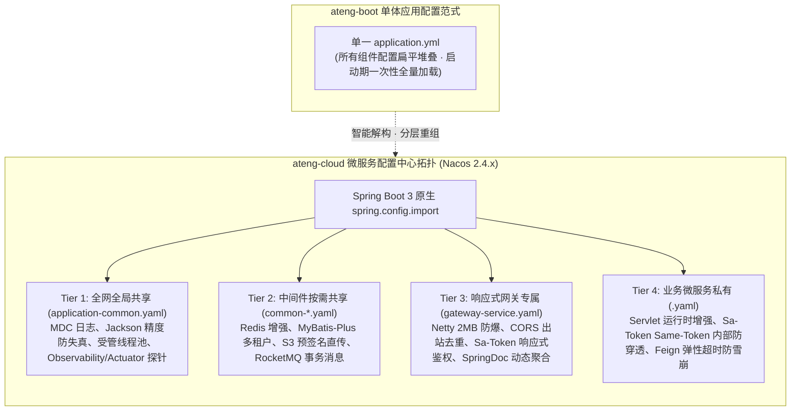

# ateng-cloud 微服务配置中心治理与组件配置全景速查指南

> **所属生态**：`ateng` 顶级技术品牌矩阵  
> **基线对齐**：JDK 17 LTS、Spring Boot `3.3.13`、Spring Cloud `2023.0.x`、Spring Cloud Alibaba `2023.0.x`、ateng-boot-bom `1.1.0`  
> **关联架构**：微服务基础设施顶级架构设计（参见 `D:/My/doc/ateng-cloud/`）  
> **设计日期**：2026-10-27  
> **文档作者**：Ateng  
> **状态**：`Approved & Effective` (工业级生产就绪指南)

---

## 1. 战略定位与微服务配置治理哲学 (Executive Summary & Philosophy)

在从 `ateng-boot`（单体通用基础设施）跨越至 `ateng-cloud`（分布式微服务基础设施）的过程中，配置治理面临根本性的范式跃迁：



### 核心治理原则 (Core Invariants)

1. **去中心化继承与零重复配置 (Anti-Duplication Invariant)**：
   - 彻底打破单体工程在每个微服务重复维护数十行 Redis、数据源、Logback、Actuator 配置的坏味道；
   - 依赖 Nacos 共享 Data ID 机制，实现共性配置“一次定义，全网生效”。
2. **现代加载规范，彻底剔除 `bootstrap.yml`**：
   - 全面拥抱 Spring Boot 3 原生 `spring.config.import` 机制，与 Spring Boot 容器生命周期 100% 契合，消除额外的上下文冷启动耗时。
3. **严格物理隔离铁律 (Reactive vs Servlet)**：
   - 网关专属配置与业务服务配置强隔离；**绝对严禁**将 `ateng-boot-web`（Servlet 阻塞栈）配置植入网关节点。
4. **生命周期安全与 `@RefreshScope` 绝对禁令**：
   - 杜绝在承载业务与事务的单例 Bean 上滥用 `@RefreshScope`；配置动态热更严格收敛于 `@ConfigurationProperties` 纯属性类只读热绑。

---

## 2. Nacos 配置中心分层拓扑与导入范式 (Data ID Topology & Import Spec)

### 2.1 四层 Data ID 分层矩阵

| 分层维度 | Nacos Data ID | 适用范围 | 核心纳管内容 | 治理生命周期 |
| :--- | :--- | :--- | :--- | :--- |
| **Tier 1: 全网共享** | `application-common.yaml` | 全网所有微服务 (含 Gateway) | 时区编码、Jackson 53 位防失真、MDC 日志格式、受管异步线程池、Actuator 探针、Micrometer 链路追踪 | `[只读-需重启]` / `[环境热绑-只读属性]` |
| **Tier 2: 中间件共享** | `common-redis.yaml` | 依赖 Redis/Redisson 的服务 | Redis 连接池、增强缓存 TTL、防雪崩扰动、分布式锁租约 | `[只读-需重启]` / `[环境热绑-只读属性]` |
| | `common-mybatis.yaml` | 依赖持久层数据库的服务 | HikariCP 数据源、AST 行级多租户、数据权限、分批插入引擎 | `[只读-需重启]` / `[环境热绑-只读属性]` |
| | `common-storage.yaml` | 依赖文件/音视频上传的服务 | S3 / MinIO 连接端点、Bucket、15 分钟预签名 URL 直传有效时限 | `[只读-需重启]` / `[环境热绑-只读属性]` |
| | `common-rocketmq.yaml` | 依赖事件驱动与事务解耦的服务 | RocketMQ 5.x gRPC Proxy、事务半消息生产者组、四维上下文透传拦截器 | `[只读-需重启]` / `[环境热绑-只读属性]` |
| **Tier 3: 网关专属** | `gateway-service.yaml` | 仅限 `ateng-cloud-gateway` | Netty 2MB 载荷硬防爆、出站 CORS 标头去重、Sa-Token 响应式鉴权、SpringDoc 动态聚合 | `[只读-需重启]` / `[环境热绑-只读属性]` |
| **Tier 4: 业务私有** | `<service-name>.yaml`<br/>*(如 `order-service.yaml`)* | 内部各具体微服务节点 | Sa-Token `Same-Token` 防穿透校验、Feign 双阶分级超时与防雪崩重试、Sentinel 降级、Web 防重幂等/限流/慢告警 | `[只读-需重启]` / `[环境热绑-只读属性]` |

---

### 2.2 微服务客户端标准 `application.yml` 导入范式

每个微服务只需在其本地 `src/main/resources/application.yml` 中声明极简的标准导入头，即可实现配置自动挂载：

#### 业务微服务 (如 `order-service`) 声明范式
```yaml
spring:
  application:
    name: order-service
  profiles:
    active: ${SPRING_PROFILES_ACTIVE:dev}
  config:
    import:
      # 1. 引入 Tier 1: 全网公共基线
      - optional:nacos:application-common.yaml
      - optional:nacos:application-common-${spring.profiles.active}.yaml
      # 2. 引入 Tier 2: 按需引入中间件共享配置
      - optional:nacos:common-redis.yaml
      - optional:nacos:common-mybatis.yaml
      - optional:nacos:common-rocketmq.yaml
      # 3. 引入 Tier 4: 服务自身专属配置与环境覆盖
      - optional:nacos:${spring.application.name}.yaml
      - optional:nacos:${spring.application.name}-${spring.profiles.active}.yaml
```

#### 网关服务 (`ateng-cloud-gateway`) 声明范式
```yaml
spring:
  application:
    name: ateng-cloud-gateway
  profiles:
    active: ${SPRING_PROFILES_ACTIVE:dev}
  config:
    import:
      # 1. 引入全网公共基线
      - optional:nacos:application-common.yaml
      - optional:nacos:application-common-${spring.profiles.active}.yaml
      # 2. 引入 Redis (供网关分布式限流或 Sa-Token 会话查询按需选用)
      - optional:nacos:common-redis.yaml
      # 3. 引入 Tier 3: 网关专属配置
      - optional:nacos:gateway-service.yaml
      - optional:nacos:gateway-service-${spring.profiles.active}.yaml
```

> [!TIP]
> **多环境隔离最佳实践**：
> - **中小型团队**：统一在 `DEFAULT_GROUP` 下，采用 `-${spring.profiles.active}.yaml` 后缀覆盖差异项；
> - **大型企业/等保三级**：强推以 Nacos **命名空间 (Namespace)**（如 `dev`、`test`、`prod` 的专属 Namespace ID）在物理上隔离生产与测试配置，实现环境隔离与权限分权控制。

---

## 3. `ateng-boot` 存量组件微服务化纳管与裁剪矩阵 (Component Adaptation & Pruning Matrix)

针对 `ateng-boot` 既有 31 个构件，按微服务生产需求实施严格的分类判定与差异化落地：

| 组件名称 (ArtifactId) | 纳管状态 | 适用运行时 | 微服务集成模式与适配关键点 |
| :--- | :---: | :---: | :--- |
| **`ateng-boot-core`** | **核心纳管** | 通用 (All) | 53 位雪花算法防丢失、统一强类型 `Result<T>` 契约、四维上下文快照 (`ContextCopyingTaskDecorator`)、全场景脱敏 |
| **`ateng-boot-observability`** | **核心纳管** | 通用 (All) | W3C 标准 `traceparent` 分布式追踪透传、Micrometer Tracing 整合、Actuator 探针 |
| **`ateng-boot-satoken`** | **核心纳管** | 双轨适配 | **网关**：基于 Reactor 响应式网关拦截；**微服务**：强制开启 `same-token.check=true` 实现内网零信任防穿透 |
| **`ateng-boot-redis`** | **核心纳管** | 通用 (All) | 统一 Spring Data Redis + Redisson 双核，无 `@class` 安全 JSON 序列化，分布式锁租约防死锁 |
| **`ateng-boot-mybatis-plus`**| **核心纳管** | Servlet | 行级多租户 AST 注入、数据权限切面、单条多值高性能批量插入 (`BatchUtil`) |
| **`ateng-boot-storage`** | **核心纳管** | Servlet | 守住网关 Netty 内存安全，100% 依托 S3 兼容协议实现预签名直传 (Presigned URL) |
| **`ateng-boot-rocketmq`** | **核心纳管** | 通用 (All) | 核心高并发交易推荐方案：2PC 事务半消息 + `@Idempotent` 幂等实现高可靠最终一致性 |
| **`ateng-boot-web`** | **隔离纳管** | **严禁网关**<br/>(仅限 Servlet) | 包含 `@Idempotent` 防重、`@RateLimiter` 限流、`@ApiSign` 加签、`@OperateLog` 审计与慢请求告警。**坚决禁止网关引入** |
| **`ateng-boot-openapi`** | **协同纳管** | 协同双轨 | 微服务提供纯净 `/v3/api-docs`，网关聚合展示并受 `OpenApiGuardFilter` 安全守卫拦截 |
| **`ateng-boot-encrypt`** | **可选纳管** | 通用 (All) | 配合 `ENC(...)` 实现 Nacos 中数据库密码、密钥等敏感字段的非对称/国密加解密 |
| **`ateng-boot-datasource`** | **可选纳管** | Servlet | 物理分库多分片场景选用，配合多租户动态切换数据源 |
| **`ateng-boot-kafka`** / **`rabbitmq`** | **可选纳管** | 通用 (All) | 消息出入栈自动织入四维上下文与流量染色标头 |
| **`ateng-boot-excel`** / **`document`** | **按需选用** | Servlet | 流式导出与报表生成，需配合 S3 直传防内存溢出 |
| **`ateng-boot-job-local`** | **明确剔除** | - | **微服务反模式**：单机定时调度无法应对集群多实例并发，集群调度由 XXL-JOB/PowerJob 接管 |
| **`ateng-boot-admin`** | **明确剔除** | - | **微服务反模式**：集群实例多、动态上下线频繁，统一收敛于 Nacos、Sentinel 控制台及 Prometheus/Grafana |

---

## 4. 核心治理机制与生产红线 (Core Invariants & Anti-Patterns)

### 4.1 单例 Bean `@RefreshScope` 绝对禁令

> [!CAUTION]
> **严禁在 `@Service`、`@Component` 等承载实际业务逻辑的单例 Bean 上标注 `@RefreshScope`！**
> 
> - **原理危害**：`@RefreshScope` 收到 Nacos 配置刷新事件时，会直接在当前 JVM 容器中**物理销毁**旧 Bean 并重新执行实例化。若该 Bean 正持有未提交的数据库本地事务、Redisson 分布式锁、线程池在途任务或并发连接，物理销毁会导致**锁悬挂、事务异常断裂、上下文丢失与严重内存泄露**。
> - **规范解法**：动态配置属性统一收敛于标注 `@ConfigurationProperties` 的纯 POJO 类；当环境变量更新时，Spring 原生 `EnvironmentChangeEvent` 会直接对属性执行增量热绑，确保单例服务生命周期平稳不受冲击。

### 4.2 全链路标头契约统一定义

为了确保南北向网关鉴权与东西向微服务 RPC/MQ 通信完全自洽，全网统一锁定以下标头契约：

| 标头名称 (Header Key) | 协议语义 | 产生源头 | 消费与透传端点 |
| :--- | :--- | :--- | :--- |
| **`X-Trace-Id`** | 全链路分布式追踪唯一标识 | 外部请求或网关 TraceFilter 自动初始化 | 注入 MDC、透传至 Feign 请求头与 Dubbo Attachment |
| **`X-User-Id`** | 当前登录人唯一主键 | 网关解析 Sa-Token 鉴权提取并注入 | 内部微服务 `UserContextHolder` 恢复 |
| **`X-Tenant-Id`** | 行级多租户隔离标识 | 网关解析或客户端携带并校验 | 内部微服务 `TenantContextHolder` 及 MyBatis-Plus AST 注入 |
| **`X-Ignore-Tenant`**| 多租户短路标识 (`true`/`false`) | 内部受信调用发起 | 豁免多租户过滤（如平台管理员全量对账） |
| **`X-Traffic-Tag`** | 全链路流量染色与金丝雀环境标记 | 网关多维染色解析（标头/用户/权重） | Feign / Dubbo Tag Router 精确路由到金丝雀实例 |
| **`Same-Token`** | 内部微服务零信任防穿透签名凭证 | 网关出站管道使用内网密钥实时生成 | 内部微服务过滤器校验（未经网关者直接 Fail-Fast 401） |

### 4.3 Feign 防雪崩重试纪律

在微服务调用中，**盲目重试是非幂等写接口引发雪崩与资损的第一元凶**：
- **读超时严禁重试**：当微服务执行 POST/PUT 写接口（如创建订单、扣减库存）发生 `SocketTimeoutException` (Read Timeout) 时，**默认彻底关闭重试**。因为对端服务端大概率正在执行写库，重复重试将导致数据库并发死锁与重复插入；
- **连接超时受控重试**：仅对网络握手未成功的连接超时（`ConnectTimeoutException`），允许在不同实例间弹性重试最多 1 次。

---

## 5. 标准 Data ID 配置模板全景速查 (Template Catalog)

所有开箱即用的标准 Nacos 配置模板已按 Data ID 物理独立存盘于 [`deploy/nacos/`](../../deploy/nacos/) 目录：

| Data ID 模板文件 | 模块定位与核心用途 | 直达查看 |
| :--- | :--- | :---: |
| [`application-common.yaml`](../../deploy/nacos/application-common.yaml) | 全网全服务必选底座 (MDC 日志、Jackson 53 位精度防截断、受管线程池、Actuator 探针) | [查看模板](../../deploy/nacos/application-common.yaml) |
| [`common-redis.yaml`](../../deploy/nacos/common-redis.yaml) | Redis / Redisson 连接池、业务缓存 TTL、防雪崩扰动与分布式锁租约模板 | [查看模板](../../deploy/nacos/common-redis.yaml) |
| [`common-mybatis.yaml`](../../deploy/nacos/common-mybatis.yaml) | HikariCP 数据源、MyBatis-Plus 全局配置、AST 多租户隔离、批量插入模板 | [查看模板](../../deploy/nacos/common-mybatis.yaml) |
| [`common-storage.yaml`](../../deploy/nacos/common-storage.yaml) | S3 / MinIO 预签名直传配置模板 (大文件直传旁路，彻底解放网关内存) | [查看模板](../../deploy/nacos/common-storage.yaml) |
| [`common-rocketmq.yaml`](../../deploy/nacos/common-rocketmq.yaml) | RocketMQ 5.x gRPC Proxy、2PC 事务半消息与四维上下文透传模板 | [查看模板](../../deploy/nacos/common-rocketmq.yaml) |
| [`gateway-service.yaml`](../../deploy/nacos/gateway-service.yaml) | **响应式网关专属模板** (物理隔离 Servlet、Netty 2MB 防爆、CORS 出站去重、Sa-Token 鉴权) | [查看模板](../../deploy/nacos/gateway-service.yaml) |
| [`business-service-template.yaml`](../../deploy/nacos/business-service-template.yaml) | **业务微服务节点模板** (Servlet 运行时、Same-Token 校验、Feign 防雪崩超时、Sentinel 降级) | [查看模板](../../deploy/nacos/business-service-template.yaml) |

---

## 6. 机密脱敏与加解密集成规范 (Zero-Secret & Encryption Guide)

恪守 `AGENTS.md` 规定的“零明文不变量 (Zero-Secret Invariant)”红线：

### 6.1 环境变量占位符规范 (推荐云原生交付形态)

在 Nacos 配置文件中，任何涉及密码、Token、SecretKey 的项，统一采用大写语义占位符加合理本地默认值的形式：
```yaml
spring:
  datasource:
    password: ${MYSQL_PASSWORD:YOUR_MYSQL_PASSWORD}
  data:
    redis:
      password: ${REDIS_PASSWORD:YOUR_REDIS_PASSWORD}
ateng:
  boot:
    storage:
      s3:
        secret-key: ${S3_SECRET_KEY:YOUR_S3_SECRET_KEY}
```
在 K8s 生产部署中，通过 `Secret` 注入到 Pod 环境变量，彻底隔绝运维明文泄露。

### 6.2 `ateng-boot-encrypt` 静态密文存储规范 (金融/等保三级选型)

若企业安全合规要求将敏感配置以密文形态静态持久化在 Nacos 配置中心，可引入 `ateng-boot-encrypt`：
1. 启动微服务时通过 JVM 参数或安全容器注入主解密密钥：
   ```bash
   java -Dateng.boot.encrypt.password=YOUR_MASTER_KEY -jar order-service.jar
   ```
2. Nacos 配置文件中直接编写带有 `ENC(...)` 标记的密文：
   ```yaml
   spring:
     datasource:
       password: "ENC(AbCdEf123456...)"
   ```
3. 容器启动时由 `ateng-boot-encrypt` 环境后置处理器自动安全解密回填，内存运行无痕。
